# crates/target/llrm-x86-m32/vsgcc

For maintainers running llrm's `m32` output against gcc and clang. Method, commands, flow and caveats: [vs-gcc-clang](../../../../docs/comparison/vs-gcc-clang.md). This file lists the files and how to run them.

    crates/target/llrm-x86-m32/vsgcc/run.sh                                              # build, run, print the tables; products in $VSGCC_WORK
    uv run --project tools python crates/target/llrm-x86-m32/vsgcc/harness.py sieve gccO2     # one program, one variant
    uv run --project tools python crates/target/llrm-x86-m32/vsgcc/loops.py sieve llrm gccO2 clangO2   # its hottest loop, side by side
    uv run --project tools --group dev pytest crates/target/llrm-x86-m32/vsgcc                # after run.sh

| File | Does |
|---|---|
| `run.sh` | builds llrm-cc and every program with every compiler, runs all, prints `table.py`, writes `loops.PROG.txt` and `ctime.json` |
| `build.sh PROG` | one program at -O1, -O2, -O3, -Os in llrm (OMF; ELF for `loops.py`), gcc and clang |
| `wrap.py` | the copy every compiler builds: `main` calls the kernel through a volatile pointer |
| `harness.py` | links, runs `main` in unicorn, counts the kernel's instructions, memory operands, 486 clocks |
| `against_m16.py` | llrm's m32 against its m16 on the same programs ([m32-vs-m16](../../../../docs/comparison/m32-vs-m16.md)); `VSGCC_ONLY=llrm build.sh PROG` builds llrm's objects alone |
| `table.py`, `loops.py` | the tables, the hottest loop |
| `programs.py`, `kernels/x_*` | the programs; `x_*` are kernels written for this comparison, each with a `.out` self-check from gcc `-O0` on the host, which every variant must reproduce or `table.py` refuses |
| `levels_time.py`, `ctime.py` | compile cost per level, compile wall clock |
| `scaling.py`, `scaling_gate.py` | compile cost against program size: [scaling](scaling.md) |
| `dfaces/` | QCport's `d_faces.c` executed on a seeded scene: the code-quality scoreboard for that file ([dfaces](dfaces/readme.md)) |
| `stub.s` | `report`, `memset`, `memcpy`, `memmove` for every variant |

A rerun with another llrm shows a change in the table's llrm columns; gcc and clang do not move.

```mermaid
%%{init: {'theme':'base','themeVariables':{'fontFamily':'Segoe UI, Helvetica Neue, Arial, DejaVu Sans, sans-serif','fontSize':'15px','primaryColor':'#475569','primaryTextColor':'#ffffff','primaryBorderColor':'#334155','lineColor':'#64748b','secondaryColor':'#475569','tertiaryColor':'transparent','clusterBkg':'transparent','clusterBorder':'#64748b','edgeLabelBackground':'#334155','textColor':'#64748b','titleColor':'#64748b'},'flowchart':{'curve':'basis','nodeSpacing':38,'rankSpacing':52,'padding':16,'wrappingWidth':360,'htmlLabels':true,'useMaxWidth':true}}}%%
flowchart LR
  classDef src fill:#2563eb,stroke:#1e40af,stroke-width:2px,color:#ffffff,rx:12px,ry:12px
  classDef mid fill:#475569,stroke:#334155,stroke-width:2px,color:#ffffff,rx:12px,ry:12px
  classDef opt fill:#ea580c,stroke:#9a3412,stroke-width:2px,color:#ffffff,rx:12px,ry:12px
  classDef out fill:#16a34a,stroke:#166534,stroke-width:2px,color:#ffffff,rx:12px,ry:12px
  linkStyle default stroke:#64748b,stroke-width:2.2px
  run["<b>run.sh</b>"]:::src
  build["<b>build.sh</b>"]:::mid
  wrap["<b>wrap.py</b>"]:::mid
  comp["<b>llrm-cc, gcc, clang</b>"]:::opt
  har["<b>harness.py</b><br/><small>unicorn</small>"]:::mid
  res["<b>results.jsonl</b>"]:::mid
  tab["<b>table.py</b>"]:::out
  loops["<b>loops.py</b>"]:::mid
  run --> build
  build --> wrap
  wrap --> comp
  comp --> har
  har --> res
  res --> tab
  comp -.->|"ELF of llrm, gcc, clang"| loops
```

*The vsgcc scripts, in the order they run*
