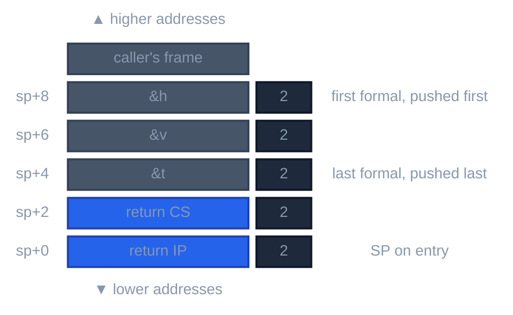
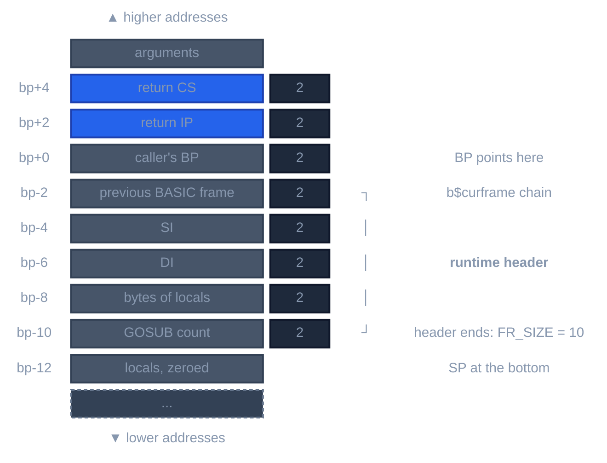
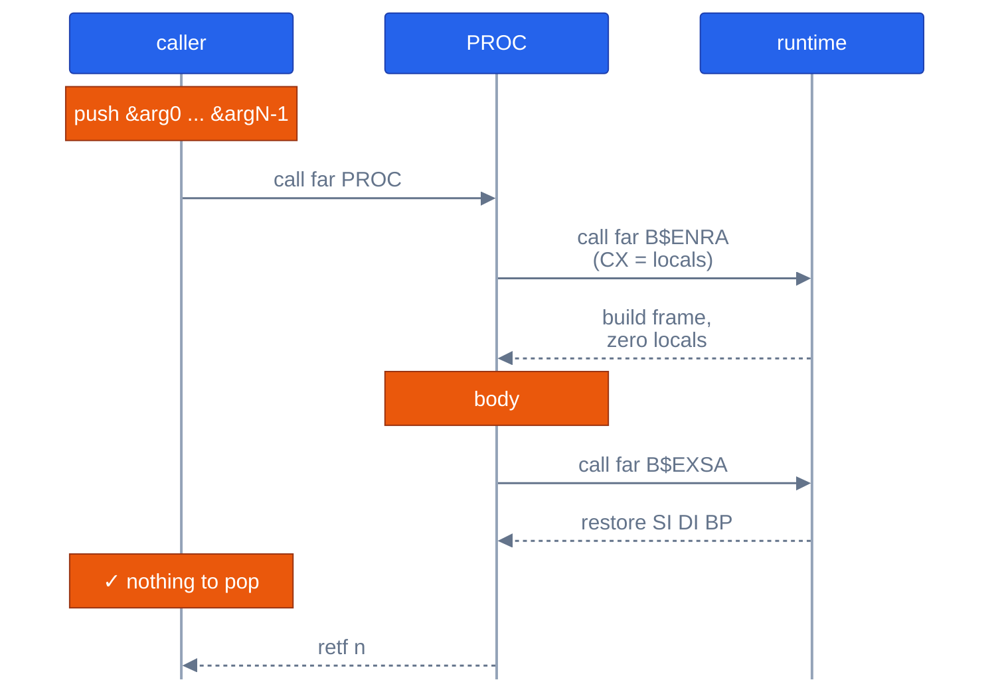

# BASIC calling conventions

For contributors to `llrm-qb`, `llrm-omf` and the QB runtime. The convention of BASIC procedures on the real-mode target, how calls into the Microsoft and llrm runtimes are described, and the frame `B$ENRA` builds. The facts measured from compiled BASIC, with the evidence, are in [frontends/qb/abi.md](../frontends/qb/abi.md); descriptors and frame sizes by dialect are in [memory-model](../frontends/qb/memory-model.md#procedure-calls-and-frames).

## Procedures

A SUB or FUNCTION is `pascal16`'s shape ([x86-m16](x86-m16.md#the-conventions)): the first formal is pushed first, the call is far and the callee removes the arguments with `retf n`. `DECLARE ... CDECL` alone reverses the push order and makes the caller remove them. MIR sees the callee-pops case as `BASIC` and the caller-pops case as `ccc` ([selection](selection.md#from-a-convention-to-mir)); the call-site side table records the stack permutation, distance and cleanup owner, and they are applied after semantic optimization by emitting MIR `ARG` forms.

| Parameter | Passed as |
|---|---|
| `BYREF` (the default) | a near pointer into DGROUP, 2 bytes |
| `BYVAL` | the value: 2 bytes for an INTEGER, 4 for a LONG |
| array | one word, the address of the array descriptor |
| FUNCTION result | INTEGER or string descriptor in AX, LONG in DX:AX; SINGLE and DOUBLE through a near pointer the caller pushes last, returned in AX |

A procedure keeps SI, DI, BP, SP, DS, SS and the direction flag (the `keeps` rows of `tests/fixtures/callconv/bas/reference.txt`, read from BC's listings). Every other register is the callee's: a call no runtime contract describes clobbers every register except those the program declares preserved, and its memory effects stay conservative (`ordinary` in `abi/qb.rs`).

A far procedure, SUB `pDbl(h AS INTEGER, v AS DOUBLE, t AS INTEGER)`, at entry (BC's listing: `far pops 6`, the arguments at `in+8`, `in+6`, `in+4` from SP):

*Far BASIC procedure at entry (SUB pDbl(h, v, t))*

A private procedure that frames itself is called near: no CS, so the arguments start 2 bytes closer (`[bp+4]` after `push bp; mov bp,sp`).

## The runtime frame

A procedure whose errors can land in it, or that has a local string, calls `B$ENRA` and leaves with `B$EXSA`; any other frames itself with `push bp`, `mov bp,sp`, `sub sp`. `B$ENRA` takes CX = bytes of locals (even) and builds the frame below. Its header is 10 bytes in QB 4.5 and in the llrm runtime, 18 in PDS 7.1 and 20 in VBDOS (`_RUNTIME_FRAME_HEADER` in `crates/codegen/llrm-codegen/src/driver/basic.rs`); the llrm runtime's flat header is 32. `B$EXSA` takes BP and the result in DX:AX, restores SI, DI and BP and leaves BP and SP as the procedure used them.

*Frame B$ENRA builds (llrm runtime, 16-bit)*

The diagram is the llrm runtime's, `runtime/qb/dos/m16/frame.asm`; its flat counterpart is `runtime/qb/dos/m32/frame.asm`. The backend's names for the entries are `ENTER` and `LEAVE` in `backend/frame.rs`.

*A BASIC procedure call through the runtime*

## Calls into a runtime

| `--runtime` | A runtime call is described by |
|---|---|
| `qb45`, `pds71`, `vbdos` | the Microsoft routine's audited stack contract: bytes it removes, registers it destroys and reads, memory and error effects (`llrm-qbruntime` tables, with the `_AUDITED_*_STACK` tables in `abi/qb.rs` for the cleanup of the string, graphics and statement entries). A routine without a complete contract is refused. |
| `llrm` (default) | the target's own convention: the routines are plain public C functions in `runtime/qb`, far in the medium model, with link names given by `#pragma aux` (`runtime/qb/qb.h`). Only the table's effects are kept, not Microsoft's stack block or registers. |

Some entries keep a register interface beside the stack block: `B$HARY` takes the subscripts and their count pushed and the descriptor in BX and answers the element's address in ES:BX (`registers` in `abi/qb.rs`). `B$RESA` takes the resume offset in AX.

## Calls out of BC objects

`llrm-omf` lifts a Microsoft BASIC object. For a call to an external, non-`B$` symbol with no runtime contract, `callsite.rs` assumes caller cleanup when the next instruction is `add sp, imm` and callee cleanup otherwise, and keeps every general-purpose input.

## Tests

`crates/frontends/qb/src/callconv_tests.rs` compares llrm's lowering of each call boundary with BC's `/A` listings of the same program; [conformance](conformance.md) lists the rest.
