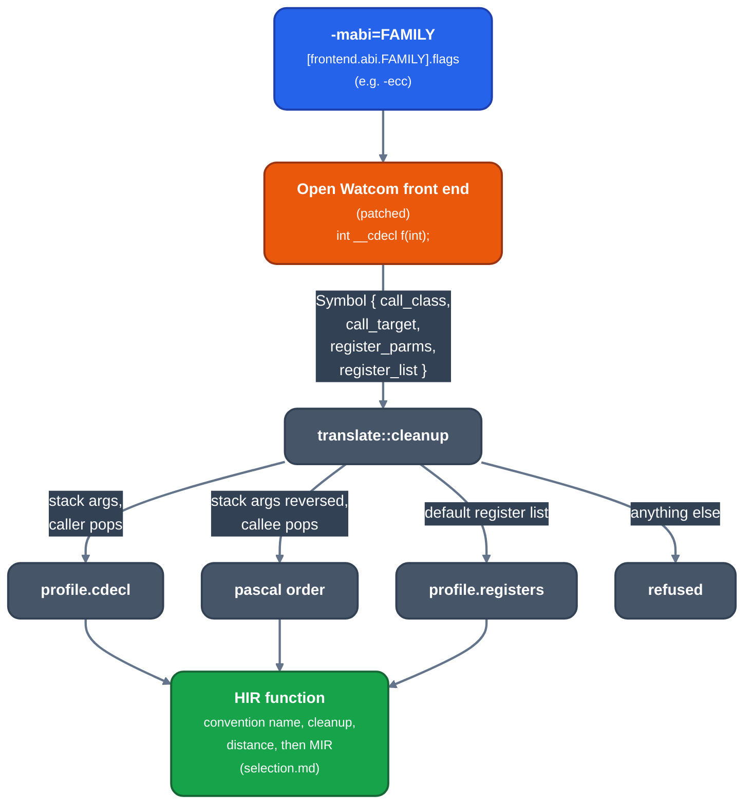

# C calling conventions

For contributors to `llrm-c`. How the patched Open Watcom front end's record of a function becomes a convention, and what a C programmer gets from `-mabi=` and the calling-convention keywords. The register and stack layouts are in [x86-m16](x86-m16.md) and [x86-m32](x86-m32.md).

`llrm-c` does not run Open Watcom's code generator: it records the front end's calls and translates them ([ow-contract](../frontends/c/ow-contract.md)). A function arrives as a symbol with a call class (`CALLER_POPS`, `REVERSE_PARMS`, `HAS_VARARGS`), a call target (`FAR_CALL`, `INTERRUPT`) and the register list the front end gave it. The front end is asked for the target's ABI with the switches in the target's `runtime/c/<target>/c.toml`, under `[frontend.abi.<family>]`.

*From a recorded C function to a convention*

## What each record becomes

[`cleanup`](https://github.com/ali-mosavian/llrm/blob/c341bd6e3de058142c6652d399b8dfeb444eff9b/crates/frontends/llrm-c/src/translate.rs#L714) reads the record:

| Recorded | Keyword | Becomes |
|---|---|---|
| stack arguments, caller pops | `__cdecl`; every function under `-ecc` | the family's `cdecl` convention |
| stack arguments reversed, callee pops | `__pascal` | arguments pushed first to last, callee removes them (`BASIC` in MIR) |
| the front end's default register list | no keyword, without `-ecc` | the family's `registers` convention |
| any other register list | `#pragma aux` register lists, `__fastcall` | refused: `<name> has a register calling convention` |

`main` is the exception: the start-up calls it in the convention the target's description names (`entry_convention`: `cdecl16`, `cdecl32`), whatever the front end recorded.

A definition that contradicts its prototype's convention is an error, as Open Watcom says (`test_a_definition_contradicting_its_prototype_is_refused`). A definition takes its declaration's convention: under `regparm3`, `int __cdecl declared(int, int)` declared then defined plainly is `cdecl16`, and an unmarked `plain` is `_plain@3` (`test_m16_regparm3_a_definition_takes_the_convention_of_its_declaration`).

## Families

`cdecl` and `registers` in each `[frontend.abi.*]` are the `calling.toml` conventions a recorded cdecl function and a recorded default-register function take.

| Target | `-mabi=` | Switches | Unmarked | `__cdecl` |
|---|---|---|---|---|
| x86-m16 | `cdecl` | `-ecc` | `cdecl16` | `cdecl16` |
| | `watcom` | none | `watcall16` | `cdecl16` |
| | `ia16` | `-ecc` | `ia16` | `ia16` |
| | `regparm3` (default) | none | `regparm3` | `cdecl16` |
| x86-m32 | `watcom` (default) | none | `watcall32` | `cdecl32` |
| | `sysv` | `-ecc` | `sysv32` | `sysv32` |

Under `-mabi=watcom` on x86-m16, `__watcall` keeps Open Watcom's meaning, which Borland's runtime does not have: `borland.h` moves the runtime's declarations to cdecl. Under `regparm3` the Borland runtime's declarations and every function that names a convention stay cdecl. The headers are `crates/frontends/llrm-c/src/borland.h` (x86-m16) and `flat.h` (x86-m32).

A symbol's name is decorated by its convention and the object format (`_name`, `name_`, `NAME`, `_name@3`; tables in [x86-m16](x86-m16.md#the-conventions) and [x86-m32](x86-m32.md#the-conventions)). `#pragma aux f "NAME"` spells the symbol as written.

## Distance and interrupts

A function is far when the front end records `FAR_CALL` (`__far`, a far code model), interrupt when it records `INTERRUPT` (`__interrupt`), near otherwise. On x86-m32 `__far` and `__huge` pointers are near, with a warning: one address space.

An interrupt handler's parameters are the saved registers, named in Borland's order (`interrupt_parameters`), each its slot of the frame ([x86-m16](x86-m16.md#interrupt-handlers)); what the handler writes to one is what it returns to. A target with no interrupt frame refuses the handler.

## Aggregates and variadic functions

A struct result and a struct argument follow the convention ([x86-m16](x86-m16.md#the-conventions), [x86-m32](x86-m32.md#the-conventions)); one over 16 bytes is a `byval` pointer ([aggregate-arguments](../reference/semantics/aggregate-arguments.md)). A variadic function takes `HAS_VARARGS`: the caller pops and a variadic callee keeps its arguments in their stack slots, so `va_start` walks them; a call of a register convention's variadic function is made in the convention `variadic` names.

## Tests

`crates/frontends/llrm-c/src/compile.rs` holds the per-family tests (`test_m16_regparm3_*`, `test_m16_ia16_*`, `test_m16_watcom_*`); [conformance](conformance.md) lists the rest.
