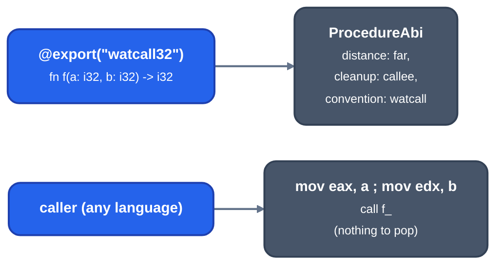

# Nib calling conventions

For contributors to `llrm-nib` and for Nib programs that call or are called by C, assembly or BASIC. A Nib function states its convention with a mark; the language rules are in [the language spec, section 15](../frontends/nib/language-spec.md#15-foreign-interoperability).

## Marks

`@extern("abi")` imports a symbol and `@export("abi")` exposes one under the function's own name; either takes `name="symbol"`. The ABI names are `c`, `cdecl16`, `cdecl32`, `watcall16`, `watcall32`, `ia16`, `regparm3`, `sysv32`, `pascal16`, `interrupt16`, `qb45`, `pds71` and `vbdos` (`Abi::named`). `"c"` is the convention of an unmarked C function on the target: the default the target's `calling.toml` names, `regparm3` on x86-m16 and `watcall32` on x86-m32, or the `-mabi=` family's ([selection](selection.md#abi-families)).

Each name is a convention of the target's `calling.toml`: [x86-m16](x86-m16.md) and [x86-m32](x86-m32.md) state registers, stack and results. `pascal16` is the Pascal one; `qb45`, `pds71` and `vbdos` are `like` it.

## What a mark makes of a function

[`ProcedureAbi::of`](https://github.com/ali-mosavian/llrm/blob/c341bd6e3de058142c6652d399b8dfeb444eff9b/crates/frontends/llrm-nib/src/hir.rs#L186) gives each function its HIR distance, cleanup and convention:

| Mark | Distance | Cleanup | MIR convention |
|---|---|---|---|
| `c`, `cdecl16`, `cdecl32` | exported: none, a native function; else `any` | caller | `ccc` |
| `pascal16`, `qb45`, `pds71`, `vbdos` | exported: `far`; else `any` | callee, `parameter_bytes` | `BASIC` |
| `watcall16`, `watcall32` | exported: `far`; else `any` | callee | `watcallcc` |
| `regparm3`, `ia16`, `sysv32` | exported: `far`; else `any` | caller | `regparm3cc`, `ia16cc`, `sysvcc` |
| `interrupt16` | `interrupt` | callee, left by `iret` | `x86_intrcc` |

`any` lets a function that only its own module calls, and only directly, be entered by a near `call` and left by `ret` ([x86-m16](x86-m16.md#near-and-far-calls)); `tests/nearcalls.rs` pins it. A float result goes through a hidden near pointer for the BASIC marks and in `st(0)` for the rest (`float_return`).

*An exported watcall32 function and its caller*

## Interrupt handlers

`interrupt16` is a far procedure that `INT` or an IRQ enters with any DS. It takes nothing and returns `void`; the entry saves every register in the frame of [x86-m16](x86-m16.md#interrupt-handlers), loads DS and ES with the data group and clears the direction flag, and the exit is `iret`. The x87 state is not saved, so a handler must not use floating point. The spec lists what a handler must not call.

## BASIC marks

`qb45`, `pds71` and `vbdos` pass an argument by reference, as a near pointer into DGROUP, unless it is `BYVAL`; adapters (`qb.Ref`, `qb.StringRef`, `qb.ArrayRef`) borrow what the pointer points to. A function returns an INTEGER in AX and a LONG in DX:AX; a SINGLE or DOUBLE is stored through a near pointer the caller pushes last, which the callee returns in AX. See [basic](basic.md) for the compiler's own side.

## Runtime

Nib's runtime routines (`N$...`, named in `crates/codegen/llrm-codegen/src/abi/nib.rs`) are Nib functions exported under those names, in `crates/frontends/nib/src/runtime`. The `abi/nib.rs` constants also sort them by what they touch: those that end the program (`TERMINATING`), those that touch only the runtime's own state (`RUNTIME_STATE_ONLY`) and those that only read what their arguments point to (`READ_ONLY`).

## Tests

`tests/register_convention.rs` (`watcall32` arguments, results and cleanup, read from `wcc386 -3r`; private functions under `-mabi=sysv`), `tests/nearcalls.rs`.
