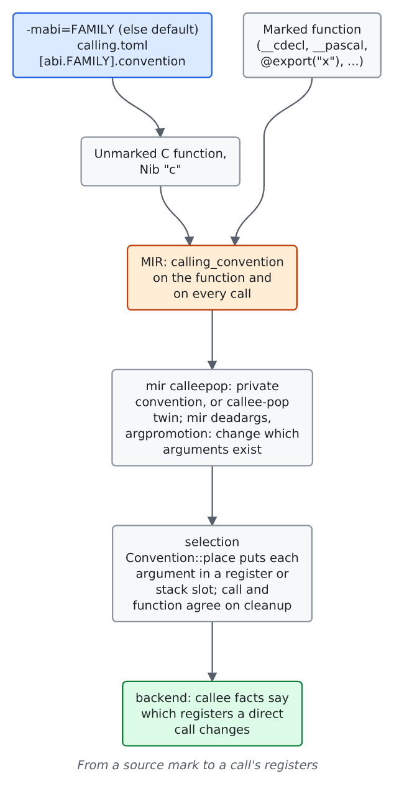
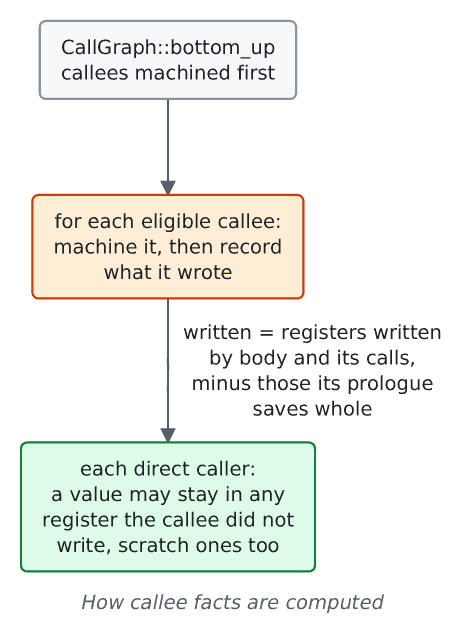

# Choosing a convention

For contributors changing a target's `calling.toml`, a frontend's marks or the interprocedural passes. How a function and each call of it get a convention, and how the compiler learns which registers a call leaves alone.

## ABI families

`calling.toml` names `default`, an ABI family for a program with no `-mabi=`, and one `[abi.<family>]` per family. Each family names the convention an unmarked function has.

| Target | `-mabi=` | Convention | Default |
|---|---|---|---|
| x86-m16 | `cdecl` | `cdecl16` | |
| | `watcom` | `watcall16` | |
| | `ia16` | `ia16` | |
| | `regparm3` | `regparm3` | yes |
| x86-m32 | `watcom` | `watcall32` | yes |
| | `sysv` | `sysv32` | |

A family the target lacks is refused with the families it has (`Calling::chosen`, [`calling.rs`](https://github.com/ali-mosavian/llrm/blob/c341bd6e3de058142c6652d399b8dfeb444eff9b/crates/target/llrm-target/src/calling.rs#L300)). `llrm-c` and `llrm-nib` read the switch; the driver resolves it in [`flags.rs`](https://github.com/ali-mosavian/llrm/blob/c341bd6e3de058142c6652d399b8dfeb444eff9b/crates/backend/llrm-core/src/driver/flags.rs#L317).

## Marks

A mark on one function overrides the family. [c](c.md) lists what the C front end records and what each record becomes; [nib](nib.md) lists the `@export` and `@extern` names. A convention that a family names is a family's own: a marked function with another keeps it, and `calleepop` leaves it alone ([below](#private-functions-and-calleepop)).

## From a convention to MIR

A MIR function and each call of it carry a numbered calling convention (`ccc`, `fastcc` and the target's own); `calling.toml`'s `cc` key says which name a convention answers to.

| MIR | `calling.toml` |
|---|---|
| `ccc` (0) | the convention stating `cc = "cdecl"`: `cdecl16`, `cdecl32` |
| `fastcc` (8) | the callee-pop twin of `ccc` |
| `watcallcc` | `watcall16`, `watcall32` |
| `sysvcc`, `ia16cc`, `regparm3cc`, `regparm3popcc` | `sysv32`, `ia16`, `regparm3`, `regparm3pop` |
| `x86_intrcc` (83) | the interrupt handler's |
| `BASIC` (1000) | a callee that pops, no `cc` named: `pascal16`, `qb45`, `pds71`, `vbdos` |

[`convention` in `mir.rs`](https://github.com/ali-mosavian/llrm/blob/c341bd6e3de058142c6652d399b8dfeb444eff9b/crates/ir/llrm-hir/src/mir.rs#L1177) maps HIR's `named`, `cleanup` and `distance` to a number and a code address space. A convention with no `cc` is `ccc` when the caller pops and `BASIC` when the callee does. The call keeps its typed arguments: physical stack order is applied after semantic optimization by emitting MIR `ARG` forms ([qb abi](../frontends/qb/abi.md)).

## Private functions and `calleepop`

[`calleepop`](../optimizations/passes.md#after-the-interprocedural-stage) is the one place a convention is assigned after the frontend. Isel takes both ends' cleanup from it, so a call and the function it names agree. It runs above `-O0`.

A function is eligible when nothing outside the module reaches it (`direct_only`: no export, no address taken) and every call names it in its own convention.

| Target | What an eligible function becomes |
|---|---|
| x86-m32 | `private = "watcall32"`: every such non-variadic function whose convention is an ABI family's own (`watcall32`, `sysv32`) takes `watcall32`, and every call of it with it. No price is asked: registers cost no more than the stack at either end. A `__cdecl` function under `-mabi=watcom` is not an ABI family's own and keeps `cdecl32`. |
| x86-m16 | no `private`. The callee-pop twin (`callee_pop`: `cdecl16` to `fastcc`, `regparm3` to `regparm3pop`) when it pays: internal, not variadic, with arguments, never named but as a callee, called only in its own convention, and `calls * cleanup(words) + pop >= returns * return_pops`, in clocks or, at `-Os`, bytes |

Sources: [`privately`](https://github.com/ali-mosavian/llrm/blob/c341bd6e3de058142c6652d399b8dfeb444eff9b/crates/opt/llrm-transforms/src/calleepop.rs#L150) and [`decided`](https://github.com/ali-mosavian/llrm/blob/c341bd6e3de058142c6652d399b8dfeb444eff9b/crates/opt/llrm-transforms/src/calleepop.rs#L71); tests `calleepop_tests.rs` and `a_private_function_takes_registers_under_sysv_and_an_exported_one_keeps_the_stack`.

## `deadargs` and `argpromotion`

Both change which arguments a function takes, so the convention places the new list.

- [`deadargs`](../optimizations/passes.md#interprocedural-stage) (`ipa-deadargs`): a parameter nothing reads goes, with the argument at every call, round a recursion too (`tests/dead_arguments.rs`).
- [`argpromotion`](../optimizations/passes.md#interprocedural-stage) (`promote.`): a pointer parameter only read at fixed offsets becomes the fields it reads; callers load them (`tests/nearcalls.rs`: a struct's field in C, a slice's pointer and length in Nib).

## Register facts

[`CalleeFacts`](https://github.com/ali-mosavian/llrm/blob/c341bd6e3de058142c6652d399b8dfeb444eff9b/crates/backend/llrm-core/src/backend/calleefacts.rs#L57) records, for each function nothing outside the module reaches and that is in no cycle of calls, the registers its final body writes and does not save and restore. A call of it clobbers those, no more. A function that is exported, has its address taken or calls itself tells nothing, and its callers assume the convention's `clobbered` list. A function that saves only the 16-bit half of a register (`push si` for ESI) and writes it loses the upper half for its caller (`Written.high`). Nothing gates it. `LLRM_DEBUG=facts` prints what each function wrote.

`tests/ipra.rs` pins it: `twice` writes AX alone, `cdecl16` says a call loses AX, BX, CX, DX and ES, and `g` keeps its value in BX instead of SI and saves nothing. A callee that loads a far pointer writes ES, which its caller must not hold a value in.

A runtime routine is not machined here: [`callregs.rs`](https://github.com/ali-mosavian/llrm/blob/c341bd6e3de058142c6652d399b8dfeb444eff9b/crates/backend/llrm-core/src/backend/callregs.rs#L13) reads its contract (`llrm-qbruntime`) for what the call destroys or keeps, and adds every selector the contract does not name when the routine reaches user code or is written for the 386.

## Near, far, interrupt

The distance of a function and of a call is chosen by the frontend and by `nearcode.rs`; see [x86-m16](x86-m16.md#near-and-far-calls). It does not depend on the convention: a `watcall16` function is far or near like any other.
