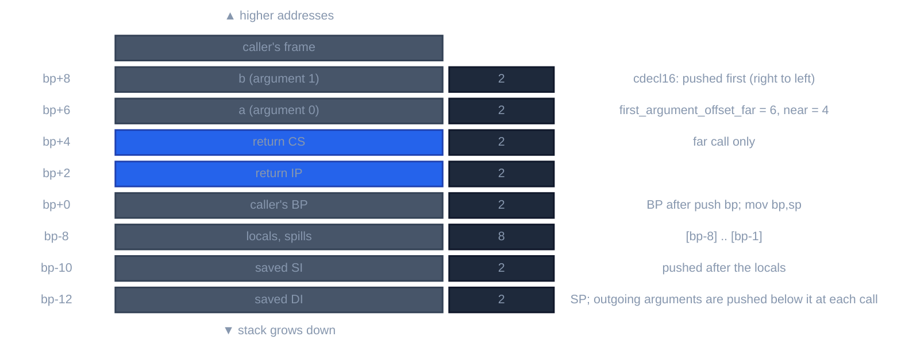
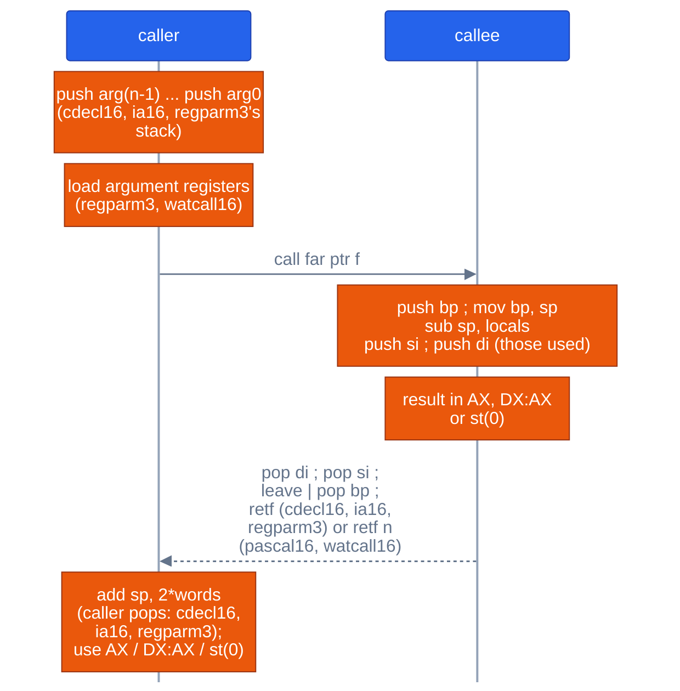
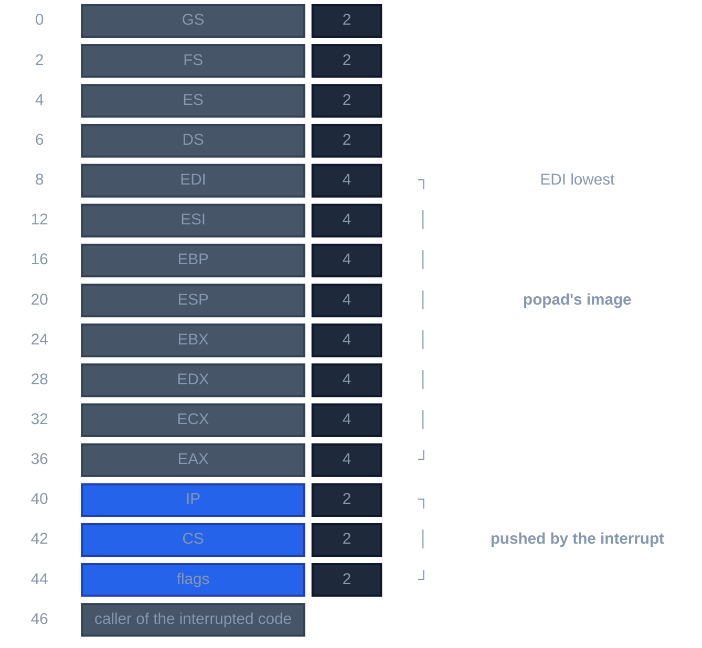

# Calling conventions on x86-m16

For contributors to the backend and to frontends on the real-mode target. The conventions `llrm-x86-m16` states in its `calling.toml`, with the stack and register layout each produces. The code that applies them is in [selection](selection.md).

A word is 2 bytes, an `int` 2, a long 4, a near pointer 2 (an offset in DS), a far pointer 4 (offset at the lower address, segment above it). The program model reserves DS for the data group, SS for the stack and CS for code ([`dos.toml`](https://github.com/ali-mosavian/llrm/blob/c341bd6e3de058142c6652d399b8dfeb444eff9b/crates/target/llrm-x86-m16/src/machines/dos.toml#L19)); `-mstack-is-data` promises SS and DS select the same bytes.

## The conventions

Defined in [`calling.toml`](https://github.com/ali-mosavian/llrm/blob/c341bd6e3de058142c6652d399b8dfeb444eff9b/crates/target/llrm-x86-m16/src/machines/calling.toml#L19); `like` conventions take every key they do not state from the one named.

| Convention | Arguments | Cleanup | Result | Struct result | OMF symbol | Is |
|---|---|---|---|---|---|---|
| `cdecl16` | all on the stack, right to left | caller | AL, AX, DX:AX, EDX:EAX (i64), `st(0)` | 1, 2, 4 bytes in AL, AX, DX:AX; else a far pointer pushed after the arguments, returned in DX:AX | `_name` | Borland's medium model, as Open Watcom's `-mm -ecc` records it |
| `pascal16` | all on the stack, left to right | callee (`retf n`) | as `cdecl16` | as `cdecl16` | `NAME` | Pascal, Nib's `pascal16`; `qb45`, `pds71`, `vbdos` are `like` it |
| `regparm3` | first three integers or near pointers in EAX, EDX, ECX by size; rest on the stack | caller | AL, AX, EAX, EDX:EAX (i64), `st(0)` | 1, 2, 4 bytes as that integer; else as `cdecl16` | `_name@3` | gcc's `-mregparm=3` |
| `regparm3pop` | as `regparm3` | callee (`retf n`) | as `regparm3` | as `regparm3` | `_name@3` | `regparm3` after `calleepop` |
| `watcall16` | AX, DX, BX, CX; a long or far pointer takes DX:AX or CX:BX; rest on the stack | callee (`retf n`) | as `cdecl16` | 1, 2, 4 bytes as an integer; else written through the near address in SI, returned in AX | `name_` | Open Watcom `-ecw`, `__watcall` |
| `ia16` | all on the stack, right to left | caller | as `cdecl16` | 1, 2, 4 bytes as an integer; else a near pointer, the first argument, returned in AX | `_name` (OMF), `name` (ELF) | gcc-ia16 `-O2` |
| `interrupt16` | none; one parameter points at the saved frame | `iret` | none | none | as `cdecl16` | Interrupt handlers |

`regparm3` is the default; `-mabi=` picks which convention an unmarked function has ([selection](selection.md#abi-families)).

## Registers

| Register | `cdecl16`, `pascal16` | `regparm3` | `watcall16` | `ia16` |
|---|---|---|---|---|
| AX | result; scratch | argument 0 (AL, AX or EAX), result | argument, result; the callee changes it | result; scratch |
| DX | high word of a long result; scratch | argument 1 | argument; changed when a long returns in DX:AX | scratch |
| CX | scratch | argument 2 | argument; callee keeps it unless an argument arrives there | scratch |
| BX | scratch | scratch | argument; callee keeps it unless an argument arrives there | scratch |
| SI, DI | kept (pushed as 16-bit halves) | kept | kept | kept |
| BP | frame; kept | frame; kept | frame; kept | frame; kept |
| ES | scratch | scratch | changed | kept |

Every convention keeps DS, SS and SP: the BCC reference rows read `keeps si di bp sp ds ss df` for `cdecl16`. The direction flag is clear on entry and return, and the x87 stack is empty on entry and, apart from a float result in `st(0)`, on return (`entry_state`). Flags are otherwise scratch. No convention keeps FS or GS across a call.

The upper halves of ESI and EDI are lost across a call: the prologue pushes SI and DI, not ESI and EDI. A call into code that may use FS and GS changes them, because no convention names them (`test_m16_regparm3_a_call_does_not_keep_a_segment_in_fs_or_gs`).

## Stack frame

A far call to a function with a frame, two word arguments `a` and `b`, 8 bytes of locals and SI and DI in use. The listing it comes from is `test_variable_indices_are_scaled_and_added` in [`isel_tests.rs`](https://github.com/ali-mosavian/llrm/blob/c341bd6e3de058142c6652d399b8dfeb444eff9b/crates/backend/llrm-core/src/backend/isel_tests.rs#L313): `push bp`, `mov bp,sp`, `sub sp,8`, `push si`, `push di`, then `pop di`, `pop si`, `leave`, `retf`.



*Frame of an x86-m16 far function, two word arguments, 8 bytes of locals*

`pascal16` puts `a` at the higher address: the first argument is pushed first, so with the same two words `a` is at `[bp+8]` and `b` at `[bp+6]`.

## Call and return



*A call and its return on x86-m16*

A real callee of `watcall16`, six word arguments, from `test_m16_watcom_words_arrive_in_ax_dx_bx_cx_and_the_callee_pops_the_rest` ([`compile.rs`](https://github.com/ali-mosavian/llrm/blob/c341bd6e3de058142c6652d399b8dfeb444eff9b/crates/frontends/llrm-c/src/compile.rs#L1324)): arguments 0 to 3 arrive in AX, DX, BX, CX and the last two are at `[bp+6]` and `[bp+8]`.

```
push bp / mov bp, sp
sub ax, dx / imul bx, cx / add ax, bx
sub ax, word ptr [bp+6] / add ax, word ptr [bp+8]
pop bp / retf 4
```

A `regparm3` function reads its fourth argument at `[bp+6]` (`test_m16_regparm3_the_first_three_arguments_arrive_by_their_size_and_the_fourth_on_the_stack`, [`compile.rs`](https://github.com/ali-mosavian/llrm/blob/c341bd6e3de058142c6652d399b8dfeb444eff9b/crates/frontends/llrm-c/src/compile.rs#L1065)). A struct result under `ia16` is `lea ax,[bp-6]` pushed as the first argument and `add sp,6` after the call (`test_m16_ia16_a_struct_result_is_a_near_first_argument_the_caller_removes`).

## Arguments

- A byte or word argument takes one 2-byte slot. A long or a far pointer takes two. A float takes 4 bytes, a double or an i64 8, a struct its size rounded up to 2. Each is a run of words, low half at the lower address.
- `regparm3` gives a register to an integer or near pointer by its size: AL, AX or EAX for 1, 2 or 4 bytes. A float, an i64 or a struct takes no register and does not stop later integers taking the free ones; gcc counts integers only. A struct argument is always on the stack, however small.
- `watcall16` gives the first free of AX, DX, BX, CX to a word; a long or far pointer needs both registers of DX:AX or CX:BX. A register passed over stays free for a later word. The first argument that fits no register (a float, an i64, a struct larger than 4 bytes) and every one after it goes on the stack. A struct of 1, 2 or 4 bytes is passed as an integer.
- A struct larger than 16 bytes is one `byval` pointer ([aggregate-arguments](../reference/semantics/aggregate-arguments.md)).
- Floats and doubles on the stack are read with `fld dword ptr` and `fld qword ptr` (`test_m16_regparm3_a_float_and_a_double_do_not_stop_the_later_integers_taking_registers`). A float result is in `st(0)`; no convention returns one in a general register.

## Variadic calls

`watcall16` and `regparm3` state `variadic = "cdecl16"`: a call of a variadic function moves its arguments as `cdecl16` does, so the caller pops. A variadic float is a double (`variadic_float`). A variadic callee keeps its arguments as consecutive words in their stack slots; an address-taken parameter lives with the arguments after it.

## Near and far calls

A far call pushes CS and IP (4 bytes) and the callee returns with `retf`; a near call pushes IP (2 bytes) and the callee returns with `ret`, so the first argument is at `[bp+4]`.

HIR gives each function and call one distance: `far`, `near`, `any` or `interrupt`. `far` and `near` are the frontend's final word. `any` marks a function the frontend allows near (the MIR flag `nearcode`): where only its own module calls it, and only directly (`direct_only`), `nearcode.rs` moves it to near code.

| Frontend | Distance |
|---|---|
| C | as the front end records it (`FAR_CALL`); a `static` function is entered near |
| Nib | exported: far; not exported: `any` |
| QB | a module-internal procedure that frames itself: near; any other: far |

`tests/nearcalls.rs` pins all three. A call through a function pointer is a far call through a 4-byte value, which the 16-bit ISA takes only from memory (`m16:16`): `farcall.rs` stores the pointer in one frame cell and calls through it.

## Interrupt handlers

`interrupt16` is entered by `INT` or an IRQ with the flags, CS and IP pushed (6 bytes). The entry sequence is `pushad`, then `push` DS, ES, FS, GS, then DS and ES are loaded with the data group and the direction flag is cleared; the exit pops GS, FS, ES, DS, `popad` and `iret` ([`masm.rs`](../optimizations/backend/masm.md)). The x87 state is not saved. The handler's one parameter points at the frame below, whose layout is the `interrupt_frame` key.



*Frame of an interrupt16 handler, offsets from the frame pointer, lowest first*

A handler that writes a slot writes what `popad`, a `pop` or `iret` restores. C's `__interrupt` parameters name the slots in Borland's order (`interrupt_parameters` in `runtime/c/x86-m16/c.toml`).

## Source

- [`calling.toml`, `cdecl16`](https://github.com/ali-mosavian/llrm/blob/c341bd6e3de058142c6652d399b8dfeb444eff9b/crates/target/llrm-x86-m16/src/machines/calling.toml#L19), [`interrupt16`](https://github.com/ali-mosavian/llrm/blob/c341bd6e3de058142c6652d399b8dfeb444eff9b/crates/target/llrm-x86-m16/src/machines/calling.toml#L91), [`watcall16`](https://github.com/ali-mosavian/llrm/blob/c341bd6e3de058142c6652d399b8dfeb444eff9b/crates/target/llrm-x86-m16/src/machines/calling.toml#L110), [`ia16`](https://github.com/ali-mosavian/llrm/blob/c341bd6e3de058142c6652d399b8dfeb444eff9b/crates/target/llrm-x86-m16/src/machines/calling.toml#L134), [`regparm3`](https://github.com/ali-mosavian/llrm/blob/c341bd6e3de058142c6652d399b8dfeb444eff9b/crates/target/llrm-x86-m16/src/machines/calling.toml#L152)
- [`Convention::place`](https://github.com/ali-mosavian/llrm/blob/c341bd6e3de058142c6652d399b8dfeb444eff9b/crates/target/llrm-target/src/calling.rs#L636): which argument goes where
- [`farcall.rs`](../optimizations/backend/farcall.md), [`nearcode.rs`](../optimizations/backend/nearcode.md), [`callregs.rs`](../optimizations/backend/callregs.md)
