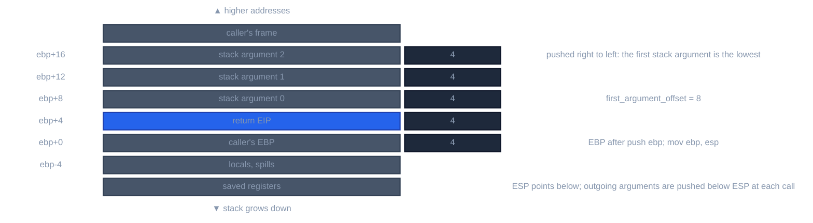
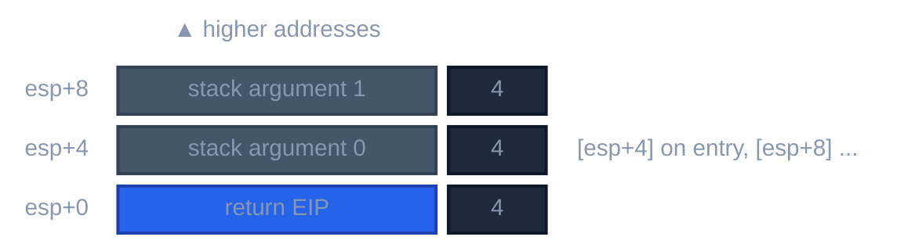
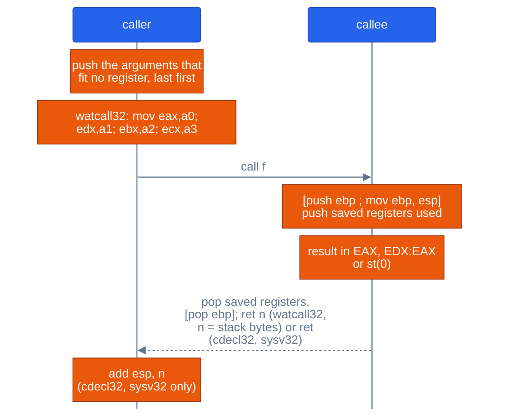

# Calling conventions on x86-m32

For contributors to the backend and to frontends on the flat 32-bit target. The conventions `llrm-x86-m32` states in its `calling.toml`, with the stack and register layout each produces. The code that applies them is in [selection](selection.md).

A word is 4 bytes, a pointer 4, an `int` 4. There is one address space: no far calls, no far pointers and no segment registers in a convention. There are no interrupt handlers: the C front end refuses `__interrupt` where the target has no `interrupt_frame`.

## The conventions

Defined in [`calling.toml`](https://github.com/ali-mosavian/llrm/blob/c341bd6e3de058142c6652d399b8dfeb444eff9b/crates/target/llrm-x86-m32/src/machines/calling.toml#L23).

| Convention | Arguments | Cleanup | Result | Struct result | Symbol (OMF, COFF / ELF / Mach-O) | Is |
|---|---|---|---|---|---|---|
| `watcall32` | EAX, EDX, EBX, ECX; an i64 takes EAX:EDX or EBX:ECX; rest on the stack, right to left | callee (`ret n`) | AL, AX, EAX; EDX:EAX (i64); `st(0)` | 1, 2, 4 bytes as an integer; else written through the pointer in ESI, returned in EAX | `name_` / `name` / `_name` | Open Watcom `wcc386 -3r`, `__watcall` |
| `fastcc32` | ECX, EDX (an i8 in CL, an i16 in DX, an i64 in ECX:EDX); rest on the stack, right to left | caller | as `watcall32` | as `cdecl32` | as `cdecl32` | the pin's `fastcc`, read from `llc` |
| `cdecl32` | all on the stack, right to left | caller | as `watcall32` | 1, 2, 4 bytes as an integer; else a pointer pushed after the arguments, returned in EAX, popped by the caller | `_name` / `name` / `_name` | Open Watcom `-ecc`, with a reentrant struct return |
| `sysv32` | as `cdecl32` | caller | as `watcall32` | every struct through a pointer that is the first argument, returned in EAX, popped by the callee (`ret 4`) | as `cdecl32` | gcc `-m32` on Linux |

The default ABI is `watcom` (`watcall32`); `-mabi=sysv` makes `sysv32` the convention of an unmarked function ([selection](selection.md#abi-families)). `cdecl32` differs from Open Watcom's `-ecc` in one place: Open Watcom returns a large struct by the address of one static area in EAX, which is not reentrant. A call into an Open Watcom object that returns such a struct is the one call this ABI does not match.

`sysv32` returns structs of 1, 2, 4 and 8 bytes through memory too, as gcc does by default on Linux, not in EAX and EDX as `-freg-struct-return` systems do.

## Registers

| Register | `watcall32` | `cdecl32`, `sysv32` |
|---|---|---|
| EAX | argument 0, result; changed | result; scratch |
| EDX | argument 1; changed when an i64 returns | high half of an i64 result; scratch |
| EBX | argument 2; kept unless an argument arrives in it | kept |
| ECX | argument 3; kept unless an argument arrives in it | scratch |
| ESI | kept; carries a struct result's address | kept |
| EDI | kept | kept |
| EBP | kept; the frame register, or one more value register in a function that needs none | the same |
| ESP | stack | stack |
| `st(0)`..`st(7)` | changed; a float result is in `st(0)` | the same |
| flags | direction flag clear on entry and return | the same |

A callee that calls a `cdecl32` routine saves the registers that call clobbers and its own arguments do not arrive in: `g_` of two arguments pushes and pops ECX around a call to `cdecl32` `ext` (`a_callee_saves_the_register_a_call_it_makes_clobbers`, [`register_convention.rs`](https://github.com/ali-mosavian/llrm/blob/c341bd6e3de058142c6652d399b8dfeb444eff9b/tests/register_convention.rs#L176)).

## Stack frame

*Frame of an x86-m32 function with a frame register*

`frame_optional = true` for all three. A function whose frame cells can all be addressed through ESP, at a depth every way into each block agrees on, has no frame register: `framefree.rs` decides before allocation, EBP becomes a value register, and the prologue pushes it where it is used. Then the stack at entry is:

*Stack at entry of a function with no frame register*

A body with inline code, a landing pad or `returns_twice`, or whose stack depth is not known at every instruction, keeps EBP.

## Call and return

*A call and its return on x86-m32*

`tests/register_convention.rs` states what each step is, each read from `wcc386 -3r`'s output for the same signature:

- `the_first_four_arguments_arrive_in_eax_edx_ebx_ecx`: `third_` is `mov eax, ebx; ret`, `fourth_` is `mov eax, ecx; ret`.
- `arguments_past_the_fourth_are_on_the_stack_and_the_callee_pops_them`: `sixth_` reads `mov eax, dword ptr [esp+4]`, `add eax, dword ptr [esp+8]` and ends `ret 8`.
- `a_call_loads_the_registers_and_pushes_the_rest_without_popping`: `pushd 6` and `pushd 5` come before `call ext6_`, the four register loads come before it, and no `add esp` follows.
- `the_argument_after_a_float_is_on_the_stack_too`: `(int, double, int)` puts the second `int` on the stack, read at `[esp+12]`, and the function ends `ret 12`, though EDX was free.
- `an_explicit_cdecl32_keeps_stack_arguments_and_caller_cleanup`: `pushd 7`, `call _extc`, then `add esp`.

## Arguments

- A byte or word argument is widened to a 4-byte slot. An i64 or a double takes two slots, low half at the lower address.
- `watcall32` gives the first free of EAX, EDX, EBX, ECX to a 32-bit argument. An i64 needs both registers of EAX:EDX or EBX:ECX, the first pair with both free; a register passed over stays free for a later 32-bit argument. The first argument that fits no register (a float, a struct, an i64 with no pair free) goes on the stack with every one after it.
- A struct larger than 16 bytes is one `byval` pointer; see [aggregate-arguments](../reference/semantics/aggregate-arguments.md).
- A float is passed in memory, never in `st(0)`.

## Variadic calls

`watcall32` states `variadic = "cdecl32"`: a variadic call is made as `cdecl32` makes it, so the caller pops. A variadic float is a double. A variadic function's `va_start` makes a full-width list pointer, `lea eax, [esp+n]`, and stores a dword (`a_variadic_function_on_a_flat_target_makes_a_full_width_list_pointer`).

## Private functions

`private = "fastcc32"`: under every ABI, a function nothing outside the program reaches takes `fastcc32` (the pin's `fastcc`: ECX, EDX, the rest on the stack, the caller pops; CC1), with every call of it. `LLRM_PRIVATE_WATCALL=1` gives them `watcall32`, to compare. `calleepop` assigns it ([selection](selection.md#private-functions-and-calleepop)). Under `-mabi=sysv`, a `static` function takes registers and an exported one keeps the stack (`a_private_function_takes_registers_under_sysv_and_an_exported_one_keeps_the_stack`).

## Source

- [`calling.toml`: `watcall32`](https://github.com/ali-mosavian/llrm/blob/c341bd6e3de058142c6652d399b8dfeb444eff9b/crates/target/llrm-x86-m32/src/machines/calling.toml#L23), [`cdecl32`](https://github.com/ali-mosavian/llrm/blob/c341bd6e3de058142c6652d399b8dfeb444eff9b/crates/target/llrm-x86-m32/src/machines/calling.toml#L72), [`sysv32`](https://github.com/ali-mosavian/llrm/blob/c341bd6e3de058142c6652d399b8dfeb444eff9b/crates/target/llrm-x86-m32/src/machines/calling.toml#L132)
- [`Convention::place`](https://github.com/ali-mosavian/llrm/blob/c341bd6e3de058142c6652d399b8dfeb444eff9b/crates/target/llrm-target/src/calling.rs#L636): which argument goes where
- `crates/codegen/llrm-codegen/src/backend/framefree.rs`: the frame register as a value register
