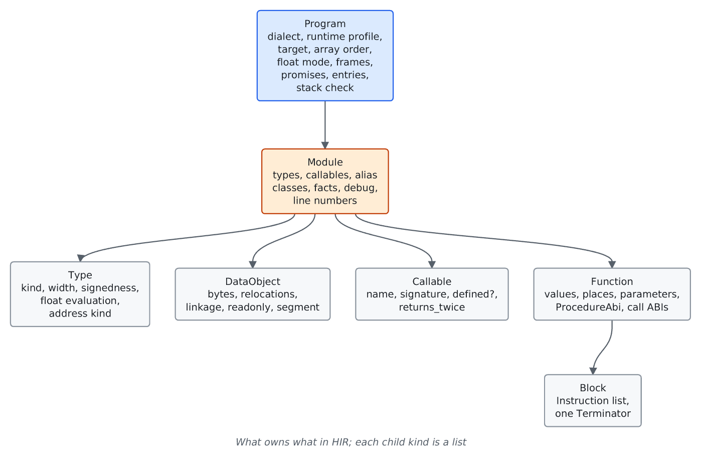

# HIR model

For frontend authors. The schema of `crates/ir/llrm-hir/src/model.rs`
([`Program`](https://github.com/ali-mosavian/llrm/blob/c341bd6e3de058142c6652d399b8dfeb444eff9b/crates/ir/llrm-hir/src/model.rs#L1175)),
which every source frontend constructs. Overview: [readme.md](readme.md).

## Ownership

Every entity has an integer id local to its owner; names and spans annotate.
The JSON codec (`codec.rs`) is deterministic and strict: it rejects an unknown
schema version (`SCHEMA_VERSION`), field, enum value, operand tag or type, and
never supplies a target default for an omitted fact. `verify::verify` runs the
semantic checks before MIR is built: identities belong to their owner, every
block has one terminator with existing targets, types agree, floats have an
evaluation format, arrays are complete, call arity and modes match the
callable, relocations target known objects and fit.

## Program profile

`Dialect` (`qbasic11`, `qb45`, `pds71`, `vbdos`, `quickr`, `nib`, `c`),
`RuntimeProfile` (`qb45`, `pds71`, `vbdos`, `llrm`, `freestanding`),
`TargetProfile`, `ArrayOrder`, `FloatMode`, `FloatSemantics` (`declared`
rounds where the language says so, `machine` keeps precision until a store),
`Frames` (`runtime` or `own`) and `zeroed_locals` are stated once on the
program. Nothing infers them from an instruction.

## Types

`TypeKind` is `void`, `boolean`, `integer`, `float`, `array`, `pointer` or
`opaque`. A float type carries `FloatEvaluation` (`binary32`, `binary64`,
`extended80`) separately from its storage width. A pointer has an
`AddressKind`: `near`, `far`, `huge`, `code`, `segment` or `fixed`. Arrays
carry rank, element and bounds. A runtime-managed string is `opaque`.

## Places and operands

A `Place` is mutable source storage: `Storage` is `local`, `parameter`,
`static`, `module`, `common` or `external`, with an offset, optional extent,
address kind and a `volatile` flag. Volatile is an access property carried into
MIR, so value numbering cannot reuse the read nor loop motion hoist it.

An `Operand` is a `ValueRef`, `Constant`, `PlaceRef`, `ArrayElement`,
`ProjectedPlace` (a member of a place), `IndirectPlace` (through a pointer
value) or `DescriptorPlace` (a field of an array descriptor). A place carries
logical provenance, never a segment register or addressing mode.

Data relocations distinguish near offsets, complete far or huge pointers, code
identities and a segment selector word, which is not an integer constant and
cannot be rebuilt from an offset after linking.

## Instructions and terminators

An `Instruction` has an `Op`, result value ids, operands and, for calls, a
callee name. Families of `Op`:

| Family | Ops |
| --- | --- |
| Data movement | `copy`, `load`, `store`, `address`, `copy_bytes`, `lifetime_start`, `lifetime_end` |
| Pointers | `ptr_offset`, `ptr_diff`, `pointer_segment`, `pointer_offset`, `concat` |
| Conversion | `convert`, `truncate`, `sign_extend`, `zero_extend` |
| Integer | `add sub mul div rem divmod udiv urem udivmod`, `and or xor shl shr sar neg not`, `fixed_mul`, `fixed_div` |
| Compare | `eq ne lt le gt ge below below_eq above above_eq`, string compares |
| Float | `fadd fsub fmul fdiv fneg fabs fsqrt fsin fcos fatan fround` |
| Other | `port_in`, `port_out`, `assume`, `call`, `asm` |

Evaluation order is instruction order; an unused result stays when the
operation can trap or has effects. `Terminator` is `jump`, `branch`, `switch`,
`return` or `unreachable`. A branch's target 0 is taken when the condition is
true, so a source-profile branch rule is encoded as successor order and no
later stage needs the source language's exception.

## Calls and ABI

A `CallAbi` per call instruction records the argument order, stack cleanup
(`caller` or `callee`), distance (`near`, `far`, `any`), float-return form
(`pointer`, `address`, `register`), convention name and by-value arguments. A
`ProcedureAbi` states the same for a procedure's entry. Typed operands stay on
the semantic call through optimisation; the BASIC calling convention is a
side table, not a MIR field. Function linkage (`internal`, `external`) is
semantic scope; spelling it for an object format is the writer's concern.

## Side tables

Source map and line numbers, `-g` types and variables (`Debug`), alias classes
(a TBAA tree), stated facts, the QB statement table (`$qb$statementTable`),
runtime promises, and the stack-check configuration sit beside the CFG, never
in an instruction operand.
