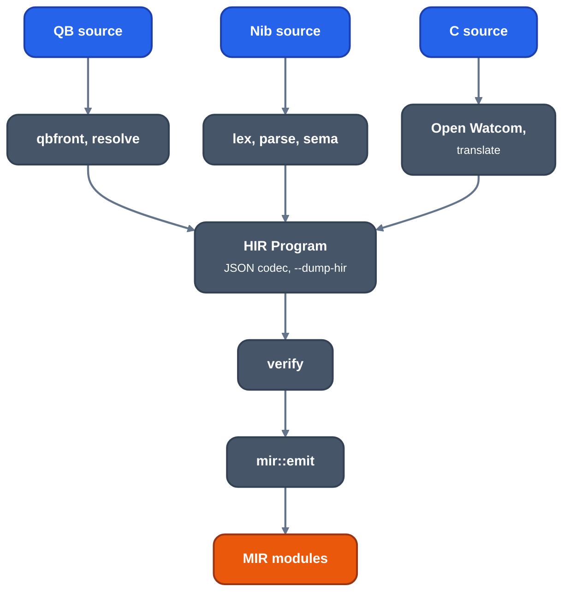

# HIR

For frontend authors and anyone reading how source becomes MIR. HIR is the
typed, name-resolved, non-SSA control-flow graph between a source frontend and
MIR. It lives in `crates/ir/llrm-hir`; the schema is in [model.md](model.md).

*Producers of HIR and the way to MIR*

Producers: `llrm-qb` (parser `qbfront`) and `llrm-nib`. `llrm-qb --dump-hir PATH` writes the JSON document and
`hir-mir HIR.json` (`crates/ir/llrm-hir/src/bin/hir-mir.rs`) prints the MIR it
emits, with each refusal and verifier complaint on stderr.

## Rules

1. HIR is typed and name-resolved. Parser tokens and implicit-name lookup do
   not escape into it. Calls name stable `Callable` ids; the callable owns the
   linkage name, result type and parameter modes. Runtime intrinsics are a
   separate frontend registry resolved to one exact lowering variant.
2. It preserves source evaluation order, storage identity, aliasing facts,
   conversions and observable effects.
3. It is a CFG but not SSA. `mir::emit` builds SSA: local places become
   `alloca`s, data objects globals, values SSA values, as clang's CodeGen does.
4. It names semantic operations, never registers, instructions, calling
   sequences, object records or encodings.
5. It may state target facts that change meaning: near, far, huge, segment and
   fixed address kinds, `volatile` places, internal versus external linkage.
6. Every operation must lower to MIR. What MIR cannot hold yet is refused
   whole with a reason: the function is left declared, the data object an
   external global.
7. Facts a language promises (`restrict`, alias classes, loop trip promises)
   are stated through `llrm_hir::facts`. A fact may be ignored without
   changing meaning; what changes meaning is an IR field.

MIR and the backend stay as [split.md](../split.md) describes: recognition
before optimisation, every pass MIR to MIR.

## What stays in the frontend

Language-specific parse trees, QB array descriptors and string layout, C
qualifiers and object layout are frontend or ABI concerns. A concept becomes
common only when a second frontend needs the same fact with the same meaning.
Runtime-specific descriptor fields are resolved before HIR: the QB frontend
loads a descriptor's selector and offset and emits ordinary `concat` and
`ptr_offset` operations.

## Verification and the interpreter

`verify::verify` checks a `Program` before MIR construction. `crates/codegen/llrm-codegen/src/hir/`
holds a HIR interpreter (`execute*.rs`) used by tests and re-exports the
`llrm-hir` modules. Other pieces of `llrm-hir`: `escape` (which data objects
a pointer can reach), `onerror` (ON ERROR as invokes and a landing pad),
`meaning` (what a runtime routine computes), `debug` (`-g` types and
variables).

See also the [QB frontend](../../frontends/qb/readme.md) and its
[memory model](../../frontends/qb/memory-model.md).
