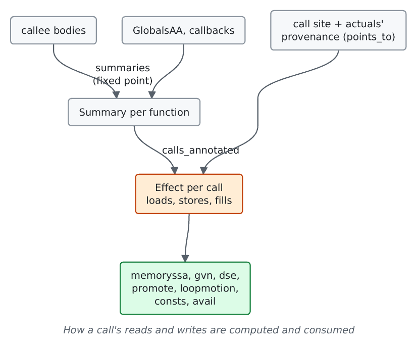

# Call effects

For contributors working on interprocedural analyses or their compile time.
How a call's reads and writes are computed and consumed, and what is still
open.

## What exists

A `Summary` ([source](https://github.com/ali-mosavian/llrm/blob/c341bd6e3de058142c6652d399b8dfeb444eff9b/crates/opt/llrm-analysis/src/alias.rs#L321))
is the modref record of one function: slices of objects read and written,
captured parameters, and unknown-access flags. The `Summaries` analysis holds
one per defined function; `GlobalsAA` adds which globals only the module
reaches by name, and the callbacks (what an address-taken function may do) are
held once.

[`calls_annotated`](https://github.com/ali-mosavian/llrm/blob/c341bd6e3de058142c6652d399b8dfeb444eff9b/crates/opt/llrm-analysis/src/alias.rs#L1643)
instantiates a callee's summary at each call against its actuals and returns
an `Effect`: the loads and stores (lists of `MemRef`) and the `fills` from
`initializes`. The `CallEffects` analysis holds it per body.

Most consumers ask a yes or no about one reference. Some enumerate the lists:
`consts` kill sets, `avail::after` and the dead-store walks.

`stamped_all` in `llrm-transforms` writes the proved `memory`, `nocapture` and
`initializes` attributes onto every declaration, callees first.

## Open

Per-body points-to and call-effects work is redone for every body version:
[#779](https://github.com/ali-mosavian/llrm/issues/779),
[#1166](https://github.com/ali-mosavian/llrm/issues/1166),
[#558](https://github.com/ali-mosavian/llrm/issues/558). The design target is
GCC's modref: a summary queried per reference, not a footprint built for every
call. The rules for keeping an answer sound across edits are in
[points-to-lifetime.md](points-to-lifetime.md).
