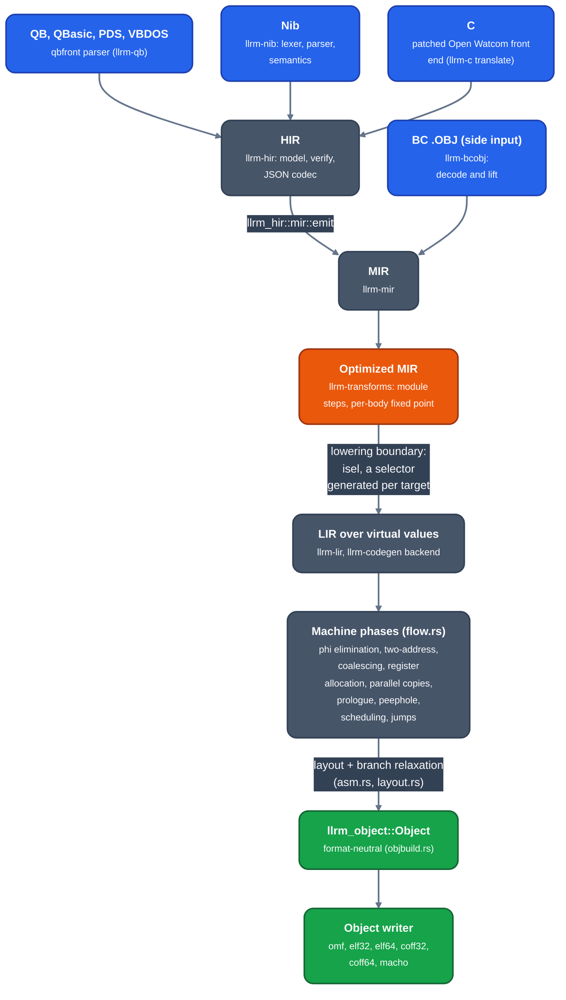
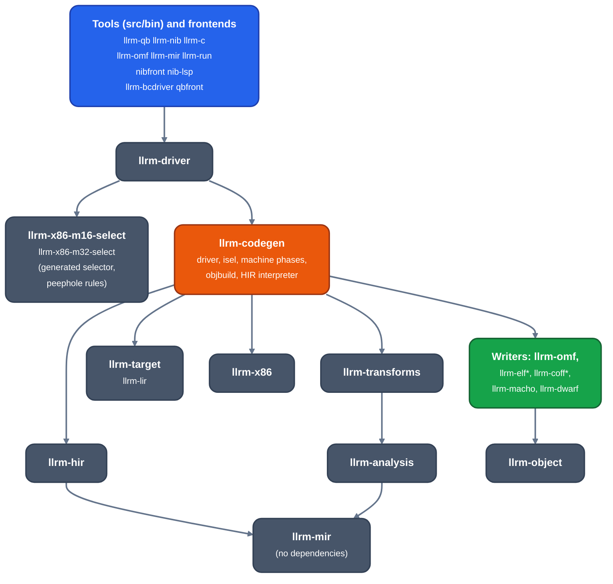
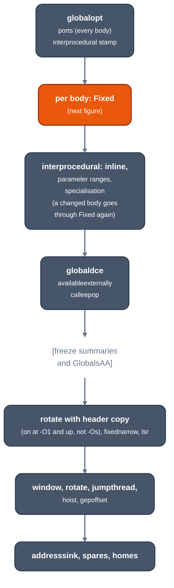
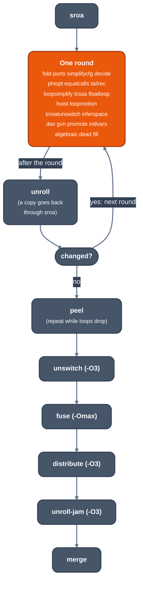
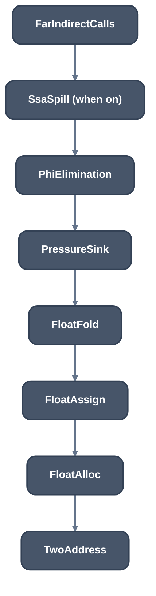
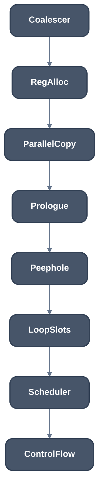

# Architecture

For contributors. What the compiler is made of, the order things run in, and
which crate owns each step.

<!-- architecture-index:start -->
Contents: [the end-state design, box by box, mirroring LLVM](target-architecture.md), [arm64 backend spike, plan and order of work](arm64-spike.md), [arm64 against the core machine passes, an inventory](arm64-core-passes.md), [x86-64 backend spike, plan and order of work](x86-64-spike.md), [LP64 C front end, plan (no code)](lp64-c-frontend-plan.md), [split](split.md), [source layout](source-layout.md), [HIR](hir/readme.md), [HIR model](hir/model.md), [MIR](rich-mir.md), [strong alias analysis](strong-alias.md), [call effects](modref.md), [the parity pipeline: plan](parity-pipeline.md), [points-to across edits](points-to-lifetime.md), [the pinned LLVM pipeline per level](parity-pipeline-slots.md), [what the rotate slot changes](rotate-refusals.md), [optimizer pipeline design](pipeline-design.md), [compile time against gcc and clang](compile-time-review.md), [a decision that records what it read](decision-dependencies.md), [compile-time architecture](compile-time-spec.md), [decide against SimplifyCFG and JumpThreading](decide-vs-llvm.md), [indvars against IndVarSimplify](indvars-vs-llvm.md), [lsr against LoopStrengthReduce](lsr-vs-llvm.md), [the split path against SplitKit](split-path.md), [the allocator on the LIR core](allocator-lir-core.md), [the allocator's decision procedure against RAGreedy's](allocator-procedure.md), [pass lists against clang](pass-parity.md), [LLVM's architecture against llrm's](architecture-parity.md), [LICM as a translation of LLVM's](licm-port.md), [front-end aggregates](frontend-aggregates.md), [LoopIdiomRecognize as a translation of LLVM's](loopidiom-port.md), [MemorySSA as a translation of LLVM's](memoryssa-port.md), [ScalarEvolution as a translation of LLVM's](scev-port.md), [DominatorTree as a translation of LLVM's](domtree-port.md), [ConstraintElimination as a translation of LLVM's](constraint-elimination-port.md), [JumpThreading as a translation of LLVM's](jumpthreading-translation.md), [ShrinkWrap as a translation of LLVM's](shrinkwrap-port.md), [DFAJumpThreading as a translation of LLVM's](dfajumpthreading-translation.md), [Retiring the old Shape analysis](shape-retirement.md), [the translation queue: old slots ranked by cost](translation-queue.md), [JumpThreading ON loses on 13 rows: cause and owner per row](jt-row-losses.md), [GVN and MemoryDependenceAnalysis as a translation of LLVM's](gvn-port.md), [BasicAA as a translation of LLVM's](basicaa-port.md), [DSE in LLVM's shape on the memory SSA](dse-poc.md), [LLVM measured](../comparison/llvm/measured.md), [LLVM compared](../comparison/llvm/readme.md), [LLVM's analysis manager against llrm's `Analyses`](../comparison/llvm/analysis-manager.md), [the analysis-manager model: invalidation rules, audit and per-analysis PRs](analysis-manager-model.md), [LLVM's MemorySSA walker against llrm's frontier walk](../comparison/llvm/memoryssa.md), [LLVM's BasicAA against llrm's `regions::overlapping`](../comparison/llvm/alias.md), [LLVM's LICM against llrm's `hoist`](../comparison/llvm/licm.md), [LLVM's SimplifyCFG against llrm's `decide`](../comparison/llvm/simplifycfg.md), [LIR jumps and coalescing against LLVM's](../comparison/llvm/lir-jumps-coalesce.md), [LIR clean-up: each pass against LLVM's machine pass](lir-cleanup-plan.md), [analyses gcc and LLVM do not compute](analysis-avoidance.md), [compile-cost gap by date](compile-gap-series.md), [output rows by date](rows-series.md), [the plan to reach clang's compile time](redesign-plan.md), [one combine pass with a worklist](combine-worklist.md), [the inliner as LLVM's: translation plan](cgscc-plan.md), [per-function register lists: design note](register-lists.md), [TargetTransformInfo: one translation, many readers](tti-plan.md), [the glue between bodies as LLVM's mechanisms](glue-plan.md), [loop passes as translations of LLVM's](loop-passes-port.md), [LLVM pass order evidence](llvm-order.md), [object model](../formats/object-model.md), [emission against AsmPrinter and MC](emission-survey.md), [the old ranges and regions modules: callers and deletion order](old-ranges-deletion.md), [Pre-RA MachineCSE: row losses](precse-rows.md), [one ScalarEvolution per function, held by the manager across the loop passes: design and invalidation map](persistent-scev.md), [Target facts in backend code: audit](target-facts-audit.md), [LIR vocabulary, one and target-generic](lir-vocabulary.md), [LIR data model, mutable instructions with register use lists](lir-data-model.md), [machine descriptions: ISA, tuning, platform files](machine-description.md), [arm64 isel and peephole gaps against llc, as the table patterns to write](arm64-patterns.md), [packages design](https://github.com/ali-mosavian/llrm/issues/1526), [Recursion rows (D10)](recursion-rows.md)
<!-- architecture-index:end -->

Source frontends (QB, C through Open Watcom, Nib) produce HIR. HIR is emitted
as MIR, a subset of LLVM IR. One optimizer improves whole bodies there; the
backend lowers them to a target's machine IR (LIR), selects instructions,
allocates registers, runs peephole rules and writes an object file (OMF, ELF,
COFF or Mach-O) with debug info (`-g`). The rule that shapes everything:

> Recognition happens when MIR is built. Optimization is machine-independent
> MIR. Machine choices appear at lowering and stay below it.

## Pipeline

*From source to object file*

| Tool | Frontend | Reaches MIR by |
| --- | --- | --- |
| `llrm-qb` | `qbfront` parses and resolves each dialect | HIR, emitted by `llrm_hir::mir::emit` |
| `llrm-nib` | `crates/frontends/nib/src/` | the same HIR path |
| `llrm-c` | a patched Open Watcom front end records its code-generator calls (`toolchain/owshim/`) | HIR from `crates/frontends/llrm-c/src/translate.rs` |
| `llrm-omf` | objects QuickBASIC's BC wrote (a side input, [BC objects](../frontends/bc.md)) | `llrm-bcobj` lifts their machine code; `llrm-bcdriver` compiles it afresh |

[`driver::compiled`](https://github.com/ali-mosavian/llrm/blob/c341bd6e3de058142c6652d399b8dfeb444eff9b/crates/backend/llrm-core/src/driver/mod.rs#L125)
runs the HIR route: emit, optimize, then
[`assemble::assembled_by`](https://github.com/ali-mosavian/llrm/blob/c341bd6e3de058142c6652d399b8dfeb444eff9b/crates/backend/llrm-core/src/backend/assemble.rs#L79)
selects and runs the machine phases. There is one optimizer and one backend.
Any construct a stage cannot handle is refused with its reason and the tool
exits nonzero; no partial output is written.

## Crate layering

An arrow reads "depends on". Verified against each crate's `Cargo.toml`.

*Crate layering; an arrow reads "depends on"*

Three edges carry the architecture:

- `llrm-mir`, `llrm-analysis` and `llrm-transforms` depend on no machine
  crate. A pass reaches the target only as `llrm_mir::target::Machine`.
- `llrm-codegen` depends on no `llrm-x86-m*` crate
  (`tests/core_depends_on_no_target.rs`); `llrm-driver` is the one place that
  matches on a target's name.
- Frontends depend on `llrm-codegen` and `llrm-driver`, never on each other.

[source-layout.md](source-layout.md) lists every crate.

## BC objects (side input)

`llrm-omf` takes objects QuickBASIC's BC already compiled, lifts each
procedure's machine code to MIR (`llrm-bcobj`, on `llrm-bcobj`'s
decoder) and sends it through the same optimizer and backend; it writes a new
object, not a patched one. Runtime calls carry contracts from `runtime.toml`.
See [BC objects](../frontends/bc.md).

## The optimizer

Order comes from the code, not this page: `llrm_transforms::pipeline::passes()`
prints the per-body list, and
[`recorded`](https://github.com/ali-mosavian/llrm/blob/c341bd6e3de058142c6652d399b8dfeb444eff9b/crates/opt/llrm-transforms/src/pipeline.rs#L367)
lists the module steps. Which passes a level enables is in
[levels](../reference/levels.md).

*Module steps of the optimizer, in order*

`Fixed` runs one body:

*Fixed, the passes that run on one body*

A round is repeated until the body prints the same. A repeated state is an
error (a pass oscillates), as is exceeding `max(16, size + 1)` rounds. A pass
that found nothing on a body is skipped until an edit reaches what it reads.
`LLRM_MIR_STAGES=DIR` writes the MIR after each step that changed a body;
diffing adjacent files finds the pass that broke a program.

Analyses are in `crates/opt/llrm-analysis/`; [rich-mir.md](rich-mir.md)
describes the IR and [strong-alias.md](strong-alias.md) the memory model.

## Lowering, LIR and the machine phases

Selection turns each MIR instruction into target instructions over virtual
values and states every placement constraint on them: fixed registers, register
classes, tied operands, clobbers, widths. The selector is generated from
`patterns.isel` by `llrm-iselgen` at build time; each target's directory holds
its patterns, `x86.instr`, `registers.regs`, `timings.times` and `.toml`
descriptions (`calling`, `datalayout`, `dos`, `object`).

[`flow::machine_with`](https://github.com/ali-mosavian/llrm/blob/c341bd6e3de058142c6652d399b8dfeb444eff9b/crates/backend/llrm-core/src/flow.rs#L56)
is the phase order:

*Machine phase order (first half)*

*Machine phase order (second half)*

`RegAlloc` places every value; nothing before it picks a register for an
unconstrained value, and `Peephole` runs after it because its rewrites depend
on placement. Peephole rules are `peephole.peep` files compiled by
`llrm-peepgen`; the groups that run are listed in
`crates/codegen/llrm-codegen/src/backend/peep/groups.list`. `ISEL_DUMP=1` prints
the LIR after each phase.

Layout orders bodies and relaxes branches to a fixed point.
[`objbuild`](https://github.com/ali-mosavian/llrm/blob/c341bd6e3de058142c6652d399b8dfeb444eff9b/crates/backend/llrm-core/src/backend/objbuild.rs#L434)
builds the neutral object and hands it to the writer of the requested format
(`-fobject-format`); see [object-model.md](../formats/object-model.md).

## Facts live in descriptions

A fact about a target or the runtime is written once, in a description a build
step or a reader consumes, not in code:

| Description | Read by |
| --- | --- |
| `crates/frontends/qb/runtime.toml` | HIR emission, the BC lift and lowering: routine contracts |
| `patterns.isel`, `x86.instr` | `llrm-iselgen`: the selector |
| `peephole.peep` | `llrm-peepgen`: rewrite rules |
| `registers.regs`, `timings.times`, `opcosts.txt`, `*.toml` per target | the target crates: registers, costs, layout, ABI |

Open work on this is tracked in
[#618](https://github.com/ali-mosavian/llrm/issues/618).

## Open

- LIR registers are iced's x86 `Register`, so no non-x86 target can use LIR
  ([#634](https://github.com/ali-mosavian/llrm/issues/634)).
