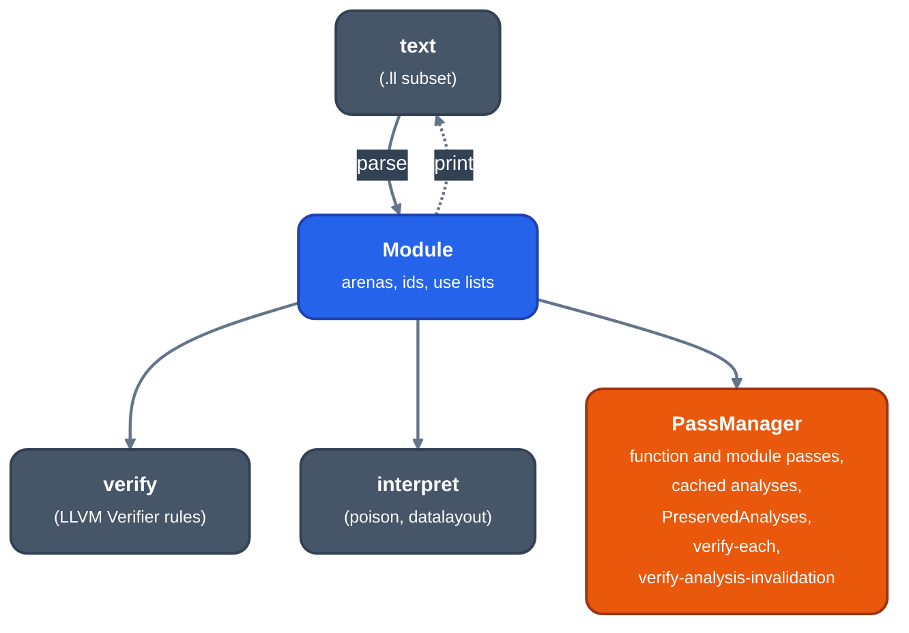

# MIR

For contributors writing a frontend, a pass or lowering. MIR is the one IR
every frontend builds and every pass reads and writes. It lives in
`crates/ir/llrm-mir`, which has no dependencies.

## Decision

MIR is LLVM IR. Its text is a subset of LLVM's assembly language, its meaning
is the LangRef's, and every MIR file is one that LLVM 20's
`opt -passes=verify` accepts. Where llrm needs something LLVM lacks it takes
the form LLVM gives extensions: an intrinsic, an attribute or metadata. It
never adds syntax, a type or an instruction.

The form is LLVM's; the compiler is llrm's. Its analyses, passes and code
generation are its own, because LLVM has no segmented 16-bit x86 target. LLVM
is a reference and an oracle, never a dependency.

*The rich MIR module and what works on it*

Independent oracles, pinned to LLVM 20: `opt -passes=verify` checks stage
dumps, `lli -force-interpreter` runs what it can, `llc -mtriple=msp430`
compiles most of it, and `opt -O2` is a quality reference.
`tools/mir-oracle.sh` runs them; `llrm-mir`'s verifier and interpreter are
held to `opt` and `lli` over the corpus. An input one accepts and the other
rejects, or an answer they disagree on, is a bug in one of them.

## Vocabulary

Types: `void`, `label`, `metadata`, `token`, `iN`, `float`, `double`, opaque
`ptr` per address space, arrays, vectors, literal and named structs,
function types
([`types.rs`](https://github.com/ali-mosavian/llrm/blob/c341bd6e3de058142c6652d399b8dfeb444eff9b/crates/ir/llrm-mir/src/types.rs)).

Instructions
([`Opcode`](https://github.com/ali-mosavian/llrm/blob/c341bd6e3de058142c6652d399b8dfeb444eff9b/crates/ir/llrm-mir/src/opcode.rs#L455)):

| Class | Opcodes |
| --- | --- |
| Terminators | `ret`, `br`, `switch`, `invoke`, `resume`, `unreachable` |
| Arithmetic | `add sub mul udiv sdiv urem srem shl lshr ashr and or xor`, `fadd fsub fmul fdiv frem`, `fneg` |
| Casts | `trunc zext sext fptrunc fpext fpround fptoui fptosi uitofp sitofp ptrtoint inttoptr bitcast addrspacecast` |
| Aggregates | `extractvalue`, `insertvalue` |
| Memory | `alloca`, `load`, `store` (both with `volatile`), `getelementptr` |
| Other | `icmp`, `fcmp`, `phi`, `select`, `freeze`, `call`, `landingpad` |

There are no atomics or `indirectbr`; the parser refuses them. `undef` is an `UndefValue` constant as at the pin, apart from `poison`. Flags
(`nsw`, `nuw`, `exact`, `inbounds`, fast-math) and attributes, including
`memory(...)`, `noalias`, `nocapture` and `initializes`, are LLVM's.
Intrinsics are one table
([`intrinsics.rs`](https://github.com/ali-mosavian/llrm/blob/c341bd6e3de058142c6652d399b8dfeb444eff9b/crates/ir/llrm-mir/src/intrinsics.rs)):
the overflow, min/max, `fmuladd`, math, `memcpy`/`memmove`/`memset`, `assume`,
`lifetime` and `va_start` intrinsics of LLVM, plus llrm's `llrm.noalias` (restrict, said of a loop's pointers by versioning) and `llrm.ia16.*`
(port I/O, huge-pointer difference and window, inline code and assembly).
The table gives each its signature and attributes; the parser sets them as
LLVM does, the verifier checks them, the interpreter runs them.
The attributes of the `llvm.*` intrinsics come from `Intrinsics.td`:
`intrinsic_attrs.rs`, which `tools/intrinsics/gen.py` writes, holds the ones MIR
enumerates and the ones ValueTracking reads by name. Its header lists the four
attributes MIR has no word for and which intrinsics they would have been on.

Beyond instructions, `llrm-mir` holds LLVM's analyses in the form passes
need them: dominators, loops, scalar evolution, value tracking, TBAA, the
call graph and the pass manager.

## Where llrm differs from LLVM

The complete list; everything else is LLVM's.

1. **Passes see no target.** LLVM passes read `TargetTransformInfo`; llrm's
   read `llrm_mir::target::Machine` (costs, register counts, address-space
   roles). `target datalayout` is kept because it states the program's memory
   layout; there is no `target triple`.
2. **A subset.** No constant expressions outside global
   initializers, nothing without a producer. The subset grows when a producer
   needs more, never by an llrm construct.
3. **Rust, not C++.** LLVM's object model (module, functions, blocks,
   instructions, typed values, use lists, `replace_all_uses_with`) held in
   arenas addressed by id. Ids are never reused. Every edit is logged as a
   `Change`, and `check_uses` recomputes use lists and compares.
4. **Address spaces are roles.** A target's `datalayout.toml` gives the
   numbers. For x86-m16: `0` near, `1` far (segment:offset, 32 bits, indexed
   by 16), `2` a bare segment selector, `3` huge, `4` fixed device memory,
   `5` stack. A pass asks the target for the role and never names a number
   ([`spaces.rs`](https://github.com/ali-mosavian/llrm/blob/c341bd6e3de058142c6652d399b8dfeb444eff9b/crates/ir/llrm-mir/src/spaces.rs#L9)).

## What frontends map onto it

| Source construct | MIR form |
| --- | --- |
| A long held in a register pair | `i32`, recognised when MIR is built |
| A write to half of a word | `trunc`, `zext`, `shl`, `or` |
| Carry, borrow, overflow | `llvm.uadd.with.overflow` and kin, `extractvalue` |
| Runtime arithmetic such as `B$MUI4` | the LLVM operation |
| Division | `sdiv`, `srem`, unguarded, as in C |
| `ON ERROR`, `RESUME` | `invoke` and `landingpad` under `@llrm.qb.personality`; `@llrm.qb.onerror` and `onlocalerror` turn trapping on and off |
| `GOSUB`/`RETURN`, event handlers | an `i16` continuation index and a `switch` over the places control may return to |
| Variables BASIC zeroes | explicit stores or `zeroinitializer`; `alloca` is uninitialised |
| Near and far pointers | `ptr` and `ptr addrspace(1)`; `ptrtoint` of a far pointer is segment:offset |
| A frontend's promise that an access stays in its object | `getelementptr inbounds`, `noalias`, `!tbaa` |
| A runtime routine | `@llrm.qb.<name>`, declared with `memory(...)` as proved |
| An unrecognised external call | a call to its declaration, all effects unknown |

The frontend recognises; no pass does. `B$MUI4` is a `mul` the moment MIR exists.
Facts a language promises (what a pass may use and may drop without changing
meaning) are stated through `llrm_hir::facts` and read through
`llrm_mir::facts`; what changes meaning, such as `volatile`, is an IR field.

## Invariants

- The verifier ([`verify.rs`](https://github.com/ali-mosavian/llrm/blob/c341bd6e3de058142c6652d399b8dfeb444eff9b/crates/ir/llrm-mir/src/verify.rs))
  holds LLVM's rules for the subset. The pass manager verifies after every pass when `LLRM_VERIFY` is set.
- A frontend's MIR holds no `poison`, no flag but a GEP's `inbounds`, and no
  read of an alloca before a store of its whole type (`lint::poison`).
- A pass reports a change by preserving fewer analyses than all of them.
- `LLRM_MIR_STAGES=DIR` writes one `.ll` per changed step; diff adjacent files.
- `crates/ir/llrm-mir` depends on nothing: MIR cannot name a decoder, object
  file or target, and a test keeps it so.

## Lowering contract

Lowering receives MIR, the target and the ABI bindings of an existing object.
It may choose types' machine representations, legalise, select and implement
intrinsics. It may not consult original bytes to decide what an instruction
means, invent an input, result or edge, or feed a machine fact back into a MIR
pass. See [split.md](split.md).
