# The split

For contributors deciding where a piece of logic belongs. There is one line in
this compiler: on one side a program is values and operations, on the other it
is machine instructions. **Nothing crosses except at the two doors:** MIR
construction and lowering.

```mermaid
%%{init: {'theme':'base','themeVariables':{'fontFamily':'Segoe UI, Helvetica Neue, Arial, DejaVu Sans, sans-serif','fontSize':'15px','primaryColor':'#475569','primaryTextColor':'#ffffff','primaryBorderColor':'#334155','lineColor':'#64748b','secondaryColor':'#475569','tertiaryColor':'transparent','clusterBkg':'transparent','clusterBorder':'#64748b','edgeLabelBackground':'#334155','textColor':'#64748b','titleColor':'#64748b'},'flowchart':{'curve':'basis','nodeSpacing':38,'rankSpacing':52,'padding':16,'wrappingWidth':360,'htmlLabels':true,'useMaxWidth':true}}}%%
flowchart LR
  classDef mid fill:#475569,stroke:#334155,stroke-width:2px,color:#ffffff,rx:12px,ry:12px
  classDef opt fill:#ea580c,stroke:#9a3412,stroke-width:2px,color:#ffffff,rx:12px,ry:12px
  classDef out fill:#16a34a,stroke:#166534,stroke-width:2px,color:#ffffff,rx:12px,ry:12px
  linkStyle default stroke:#64748b,stroke-width:2.2px
  subgraph g_src["SOURCE: MIR CONSTRUCTION<br/>(ONE DOOR)"]
    hir["<b>HIR</b><br/><small>QB, Nib, C</small>"]:::mid
    bc["<b>BC objects</b>"]:::mid
  end
  subgraph g_abs["ABSTRACT"]
    opt["<b>llrm-transforms</b><br/><small>pipeline</small>"]:::opt
  end
  subgraph g_mach["MACHINE"]
    isel["<b>isel</b>"]:::mid
    lir["<b>LIR</b>"]:::mid
    ph["<b>phases</b>"]:::mid
    lay["<b>layout</b>"]:::mid
    wr["<b>writer</b>"]:::out
  end
  hir -->|"emit"| opt
  bc -->|"decode, lift"| opt
  opt -->|"lowering<br/>(the other door)"| isel
  isel --> lir
  lir --> ph
  ph --> lay
  lay --> wr
  style g_src fill:#47556912,stroke:#475569,stroke-width:1.6px,stroke-dasharray:7 5,color:#475569
  style g_abs fill:#ea580c12,stroke:#ea580c,stroke-width:1.6px,stroke-dasharray:7 5,color:#ea580c
  style g_mach fill:#47556912,stroke:#475569,stroke-width:1.6px,stroke-dasharray:7 5,color:#475569
```

*The two doors between source, abstract and machine*

## The rule

**Every pass between MIR construction and lowering takes MIR and returns MIR, and
names nothing about the machine.** No register, no mnemonic, no encoding, no
byte offset into a source object. Only selection and the machine phases after
it see machine form.

## Why

**A pass that knows the machine does the allocator's job badly.** Picking a
spare register, rewriting readers to name it and emitting the copies means
deciding placement without the allocator's information.

**A pass that reads the emitted form asks the wrong question.** For an
operation a pass has already rewritten, the original instruction answers
"what does this compute" wrongly.

**An idiom recognised in a pass is recognised in the wrong place.** What a
long pair is, what a runtime call means: these are questions about the source
form, and only the frontend (HIR emission, or the lift of a BC object) sees it.

**The abstract side is where the optimisation is.** Value numbering,
loop-invariant motion, promotion and induction variables are statements about
values. They cannot be stated while a value is a register and an operation is
an instruction.

## What each side may say

|                    | machine side             | abstract side                  |
| ------------------ | ------------------------ | ------------------------------ |
| a place            | a register, a frame slot | an SSA value, an `alloca`      |
| an operation       | a mnemonic, an encoding  | a MIR instruction              |
| a comparison       | flags                    | `icmp` and its predicate       |
| a width            | the instruction's form   | the type, `i16`, `i32`         |
| a machine resource | `es`, `st(0)`            | an intrinsic, by name only     |
| where something is | an address, a byte span  | a block, and `br`'s targets    |

A fact the machine side needs and cannot see in its own form, such as what a
call may touch, is computed on MIR and carried down on the instruction
(`CallMemory` in `crates/codegen/llrm-codegen/src/model/lir.rs`), never
re-derived from machine form.

## Who owns what

| Concern | Owner |
| --- | --- |
| Object records and relocations | the object writers; for BC input, `llrm-omf`, `llrm-bcobj` |
| Language semantics, runtime idioms | the frontend and `llrm_hir::mir::emit`; for BC objects, the lift in `llrm-bcobj` |
| Types, values, comparisons, memory objects and effects, control flow | MIR |
| CSE, DSE, promotion, LICM, ranges, loop recurrences | `llrm-transforms`, `llrm-analysis` |
| Runtime call effects (reads, writes, escape, return) | contracts in `llrm-qbruntime`, consumed by HIR emission and MIR |
| Argument locations, clobbers, stack cleanup, frames | physical ABI summaries, consumed by lowering and the backend |
| Encodings, addressing modes, timing trade-offs, operand constraints | selection |
| Phi realisation, parallel copies, tied operands, coalescing, spills | machine phases and `RegAlloc` |
| Redundant moves and segment reloads after placement | `Peephole` |
| Branch distances, layout, rewritten relocations | layout and `objbuild` |

Machine phases implement MIR efficiently; they do not rediscover CSE, LICM or
loop transformations on LIR.

## How it is enforced

- **The crate graph.** `llrm-mir` has no dependencies
  (`the_crate_depends_on_nothing`); `llrm-analysis` and `llrm-transforms`
  depend only on it and `llrm-support`. `llrm-codegen` names no
  `llrm-x86-m*` crate (`tests/core_depends_on_no_target.rs`). A pass cannot
  name a register.
- **Stage dumps.** `LLRM_MIR_STAGES=DIR` writes MIR between passes;
  `ISEL_DUMP=1` prints LIR after selection and after each machine phase.

## Goal

Every documented target is within 1.5x of an independently derived reference
under equivalent semantics. A refusal or an unchanged fallback is not an
optimisation win.

**Review question:** could this MIR transformation still be stated if the body
were lowered to a different machine? If not, move the decision across the
line.
