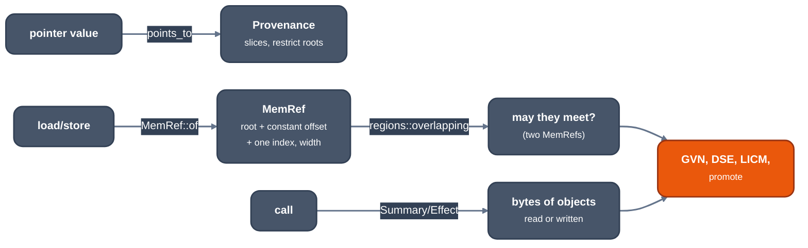

# Strong alias analysis

For contributors writing or reading an analysis or pass that asks about
memory. One machine-independent vocabulary answers every such question, for
every frontend; it lives in `crates/opt/llrm-analysis/src/` (`memory.rs`,
`regions.rs`, `alias.rs`, `memoryssa.rs`).

*From pointer values to answers about memory*

## Objects and slices

A memory object has a `MemoryKind`, a stable id and an optional extent. The
kinds MIR produces are `Frame` (an alloca), `Global`, `Parameter` (what a
pointer parameter points to), `Nonlocal` (what a callee may reach), `Absolute`
(linear memory) and `Unknown`. Different concrete objects are disjoint.
`Nonlocal` reaches globals and escaped objects but not an unescaped frame;
`Unknown` reaches everything.

An access is a half-open byte `Slice` of one object, with a stride and an
element width. Two slices intersect by their modular byte lanes, not by their
hull, so interleaved even and odd lanes are disjoint. Non-wrapping range facts
narrow an indexed access to its possible start offsets.

## Points-to and escape

`points_to` ([source](https://github.com/ali-mosavian/llrm/blob/c341bd6e3de058142c6652d399b8dfeb444eff9b/crates/opt/llrm-analysis/src/alias.rs#L2436))
has two phases. `point_values` flows provenance through SSA values, `select`s,
phis and exact pointer spill slots: an exact store is a strong update, an
overlapping or unresolved store kills the fact, a join keeps a slot only when
every edge defines it, and a missing phi arm gives `Unknown`. The escape
phase is a second forward dataflow: publishing a pointer, returning it or
passing it to a capturing callee exposes its object from that point on, so a
call sees only what escaped before it.

The value solve does not read call arguments or captures, so it is its own
analysis (`PointerValues`) and `Pointers` and `CallEffects` each run only their
escape phase on it.

## Calls

A `Summary` holds the slices a procedure reads and writes in its own
parameter space, the parameters it captures, and unknown-read and
unknown-write flags. Summaries are solved to a fixed point over the call
graph; a body that may be replaced (weak, linkonce) describes no call.
`instantiated` rebases a summary onto each actual pointer's provenance. An
unknown callee reaches all nonlocal storage, the whole object behind each
pointer actual and what has already escaped; it cannot reach an unrelated
frame object. The data model and its cost are in [modref.md](modref.md).

What the C library is known to do (`strlen` reads its arguments and keeps
none) is stated as attributes on the declaration. A local definition overrides it; a name's
decoration alone grants no contract.

## Language promises

`!tbaa` types make two accesses disjoint unless one type is an ancestor of the
other (`typed_apart`); character and untyped accesses stay conservative.
`llrm-cc` writes C's aliasing classes as a TBAA tree, and a C `restrict`
parameter becomes a `noalias` parameter, which gives it a restrict root that
travels with the pointer through copies, arithmetic and phis. `llrm-nib` and
`llrm-qb` state their own facts the same way, through `llrm_hir::facts`.
