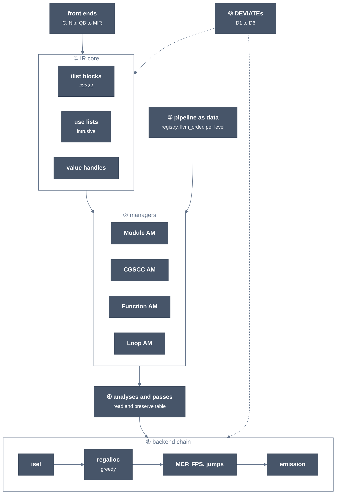

# Target architecture: llrm as LLVM's boxes

TL;DR: the end state is LLVM's structure at `d1106deb71cc` (IR core, four pass managers, the pipeline as data, per-pass analysis contracts, the backend chain), with six numbered DEVIATEs for the 16-bit target. Every port PR names its box here.

Status: design. Mirror rule: each box is `MIRROR` unless a DEVIATE below says otherwise. Reference: [pinned pipeline per level](parity-pipeline-slots.md), [slot table](redesign-plan.md), [road to parity](parity-pipeline.md).

## The boxes

*The boxes; numbers are the sections below.*

## 1. IR core

| LLVM (at the pin) | llrm today | end state |
|---|---|---|
| [`BasicBlock` holds `simple_ilist<Instruction>`](https://github.com/llvm/llvm-project/blob/d1106deb71cc81016406a1917d0508d2df296266/llvm/include/llvm/ADT/simple_ilist.h#L78) | `Block::instructions: Vec<InstId>` | intrusive list; insert, erase, splice O(1). Plan: [#2322]. MIRROR |
| [`Use`/`Value::use_list`](https://github.com/llvm/llvm-project/blob/d1106deb71cc81016406a1917d0508d2df296266/llvm/include/llvm/IR/Use.h#L42) | operands in `Vec<Operand>`; users found by scans or per-pass maps | intrusive use lists; `replaceAllUsesWith` is O(uses). Landed as `uselist.rs` for values and blocks (newest first, O(1) unlink; arena node per operand slot, DEVIATE 1). MIRROR |
| [`ValueHandle`](https://github.com/llvm/llvm-project/blob/d1106deb71cc81016406a1917d0508d2df296266/llvm/include/llvm/IR/ValueHandle.h#L1) (`WeakTrackingVH`, `AssertingVH`) | none | handles for caches that survive erasure (AssumptionCache, SCEV, MemorySSA). MIRROR |
| [`User` co-allocated operands](https://github.com/llvm/llvm-project/blob/d1106deb71cc81016406a1917d0508d2df296266/llvm/lib/IR/User.cpp#L137) | `Vec<Operand>` per instruction | DEVIATE D5 |
| [`LLVMContext` uniquing tables](https://github.com/llvm/llvm-project/blob/d1106deb71cc81016406a1917d0508d2df296266/llvm/lib/IR/LLVMContextImpl.h) (`IntConstants`, `FPConstants`, types): `ConstantInt::get(Ctx, ..)` interns through the context's own tables, whoever holds it | `Context::constant`/`int` and `Types::intern` take `&mut self`: 273 functions take `&mut Context`, so a read-only analysis cannot ask for a constant | append-only arena, stable ids, constants never freed; interning through `&self`; no `RefCell` borrow held across a call. Stages below. MIRROR |

Box names for PRs: `IR/ilist`, `IR/uselist`, `IR/handles`, `IR/context-intern`.

`IR/context-intern` stages (owner domtree-port; coordinate with simplify-combine-wiring-2128):
1. Price: d_faces compile (method M) and the SCEV and LVI hot paths, before.
2. `Arena<T>`: chunked, append-only, one audited `unsafe` for a `&T` that outlives the table's borrow. `Context::constant`, `int` and `Types::intern` move to `&self`; the hash table's `RefCell` is borrowed for one lookup or insert, never across a call. Existing `&mut` callers compile unchanged. `renumber_globals` and named-struct definition stay `&mut` (module construction).
3. `&mut Context` to `&Context`, compiler-guided, one crate per PR (mir, analysis, transforms by file family, core, x86-bc). A scan finds 273 such functions, 35 of which only intern or read directly.
4. DONE: delete the 'not yet interned' workarounds: gvn-ci-2160-2172's DEVIATE for #2500 (PHITransAddr counts a constant not yet interned as unavailable). A grep of the head finds no other; stage 3's errors list any `Option`-returning 'constant if present' helper, recorded here.
5. DONE, priced again (2026-10-20, dist, min of 3, #2612 against its parent): d_faces.c 2,481.6 M to 2,481.5 M, d_faces -m32 flat 1,613.7 M to 1,613.7 M. Stages 3 and 4 claw back nothing measurable: the debt is the reads, not the clones. C1 stays open.

COST DEBT C1 (stage 2, [#2527](https://github.com/ali-mosavian/llrm/pull/2527)): `&self` interning costs +0.9 to +1.1% instructions:u on the dist build (fat LTO, one CGU), `llrm-c -O2` at the base `3b8d044e2`, min of 3: vid.c 370.9 M to 374.8 M, menu.c 1,357.5 M to 1,372.2 M, d_faces.c 2,350.4 M to 2,371.5 M, d_faces -m32 flat 1,666.8 M to 1,683.1 M; objects byte-identical in size. Instructions only; cycles not claimed. Exit: the debt closes when the dist price is within 0.3%; stages 3 and 4 did not move it (stage 5), so it needs the reads (`int_bits`, `operand_type`, `callee`) made cheaper, or it is accepted.

## 2. Pass and analysis managers

LLVM runs four managers over one tree: Module, CGSCC, Function, Loop. An outer manager holds the inner's results through a proxy (`FunctionAnalysisManagerModuleProxy`, `FunctionAnalysisManagerCGSCCProxy`, `LoopAnalysisManagerFunctionProxy`, and the outer-to-inner `*OuterAnalysisManager*Proxy`). A pass returns `PreservedAnalyses`; the manager invalidates what it did not keep. A loop pass reads `LoopStandardAnalysisResults` (AA, AC, DT, LI, MSSA, SE, TLI, TTI, BFI, BPI) and never asks the function manager directly.

End state in llrm: the same four managers, the same proxies, the same invalidation by `PreservedAnalyses`. Passes declare nothing else: no "settled" marks, no stamps, no per-pass caches kept outside a manager (`LastRunTrackingAnalysis` is the one LLVM exception, mirrored). Box names: `PM/module`, `PM/cgscc`, `PM/function`, `PM/loop`, `PM/proxies`. MIRROR. Owners: cgscc-poc (CGSCC, proxies), llvm-order-poc (run counts).

## 3. The pipeline as data

One registry per level, keyed by slot: `slot -> Translated | Old | Missing` (state `Partial` while a translation runs only part of its slot). The list per level is LLVM's `PassBuilderPipelines.cpp` order at the pin, held as data (`llvm_order`), not as code per level. -O1, -O2, -Os share one list with level guards; -Os is -O2 on optsize IR; -O3 adds its slots. A slot's run count equals LLVM's. Spec: [parity-pipeline.md](parity-pipeline.md) ([#2288]). Box: `Pipeline/registry`. MIRROR.

## 4. What each pass reads and preserves

Derived from the pinned source: `get(Cached)Result<X>` and `getAnalysis<X>` in the pass's file are the reads (legacy-wrapper and tracker entries dropped); `preserve<X>` and `preserveSet<X>` are the preserves. Loop passes read `AR.<field>` of `LoopStandardAnalysisResults`. The link is the pass's `run` at the pin. A pass whose `run` calls a helper in another file lists only what its own file names. The table is the contract: a translation takes exactly these reads, and a read outside its row is a DEVIATE.

| pass (source at the pin) | reads | preserves |
|---|---|---|
| [early-cse](https://github.com/llvm/llvm-project/blob/d1106deb71cc81016406a1917d0508d2df296266/llvm/lib/Transforms/Scalar/EarlyCSE.cpp#L1758) | AssumptionAnalysis, DominatorTreeAnalysis, MemorySSAAnalysis, TargetIRAnalysis, TargetLibraryAnalysis | CFGAnalyses, MemorySSAAnalysis; `all()` on no change |
| [sroa](https://github.com/llvm/llvm-project/blob/d1106deb71cc81016406a1917d0508d2df296266/llvm/lib/Transforms/Scalar/SROA.cpp#L6490) | AssumptionAnalysis, DominatorTreeAnalysis | CFGAnalyses, DominatorTreeAnalysis; `all()` on no change |
| [mem2reg](https://github.com/llvm/llvm-project/blob/d1106deb71cc81016406a1917d0508d2df296266/llvm/lib/Transforms/Utils/Mem2Reg.cpp#L61) | AssumptionAnalysis, DominatorTreeAnalysis | CFGAnalyses; `all()` on no change |
| [instsimplify](https://github.com/llvm/llvm-project/blob/d1106deb71cc81016406a1917d0508d2df296266/llvm/lib/Transforms/Scalar/InstSimplifyPass.cpp#L123) | AssumptionAnalysis, DominatorTreeAnalysis, TargetLibraryAnalysis | CFGAnalyses; `all()` on no change |
| [instcombine](https://github.com/llvm/llvm-project/blob/d1106deb71cc81016406a1917d0508d2df296266/llvm/lib/Transforms/InstCombine/InstructionCombining.cpp#L5780) | AAManager, AssumptionAnalysis, BlockFrequencyAnalysis, BranchProbabilityAnalysis, DominatorTreeAnalysis, LastRunTrackingAnalysis, LazyBlockFrequencyInfoPass, ModuleAnalysisManagerFunctionProxy, OptimizationRemarkEmitterAnalysis, ProfileSummaryAnalysis, TargetIRAnalysis, TargetLibraryAnalysis | CFGAnalyses, LastRunTrackingAnalysis; `all()` on no change |
| [aggressive-instcombine](https://github.com/llvm/llvm-project/blob/d1106deb71cc81016406a1917d0508d2df296266/llvm/lib/Transforms/AggressiveInstCombine/AggressiveInstCombine.cpp#L2685) | AAManager, AssumptionAnalysis, DominatorTreeAnalysis, TargetIRAnalysis, TargetLibraryAnalysis | CFGAnalyses, DominatorTreeAnalysis; `all()` on no change |
| [simplifycfg](https://github.com/llvm/llvm-project/blob/d1106deb71cc81016406a1917d0508d2df296266/llvm/lib/Transforms/Scalar/SimplifyCFGPass.cpp#L378) | AssumptionAnalysis, DominatorTreeAnalysis, TargetIRAnalysis | DominatorTreeAnalysis; `all()` on no change |
| [jump-threading](https://github.com/llvm/llvm-project/blob/d1106deb71cc81016406a1917d0508d2df296266/llvm/lib/Transforms/Scalar/JumpThreading.cpp#L240) | AAManager, BlockFrequencyAnalysis, BranchProbabilityAnalysis, DominatorTreeAnalysis, LazyValueAnalysis, TargetIRAnalysis, TargetLibraryAnalysis | BlockFrequencyAnalysis, BranchProbabilityAnalysis, DominatorTreeAnalysis, LazyValueAnalysis; `all()` on no change |
| [correlated-propagation](https://github.com/llvm/llvm-project/blob/d1106deb71cc81016406a1917d0508d2df296266/llvm/lib/Transforms/Scalar/CorrelatedValuePropagation.cpp#L1441) | DominatorTreeAnalysis, LazyValueAnalysis | DominatorTreeAnalysis, LazyValueAnalysis; `all()` on no change |
| [gvn](https://github.com/llvm/llvm-project/blob/d1106deb71cc81016406a1917d0508d2df296266/llvm/lib/Transforms/Scalar/GVN.cpp#L892) | AR.getOffset, AR.hasOffset | DominatorTreeAnalysis, LoopAnalysis, MemorySSAAnalysis, TargetLibraryAnalysis; `all()` on no change |
| [dse](https://github.com/llvm/llvm-project/blob/d1106deb71cc81016406a1917d0508d2df296266/llvm/lib/Transforms/Scalar/DeadStoreElimination.cpp#L2823) | AAManager, CycleAnalysis, DominatorTreeAnalysis, MemorySSAAnalysis, PostDominatorTreeAnalysis, TargetLibraryAnalysis | CFGAnalyses, MemorySSAAnalysis; `all()` on no change |
| [memcpyopt](https://github.com/llvm/llvm-project/blob/d1106deb71cc81016406a1917d0508d2df296266/llvm/lib/Transforms/Scalar/MemCpyOptimizer.cpp#L2235) | AAManager, AssumptionAnalysis, DominatorTreeAnalysis, MemorySSAAnalysis, PostDominatorTreeAnalysis, TargetLibraryAnalysis | CFGAnalyses, MemorySSAAnalysis; `all()` on no change |
| [reassociate](https://github.com/llvm/llvm-project/blob/d1106deb71cc81016406a1917d0508d2df296266/llvm/lib/Transforms/Scalar/Reassociate.cpp#L2729) | UniformityInfoAnalysis | CFGAnalyses; `all()` on no change |
| [sccp](https://github.com/llvm/llvm-project/blob/d1106deb71cc81016406a1917d0508d2df296266/llvm/lib/Transforms/Scalar/SCCP.cpp#L128) | AssumptionAnalysis, DominatorTreeAnalysis, TargetLibraryAnalysis | DominatorTreeAnalysis; `all()` on no change |
| [bdce](https://github.com/llvm/llvm-project/blob/d1106deb71cc81016406a1917d0508d2df296266/llvm/lib/Transforms/Scalar/BDCE.cpp#L209) | DemandedBitsAnalysis | CFGAnalyses; `all()` on no change |
| [adce](https://github.com/llvm/llvm-project/blob/d1106deb71cc81016406a1917d0508d2df296266/llvm/lib/Transforms/Scalar/ADCE.cpp#L621) | DominatorTreeAnalysis, PostDominatorTreeAnalysis | CFGAnalyses, DominatorTreeAnalysis, MemorySSAAnalysis, PostDominatorTreeAnalysis; `all()` on no change |
| [tailcallelim](https://github.com/llvm/llvm-project/blob/d1106deb71cc81016406a1917d0508d2df296266/llvm/lib/Transforms/Scalar/TailRecursionElimination.cpp#L1172) | AAManager, BlockFrequencyAnalysis, DominatorTreeAnalysis, ModuleAnalysisManagerFunctionProxy, OptimizationRemarkEmitterAnalysis, PostDominatorTreeAnalysis, ProfileSummaryAnalysis, TargetIRAnalysis | DominatorTreeAnalysis, PostDominatorTreeAnalysis; `all()` on no change |
| [loop-simplifycfg](https://github.com/llvm/llvm-project/blob/d1106deb71cc81016406a1917d0508d2df296266/llvm/lib/Transforms/Scalar/LoopSimplifyCFG.cpp#L744) | AR.DT, AR.LI, AR.MSSA, AR.SE | MemorySSAAnalysis; `all()` on no change |
| [loop-rotate](https://github.com/llvm/llvm-project/blob/d1106deb71cc81016406a1917d0508d2df296266/llvm/lib/Transforms/Scalar/LoopRotation.cpp#L74) | AR.AC, AR.DT, AR.LI, AR.MSSA, AR.SE, AR.TTI | MemorySSAAnalysis; `all()` on no change |
| [licm](https://github.com/llvm/llvm-project/blob/d1106deb71cc81016406a1917d0508d2df296266/llvm/lib/Transforms/Scalar/LICM.cpp#L298) | AR.AA, AR.AC, AR.DT, AR.LI, AR.MSSA, AR.SE, AR.TLI, AR.TTI | DominatorTreeAnalysis, LoopAnalysis, MemorySSAAnalysis; `all()` on no change |
| [simple-loop-unswitch](https://github.com/llvm/llvm-project/blob/d1106deb71cc81016406a1917d0508d2df296266/llvm/lib/Transforms/Scalar/SimpleLoopUnswitch.cpp#L3494) | AR.AA, AR.AC, AR.DT, AR.LI, AR.MSSA, AR.SE, AR.TTI | MemorySSAAnalysis; `all()` on no change |
| [indvars](https://github.com/llvm/llvm-project/blob/d1106deb71cc81016406a1917d0508d2df296266/llvm/lib/Transforms/Scalar/IndVarSimplify.cpp#L2057) | AR.DT, AR.LI, AR.MSSA, AR.SE, AR.TLI, AR.TTI | CFGAnalyses, MemorySSAAnalysis; `all()` on no change |
| [loop-idiom](https://github.com/llvm/llvm-project/blob/d1106deb71cc81016406a1917d0508d2df296266/llvm/lib/Transforms/Scalar/LoopIdiomRecognize.cpp#L314) | AR.AA, AR.DT, AR.LI, AR.MSSA, AR.SE, AR.TLI, AR.TTI | MemorySSAAnalysis; `all()` on no change |
| [loop-deletion](https://github.com/llvm/llvm-project/blob/d1106deb71cc81016406a1917d0508d2df296266/llvm/lib/Transforms/Scalar/LoopDeletion.cpp#L516) | AR.DT, AR.LI, AR.MSSA, AR.SE | MemorySSAAnalysis; `all()` on no change |
| [loop-unroll](https://github.com/llvm/llvm-project/blob/d1106deb71cc81016406a1917d0508d2df296266/llvm/lib/Transforms/Scalar/LoopUnrollPass.cpp#L1640) | AR.AC, AR.DT, AR.LI, AR.SE, AR.TTI, LoopAnalysisManagerFunctionProxy, ModuleAnalysisManagerFunctionProxy | getLoopPassPreservedAnalyses; `all()` on no change |
| [loop-load-elim](https://github.com/llvm/llvm-project/blob/d1106deb71cc81016406a1917d0508d2df296266/llvm/lib/Transforms/Scalar/LoopLoadElimination.cpp#L691) | AssumptionAnalysis, BlockFrequencyAnalysis, DominatorTreeAnalysis, LoopAccessAnalysis, LoopAnalysis, ModuleAnalysisManagerFunctionProxy, ProfileSummaryAnalysis, ScalarEvolutionAnalysis | DominatorTreeAnalysis, LoopAnalysis; `all()` on no change |
| [loop-sink](https://github.com/llvm/llvm-project/blob/d1106deb71cc81016406a1917d0508d2df296266/llvm/lib/Transforms/Scalar/LoopSink.cpp#L357) | AAManager, BlockFrequencyAnalysis, DominatorTreeAnalysis, LoopAnalysis, MemorySSAAnalysis | CFGAnalyses, MemorySSAAnalysis; `all()` on no change |
| [lsr](https://github.com/llvm/llvm-project/blob/d1106deb71cc81016406a1917d0508d2df296266/llvm/lib/Transforms/Scalar/LoopStrengthReduce.cpp#L7287) | AR.AC, AR.DT, AR.LI, AR.MSSA, AR.SE, AR.TLI, AR.TTI | MemorySSAAnalysis; `all()` on no change |
| [float2int](https://github.com/llvm/llvm-project/blob/d1106deb71cc81016406a1917d0508d2df296266/llvm/lib/Transforms/Scalar/Float2Int.cpp#L507) | DominatorTreeAnalysis | CFGAnalyses; `all()` on no change |
| [div-rem-pairs](https://github.com/llvm/llvm-project/blob/d1106deb71cc81016406a1917d0508d2df296266/llvm/lib/Transforms/Scalar/DivRemPairs.cpp#L423) | DominatorTreeAnalysis, TargetIRAnalysis | CFGAnalyses; `all()` on no change |
| [mldst-motion](https://github.com/llvm/llvm-project/blob/d1106deb71cc81016406a1917d0508d2df296266/llvm/lib/Transforms/Scalar/MergedLoadStoreMotion.cpp#L363) | AAManager | CFGAnalyses; `all()` on no change |
| [speculative-execution](https://github.com/llvm/llvm-project/blob/d1106deb71cc81016406a1917d0508d2df296266/llvm/lib/Transforms/Scalar/SpeculativeExecution.cpp#L340) | TargetIRAnalysis | CFGAnalyses; `all()` on no change |
| [infer-alignment](https://github.com/llvm/llvm-project/blob/d1106deb71cc81016406a1917d0508d2df296266/llvm/lib/Transforms/Scalar/InferAlignment.cpp#L192) | AssumptionAnalysis, DominatorTreeAnalysis | -; `all()` on no change |
| [function-attrs](https://github.com/llvm/llvm-project/blob/d1106deb71cc81016406a1917d0508d2df296266/llvm/lib/Transforms/IPO/FunctionAttrs.cpp#L1788) | AAManager, FunctionAnalysisManagerCGSCCProxy, LazyCallGraphAnalysis | CFGAnalyses, FunctionAnalysisManagerCGSCCProxy, LazyCallGraphAnalysis; `all()` on no change |
| [inline](https://github.com/llvm/llvm-project/blob/d1106deb71cc81016406a1917d0508d2df296266/llvm/lib/Transforms/IPO/Inliner.cpp#L200) | AAManager, AssumptionAnalysis, BlockFrequencyAnalysis, EphemeralValuesAnalysis, FunctionAnalysisManagerCGSCCProxy, InlineAdvisorAnalysis, ModuleAnalysisManagerCGSCCProxy, OptimizationRemarkEmitterAnalysis, ProfileSummaryAnalysis | FunctionAnalysisManagerCGSCCProxy; `all()` on no change |
| [ipsccp](https://github.com/llvm/llvm-project/blob/d1106deb71cc81016406a1917d0508d2df296266/llvm/lib/Transforms/IPO/SCCP.cpp#L368) | AssumptionAnalysis, BlockFrequencyAnalysis, DominatorTreeAnalysis, FunctionAnalysisManagerModuleProxy, PostDominatorTreeAnalysis, TargetIRAnalysis, TargetLibraryAnalysis | DominatorTreeAnalysis, FunctionAnalysisManagerModuleProxy, PostDominatorTreeAnalysis; `all()` on no change |

Regenerate with the same scan over the pin when the pin moves. Box: `Analysis/<name>` for an analysis, `Pass/<name>` for a pass.

## 5. The backend chain

In order, as `llc -O2 -debug-pass=Structure` at the pin; slot numbers are those of the [slot table](redesign-plan.md).

| step | LLVM | slots | owner |
|---|---|---|---|
| isel | `X86ISelLowering`, `SelectionDAGISel`, `SwitchLoweringUtils` | 50, 51 | backend-slopes |
| pre-RA machine passes | early-ifcvt, machine-cse, machine-sink, peephole-opt, coalescer, scheduler | 52 to 57 | lir-cleanup-poc |
| regalloc | `RAGreedy`, `SplitKit`, `VirtRegRewriter`, stack-slot-coloring | 58 | regalloc-core-poc |
| MCP | `MachineCopyPropagation` (block-local) | 59 | lir-cleanup-poc |
| FPS | `X86FloatingPoint.cpp`, RFP register classes | 60 | backend-slopes |
| frame, jumps | prolog-epilog, shrink-wrap, `hasFP`, branch-folder, block-placement | 61, 62, 65 | lir-cleanup-poc, backend-slopes |
| emission | asm printer, `MCObjectStreamer`, `MCAssembler`, `X86MCCodeEmitter` | 64 | backend-slopes |

Boxes: `Backend/isel`, `Backend/ra`, `Backend/mcp`, `Backend/fps`, `Backend/jumps`, `Backend/emit`. MIRROR except D3, D4, D6.

## 6. DEVIATEs

llrm targets i386 real mode and flat 32-bit. Six places differ from LLVM on purpose; any other difference is a bug to translate away.

| # | DEVIATE | why | where |
|---|---|---|---|
| D1 | Segments and far/huge pointers: MIR states a huge pointer in the target's huge address space; isel gives it its representation; `window` splits huge recurrences | LLVM's x86 has no 16-bit segmented model | MIR, isel, loop passes |
| D2 ([#2418]) | temporary. Front-end shapes: the front ends emit branch conditions, scaled indices and aggregate copies as word runs that clang does not ([frontend-aggregates.md](frontend-aggregates.md)) | no clang front end for Nib, QB or Open Watcom C | front ends, HIR; exit: the front-end shapes plan (C translate step 1, [#2306]; owner hir-branch-icmp-2211) brings the shapes to clang's |
| D3 ([#2419]) | temporary. x87 as register-stack code: `floatassign` stands in for the RFP register classes until slot 60 joins; `floatalloc` is already translated from `X86FloatingPoint.cpp` | float registers are a stack | backend slot 60; exit: slot 60 joined with FPS ON by default (backend-slopes) |
| D4 ([#2420]) | temporary. Emission: llrm relaxes a flat item list at one fixpoint instead of `MCAssembler` layout; the OMF writer has no LLVM counterpart and stays | relax and write is about 2.7 M of the 22.5 M emission on `d_faces` -O2 (backend-slopes split); no measurement of `MCAssembler` layout yet | backend slot 64; exit: measure clang's layout on the same input, keep only if llrm's is at most 1.5x |
| D5 | Operands as `Vec<Operand>` per instruction, not co-allocated `User` operands | inline operands are at most 2.7% of allocations and 0.2% of instructions ([architecture-parity.md](architecture-parity.md)) | IR core; revisit when use lists and ilist ([#2322]) have landed: re-measure, adopt if above 1% |
| D6 | `noipa` on Nib bench kernels, honoured by every IPO pass | GCC's `noipa` precedent | CGSCC, IPO |

A new DEVIATE takes the next number, a reason, and a measured number, or it is not allowed.

## 7. Translated against old, today

The registry in `parity.rs` (`crates/opt/llrm-transforms`) is the source of truth, one entry per llrm slot of `llvm_order`: 3 Translated, 1 Partial, 67 Old, 9 Missing (80 entries, on feat/parity at `af7dd82f0`; the 65-slot count in the [slot table](redesign-plan.md) is LLVM's slots, an llrm slot may cover several).

| state | entries |
|---|---|
| Translated | `earlycse` (both slots), `floatalloc` (X86FloatingPoint.cpp) |
| Partial | `allocate` (greedy by default under LLVM's order, [#2312]; exit: SplitKit translated, rows at or below the old allocator) |
| Missing | loop-instsimplify, loop-simplifycfg, sccp and bdce, dfa-jump-threading, vector-combine, early-tailduplication, stack-coloring and shrink-wrap (Backend) |
| Old | everything else: simplifycfg, instcombine, sroa, mem2reg, gvn, licm, loop passes, indvars, dse and the machine passes, each naming the translation that replaces it |

Translations written and not yet joined (SROA, mem2reg, GVN, InstSimplify, DomTree, LVI, BackedgeTakenInfo, DSE) are in the road in [parity-pipeline.md](parity-pipeline.md). A box turns from Old to Translated only when its slot joins with its oracle passing. The count is part of each status report: regenerate it from `parity.rs` every time.

[#2418]: https://github.com/ali-mosavian/llrm/issues/2418
[#2419]: https://github.com/ali-mosavian/llrm/issues/2419
[#2420]: https://github.com/ali-mosavian/llrm/issues/2420
[#2306]: https://github.com/ali-mosavian/llrm/pull/2306
[#2312]: https://github.com/ali-mosavian/llrm/pull/2312
[#2288]: https://github.com/ali-mosavian/llrm/pull/2288
[#2322]: https://github.com/ali-mosavian/llrm/pull/2322
