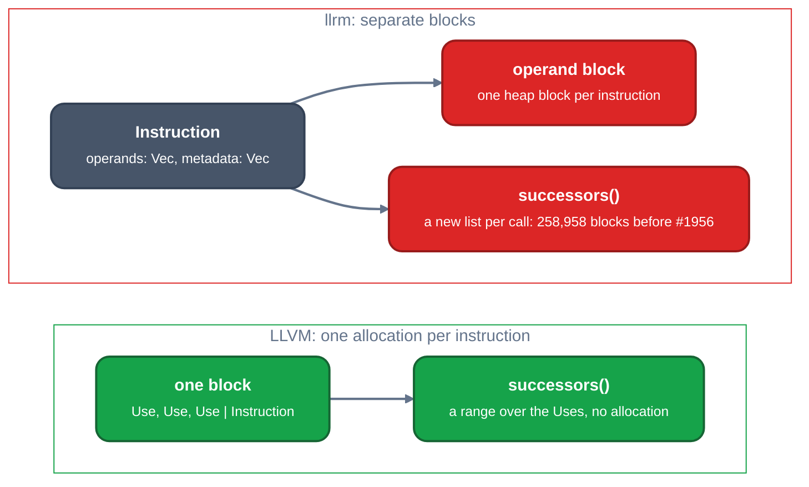

# Allocation and instruction layout against LLVM

TL;DR: a size-class free list over mimalloc (`llrm-alloc`, landed) took 4.2% of the `d_faces` compile; the count is unchanged. Compiling `d_faces` at `-O2`, llrm makes 3,765,923 allocations (638 MB); clang's `cc1` makes 62,881 (38 MB), 60x fewer. Peak live heap is 23 MB against 5.5 MB; peak resident set is 4 to 12 KB per IR instruction with the system allocator (8 to 18 KB with mimalloc, which keeps freed pages) against 0.3 to 0.9 KB in clang. 24% of llrm's L1d misses are allocation and copying.

## LLVM

An instruction is one allocation: the operands (`Use`) sit in the same block, before the object, so building an instruction costs one `operator new` whatever its operand count.

[`User.cpp#L137-L168`](https://github.com/llvm/llvm-project/blob/d1106deb71cc81016406a1917d0508d2df296266/llvm/lib/IR/User.cpp#L137-L168)

```cpp
void *User::allocateFixedOperandUser(size_t Size, unsigned Us,
                                     unsigned DescBytes) {
  assert(Us < (1u << NumUserOperandsBits) && "Too many operands");

  static_assert(sizeof(DescriptorInfo) % sizeof(void *) == 0, "Required below");

  unsigned DescBytesToAllocate =
      DescBytes == 0 ? 0 : (DescBytes + sizeof(DescriptorInfo));
  assert(DescBytesToAllocate % sizeof(void *) == 0 &&
         "We need this to satisfy alignment constraints for Uses");

  size_t LeadingSize = DescBytesToAllocate + sizeof(Use) * Us;

  // Ensure we allocate at least one pointer's worth of space before the main
  // user allocation. We use this memory to pass information from the destructor
  // to the deletion operator, so it can recover the true allocation start.
  LeadingSize = std::max(LeadingSize, sizeof(void *));

  uint8_t *Storage = static_cast<uint8_t *>(::operator new(LeadingSize + Size));
  User *Obj = reinterpret_cast<User *>(Storage + LeadingSize);
  Use *Operands = reinterpret_cast<Use *>(Obj) - Us;
  Obj->NumUserOperands = Us;
  Obj->HasHungOffUses = false;
  Obj->HasDescriptor = DescBytes != 0;

  if (DescBytes != 0) {
    auto *DescInfo = reinterpret_cast<DescriptorInfo *>(Operands) - 1;
    DescInfo->SizeInBytes = DescBytes;
  }

  return Obj;
}
```

A terminator's successors are a range over its operands; nothing is allocated to ask for them ([`Instruction.h#L1029-L1035`](https://github.com/llvm/llvm-project/blob/d1106deb71cc81016406a1917d0508d2df296266/llvm/include/llvm/IR/Instruction.h#L1029-L1035), [`Instruction.cpp#L1462-L1472`](https://github.com/llvm/llvm-project/blob/d1106deb71cc81016406a1917d0508d2df296266/llvm/lib/IR/Instruction.cpp#L1462-L1472)).

## llrm

An instruction owns two `Vec`s, and `successors` returns a fresh `Vec` per call, with a linear duplicate check.

[`module.rs#L70-L79`](https://github.com/ali-mosavian/llrm/blob/21f5c9fc8e67b5bf405cf9ecdaf65247a26c0450/crates/ir/llrm-mir/src/module.rs#L70-L79)

```rust
#[derive(Clone, Debug, PartialEq)]
pub struct Instruction {
    pub opcode: Opcode,
    /// The result's type; `void` when there is none.
    pub ty: TypeId,
    pub operands: Vec<Operand>,
    pub flags: Flags,
    pub result: Option<ValueId>,
    pub metadata: Vec<(String, MetadataId)>,
}
```

[`module.rs#L548-L565`](https://github.com/ali-mosavian/llrm/blob/21f5c9fc8e67b5bf405cf9ecdaf65247a26c0450/crates/ir/llrm-mir/src/module.rs#L548-L565)

```rust
    pub fn successors(
        &self,
        block: BlockId,
    ) -> crate::blocklist::BlockList {
        let operands = self.terminator(block).map(|one| self.instruction(one).operands.as_slice()).unwrap_or_default();
        if operands.len() > SCAN {
            return Self::listed_once(operands);
        }
        let mut out = crate::blocklist::BlockList::new();
        for operand in operands {
            if let Operand::Block(target) = operand
                && !out.contains(target)
            {
                out.push(*target);
            }
        }
        out
    }
```



*An instruction and its neighbours' lists, in memory*

## Divergence

The instruction itself is not where DHAT finds the allocations (`Instruction::clone` is 86,673 of 3.77 M); they are in the tables built beside the IR, one `Vec` per block, per value or per query, rebuilt after every pass that changes the body. `Function::successors` alone made 258,958 allocations (6.9%) before #1956, for `cfg::graph` (109 k), `DominatorTree::new` (34 k), `LoopInfo::new` (31 k) and `cfg::natural` (30 k). Allocation inside CFG, loop and dominator builders is 14% of all allocations, memory SSA 10.7% (126 MB, 20% of the bytes), alias facts 8.5% (73 MB), register allocation 11.1%.

## Measured

`d_faces.c` of qbq-llrm, `-O2 -m32 -march=i486 -fno-inline-functions`. llrm-cc built `--profile dist` from main `21f5c9fc8` and, for DHAT, with the global allocator removed (`valgrind --tool=dhat`; 3.26 G instructions against 2.8 G with mimalloc). `cc1` is the driver's own command line under DHAT.

| | clang 24 `cc1` | llrm-cc |
|---|---:|---:|
| allocations | 62,881 | 3,765,923 |
| bytes allocated | 38.4 MB | 638 MB |
| mean block | 611 B | 170 B |
| peak live (`t-gmax`) | 5.5 MB in 7,843 blocks | 23.3 MB in 106,021 blocks |
| blocks living under 1,000 instructions | 12% | 36% |
| blocks of 16 bytes or less | 9% | 36% |
| peak resident set (`/usr/bin/time`), mimalloc | 63 MB | 82 MB |
| peak resident set, system allocator (empty input: 18 MB) | 63 MB | 44 MB |

Resident set above an empty input, per pre-optimization IR instruction (`tools/ladder/rss.py`, clang end to end against `llrm-cc`):

| shape, N | IR instructions | clang | llrm-cc |
|---|---:|---:|---:|
| mem 100 | 1,205 | 697 B | 17,890 B |
| mem 1600 | 19,205 | 302 B | 16,192 B |
| arith 1600 | 14,467 | 445 B | 7,836 B |
| diamond 1600 | 6,413 | 941 B | 15,108 B |

The same with `llrm-cc` built without mimalloc (system allocator), which returns freed memory:

| shape, N | IR instructions | clang | llrm-cc |
|---|---:|---:|---:|
| mem 1600 | 19,205 | 309 B | 11,652 B |
| arith 1600 | 14,467 | 377 B | 4,450 B |
| diamond 1600 | 6,413 | 920 B | 7,443 B |

What is live at the peak, from DHAT (`t-gmax`, 23.3 MB in 106,021 blocks on `d_faces`): the backend's copies of LIR, not the analysis tables: `peephole::EffectsHeld::remember` 2.9 MB, `spiller::_renamed` 2.3, `allocate::applied` 2.1, `phielim::_renamed` 1.9, `coalesce::_renamed` 1.1, `Semantics::clone` 0.8 (18,442 blocks). The rest of the 82 MB is mimalloc keeping pages after `free`: 44 MB with the system allocator.

Allocations by owner in llrm-cc (first matching frame of the DHAT stack, so each block counts once):

| owner | allocations | share | MB |
|---|---:|---:|---:|
| CFG, loop and dominator builders | 523,311 | 13.9% | 31 |
| register allocation | 419,531 | 11.1% | 72 |
| memory SSA | 403,671 | 10.7% | 126 |
| alias facts | 320,130 | 8.5% | 73 |
| peephole | 187,922 | 5.0% | 22 |
| `gvn` | 172,936 | 4.6% | 27 |
| `fold` and `consts` | 102,622 | 2.7% | 27 |
| instruction selection | 100,049 | 2.7% | 18 |

## Proposed change

LLVM does not make small allocations. It keeps the few elements inline ([`SmallVector`](https://github.com/llvm/llvm-project/blob/d1106deb71cc81016406a1917d0508d2df296266/llvm/include/llvm/ADT/SmallVector.h#L1251), storage at [`#L1166`](https://github.com/llvm/llvm-project/blob/d1106deb71cc81016406a1917d0508d2df296266/llvm/include/llvm/ADT/SmallVector.h#L1166)), puts an instruction's operands in the instruction's own block ([`User.cpp#L137`](https://github.com/llvm/llvm-project/blob/d1106deb71cc81016406a1917d0508d2df296266/llvm/lib/IR/User.cpp#L137)), and gives per-compile tables a bump arena ([`BumpPtrAllocatorImpl`](https://github.com/llvm/llvm-project/blob/d1106deb71cc81016406a1917d0508d2df296266/llvm/include/llvm/Support/Allocator.h#L68)). In llrm 2,518,817 allocations (67%) are 64 bytes or less, and 28% of all allocations are that small and gone within 1,000 instructions. The changes in that shape, largest first:

1. Inline operands. [`Instruction::operands: Vec<Operand>`](https://github.com/ali-mosavian/llrm/blob/21f5c9fc8e67b5bf405cf9ecdaf65247a26c0450/crates/ir/llrm-mir/src/module.rs#L75) becomes a small vector with 3 inline slots (`SmallVec<[Operand; 3]>`, LLVM's `SmallVector<Value *, 3>` is the same choice). `Instruction::clone` makes 86,673 allocations, and every instruction built makes one. Needs a `smallvec` dependency (not in `Cargo.lock`) or a local inline type. Saving: unmeasured; operand counts per instruction are not measured either.
2. Successor and predecessor lists without a heap block: landed as [#1956](https://github.com/ali-mosavian/llrm/pull/1956) (`BlockList`, four blocks inline, `Vec` beyond). Measured here before it landed, on main `21f5c9fc8`, with a prototype of two inline blocks and every other line as it was: `d_faces` -O2 2,814.4 M to 2,788.1 M instructions (-26.3 M, -0.93%) for 258,958 allocations removed, objects byte-identical, `diamond 800` -1.2%, `mem 200` and `arith 400` -0.03%. That is 102 instructions per allocation removed. The prototype was not kept; #1956 states 42 M for four inline blocks.
3. A per-pass scratch arena for tables that die within the pass (the [compile-time spec](../../architecture/compile-time-spec.md) lists it as not built: 34% of the allocations, 1.27 M, are freed within 1,000 instructions, from 549 sites, 56 of which hold 80%; reusing the buffers needs `&mut Scratch` threaded through APIs that return owned `Vec`, `BTreeSet` and `IdMap`, and it estimates about 75 instructions per allocation against the 102 measured above for `successors`): `Vec<i64>` collects 143,858, `forest::forest` 82,268, `DominatorTree::new` 70,084, `alias::escapes` 56,507, `alias::point_values` 32,607: 385,324 allocations (10%). Either `bumpalo::Bump` reset after each pass (new dependency) or a `Scratch` struct held by `Analyses` whose vectors are cleared and reused, which is how LLVM's passes keep member `SmallVector`s. Saving: unmeasured.
4. Presize the 4-byte-id vectors: 515,831 allocations are one `RawVec::grow_one` shared by every `Vec` of `BlockId`, `ValueId`, `InstId` and `TypeId`, and `finish_grow` is 49.9 M self instructions. `Vec::with_capacity(known length)` where the length is known (`cfg::graph`, `LoopInfo::new`, `forest::forest`). Saving: unmeasured; bound 49.9 M plus the copies after a `realloc` (2.0 M of 3.9 M D1 misses).
5. Withdrawn: building the CFG tables once per body version. The 108,796 allocations under `cfg::graph` (and most of the 523,311 in the CFG builders) were the per-block successor lists that [#1956](https://github.com/ali-mosavian/llrm/pull/1956) removed: `cfg::graph` is called 1,811 times on `d_faces` -O2, 168 distinct (function, `Mark`) states, 1,643 repeats, under 1% of the compile (keep-analyses, pass-list-parity). Top allocation sites after #1956 (pass-list-parity): LIR `Semantics` clones 110.6 K, memory `Sorted<Slice>` 43.6 K, `ShareMap` insert 31.8 K.
6. Memory-SSA and alias tables dense: `memoryssa::structure_of` 36,340 blocks, 28.9 MB; see lazy memory facts in the proposals.

### Landed: inline storage, first family

[`llrm_mir::inline::InlineVec<T, N>`](../../../crates/ir/llrm-mir/src/inline.rs) generalizes `BlockList`: `N` elements held in the owner, a `Vec` past them (LLVM's `SmallVector`; `Fill` names the unused slots so the type is safe code and `T: Copy`). `llrm_support::alloc_count` counts a thread's allocations in a test, so a conversion is a fail-first test of allocations on a fixed body. `cfg::Block::succ` was a `Vec<i64>` of one or two ids for every block of every graph: now `Successors = InlineVec<i64, 2>`. On the parent `bd6e647f6`, d_faces -O2: allocations 2,928,914 to 2,811,151 (-4.0%, 117,763 fewer, a probe allocator with stacks), instructions -0.60% at -O1, -0.73% at -O2, -0.72% at -Os, cycles not claimed (the host was loaded); the struct grows from 32 to 40 bytes (`Block`). The probe of capacity at free (d_faces and `mdl_ai.c`): 34% to 37% of all allocations free at 16 bytes or less, 54% to 56% at 32, 65% to 68% at 64, and about 45% of allocations are `Vec`s, so the next families are the small id vectors (`forest`, `exposed_allocas`, `LoopInfo`) and the instruction operand and metadata lists.

### Landed: the allocator

Each allocation cost about 71 instructions in mimalloc's `malloc` and `free`, and 61% of the blocks are 64 bytes or less, 44% living under 10,000 instructions: the allocator was 7.8% of the compile's instructions (9.4% under callgrind) and `memcpy`/`memmove` another 3.6%. [`llrm-alloc`](../../../crates/support/llrm-alloc/src/lib.rs) is a free list for each 16-byte size class up to 1 KiB, per thread, over 1 MiB chunks of mimalloc, which keeps everything larger; a pop and a push take about 10 instructions. No allocation site changes. Against its parent `1a3e557c1`, `d_faces` compiles in 4.2% fewer instructions at every level (-O2 2,908 to 2,787 M), `lru`, `bintree`, `queens` and `sieve` in 5.5% to 6.8% fewer, and in 2.5% to 2.9% fewer cycles on `d_faces` (min of 11, host load 30); objects are byte-identical (`identical.py`, 1,583 of 1,583) and the cost gate's exponents move by at most 0.012. Peak resident set grows: `d_faces` -O2 85.6 to 91.5 MB, QCport's largest module (`mdl_ai.c`) 104.0 to 122.4 MB, because a block never leaves its class. With an allocation at about a quarter of its former cost, each remaining lever above is worth about a quarter of its count: inline operands (at most 2.7% of the blocks are instructions' or functions' copies) and presized vectors are under 0.5% of the compile each.

### The same changes in Rust

`Cargo.lock` has `indexmap` and `rustc-hash` and none of `smallvec`, `arrayvec`, `bumpalo` or `typed-arena`; llrm's own dense containers are `IdSet`, `IdMap` and `Bits` ([`dense.rs`](https://github.com/ali-mosavian/llrm/blob/21f5c9fc8e67b5bf405cf9ecdaf65247a26c0450/crates/ir/llrm-mir/src/dense.rs#L37)).

**Inline operands** (`smallvec`, `SmallVector`'s counterpart: inline up to N, spills to the heap beyond):

```rust
// crates/ir/llrm-mir/src/module.rs
use smallvec::SmallVec;

pub struct Instruction {
    pub operands: SmallVec<[Operand; 3]>,
    // ...
}
const _: () = assert!(std::mem::size_of::<Instruction>() <= 128); // bound to be set from the measured size
```

`SmallVec` derefs to a slice, so `.operands.as_slice()`, `iter()` and indexing are unchanged; construction sites change from `vec![..]` to `smallvec![..]`. Three slots because printed MIR has at most 3 comma-separated operands in 98.9% of `d_faces` instructions (counted from the stage dump; type arguments are counted too, so the true share is higher). Without the dependency: a local `Inline<T, const N: usize>` of `[MaybeUninit<T>; N]` and a length, spilling to `Vec`.

**Successors without a block** (landed as #1956 with an inline list; the iterator form below is the alternative that needs no storage at all):

```rust
pub fn successors(&self, block: BlockId) -> impl Iterator<Item = BlockId> + '_ {
    let operands = self.terminator(block).map_or(&[][..], |one| self.instruction(one).operands.as_slice());
    operands.iter().enumerate().filter_map(move |(at, operand)| match operand {
        Operand::Block(target) if !operands[..at].contains(&Operand::Block(*target)) => Some(*target),
        _ => None,
    })
}
```

The duplicate scan is quadratic in a switch's operands, as the current `SCAN` guard says; the switch path keeps `listed_once` behind a separate `successors_unique` returning an `IdSet`.

**Scratch that is reused, not allocated** (std only; LLVM's passes keep `SmallVector` members and `clear()` them):

```rust
// held by Analyses, lent to the builders
#[derive(Default)]
pub struct Scratch { pub blocks: Vec<BlockId>, pub order: Vec<u32>, pub stack: Vec<(u32, u32)> }

pub fn forest(nodes: &[Node], scratch: &mut Scratch) -> Forest { scratch.order.clear(); /* push, no new Vec */ }
```

`Vec::clear` keeps the capacity, so the second call allocates nothing. Targets: `forest::forest` (82,268 allocations), `DominatorTree::new` (70,084), `alias::escapes` (56,507), `alias::point_values` (32,607).

**An arena for tables that die with the pass** (`bumpalo`, `BumpPtrAllocator`'s counterpart: allocate by bumping a pointer, free everything by `reset`):

```rust
use bumpalo::{Bump, collections::Vec as BumpVec};

// in Fixed::fixed, around each step
let scratch = Bump::new();                       // or one held by Analyses
let order: BumpVec<'_, u32> = BumpVec::with_capacity_in(n, &scratch);
// ... the pass runs; nothing built from `scratch` can outlive it (the borrow checker says so)
drop(order); scratch.reset();                    // all of it freed at once, no per-block free
```

`bumpalo::collections::Vec` takes the arena by reference; std's `Vec::new_in` needs the unstable `allocator_api`. A bump arena frees nothing until `reset`, so it fits tables of one pass (`forest`, `DominatorTree`, the alias scratch) and not facts kept across passes. Bound: the 385,324 allocations of the four sites above plus the `Vec<i64>` collects (143,858).

**IR and LIR as indexed arenas.** MIR already is one: instructions and blocks are `InstId` and `BlockId` indices into `Vec`s, so the IR needs no `Arc`. LIR does not: `Arc<Insn>` per instruction (`Semantics::clone` 55,736 allocations; `splitkit` clones `Vec<Block>` of `Vec<Arc<Insn>>`). The Rust form of LLVM's intrusive list is `Vec<Insn>` per body with `u32` positions, or one `Bump` per body handing out `&'bump Insn`; structural sharing of LIR rewrites (ssa-spill-m16) is the other route. Saving: unmeasured.

**Trees that allocate per node become dense sets.** `BTreeSet<BlockId>::insert` is 19.8 M self instructions in the flat profile, `BTreeSet<i64>` 19.6 M, `BTreeSet<usize>` 11.6 M: 51 M (1.8%), and every B-tree node is a heap block. LLVM's counterparts are `SmallPtrSet` and `DenseSet`; here `IdSet<BlockId>` (a bit set over dense ids), `Bits`, or `FxHashSet` with `with_capacity_and_hasher`. Saving: unmeasured; bound 51 M.

Dependencies are a decision for the owner. Everything marked std only needs none.

Ranked list: [proposals](proposals.md).

Open: why `mem` 1600 holds 11.7 KB per IR instruction against 4.4 KB for `arith` (the resident set of the memory shape is superlinear: 4.8 KB per instruction at N=100), and whether `successors` as an iterator saves the 259 k allocations and their misses ([#1994](https://github.com/ali-mosavian/llrm/issues/1994)).
