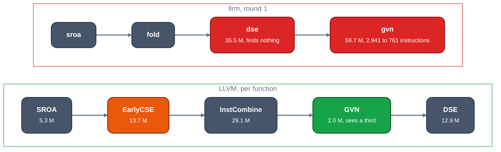

# GVN and its neighbours against llrm's `gvn`

TL;DR: on 200 statements that read and write 16 cells through a pointer, llrm's four `gvn` runs cost 68 M instructions and LLVM's one GVN run costs 2.0 M. Per instruction of the body a run sees, llrm's `gvn` is about 2x LLVM's (20 k against 9 k); the other factor of 15 is order: LLVM's GVN runs after SROA, EarlyCSE, InstCombine and DSE have cut the body to a third, llrm's first `gvn` runs on the body `fold` left, and its `dse` runs first and finds nothing.

## LLVM

The pipeline puts the cheap redundancy removers in front. SROA and EarlyCSE run first in the function simplification pipeline; GVN comes after the loop passes, then DSE.

[`PassBuilderPipelines.cpp#L643-L650`](https://github.com/llvm/llvm-project/blob/d1106deb71cc81016406a1917d0508d2df296266/llvm/lib/Passes/PassBuilderPipelines.cpp#L643-L650)

```cpp

  // Form SSA out of local memory accesses after breaking apart aggregates into
  // scalars.
  FPM.addPass(SROAPass(SROAOptions::ModifyCFG));

  // Catch trivial redundancies
  FPM.addPass(EarlyCSEPass(true /* Enable mem-ssa. */));
  if (EnableKnowledgeRetention)
```

[`PassBuilderPipelines.cpp#L776-L790`](https://github.com/llvm/llvm-project/blob/d1106deb71cc81016406a1917d0508d2df296266/llvm/lib/Passes/PassBuilderPipelines.cpp#L776-L790)

```cpp
  FPM.addPass(SROAPass(SROAOptions::ModifyCFG));

  // Try vectorization/scalarization transforms that are both improvements
  // themselves and can allow further folds with GVN and InstCombine.
  FPM.addPass(VectorCombinePass(/*TryEarlyFoldsOnly=*/true));

  // Eliminate redundancies.
  FPM.addPass(MergedLoadStoreMotionPass());
  if (RunNewGVN)
    FPM.addPass(NewGVNPass());
  else
    FPM.addPass(GVNPass());

  // Sparse conditional constant propagation.
  // FIXME: It isn't clear why we do this *after* loop passes rather than
```

EarlyCSE is one walk of the dominator tree with a scoped hash table of available loads keyed by the pointer operand ([`EarlyCSE.cpp#L1560`](https://github.com/llvm/llvm-project/blob/d1106deb71cc81016406a1917d0508d2df296266/llvm/lib/Transforms/Scalar/EarlyCSE.cpp#L1560)). A load is redundant if the table holds its pointer and nothing that may write memory came between, which is first a comparison of two generation counters. Only when the counters differ does it ask memory SSA, and it asks at most `EarlyCSEMssaOptCap` (500) times a function.

[`EarlyCSE.cpp#L1066-L1103`](https://github.com/llvm/llvm-project/blob/d1106deb71cc81016406a1917d0508d2df296266/llvm/lib/Transforms/Scalar/EarlyCSE.cpp#L1066-L1103)

```cpp
bool EarlyCSE::isSameMemGeneration(unsigned EarlierGeneration,
                                   unsigned LaterGeneration,
                                   Instruction *EarlierInst,
                                   Instruction *LaterInst) {
  // Check the simple memory generation tracking first.
  if (EarlierGeneration == LaterGeneration)
    return true;

  if (!MSSA)
    return false;

  // If MemorySSA has determined that one of EarlierInst or LaterInst does not
  // read/write memory, then we can safely return true here.
  // FIXME: We could be more aggressive when checking doesNotAccessMemory(),
  // onlyReadsMemory(), mayReadFromMemory(), and mayWriteToMemory() in this pass
  // by also checking the MemorySSA MemoryAccess on the instruction.  Initial
  // experiments suggest this isn't worthwhile, at least for C/C++ code compiled
  // with the default optimization pipeline.
  auto *EarlierMA = MSSA->getMemoryAccess(EarlierInst);
  if (!EarlierMA)
    return true;
  auto *LaterMA = MSSA->getMemoryAccess(LaterInst);
  if (!LaterMA)
    return true;

  // Since we know LaterDef dominates LaterInst and EarlierInst dominates
  // LaterInst, if LaterDef dominates EarlierInst then it can't occur between
  // EarlierInst and LaterInst and neither can any other write that potentially
  // clobbers LaterInst.
  MemoryAccess *LaterDef;
  if (ClobberCounter < EarlyCSEMssaOptCap) {
    LaterDef = MSSA->getWalker()->getClobberingMemoryAccess(LaterInst);
    ClobberCounter++;
  } else
    LaterDef = LaterMA->getDefiningAccess();

  return MSSA->dominates(LaterDef, EarlierMA);
}
```

GVN's memory dependence work is capped: 100 instructions per block, 200 blocks, 100 dependences per load ([`GVN.cpp#L129-L131`](https://github.com/llvm/llvm-project/blob/d1106deb71cc81016406a1917d0508d2df296266/llvm/lib/Transforms/Scalar/GVN.cpp#L129-L131), [`MemoryDependenceAnalysis.cpp#L72-L80`](https://github.com/llvm/llvm-project/blob/d1106deb71cc81016406a1917d0508d2df296266/llvm/lib/Analysis/MemoryDependenceAnalysis.cpp#L72-L80)).

## llrm

One pass, `gvn`, owns value numbering, load forwarding, join PRE and load PRE. What serves a load is a memory SSA walk, and where a load was served across a store the whole function is numbered twice:

[`gvn.rs#L37-L55`](https://github.com/ali-mosavian/llrm/blob/21f5c9fc8e67b5bf405cf9ecdaf65247a26c0450/crates/opt/llrm-transforms/src/gvn.rs#L37-L55)

```rust
//! What serves a load is a MemorySSA walk (`avail::forwardable_walk`).
//! `memoryssa::Accesses` says what each instruction reads and writes,
//! `alias::PointValues` what each pointer may point to, and a call's footprint
//! is its `CallEffects` from `Summaries`; without `Summaries` every callee is
//! unknown. A call that may write the bytes, or a store that may overlap, ends
//! the walk, and a walk past `MAX_NEAREST_WRITES` (100) writes gives up.
//!
//! A value held across a store saves a load but lengthens a live range. Where a
//! load was served across a store the function is numbered twice, once crossing
//! stores and once avoiding them, and the crossing one stands unless the
//! careful one prices lower (`profit::motion_price`: work weighted by block
//! frequency plus the spill forecast against the target's registers). Where
//! nothing spills the crossing one stands. Trip counts are the proven ones
//! (`profit::proven_trips`). Without `pre` there is no pricing and a load is
//! served wherever it is redundant on every path.
//!
//! `EqualCalls` runs the call numbering alone, before `tailrec`, so two equal
//! calls are one before one of them becomes the loop's next trip (EarlyCSE
//! precedes tail-recursion elimination in LLVM, FRE in gcc). It asks for no
```

It sits late in the round, after the loop passes and after `dse`; `sroa`, `fold` and `decide` are in front, and nothing resembling EarlyCSE:

[`pipeline.rs#L485-L517`](https://github.com/ali-mosavian/llrm/blob/21f5c9fc8e67b5bf405cf9ecdaf65247a26c0450/crates/opt/llrm-transforms/src/pipeline.rs#L485-L517)

```rust
    let every: Vec<Box<dyn FunctionPass>> = vec![
        // Aggregate/object leaves become ordinary SSA before any scalar or
        // CFG pass asks what is constant, redundant, or loop invariant.
        Box::new(promote::Sroa),
        Box::new(fold::Fold),
        // Before anything asks what a port call does to memory.
        Box::new(ports::Ports),
        Box::new(decide::Decide),
        // gcc runs phiopt at -O1 and above (opts.cc:609); it is priced in bytes
        // at -Os.
        Box::new(phiopt::PhiOpt { size: applied.options.prefers_size() }),
        // Once the arguments are values rather than frame cells; the loop it
        // makes goes to the loop passes below.
        // Before a call is made a loop: two equal calls are one first, as
        // LLVM's EarlyCSE and gcc's FRE precede tail-recursion elimination.
        Box::new(gvn::EqualCalls),
        Box::new(tailrec::TailRecursion),
        Box::new(loopsimplify::LoopSimplify),
        Box::new(lcssa::LoopClosedSSA),
        // Strict floating recurrences must retain their original iteration
        // order; LICM may move invariant preparation out afterwards.
        Box::new(floatloop::FloatLoop),
        Box::new(hoist::Hoist { size: applied.options.prefers_size() }),
        Box::new(loopmotion::LoopMotion),
        // The loop's exit tests that nothing in it changes are made once, with
        // the loop's entry.
        Box::new(trivialunswitch::TrivialUnswitch),
        // Before gvn: a far pointer cast from a near one is read as the near
        // one.
        Box::new(inferspace::InferAddressSpaces),
        Box::new(dse::Dse),
        Box::new(gvn::Gvn { pre: applied.options.pre }),
        // Ordinary scalar write-through promotion remains after memory GVN.
```



*`mem` N=200: the order of the redundancy passes and what each costs*

## Divergence

The caps are alike (100 writes in llrm's walk, 100 in LLVM's), so caps are not the gap. Two things are. First, order and size: the first `gvn` run takes 59.7 M and removes 2,180 of 2,941 MIR instructions (counted lines of the stage dump); LLVM does the same removal in EarlyCSE (13.7 M) and DSE (12.9 M) and its GVN then sees 556. Second, what a run asks for first: `gvn` needs `memoryssa::Accesses`, `alias::PointsTo` and `Summaries`, which `LLRM_DEBUG=runs` bills to the step (`r01-fold`: 2.4 M own work, 27.5 M with its analyses; `r01-decide`: 0.47 M, 13.0 M; `r01-sroa`: 1.9 M, 19.8 M), while EarlyCSE asks for memory SSA and uses it only when the generation counters differ, and InstCombine asks for a dominator tree and alias analysis it queries lazily.

## Measured

Input `tools/ladder/ladder_gen.py mem 200` and `loop 200`, `clang -O2 -m32 -march=i486`; LLVM `opt -passes='default<O2>'` under callgrind (inclusive per pass), llrm `LLRM_DEBUG=time` (inclusive, runs in brackets).

| pass family | LLVM mem | llrm mem | LLVM loop | llrm loop |
|---|---:|---:|---:|---:|
| value numbering | GVN 2.0 | `gvn` 68.2 (4) | GVN 2.5 | `gvn` 210 (4) |
| EarlyCSE | 13.7 | none | 5.5 | none |
| dead stores | DSE 12.9 | `dse` 41.9 (4) | | `dse` 10.8 (3) |
| InstCombine / `fold` | 29.1 | 36.8 (5) | 71.2 | 73.6 (5) |
| SROA / `sroa`, `promote` | 5.3 | 19.8 (1), 20.0 (4) | 8.6 | 15.2, 15.7 |
| SimplifyCFG / `decide` | 1.4 | 15.6 (4) | | 12.7 (3) |
| induction variables | | 1.0 (5) | 9.0 | 5.5 (5) |

M instructions. `fold` is not InstCombine (it solves constants through registers, phis and memory), so its equality with InstCombine at equal input says that per-run cost is not what makes `d_faces` 12x dearer per run; it does not say the passes do the same work.

LLVM's GVN in isolation on the same function, after the passes in front of it (`opt -passes='function(...,gvn)'` minus the same without `gvn`):

| passes before GVN | IR instructions | GVN (M) |
|---|---:|---:|
| `sroa` | 1,601 | 14.4 |
| `sroa,early-cse` | 973 | 13.0 |
| `sroa,early-cse,instcombine` | 913 | 11.8 |
| `sroa,early-cse,instcombine,dse` | 556 | 5.4 |

Superlinear in llrm, none in LLVM: M instructions of `LLRM_DEBUG=time` totals, mem shape.

| N | `dse` | `gvn` | `fold` | analysis `through-memory` |
|---:|---:|---:|---:|---:|
| 100 | 15.5 | 30.8 | 15.3 | 10.3 |
| 200 | 41.9 | 68.2 | 36.8 | 27.8 |
| 400 | 130.9 | 161.4 | 104.0 | 86.0 |
| 800 | 466.9 | 414.1 | 338.4 | 297.8 |
| 1600 | 1,829 | 1,186 | 1,205 | 1,106 |

From 800 to 1600 the work grows 3.9x (`dse`), 2.9x, 3.6x and 3.7x for a doubled body; LLVM's whole optimizer grows 2.0x ([the ladder](readme.md#the-ladder)).

## Proposed change

1. Linear `gvn`: [#1999](https://github.com/ali-mosavian/llrm/pull/1999) (greedy-port, open) removes two quadratic loops in `transform::subexpressions`; reported on `loop` N=1600: 31,766 M to 27,311 M, exponent 1.41 to 1.34, `d_faces` unchanged. The `mem` shape's `gvn` (exponent 1.5 above) after it: unmeasured.
2. Sparse reached set for `dse` (edit-rollback, PR coming): `dse` is 1,829 M of 5,577 M at `mem` N=1600 and doubles to 4.0x. LLVM bounds the same pass: [`dse-memoryssa-scanlimit` 150 and the step limits](https://github.com/llvm/llvm-project/blob/d1106deb71cc81016406a1917d0508d2df296266/llvm/lib/Transforms/Scalar/DeadStoreElimination.cpp#L127-L160). Saving on `d_faces`: unmeasured.
3. A generation-counter pass before `dse` and `gvn`, `EarlyCSE`-shaped. Measured elsewhere and not kept ([compile-time spec](../../architecture/compile-time-spec.md), `d79d8beea`, branch `alim/exp/early-cse`): with an alias-checked table it is a loss of 8.4% at -O2 on `d_faces`; with a write killing every held cell, as EarlyCSE does, it saves 3.1% to 3.4% at -O2, -O3 and -Os (3,157 to 3,058 M at -O2), costs 0.6% at -O1, shrinks `D_DRAW_FACES` from 2,914 to 2,354 instructions before `decide`, and changes four vsgcc cells for the worse. The tracker also records `gvn` before `decide` (-4.4% at -O2, +5.4% at -O3, rows lost) as not built.
4. Lazy memory facts (keep-analyses, design): the analyses a `gvn`, `fold` or `decide` run asks for first (`r01-fold` 2.4 M own, 27.5 M with analyses).

Ranked list: [proposals](proposals.md).

Open: what each of these four does per query that costs the whole body ([#1994](https://github.com/ali-mosavian/llrm/issues/1994)).
