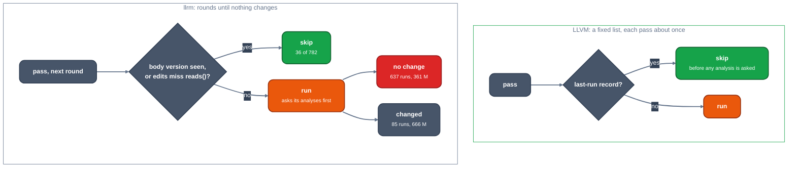

# Runs that change nothing: last-run tracking against llrm's settled skip

TL;DR: on `d_faces` `-O2` 637 of llrm's 722 itemised pass runs change nothing and cost 361 M instructions with the analyses they ask for first, twice what LLVM's whole optimizer costs on the file (178 M). Both compilers skip a pass whose input has not changed since it last found nothing; LLVM's InstCombine skips 32 of 88 runs, llrm skips 36 of 782 candidates.

## LLVM

A pass that found nothing leaves a record; any pass that changes the IR clears every record; a pass that finds its own record is skipped before it asks for a single analysis.

[`LastRunTrackingAnalysis.cpp#L30-L49`](https://github.com/llvm/llvm-project/blob/d1106deb71cc81016406a1917d0508d2df296266/llvm/lib/Analysis/LastRunTrackingAnalysis.cpp#L30-L49)

```cpp
bool LastRunTrackingInfo::shouldSkipImpl(PassID ID, OptionPtr Ptr) const {
  if (DisableLastRunTracking)
    return false;
  ++NumLRTQueries;
  auto Iter = TrackedPasses.find(ID);
  if (Iter == TrackedPasses.end())
    return false;
  if (!Iter->second || Iter->second(Ptr)) {
    ++NumSkippedPasses;
    return true;
  }
  return false;
}

void LastRunTrackingInfo::updateImpl(PassID ID, bool Changed,
                                     CompatibilityCheckFn CheckFn) {
  if (Changed)
    TrackedPasses.clear();
  TrackedPasses[ID] = std::move(CheckFn);
}
```

InstCombine asks first and, when the answer is to skip, returns `PreservedAnalyses::all()`:

[`InstructionCombining.cpp#L6258-L6263`](https://github.com/llvm/llvm-project/blob/d1106deb71cc81016406a1917d0508d2df296266/llvm/lib/Transforms/InstCombine/InstructionCombining.cpp#L6258-L6263)

```cpp
PreservedAnalyses InstCombinePass::run(Function &F,
                                       FunctionAnalysisManager &AM) {
  auto &LRT = AM.getResult<LastRunTrackingAnalysis>(F);
  // No changes since last InstCombine pass, exit early.
  if (LRT.shouldSkip(&ID))
    return PreservedAnalyses::all();
```

When it did change instructions it reports the CFG analyses kept:

[`InstructionCombining.cpp#L6286-L6291`](https://github.com/llvm/llvm-project/blob/d1106deb71cc81016406a1917d0508d2df296266/llvm/lib/Transforms/InstCombine/InstructionCombining.cpp#L6286-L6291)

```cpp
  // Mark all the analyses that instcombine updates as preserved.
  PreservedAnalyses PA;
  LRT.update(&ID, /*Changed=*/true);
  PA.preserve<LastRunTrackingAnalysis>();
  PA.preserveSet<CFGAnalyses>();
  return PA;
```

## llrm

The round loop keeps, per pass, the version of the body at which it last found nothing; it skips the pass if the body is still at that version, or if the edits since touched nothing the pass declares it reads:

[`pipeline.rs#L1026-L1043`](https://github.com/ali-mosavian/llrm/blob/21f5c9fc8e67b5bf405cf9ecdaf65247a26c0450/crates/opt/llrm-transforms/src/pipeline.rs#L1026-L1043)

```rust
                if let Some((version, stretches)) = *settled {
                    if version == run.version {
                        run.skipped += 1;
                        run.check_skipped(&mut **one, unit, analyses);
                        continue;
                    }
                    // Edits since it found nothing to do, none of which reaches
                    // what it reads.
                    run.classify(unit);
                    let reached = run.reached_since(stretches);
                    if !reached.meets(one.reads()) {
                        run.unreached += 1;
                        run.check_skipped(&mut **one, unit, analyses);
                        continue;
                    }
                }
                let name = format!("{prefix}r{:02}-{}", iteration + 1, one.name());
                *settled = (!run.step(&mut **one, &name, unit, analyses)).then(|| (run.version, run.stretches.len()));
```



*`d_faces` -O2: what happens to a pass at its turn*

## Divergence

The mechanism is the same; its reach is not. LLVM's pipeline is a fixed list that visits each pass about once per position (77 function-pass runs and 207 loop-pass runs on `d_draw_faces`), so a skipped run is a run that would repeat. llrm iterates the whole list to a fixed point, 4 rounds of 21 passes (86 runs on `d_draw_faces`), and the second round finds that an edit did reach what most passes read: `skipped as unreached` is 6 over the file, `skipped as settled` 30. The 637 idle runs average 0.57 M with analyses; the 85 runs that change something average 7.8 M. A run that changes the body invalidates the analyses and the next pass pays to compute them again (`r01-decide`: 0.47 M own work, 13.0 M with analyses).

## Measured

`LLRM_DEBUG=runs` on `d_faces.c` of qbq-llrm, `-O2 -m32 -march=i486 -fno-inline-functions`, llrm main `21f5c9fc8`. "With analyses" is the pass's own instructions plus the analyses it computed first. LLVM: 856 function and loop pass runs, 182 change the IR ([LLVM measured](measured.md)).

| | runs | M instr with analyses | M per run |
|---|---:|---:|---:|
| llrm, runs that change nothing | 637 | 360.9 | 0.57 |
| llrm, runs that change the body | 85 | 665.7 | 7.8 |
| LLVM, all runs | 856 | 178 | 0.21 |

By pass (llrm, idle runs then changing runs, M with analyses):

| pass | idle runs | idle M | changing runs | changing M |
|---|---:|---:|---:|---:|
| `gvn` | 21 | 9.4 | 14 | 226.4 |
| `fold` | 25 | 32.4 | 11 | 138.1 |
| `decide` | 32 | 39.1 | 3 | 89.8 |
| `promote` | 29 | 45.2 | 6 | 45.8 |
| `hoist` | 30 | 44.7 | 5 | 43.9 |
| `dse` | 22 | 12.9 | 12 | 39.8 |
| `sroa` | 12 | 35.6 | 0 | 0 |
| `loopidioms` | 26 | 29.0 | 0 | 0 |
| `unroll` | 26 | 16.3 | 0 | 0 |

The 722 itemised runs are 24 fewer than the 746 the pass counter reports; the steps without a name in the log are left out.

## Proposed change

1. Skip an idle step on the edit digest. Measured elsewhere and not kept ([compile-time spec](../../architecture/compile-time-spec.md), `notkept/idle-skip`, `7be773f8a`): 14 passes declaring what they read, `LLRM_CHECK_SKIPPED` silent, 543 corpus objects identical; pass runs 7,600 to 7,152 (-6%) but whole compiles 12,847 to 12,925 M (+0.6%), because the runs skipped are the cheap ones and classifying every window costs 0.65% of the compile. The ceiling: idle reruns after a pass's first run are 858 M of 12,847 M (6.7%) in a pass's own work, 1,310 M with the analyses.
2. Check for work before asking for analyses, as [`InstCombinePass::run`](https://github.com/llvm/llvm-project/blob/d1106deb71cc81016406a1917d0508d2df296266/llvm/lib/Transforms/InstCombine/InstructionCombining.cpp#L6258) asks last-run tracking first. `sroa` idle runs cost 3.0 M each, `decide` 0.47 M own against 13.0 M with analyses: a cheap scan for a candidate (a promotable alloca, a foldable branch) ahead of the analysis request. Bound: none from the analyses themselves: the spec notes that the analyses an idle run asks for are ones the next pass to ask would pay anyway (1,310 M with them, 858 M without); the lever is only the cost of asking for something and finding no work, which the own work of idle runs bounds at 6.7% of the compile. Saving: unmeasured.

Ranked list: [proposals](proposals.md).

Open: why most idle runs are not skipped, and whether the `reads()` footprints are too coarse ([#1994](https://github.com/ali-mosavian/llrm/issues/1994)).
