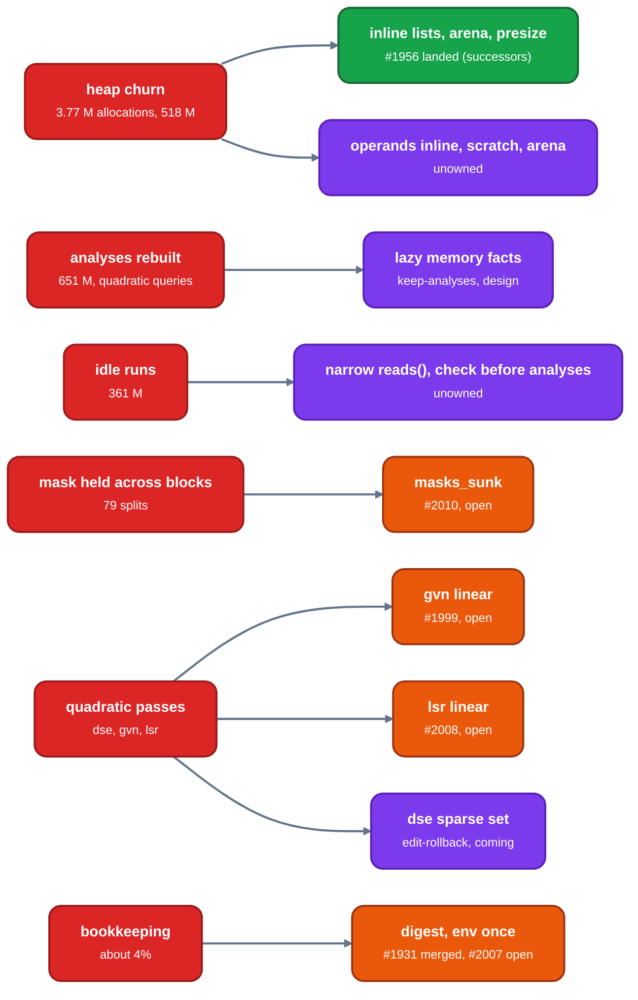

# LLVM compared: proposed changes, in order of importance

TL;DR: ten changes, ranked by what the measurements say is at stake on `d_faces` -O2 (2,874 M instructions) and by how fast the cost grows with the body (the ladder exponent). Four are built or under way; the rest have an exact site and a bound but no measured saving. A bound is the cost of the thing the change removes or reshapes, not a promised saving.

Order: first by the share of `d_faces` the thing costs, then by slope where `d_faces` hides it (its loops are small, so a quadratic pass can cost nothing there and 40% of a larger file). "unmeasured" means no number exists yet. llrm line links are at main `21f5c9fc8`, the code the measurements ran on; LLVM links are at `d1106deb71cc81016406a1917d0508d2df296266`.

*Cause (red), proposed change and its status: landed (green), open PR (orange), design or unowned (purple)*

| # | change | bound on `d_faces` -O2 | slope | owner, PR, status |
|---:|---|---|---|---|
| 1 | allocation and copying | 518 M (18.0%, a bound: it includes 22.7 M of `memcmp`); 3,765,923 allocations against 62,881; 24% of D1 misses, the largest group | memory 4 to 12 KB per IR instruction (system allocator) | unassigned; none built |
| 2 | lazy, per-version memory facts | analyses 651 M of 2,830 M (23%) in [LLVM measured](measured.md), overlapping #1 (memory SSA and alias facts are 19% of the allocations); self cost of `alias::escapes`, `MemRef::of`, `walked_from`, `structure_of`, `exposed_frames` 210 M (7.3%) | through-memory 3.7x per doubling | keep-analyses, design; walker tables greedy-port |
| 3 | idle pass runs | 361 M (12.8%) in 637 runs; the idle-skip experiment skipped 6% of runs and made the compile 0.6% slower | none | measured, not kept (`notkept/idle-skip`); the remaining lever is asking analyses after the work check |
| 4 | mask test made at each branch | none on `d_faces` stated; `diamond 800`: 1,995 M to 1,075 M reported | removes 79 splits | ssa-spill-m16, [#2010](https://github.com/ali-mosavian/llrm/pull/2010), open |
| 5 | quadratic `dse` | unmeasured on `d_faces`; 1,829 M of 5,577 M at `mem` N=1600 | 4.0x per doubling | edit-rollback, PR coming |
| 6 | linear `gvn` | `d_faces` unchanged (reported); `loop` N=1600 -14% | 2.9x per doubling on `mem`; `loop` 1.41 to 1.34 | greedy-port, [#1999](https://github.com/ali-mosavian/llrm/pull/1999), open |
| 7 | linear `lsr` | about 1 M (reported); `loop` N=1600 `lsr` 8,619 M to 962 M | `lsr` N^1.4 | greedy-port, [#2008](https://github.com/ali-mosavian/llrm/pull/2008), open |
| 8 | bookkeeping | 46 M printed-body history, 49 M `Stamp`, 22 M verifiers, 11 M `env_set`: about 4% | none | [#1931](https://github.com/ali-mosavian/llrm/pull/1931) merged; [#2007](https://github.com/ali-mosavian/llrm/pull/2007) open; `Stamp` and verifiers unassigned |
| 9 | split step reads and copies the whole body | 369 M on `diamond 800` before #2010 (`split placed` 221, `split carving` 148); `d_faces`: unmeasured | none stated | ssa-spill-m16 (structural sharing of LIR rewrites), design |
| 10 | LIR clean-up: about 40 whole-body peephole sub-passes, x87 liveness solved again | `lir peephole` 129.7 M and x87 passes 70.9 M against about 30 M and 1.4 M in LLVM; 25.7 M of the x87 is `live_rows_by` | linear (exponent 0.9 to 1.0) | ssa-spill-m16, roadmap step 6 (liveness owner, dirty blocks); sent with the page |

## 1. Allocation and copying

Calibration: removing the 258,958 allocations of `successors` saved 26.3 M instructions in a prototype, 102 instructions per allocation (landed as [#1956](https://github.com/ali-mosavian/llrm/pull/1956) with four inline blocks); at that rate the 3.77 M allocations are about 380 M, 13% of `d_faces`, an estimate that holds only if the rest are as easy to remove. What, in LLVM's shape: operands inline in the instruction (`SmallVec<[Operand; 3]>`, [`SmallVector.h#L1251`](https://github.com/llvm/llvm-project/blob/d1106deb71cc81016406a1917d0508d2df296266/llvm/include/llvm/ADT/SmallVector.h#L1251), [`User.cpp#L137`](https://github.com/llvm/llvm-project/blob/d1106deb71cc81016406a1917d0508d2df296266/llvm/lib/IR/User.cpp#L137)); `successors` and `predecessors` inline (done, #1956); a per-pass scratch arena or reused vectors for tables that die within the pass ([`Allocator.h#L68`](https://github.com/llvm/llvm-project/blob/d1106deb71cc81016406a1917d0508d2df296266/llvm/include/llvm/Support/Allocator.h#L68)); presized id vectors; B-trees that allocate per node become dense sets. The Rust forms (`smallvec::SmallVec<[Operand; 3]>`, iterators, reused `Scratch` vectors, `bumpalo::Bump`, `IdSet`) are on the [allocation page](allocation.md#the-same-changes-in-rust). 67% of the 3,765,923 allocations are 64 bytes or less. Where: [`module.rs#L75`](https://github.com/ali-mosavian/llrm/blob/21f5c9fc8e67b5bf405cf9ecdaf65247a26c0450/crates/ir/llrm-mir/src/module.rs#L75), [`module.rs#L548`](https://github.com/ali-mosavian/llrm/blob/21f5c9fc8e67b5bf405cf9ecdaf65247a26c0450/crates/ir/llrm-mir/src/module.rs#L548), [`cfg.rs#L186`](https://github.com/ali-mosavian/llrm/blob/21f5c9fc8e67b5bf405cf9ecdaf65247a26c0450/crates/opt/llrm-analysis/src/cfg.rs#L186), [`cfg.rs#L425`](https://github.com/ali-mosavian/llrm/blob/21f5c9fc8e67b5bf405cf9ecdaf65247a26c0450/crates/opt/llrm-analysis/src/cfg.rs#L425). Pages: [allocation](allocation.md#proposed-change), [profile](profile.md).

## 2. Lazy memory facts

What: compute `through-memory`, `annotated`, `accesses`, `globals-aa` and `registers` per query on first use for the body version, not for the whole function after each change. In one compile of `mem` N=200 llrm computes them 7, 11, 15, 6 and 17 times (27.8, 42.9, 34, 16.6 and 16.5 M); LLVM computes `DominatorTree` 4 times, `AAManager` 3, `MemorySSA` 2 and keeps `BasicAA` stateless. Where: the analysis manager ([page](analysis-manager.md), [LLVM `PassManagerImpl.h`](https://github.com/llvm/llvm-project/blob/d1106deb71cc81016406a1917d0508d2df296266/llvm/include/llvm/IR/PassManagerImpl.h#L80)), the walker ([page](memoryssa.md)), alias ([page](alias.md)). Also pages: [GVN](gvn.md) (`r01-fold` 2.4 M own, 27.5 M with analyses), [profile](profile.md).

## 3. Idle pass runs

What: log why idle runs are not skipped, narrow `reads()` for `promote`, `hoist`, `decide`, `sroa`, `fold`, `fill` (idle 226 M), and test for work before asking for analyses. Where: [`pipeline.rs#L1026`](https://github.com/ali-mosavian/llrm/blob/21f5c9fc8e67b5bf405cf9ecdaf65247a26c0450/crates/opt/llrm-transforms/src/pipeline.rs#L1026); LLVM [`LastRunTrackingAnalysis.cpp#L30`](https://github.com/llvm/llvm-project/blob/d1106deb71cc81016406a1917d0508d2df296266/llvm/lib/Analysis/LastRunTrackingAnalysis.cpp#L30), [`InstructionCombining.cpp#L6258`](https://github.com/llvm/llvm-project/blob/d1106deb71cc81016406a1917d0508d2df296266/llvm/lib/Transforms/InstCombine/InstructionCombining.cpp#L6258). Page: [idle runs](idle.md).

## 4. Mask test at each branch

What: [#2010](https://github.com/ali-mosavian/llrm/pull/2010) `addresssink::masks_sunk`, the half of CodeGenPrepare that remakes an `and` read only by compares with zero. Cause of the 79 splits and 419 stack operands on `diamond 800`. LLVM: [`sinkAndCmp0Expression`](https://github.com/llvm/llvm-project/blob/d1106deb71cc81016406a1917d0508d2df296266/llvm/lib/CodeGen/CodeGenPrepare.cpp#L2341), [`sinkCmpExpression`](https://github.com/llvm/llvm-project/blob/d1106deb71cc81016406a1917d0508d2df296266/llvm/lib/CodeGen/CodeGenPrepare.cpp#L1924). Page: [register allocation](regalloc.md#why-79-splits).

## 5. Quadratic `dse`

What: a sparse reached set in `dse` (edit-rollback). The pass doubles to 4.0x per doubling of the body and runs first, idle, for 35.5 M on `mem` N=200. LLVM bounds it: [`DeadStoreElimination.cpp#L127`](https://github.com/llvm/llvm-project/blob/d1106deb71cc81016406a1917d0508d2df296266/llvm/lib/Transforms/Scalar/DeadStoreElimination.cpp#L127) (scan limit 150, step, partial-store and path-check limits). Pages: [GVN and neighbours](gvn.md), [memory SSA](memoryssa.md).

## 6 and 7. Linear `gvn` and `lsr`

What: [#1999](https://github.com/ali-mosavian/llrm/pull/1999) removes two quadratic loops in `transform::subexpressions` ([`transform.rs#L266`](https://github.com/ali-mosavian/llrm/blob/21f5c9fc8e67b5bf405cf9ecdaf65247a26c0450/crates/opt/llrm-transforms/src/transform.rs#L266)); [#2008](https://github.com/ali-mosavian/llrm/pull/2008) stops `lsr`'s pressure forecast listing every resident at every step. Both are invisible in `d_faces`, whose loops are small, and show on the `loop` ladder: `gvn` 70, 210, 714, 2,631 M at N=100 to 800 and `lsr` 201, 601, 1,524, 3,728 M. LLVM's `llc` loop strength reduction is not cheaper: it costs 7.4 G at N=200 and 47 G at N=400 and gives up above 200 induction-variable users ([`LoopStrengthReduce.cpp#L6322`](https://github.com/llvm/llvm-project/blob/d1106deb71cc81016406a1917d0508d2df296266/llvm/lib/Transforms/Scalar/LoopStrengthReduce.cpp#L6322)). Page: [index](readme.md#the-ladder).

## 8. Bookkeeping

What: the printed-body history (46 M, 1.6%) is a digest since [#1931](https://github.com/ali-mosavian/llrm/pull/1931); `env_set` per step (11.4 M) in [#2007](https://github.com/ali-mosavian/llrm/pull/2007); `Stamp` (49 M) and the HIR and MIR verifiers (22 M) have no change proposed. Gate the verifiers and `Stamp` out of the shipped binary if they are checks only. Page: [index](readme.md#bookkeeping-with-no-counterpart-in-llvm).

## 9. The split step

What: [`Blocks::of`](https://github.com/ali-mosavian/llrm/blob/21f5c9fc8e67b5bf405cf9ecdaf65247a26c0450/crates/backend/llrm-core/src/backend/splitkit.rs#L596) once per split round, and [`body.blocks.clone()`](https://github.com/ali-mosavian/llrm/blob/21f5c9fc8e67b5bf405cf9ecdaf65247a26c0450/crates/backend/llrm-core/src/backend/splitkit.rs#L670) replaced by sharing untouched blocks. LLVM edits in place: [`trySplit`](https://github.com/llvm/llvm-project/blob/d1106deb71cc81016406a1917d0508d2df296266/llvm/lib/CodeGen/RegAllocGreedy.cpp#L1975). Re-measure after #2010: on `diamond 800` the splits go away and the bound shrinks to what other shapes still split. Page: [register allocation](regalloc.md#proposed-change).

## 10. LIR clean-up

What: the peephole's about 40 whole-body sub-passes re-derive lane and flag liveness; the two x87 passes solve whole-function live rows again (25.7 M of 70.9 M). LLVM does the rewrites inside four DAG combine runs at selection (20.1 M) and its stackifier reads live-in masks left by the allocator. Cause and measurements: [LIR clean-up](lir-cleanup.md). Where: [`peephole.rs#L314`](https://github.com/ali-mosavian/llrm/blob/21f5c9fc8e67b5bf405cf9ecdaf65247a26c0450/crates/backend/llrm-core/src/backend/peephole.rs#L314), [`floatassign.rs#L1869`](https://github.com/ali-mosavian/llrm/blob/21f5c9fc8e67b5bf405cf9ecdaf65247a26c0450/crates/backend/llrm-core/src/backend/floatassign.rs#L1869); LLVM [`X86FloatingPoint.cpp#L81`](https://github.com/llvm/llvm-project/blob/d1106deb71cc81016406a1917d0508d2df296266/llvm/lib/Target/X86/X86FloatingPoint.cpp#L81). Owner: ssa-spill-m16, roadmap step 6.

## Not proposed

- Moving `gvn` before `dse`, shorter rounds, copies, a walker memo: the tracker records them as measured and not the lever.
- A cap on `lsr`: llrm's `lsr` is 12x cheaper than LLVM's at N=200; its slope is what #2008 addresses.
- Anything on instruction selection: 51 M against 62 M on `diamond 800`, equal.

Open questions: [#1994](https://github.com/ali-mosavian/llrm/issues/1994).
