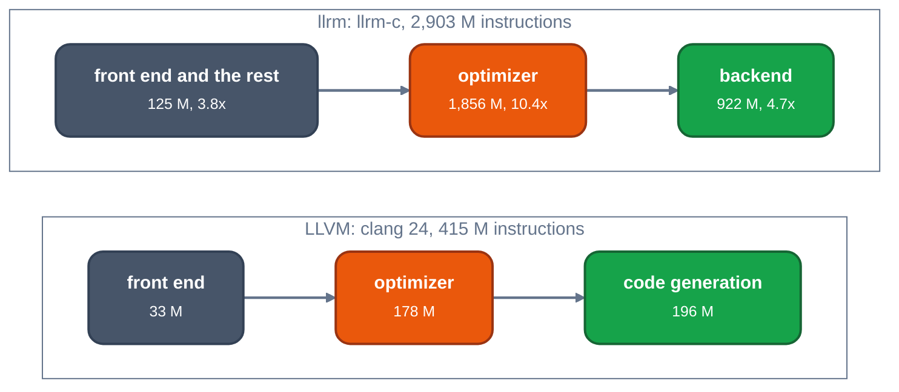

# LLVM compared: why its compile is cheap and llrm's is not

TL;DR: on identical inputs the gap is slope, not fixed cost. An empty function costs 10 M instructions in llrm and 15 M in clang; per instruction of the function llrm's optimizer costs 1.5x to 9x LLVM's and grows faster than linear (exponent 1.0 to 1.4) where LLVM's stays under 1. On `d_faces` `-O2` that is 6.8x in instructions, 4.8x to 6.4x in cycles (load-dependent) and 12.5x to 13.9x in L1d misses (counter, simulation). The measured causes, largest first: heap churn (3.77 M allocations against 62,881), whole-function tables rebuilt after each pass, a register allocator that splits 79 times where greedy splits 3 (llrm holds repeated `x & mask` tests as values across blocks, LLVM re-tests `x` at each branch), and passes that are quadratic in the body (`dse`, `gvn`, `fold`, the through-memory analysis).

Measured against `llvmorg` commit `d1106deb71cc81016406a1917d0508d2df296266` (clang 24, Release, assertions off, X86, static) and llrm main `21f5c9fc8`, both with `perf stat -e instructions:u`, minimum of three, LLVM and llrm alternating. Instructions are the claim; cycles are soft on a loaded host. Setup of the LLVM build and the earlier whole-file totals are in [LLVM measured](measured.md).

## Pages

| page | question |
|---|---|
| [LLVM measured](measured.md) | whole-file totals, pass runs, analyses and caps on `d_faces` |
| [analysis manager](analysis-manager.md) | preserved analyses and invalidation against `Analyses` |
| [memory SSA](memoryssa.md) | walker caps against `avail::forwardable_walk` |
| [alias analysis](alias.md) | depth-limited BasicAA against `regions` and `may_alias` |
| [LICM](licm.md) | LICM against `hoist` |
| [SimplifyCFG](simplifycfg.md) | SimplifyCFG against `decide` |
| [register allocation](regalloc.md) | greedy splitting against llrm's split step |
| [allocation and layout](allocation.md) | 3.77 M allocations against 62,881; memory per IR instruction |
| [GVN and its neighbours](gvn.md) | EarlyCSE, GVN, DSE and order against `gvn`; the quadratic passes |
| [fold, hoist, decide, front end](fold-hoist-decide.md) | why `fold` is 12x per run on `d_faces`: one function, floats; the `mixed` ladder shape |
| [synthesis](synthesis.md) | every cause of the gap, ranked, with status and the LLVM mechanism |
| [LIR clean-up](lir-cleanup.md) | the peephole and x87 passes against DAG combine and the stackifier |
| [LIR jumps and coalescing](lir-jumps-coalesce.md) | `jumps` and the coalescer against BranchFolding, block placement and RegisterCoalescer |
| [runs that change nothing](idle.md) | last-run tracking against llrm's settled skip; 637 idle runs cost 361 M |
| [proposals](proposals.md) | every proposed change, ranked, with owner and PR |
| [flat profile](profile.md) | top functions by instructions and by L1d misses, both compilers |

## Where the instructions go



*`d_faces` -O2: instructions by phase, llrm against LLVM (llrm figures are inclusive `driver::optimized` and `assemble::assembled_by`)*

## The ladder

Generated C, the same text compiled by both (`tools/ladder/ladder_gen.py SHAPE N`, five shapes: `arith` straight-line arithmetic with repeated sub-expressions; `mem` loads and stores through one pointer parameter; `loop` a counted loop with an invariant and an induction use; `diamond` a chain of if/else that make phis; `calls` calls to an external function). N is the statement count, 25 to 1,600. Optimizer is `opt -passes='default<O2>'` against llrm's `mir pipeline`; backend is `llc -O2` against llrm's `assemble` (`LLRM_DEBUG=time`). Slopes fit N up to 200, where both are near linear; the unit is thousand instructions per IR instruction before optimization.

| shape | optimizer, k instr per IR instr (LLVM / llrm) | backend (LLVM / llrm) | optimizer exponent N 25-1600 (LLVM / llrm) | backend exponent |
|---|---:|---:|---:|---:|
| arith | 46 / 69 | 27 / 42 | 0.95 / 1.18 | 0.82 / 0.92 |
| mem | 39 / 133 | 15 / 43 | 0.94 / 1.20 | 0.70 / 0.97 |
| loop | 46 / 409 | n/a (LSR cliff) / 222 | 0.82 / 1.43 | n/a / 0.90 |
| diamond | 59 / 176 | 58 / 183 | 0.83 / 1.07 | 0.88 / 1.44 |
| calls | 45 / 94 | 75 / 123 | 0.76 / 1.03 | 0.83 / 0.99 |

Fixed cost: an empty function costs 6 M (`opt`) + 8 M (`llc`) in LLVM, 15 M for `clang -c` end to end, and 10 M for `llrm-c`. The fitted intercepts are noise around zero. There is no fixed-cost gap.

Totals (M instructions, whole compile):

| shape | N | pre-opt IR | clang M | llrm M | llrm / clang |
|---|---:|---:|---:|---:|---:|
| arith | 50 | 517 | 47 | 87 | 1.8x |
| arith | 200 | 1,867 | 146 | 296 | 2.0x |
| arith | 800 | 7,267 | 476 | 1,463 | 3.1x |
| arith | 1600 | 14,467 | 989 | 3,776 | 3.8x |
| mem | 50 | 605 | 49 | 121 | 2.5x |
| mem | 200 | 2,405 | 147 | 527 | 3.6x |
| mem | 800 | 9,605 | 552 | 3,008 | 5.5x |
| mem | 1600 | 19,205 | 1,133 | 8,684 | 7.7x |
| loop | 50 | 788 | 127 | 317 | 2.5x |
| loop | 200 | 3,038 | 7,704 | 1,809 | 0.2x |
| loop | 800 | 12,038 | 790 | 10,634 | 13.5x |
| loop | 1600 | 24,038 | 1,254 | 29,592 | 23.6x |
| diamond | 50 | 205 | 37 | 69 | 1.9x |
| diamond | 200 | 813 | 106 | 313 | 2.9x |
| diamond | 800 | 3,213 | 396 | 2,014 | 5.1x |
| diamond | 1600 | 6,413 | 795 | 6,160 | 7.8x |
| calls | 50 | 139 | 31 | 45 | 1.5x |
| calls | 200 | 539 | 78 | 149 | 1.9x |
| calls | 800 | 2,139 | 285 | 635 | 2.2x |
| calls | 1600 | 4,275 | 609 | 1,451 | 2.4x |

The `loop` row of clang is not a rate: `llc`'s loop strength reduction costs 7,573 M at N=200 and 47,240 M at N=400 (`-disable-lsr`: 182 M and 173 M) and 75 M at N=800, because it gives up above 200 induction-variable users:

[`LoopStrengthReduce.cpp#L6322-L6336`](https://github.com/llvm/llvm-project/blob/d1106deb71cc81016406a1917d0508d2df296266/llvm/lib/Transforms/Scalar/LoopStrengthReduce.cpp#L6322-L6336)

```cpp
  // If there's no interesting work to be done, bail early.
  if (IU.empty()) return;

  // If there's too much analysis to be done, bail early. We won't be able to
  // model the problem anyway.
  unsigned NumUsers = 0;
  for (const IVStrideUse &U : IU) {
    if (++NumUsers > MaxIVUsers) {
      (void)U;
      LLVM_DEBUG(dbgs() << "LSR skipping loop, too many IV Users in " << U
                        << "\n");
      return;
    }
    // Bail out if we have a PHI on an EHPad that gets a value from a
    // CatchSwitchInst.  Because the CatchSwitchInst cannot be split, there is
```

llrm's `lsr` has no such cap and grows as N^1.4 (201, 601, 1,524, 3,728 M at N=100 to 800), 12x below LLVM's cost at N=200 and above it only where LLVM has stopped. `tools/ladder/ladder-21f5c9fc8.json` holds every row.

## Per pass at equal input

At N=200 the per-run cost of llrm's `fold` equals InstCombine's (36.8 and 29.1 M on `mem`, 73.6 and 71.2 M on `loop`), so the algorithm of that pass is not the gap. The gap is `gvn` (68 against 2.0 M), `dse` (42 against 13), `decide` (15.6 against SimplifyCFG's 1.4) and the analyses llrm computes before a pass's own work: for `r01-fold`, `r01-decide`, `r01-sroa` the pass's own instructions are 2.4, 0.47 and 1.9 M and with its analyses 27.5, 13.0 and 19.8 M. Details and the isolated GVN runs are on the [GVN page](gvn.md).

Analyses computed in one compile of `mem` N=200: LLVM `DominatorTree` 4, `AAManager` 3, `MemorySSA` 2, `ScalarEvolution` 2, `LoopInfo` 2, `BasicAA` is stateless; llrm `through-memory` 7 times (27.8 M), `annotated` 11 (42.9 M), `accesses` 15 (34 M), `globals-aa` 6 (16.6 M), `registers` 17 (16.5 M).

## Cycles and cache

Host load 35 to 38 (`uptime`) throughout, so cycles are the soft column; minimum of 5 runs, alternating.

| input | side | M instr | M cycles | IPC | M branch-miss | M L1d-miss |
|---|---|---:|---:|---:|---:|---:|
| d_faces.c | LLVM | 413 | 266 | 1.56 | 2.92 | 4.2 |
| d_faces.c | llrm | 2814 | 1289 | 2.18 | 11.51 | 53.1 |
| d_faces.c | llrm/LLVM | 6.8x | 4.9x | | 3.9x | 12.5x |
| mem200.c | LLVM | 147 | 66 | 2.24 | 0.45 | 0.9 |
| mem200.c | llrm | 526 | 177 | 2.98 | 0.84 | 11.4 |
| mem200.c | llrm/LLVM | 3.6x | 2.7x | | 1.9x | 13.3x |
| arith400.c | LLVM | 274 | 102 | 2.68 | 0.60 | 1.9 |
| arith400.c | llrm | 632 | 209 | 3.03 | 0.90 | 14.8 |
| arith400.c | llrm/LLVM | 2.3x | 2.0x | | 1.5x | 8.0x |

Cycles move with the load: the same `d_faces` pair gave 4.8x, 4.9x and, in a run of 9 at the same load (32 to 35), 6.4x (293 M against 1,889 M cycles, IPC 1.41 against 1.49) while instructions stayed at 6.8x. The IPC of the first runs (2.2 against 1.6) was a measurement of the host's other jobs, not of the compilers; read the cycle gap as 4.8x to 6.4x. `mem` 200 is steady at 2.7x. L1d misses also move with a sibling thread sharing the cache (53 M to 59 M for llrm), and stay 12.5x to 13.8x above clang's. Cache simulation (`valgrind --tool=callgrind --cache-sim=yes`, D1 32 KB): 42.7 M D1 misses against 3.08 M, LL misses 0.67 M against 0.25 M. The [flat profile page](profile.md) breaks the misses down: allocation and copying 24%, memory-fact tables 14%, register-allocation tables 9%, IR walks 7%.

## Bookkeeping with no counterpart in LLVM

At main `21f5c9fc8` llrm printed the whole body to a `String` after every round of the pass loop and kept the strings in a set, to catch two bodies that alternate (since replaced by a digest of the body, [#1931](https://github.com/ali-mosavian/llrm/pull/1931)):

[`pipeline.rs#L1007-L1009`](https://github.com/ali-mosavian/llrm/blob/21f5c9fc8e67b5bf405cf9ecdaf65247a26c0450/crates/opt/llrm-transforms/src/pipeline.rs#L1007-L1009)

```rust
        // Separately reject a repeated state, so an oscillator fails at once
        // instead of consuming the limit.
        let mut history = BTreeSet::from([print::fingerprint(unit.function)]);
```

[`pipeline.rs#L1064-L1066`](https://github.com/ali-mosavian/llrm/blob/21f5c9fc8e67b5bf405cf9ecdaf65247a26c0450/crates/opt/llrm-transforms/src/pipeline.rs#L1064-L1066)

```rust
            if !history.insert(print::fingerprint(unit.function)) {
                return Err(format!("MIR optimization did not converge: cycle after {} rounds", iteration + 1));
            }
```

On `d_faces` `Printer::instruction` is 46 M (1.6%), `Stamp` 49 M (1.7%), the HIR and MIR verifiers 22 M, `env_set` (an environment lookup per step) 11 M: about 4% of the compile. LLVM's function pipeline is a fixed list run once per function; there is no body history to keep.

## Reproduce

```
python3 tools/ladder/ladder.py --llrm <llrm-c> OUT.json     # the ladder
python3 tools/ladder/fit.py OUT.json --upto 200             # the slopes
python3 tools/ladder/cycles.py <qbq-llrm src> --runs 5 --llrm <llrm-c> <d_faces.c> ...
python3 tools/ladder/rss.py --llrm <llrm-c> --shape mem     # resident set per IR instruction
```

Per-pass numbers: `valgrind --tool=callgrind opt -passes='default<O2>' -disable-output f.ll`, `callgrind_annotate --inclusive=yes`, and `LLRM_DEBUG=time,runs llrm-c ...`. Allocations: `valgrind --tool=dhat` on `cc1` and on `llrm-c` built without its global allocator. Cache: `callgrind --cache-sim=yes`.

## Open questions

Tracked in [#1994](https://github.com/ali-mosavian/llrm/issues/1994).

- Why does llrm hold a merged `x & mask` across blocks where LLVM's selector tests `x` at each branch, and what does re-forming it at the use save (79 splits, 419 stack operands against 5 on the diamond shape)?
- Why does the memory shape hold 11.7 KB per IR instruction at N=1600 against 4.4 KB for arith? The live peak on `d_faces` is the backend's copies of LIR, not the analysis tables.
- Does `Function::successors` as an iterator remove its 258,958 allocations, and what do they cost in misses?
- What does `dse`, `gvn`, `fold` and the through-memory analysis do per query that is O(body)? Each grows 2.9x to 3.9x when the body doubles.
- Why are most idle runs not skipped: are the `reads()` footprints too coarse?
- Would a cheap pass in front of `gvn` (EarlyCSE's generation counters) pay? The first `gvn` run costs 59.7 M on the unshrunk body.
- `fold` costs the same as InstCombine per run here; what makes it 12x dearer per run on `d_faces`?
- Is the 4% of bookkeeping needed in the shipped binary?
