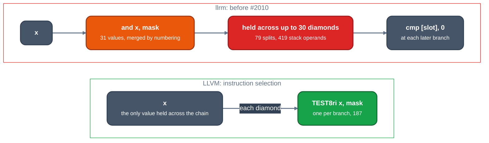

# Greedy register allocation against llrm's allocator

TL;DR: on 800 diamonds (3,213 IR instructions) LLVM's greedy allocator and live-interval analysis cost 11 M instructions of a 222 M `llc` run; llrm's allocator costs 831 M of 2,014 M. LLVM splits 3 live ranges (`splitAroundRegion`, 3 calls); llrm makes 79 split attempts, each of which re-reads the whole function (`split placed` 221 M, `split carving` 148 M), because it holds 31 merged `x & mask` values across the chain where LLVM tests `x` again at each branch (187 `TEST8ri`; 419 stack operands against 5).

> **Reference note.** The LLVM allocator figures on this page (greedy 39.5 M, 815 assignments, 78 evictions, per-decision costs) were taken from the distro `llc` 20.1.8, are not reproduced on the pinned or the distro `llc`, and are being re-taken on the pinned 24.0.0git `d1106deb71cc` by regalloc-core-poc. Do not quote them until its old-versus-new lands.

## LLVM

A live range is split only after assignment and eviction fail, by a ladder of cheap tests: one-block ranges split locally, then one region split, then block by block. Interference comes from a 32-entry cache ([`InterferenceCache.h#L137`](https://github.com/llvm/llvm-project/blob/d1106deb71cc81016406a1917d0508d2df296266/llvm/lib/CodeGen/InterferenceCache.h#L137)) and the edge bundles are an analysis computed once ([`RegAllocGreedy.cpp#L240`](https://github.com/llvm/llvm-project/blob/d1106deb71cc81016406a1917d0508d2df296266/llvm/lib/CodeGen/RegAllocGreedy.cpp#L240)).

[`RegAllocGreedy.cpp#L1975-L2010`](https://github.com/llvm/llvm-project/blob/d1106deb71cc81016406a1917d0508d2df296266/llvm/lib/CodeGen/RegAllocGreedy.cpp#L1975-L2010)

```cpp
MCRegister RAGreedy::trySplit(const LiveInterval &VirtReg,
                              AllocationOrder &Order,
                              SmallVectorImpl<Register> &NewVRegs,
                              const SmallVirtRegSet &FixedRegisters) {
  // Ranges must be Split2 or less.
  if (ExtraInfo->getStage(VirtReg) >= RS_Spill)
    return MCRegister();

  // Local intervals are handled separately.
  if (LIS->intervalIsInOneMBB(VirtReg)) {
    NamedRegionTimer T("local_split", "Local Splitting", TimerGroupName,
                       TimerGroupDescription, TimePassesIsEnabled);
    SA->analyze(&VirtReg);
    MCRegister PhysReg = tryLocalSplit(VirtReg, Order, NewVRegs);
    if (PhysReg || !NewVRegs.empty())
      return PhysReg;
    return tryInstructionSplit(VirtReg, Order, NewVRegs);
  }

  NamedRegionTimer T("global_split", "Global Splitting", TimerGroupName,
                     TimerGroupDescription, TimePassesIsEnabled);

  SA->analyze(&VirtReg);

  // First try to split around a region spanning multiple blocks. RS_Split2
  // ranges already made dubious progress with region splitting, so they go
  // straight to single block splitting.
  if (ExtraInfo->getStage(VirtReg) < RS_Split2) {
    MCRegister PhysReg = tryRegionSplit(VirtReg, Order, NewVRegs);
    if (PhysReg || !NewVRegs.empty())
      return PhysReg;
  }

  // Then isolate blocks.
  return tryBlockSplit(VirtReg, Order, NewVRegs);
}
```

The queue that orders the work is a priority queue of (size, register) pairs ([`RegAllocGreedy.cpp#L420-L436`](https://github.com/llvm/llvm-project/blob/d1106deb71cc81016406a1917d0508d2df296266/llvm/lib/CodeGen/RegAllocGreedy.cpp#L420-L436)); a range that is assigned at once never reaches `trySplit`.

## llrm

A range that fails to assign reaches the split step. The step builds the live blocks, asks `splitkit::local`, then `splitkit::placed`, and carves each region that pays.

[`allocate.rs#L2196-L2232`](https://github.com/ali-mosavian/llrm/blob/21f5c9fc8e67b5bf405cf9ecdaf65247a26c0450/crates/backend/llrm-core/src/backend/allocate.rs#L2196-L2232)

```rust
                        block.at
                    );
                }
            }
            let spread = llrm_support::debug::timed("split spread", || splitkit::live_blocks(&body, value, &live_sets));
            let occupied = splitkit::Occupied::of(&union, &facts.live, value, &facts.masks);
            let sets: &dyn LiveAt = &live_sets;
            // A range in one block splits locally; any other by region, and
            // failing that block by block. Only a piece that pays is carved.
            let regions: Vec<splitkit::Region> = match llrm_support::debug::timed("split local", || {
                splitkit::local(&body, value, &facts.index, sets, &order, &occupied, width)
            }) {
                Some(found) => vec![found],
                None => {
                    let placed = llrm_support::debug::timed("split placed", || {
                        splitkit::placed(
                            &body,
                            value,
                            &facts.index,
                            sets,
                            &bundles,
                            &order,
                            &occupied,
                            width,
                            &_held_saving,
                        )
                    });
                    if placed.is_empty() {
                        llrm_support::debug::timed("split per block", || splitkit::per_block(&body, value, sets))
                    } else {
                        placed
                    }
                }
            };
            let regions: Vec<splitkit::Region> = llrm_support::debug::timed("split pays", || {
                regions.into_iter().filter(|region| splitkit::pays(&body, value, region, sets, &_held_saving)).collect()
            });
```

`placed` builds a block table of the whole body (`Blocks::of`) and a spill placement over it, then tries every candidate register:

[`splitkit.rs#L1637-L1660`](https://github.com/ali-mosavian/llrm/blob/21f5c9fc8e67b5bf405cf9ecdaf65247a26c0450/crates/backend/llrm-core/src/backend/splitkit.rs#L1637-L1660)

```rust
pub fn placed(
    body: &LirBody,
    value: u32,
    index: &Indexes,
    live: &dyn allocate::LiveAt,
    bundles: &spillplacement::Bundles,
    candidates: &[RegId],
    occupied: &Occupied,
    width: u32,
    saving: &dyn Fn(&Insn) -> f64,
) -> Vec<Region> {
    let blocks = Blocks::of(body);
    let analysis = analysed_in(&blocks, value, live);
    if analysis.uses.is_empty() {
        return Vec::new();
    }
    let mut placement = spillplacement::Placement::new(body, bundles);
    let benefit = |region: &Region, placement: &spillplacement::Placement| {
        if region.is_empty() || _whole_range(&blocks, &analysis, value, region, live) {
            return 0.0;
        }
        _benefit(&blocks, value, region, &|at| placement.frequency[&at], live, saving)
    };
    let open = |_: i64| None;
```

A carve copies the block list, `Vec<Block>` with a `Vec<Arc<Insn>>` per block, to edit the copy; it also builds `Blocks::of(body)` again:

[`splitkit.rs#L586-L597`](https://github.com/ali-mosavian/llrm/blob/21f5c9fc8e67b5bf405cf9ecdaf65247a26c0450/crates/backend/llrm-core/src/backend/splitkit.rs#L586-L597)

```rust
pub fn carved_moving(
    body: &LirBody,
    value: u32,
    fresh: u32,
    width: u32,
    region: &Region,
) -> Option<(LirBody, Moved)> {
    // Trimming to the references can end a range inside a parallel group; snap
    // last.
    let region = region.trimmed(body, value).snapped(body);
    let blocks = Blocks::of(body);
    let referenced = region
```

[`splitkit.rs#L668-L672`](https://github.com/ali-mosavian/llrm/blob/21f5c9fc8e67b5bf405cf9ecdaf65247a26c0450/crates/backend/llrm-core/src/backend/splitkit.rs#L668-L672)

```rust
    // covers, which are in `touched`: the positions of an untouched block stay
    // (`Moved` says nothing of it).
    let mut out: Vec<Block> = body.blocks.clone();
    let mut moved: Moved = IndexMap::default();
    let touched: BTreeSet<usize> = inserted
```

## Why 79 splits

The input tests bit `i % 31` of one parameter in diamond `i`, so each of 31 masks recurs about 6 times. Both compilers merge the repeated `x & mask` at IR level. LLVM's instruction selection then makes one `TEST8ri x, mask` per branch: 187 of them, no `AND32ri`, `x` the only value held across the chain, 5 stack operands in the output. llrm keeps the 31 merged `and` results alive across up to 30 diamonds, so the allocator has 31 long ranges to place in 6 registers, splits 79 times and writes 419 stack operands (1,974 instructions against clang's 1,455).



*`diamond 800`: where the repeated `x & mask` test lives*

## Divergence

The allocator is slower on every attempt and is given more to do. LLVM edits the live intervals in place (`SplitEditor`) and splits rarely; llrm re-derives block tables, live sets and placement for every attempt and clones the body to carve. `EdgeBundles` is not the cause: llrm caches it too (`spillplacement::edge_bundles`). Isel is equal (51 M against 62 M), coalescing 1.4x (108 M against 76 M); the allocator is 75x.

## Measured

Input `tools/ladder/ladder_gen.py diamond 800`, `clang -O2 -m32 -march=i486`; LLVM `llc -O2` under callgrind, llrm `LLRM_DEBUG=time`.

| step | LLVM (M instr) | llrm (M instr) |
|---|---:|---:|
| register allocation | 5.8 (`RAGreedy::run`) + 5.3 (`LiveIntervals::analyze`) | 831 (`regalloc base`) |
| of which splitting | `splitAroundRegion` 3 calls | 506 (79 attempts: placed 221, carving 148, pays 35, spread 30, local 27) |
| of which eviction | in `RAGreedy::run` | 94 (162 runs) |
| instruction selection | 62 | 51 |
| register coalescing | 76 | 108 |
| peephole | no single counterpart | 122 |

## Backend step by step on `d_faces`

The same comparison on the whole file, `-O2` (inclusive M instructions: LLVM from callgrind of the driver's `cc1` command, llrm from `LLRM_DEBUG=time`, 11 bodies). Passes are paired by what they do, not one to one; "none" means no pass of that kind in the other compiler's `-O2` path that this measurement could name.

| step | LLVM | llrm | llrm / LLVM |
|---|---|---:|---:|
| instruction selection | `X86DAGToDAGISel` 51.3 | `isel` 54.6 | 1.1x |
| register allocation | `RAGreedy` 39.5 | `regalloc base` 444.1 | 11.2x |
| register coalescing | `RegisterCoalescer` 6.5 | `lir coalesce` 60.1 | 9.2x |
| block order and jumps | `MachineBlockPlacement` 3.2 + `BranchFolder` 2.2 | `lir jumps` 64.3 | 12x |
| copy and peephole clean-up | `MachineCopyPropagation` 3.2, `MachineCSE` 2.7 | `lir peephole` 129.7 | 22x |
| phi elimination | `PHIElimination` 1.9 | `lir phielim` 14.4 | 7.6x |
| x87 stack form | `X86FPStackifier` 1.4 | `lir floatalloc` 23.7 | 17x |
| x87 register choice | inside `RAGreedy` (all classes) | `lir floatassign` 47.3 | |
| scheduling | `MachineScheduler` 9.6 | none | |
| machine LICM and sinking | `MachineLICM` 8.5 + `MachineSinking` 3.8 | `lir pressuresink` 9.1 | 0.7x |

Selection is the one step at parity. The two largest rows are the allocator and the peephole step; `lir peephole` has no LLVM counterpart of that size on this path, and the x87 rows are the largest ratio: `floatalloc` against the stackifier is 17x, and `floatassign` has no separate LLVM figure because greedy allocation covers x87 with every other class. [LIR clean-up](lir-cleanup.md) takes the peephole and x87 rows apart.

## Proposed change

1. Make the repeated mask test at each branch instead of holding it across blocks. This is [#2010](https://github.com/ali-mosavian/llrm/pull/2010) (ssa-spill-m16, open): `addresssink::masks_sunk` makes again an `and` that only `== 0` and `!= 0` compares read, before the first such compare of each block; LLVM does it in CodeGenPrepare ([`sinkAndCmp0Expression`](https://github.com/llvm/llvm-project/blob/d1106deb71cc81016406a1917d0508d2df296266/llvm/lib/CodeGen/CodeGenPrepare.cpp#L2341), [`sinkCmpExpression`](https://github.com/llvm/llvm-project/blob/d1106deb71cc81016406a1917d0508d2df296266/llvm/lib/CodeGen/CodeGenPrepare.cpp#L1924)). Reported in the PR on this input: 79 splits gone, 419 stack operands to 0, compile 1,995 M to 1,075 M. Re-measure the table above after it lands; the changes below are for what the allocator still costs per attempt.
2. Build the block table once per split round: [`Blocks::of(body)`](https://github.com/ali-mosavian/llrm/blob/21f5c9fc8e67b5bf405cf9ecdaf65247a26c0450/crates/backend/llrm-core/src/backend/splitkit.rs#L596) runs in `carved_moving` and again in [`placed`](https://github.com/ali-mosavian/llrm/blob/21f5c9fc8e67b5bf405cf9ecdaf65247a26c0450/crates/backend/llrm-core/src/backend/splitkit.rs#L1648) for each attempt; construct it in `allocate.rs` before `splitkit::local` and pass `&Blocks`. Bound before #2010: `split placed` 221 M and `split carving` 148 M of 2,014 M on `diamond 800`. Saving: unmeasured.
3. Carve without copying the block list: [`let mut out: Vec<Block> = body.blocks.clone()`](https://github.com/ali-mosavian/llrm/blob/21f5c9fc8e67b5bf405cf9ecdaf65247a26c0450/crates/backend/llrm-core/src/backend/splitkit.rs#L670) copies every block's `Vec<Arc<Insn>>` for a change to `touched` blocks only; hold blocks behind `Arc<Block>` in `LirBody` so a carve copies the touched ones (structural sharing of LIR rewrites, ssa-spill-m16). Saving: unmeasured.

Ranked list of all proposals: [proposals](proposals.md).

Open: what the allocator still costs per attempt once the mask test is made at the branch ([#1994](https://github.com/ali-mosavian/llrm/issues/1994)).
