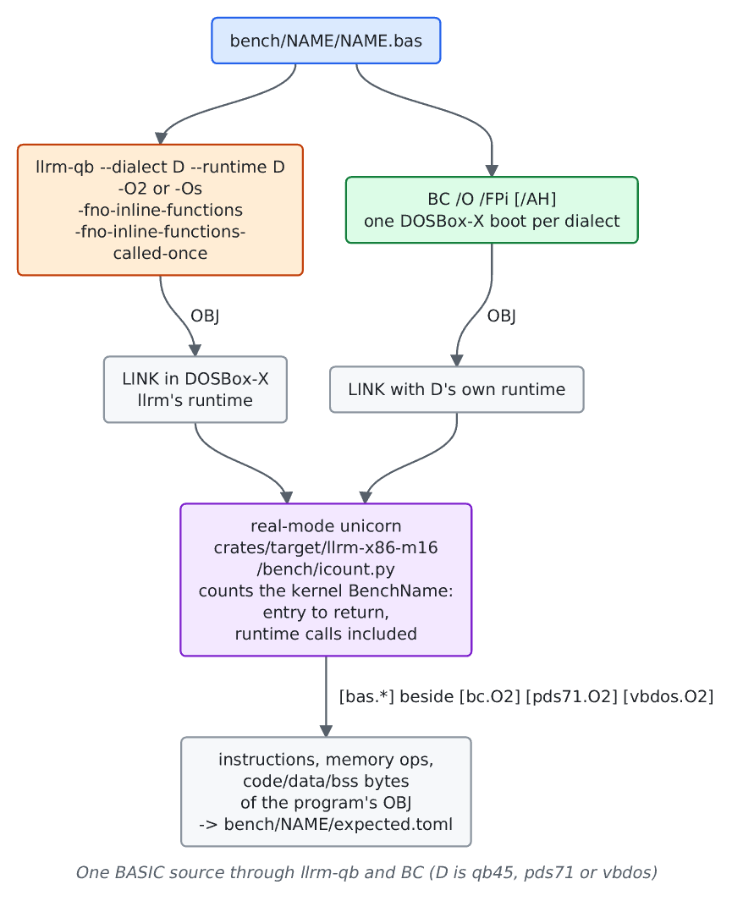

# llrm-qb against Microsoft's BASIC compilers

For maintainers comparing `llrm-qb` with BC of QuickBASIC 4.5, PDS 7.1 and VBDOS: what is measured, the exact commands, and what it cannot say. BC runs in DOSBox-X; its objects are measured by the same real-mode emulator as llrm-qb's.

## Flow

## Generated instructions and size

### What is compared

Executed instructions and memory operands of the kernel, and object bytes, of llrm-qb's BASIC against BC's. BC has one level (`/O`), so `[bc.O2]`, `[pds71.O2]` and `[vbdos.O2]` have no `Os` table; llrm's `[bas.O2]` and `[bas.Os]` are both set against them. The same source on llrm's own runtime, linked by jwlink, has `[bq16.*]` (real mode, same kernel count as `bas`) and `[bq32.*]` (flat under DOS/32A: the whole run's guest instructions in DOSBox on virtual time less the empty start-up program's); neither needs QB45, and `[bq16.*]` is set against the same references. Each BC is given every program, with the dialect of the program's header for llrm; `/AH` is added where the program asks for huge arrays. BASIC is built on llrm-qb's own frames (no `B$ENRA`/`B$EXSA` where the runtime needs no frame); `--runtime-frames` is not benchmarked.

### How

    uv run --project tools python tools/bench/bench.py                       # the gate
    uv run --project tools python tools/bench/bench.py --references          # build BC again; it must equal the stored tables
    uv run --project tools python tools/bench/bench.py --references --time --bless --reason "why"
    python3 tools/dosbatch/qbsizes.py [--work DIR] [source.bas ...]          # linked size against BCOM45's, the runtime included

`--references` needs the three toolchains (QB 4.5's `BC.EXE`, PDS 7.1 and VBDOS), `jwlink` and the DOSBox-X fork. A toolchain that is absent is skipped, and `bas` with it (a `SKIP` line names the variable, e.g. `QB45_DIR`); `bq16` and `bq32` still run.

### What it prints

`bench.py` prints, per language and level, the geomean of llrm over each reference per counter with `n=` the programs both sides have, then `FAIL` lines. `qbsizes.py` prints `LLRMQB.LIB`'s size and one row per program: linked bytes with BCOM45's runtime, with llrm's, their ratio, and `identical` or `DIFFERENT` for the two programs' output.

Example, `bench/sieve/expected.toml` (instructions / code bytes): `bas.O2` 17645 / 280, `bc.O2` 47390 / 360, `pds71.O2` 46364 / 356, `vbdos.O2` 46442 / 360. Every other benchmark is in its own `expected.toml`.

### Which benchmarks

Every directory under `bench/` and `bench/parity/` that has a `.bas`. A program a BC refuses has no row: BC 4.5 refuses the VBDOS-style `FUNCTION f (a AS INTEGER) AS LONG` the `parity` programs use, and VBDOS's BC rejects `parity/sum_three` with a syntax error. `grep` and the jpeg programs are timed only. [bench readme](../../bench/readme.md) lists the layout and `[gaps]` where BASIC lacks an idiom.

### Caveats

- Instruction counts are not cycles. No latency, no cache, no prefetch.
- The kernel count includes the runtime routines the kernel calls, so llrm's and BC's runtimes are compared as well as their code generators.
- Sizes are of the program's own object. BC's runtime cells (`BC_DATA`, `BC_DS`, `BC_SA`) are data in its object; BC leaves `BC_DATA` unloaded (bss) where llrm-qb stores it as zeros (data), so compare data plus bss.
- Programs whose loops BC folds measure BC's folding, not its loop. Give the program inputs the compiler cannot see before reading a ratio, and read the listing before the number ([measuring](../working/measurement/readme.md)).
- `qbsizes.py` compares whole images; the difference is mostly the runtime library.

## Run time

    uv run --project tools python tools/bench/bench.py --time

RDTSC in DOSBox-X at a fixed 75000 cycles per millisecond, net of an empty program built with the same toolchain: `kernel_ms`, recorded in `expected.toml` where measured and gated as a ratio to each reference. Caveats as in [vs-borland-watcom](vs-borland-watcom.md#run-time): DOSBox-X charges about one cycle per instruction, so the time follows the count; it is not a real machine.

## Compile time

Not measured. No tool times BC or llrm-qb.

## Behaviour

Not a performance comparison, but the other place BC is the reference:

- `tests/differential/qb-bc/`: each program compiled by BC 4.5 and by llrm-qb, both run in one DOSBox-X launch. `NAME.out` is what both print; a `' diverges:` header says BC prints something else and only llrm must match. The headers `' bc: SWITCHES` and `' flags: FLAGS` set each compiler's switches. Run: `python3 tools/dosbatch/run_differential.py [NAME]...` or `cargo test --test differential`.
- `tests/differential/conformance/`: the Microsoft BASIC suites of QB 4.5, PDS 7.1 and VBDOS, each case compiled by llrm-qb and linked with that dialect's own runtime. Run: `python3 tools/dosbatch/run_conformance.py [qb45|pds71|vbdos]...`. See [its readme](../../tests/differential/conformance/readme.md).
- `tests/fixtures/callconv/bas/`: llrm-qb's calling convention against BC's `/A` listings ([readme](../../tests/fixtures/callconv/readme.md)).
