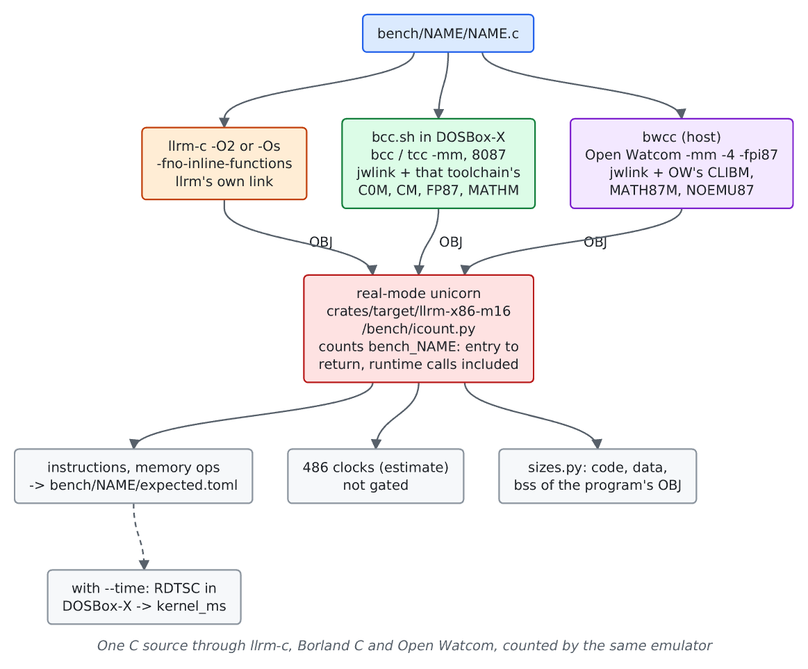

# llrm against the DOS C compilers

For maintainers comparing llrm's 16-bit C output with BCC 3.1, Turbo C 2.01, Turbo C++ 3.0 and Open Watcom: what `tools/bench` builds and counts, the exact commands, and what it cannot say. The reference compilers run in DOSBox-X or on the host; their objects are measured by the same emulator as llrm's.

## Flow

## Generated instructions and size

### What is compared

Executed instructions and memory operands of each benchmark's kernel, and the code, data and bss bytes of its object, per optimisation level (`O2`, `Os`). llrm's C result (`[c.O2]`, `[c.Os]`, built by `llrm-c` for its default 16-bit target with `-fno-inline-functions` and the program's header flags, `-march=i486`) sits beside each reference's table in `bench/NAME/expected.toml`.

| Table | Compiler | Switches (from [bench.py](https://github.com/ali-mosavian/llrm/blob/c341bd6e3de058142c6652d399b8dfeb444eff9b/tools/bench/bench.py#L69)) |
|---|---|---|
| `[bcc.*]` | Borland C++ 3.1 `bcc` | medium model, `-3 -f87`, `-Ox` for O2, `-O1` for Os |
| `[tc.*]` | Turbo C 2.01 `tcc` | `-G -O -Z -r -1 -D__huge=huge` for O2, `-O -Z -r -1 -D__huge=huge` for Os |
| `[tcpp.*]` | Turbo C++ 3.0 `tcc` | `-2 -G -O -Z -r` for O2, `-2 -O -Z -r` for Os (it has no `-3`); linked with BCC's FP87.LIB, its own does not link |
| `[ow.*]` | Open Watcom `bwcc` | `-mm -4 -fpi87`, `-ox -oe=0` for O2, `-os -ol` for Os ([build_watcom](https://github.com/ali-mosavian/llrm/blob/c341bd6e3de058142c6652d399b8dfeb444eff9b/tools/bench/bench.py#L213)) |

Borland's `TCC.EXE` is the driver of both Turbo C and Turbo C++; `tc` and `tcpp` are the two toolchain folders (`tc201`, `tcpp30`). There is no Tiny C Compiler here.

Every reference is built medium model with 8087 floating point and linked with its own start-up and libraries; only `report` comes from the corpus's `ext.asm`. `-oe=0` keeps the kernel a call, as `-fno-inline-functions` does for llrm.

### How

    uv run --project tools python tools/bench/bench.py                       # the gate: llrm against its baseline and the stored references
    uv run --project tools python tools/bench/bench.py sieve --opt O2        # one benchmark (also prints a 486-clock line)
    uv run --project tools python tools/bench/bench.py --references          # build every reference again; it must equal the stored one
    uv run --project tools python tools/bench/bench.py --references --time --bless --reason "why"   # record them

A normal run builds no reference: it reads the stored tables and prints, per language and level, the geomean of llrm over each reference per counter (`instructions`, `memory operands`, `kernel time`, `code bytes`, `data bytes`, `bss bytes`, with `n=` the programs both sides have). `--references` needs Open Watcom (`OW_BIN`, `OW_LIB`), BCC 3.1 (`TOOLCHAINS`), Turbo C and C++ (`TURBO`) and the DOSBox-X fork; a toolchain that is absent is skipped.

### What it prints

`bench.py` prints a `FAIL` line per problem and `N measurements: M problems`. `--json FILE` writes every measurement, `clocks` included. `expected.toml` holds the baselines: per table `instructions`, `memory_operands`, `code_bytes`, `data_bytes`, `bss_bytes` and, where measured under `--time`, `kernel_ms`. A reference's ratio to llrm is gated per counter against its blessed value, so llrm cannot worsen against a reference unnoticed.

Example, `bench/sieve/expected.toml` (`c.O2` is llrm; instructions / code bytes):

| llrm | bcc | tc | tcpp | ow |
|--:|--:|--:|--:|--:|
| 12106 / 146 | 12361 / 152 | 29679 / 173 | 18850 / 130 | 19596 / 122 |

All other benchmarks are in their own `expected.toml`.

### Which benchmarks

Every directory under `bench/` and `bench/parity/` except where a reference cannot build it; such a program has no row, and the geomean covers only the programs both sides have. Known gaps: Open Watcom builds only programs without long arithmetic or floating point (its 16-bit libraries are not built here) and not the file programs (`clibm.lib` cannot link `open`); Turbo C and C++ do not build C `huge` (`__huge`). `grep`, `jpeg_single` and `jpeg_fixed` are timed only (no instruction count). Layout: [bench readme](../../bench/readme.md); the tool: [tools/bench](../../tools/bench/readme.md).

### Caveats

- Instruction counts are not cycles. They model no latency, no prefetch and no cache. Clocks are an estimate from the m32 harness's 486 table, reported not gated.
- BCC runs at `-3`; llrm and Open Watcom at 486; Turbo C 2.01 at `-1` (80186), Turbo C++ 3.0 at `-2` (80286). A ratio against `tc` partly measures the instruction set.
- The counts are of the kernel with runtime calls included, so a library routine (a floating-point or `long` helper) is in the count: a compiler that calls where another inlines is charged for the callee.
- Sizes are of the program's own object, not the image: start-up, `report` and libraries are out. Alignment and the libraries' different code do not enter.
- The reference switches are the ones listed above, not each compiler's best. Choosing others moves the ratio.
- A count below its baseline fails until blessed; the baseline only ratchets, so it is a regression gate, not a ranking.

## Run time

    uv run --project tools python tools/bench/bench.py --time

`--time` runs `tools/bench/timeit.asm`, which reads RDTSC around the whole program, in DOSBox-X at a fixed `cycles=fixed 75000` (75000 cycles per millisecond on any host). An empty-kernel program (`tools/bench/startup/`) is built and timed with each toolchain and level, and its time is subtracted: `kernel_ms`. Recorded in `expected.toml` and gated as a ratio to each reference. The trend over commits is `tools/bench/history.py` and `tools/bench/dashboard.py` ([tools/bench](../../tools/bench/readme.md)).

Caveats: DOSBox-X charges about one cycle per instruction and models no latency, so `kernel_ms` follows the instruction count and tells nothing a count does not. A kernel under about 100 cycles is noise; a change must exceed 1% and 0.001 ms. It is not a measurement of a real 486 or Pentium. The PIT is not used: `TIMER` ticks at 18.2 Hz and DOSBox-X's scheduling tears even a latched read.

## Compile time

Not measured. `tools/bench` times the compiled program, not the compilers. The references run in DOSBox-X, whose timing says nothing about the compiler's speed on hardware.

## Calling convention

[tests/fixtures/callconv](../../tests/fixtures/callconv/readme.md) compares llrm's cdecl and pascal, near and far conventions with BCC 3.1's, by listings and by linking llrm and BCC callers with callees. It judges agreement with BCC's ABI, not speed or size.
