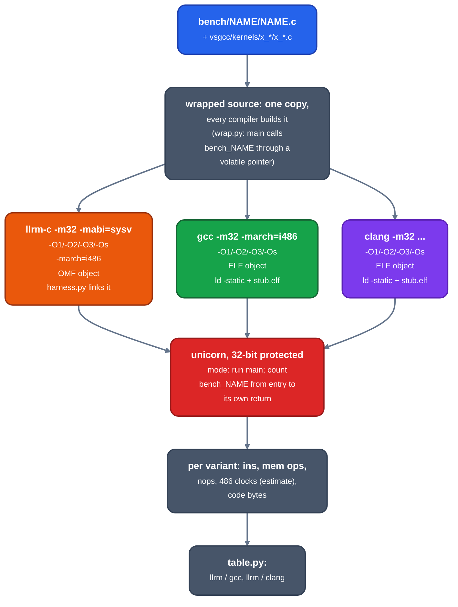

# llrm against gcc and clang

For maintainers comparing llrm's 32-bit x86 (`m32`) output and compile cost with gcc and clang: what each instrument measures, the exact commands, and what it cannot say. gcc and clang are the only competitors measured at `m32`; the DOS compilers are in [vs-borland-watcom](vs-borland-watcom.md) and [vs-basic](vs-basic.md).

No result is kept here. Each tool prints its own table; a number in a document stops being true when the compiler moves.

## Flow



*One C source through llrm-c, gcc and clang, counted in 32-bit unicorn*

Compile time is a separate flow: the same sources go to each compiler under `perf stat`, and only the compile is counted.

## Generated instructions and size

### What is compared

For each program, the work llrm's `m32` object does against gcc's and clang's at `-O1`, `-O2`, `-O3` and `-Os`: executed instructions, memory operands, an estimated 486 clock count, and code bytes. Programs are the `bench/` C sources `programs.py` accepts, plus the `x_*` kernels in `crates/target/llrm-x86-m32/vsgcc/kernels/`, which exist because the bench programs do not exercise every idiom. Left out: `grep` (timed only), `huge` and `textfill` (16-bit only), `parity` (not a program), and in `programs.py` the programs that include `bench_io.h` (`jpeg_*`, `stft_*`: file input, no gcc build).

### How

    crates/target/llrm-x86-m32/vsgcc/run.sh                                  # build llrm-c, every program with every compiler, run, print
    uv run --project tools python crates/target/llrm-x86-m32/vsgcc/harness.py sieve gccO2        # one program, one variant (prints one JSON line)
    uv run --project tools python crates/target/llrm-x86-m32/vsgcc/table.py                      # the tables, from $VSGCC_WORK/results.jsonl
    uv run --project tools python crates/target/llrm-x86-m32/vsgcc/loops.py sieve llrm gccO2 clangO2   # hottest loop, side by side

Variants are `llrm` (that is `-O2`), `llrmO1`, `llrmO3`, `llrmOs` and `gccO1 gccO2 gccO3 gccOs`, `clangO1 ...`. `$VSGCC_WORK` (default `$HOME/scratch/vsgcc-work`, set in `run.sh`) holds products and results. Needs gcc, clang with 32-bit support, GNU `ld`, `uv`. Usage and layout: [vsgcc readme](../../crates/target/llrm-x86-m32/vsgcc/readme.md).

Flags, from [build.sh](https://github.com/ali-mosavian/llrm/blob/c341bd6e3de058142c6652d399b8dfeb444eff9b/crates/target/llrm-x86-m32/vsgcc/build.sh#L22):

- llrm: `llrm-c -m32 -mabi=sysv -O<n> -march=i486`. `VSGCC_ABI` overrides the convention; `sysv` is what gcc and clang use, so the table does not compare register arguments with stack ones.
- gcc and clang: `-Dfar= -m32 -march=i486 -fno-pic -fno-stack-protector -fcf-protection=none -fno-asynchronous-unwind-tables`.
- No `-fno-inline-functions` (`tools/bench` uses it). [wrap.py](https://github.com/ali-mosavian/llrm/blob/c341bd6e3de058142c6652d399b8dfeb444eff9b/crates/target/llrm-x86-m32/vsgcc/wrap.py#L11) makes `main` call the kernel through a volatile pointer in every compiler's copy: the kernel stays a call, nothing is cloned for `main`'s constants, and everything else inlines as the level says. `__attribute__((noinline))` would do the same for gcc and clang, but llrm-c's C front end does not take it.

### What it prints

`harness.py` prints one JSON line: `ins` (executed instructions), `mem` (memory operands, `lea` excluded), `nops`, `clocks`, `code` (bytes of .text) and `data` (.data and .rodata; bss is not counted), `ok` (the program's `report()` values equal its `.out`), `got`. `table.py` prints one row per program, compiler and level (`instr`, `mem ops`, `486 clk`, `nops`, `text+data B`, llrm/gcc and llrm/clang ratios) and, per level and counter, the geomean and worst ratio of llrm over gcc and over clang, with the bench programs and the `x_` kernels as separate groups. It refuses a program that lacks a variant or reports a value other than the `.out`.

`loops.py` prints the hottest natural loop of a kernel per variant, one line per instruction with executions per iteration of the header. Use it to read why a ratio is what it is.

### Instrument

- llrm's OMF is linked by `harness.py` (segments by class, fixups resolved); gcc's and clang's ELF is linked by `ld` at `0x10000`. All variants resolve `report`, `memset`, `memcpy` and `memmove` to one stub (`stub.s`).
- Counted: from `bench_NAME`'s first instruction to the return that pops its own entry frame, callees included. A `rep` string instruction counts once per iteration. This is the convention of `crates/target/llrm-x86-m16/bench/icount.py`, which `tools/bench` uses at 16 bits.
- Alignment `nop`s are counted apart (`nops`): clang pads loops with them.
- Clocks: `cost()` ([harness.py](https://github.com/ali-mosavian/llrm/blob/c341bd6e3de058142c6652d399b8dfeb444eff9b/crates/target/llrm-x86-m32/vsgcc/harness.py#L176)) is a per-mnemonic table of 486 clocks. `mul` and `imul` are data dependent, `10 + max(bits of the multiplier, n)` (Intel 240440-002, i486 data sheet Table 10.1 note 3), and the multiplier is the r/m or immediate operand, not the accumulator. A ratio that rests on an `imul` is not a compiler finding until its operand order is read.

### Caveats

- Instruction counts are not cycles. The clock column is a table, the compiler's own: `cost()` reads each form's clocks from the targets' `timings.times` (`vsgcc/clocks.py`; the few forms it has no row for are listed there) and adds a clock for each operand-size or address-size prefix, which is every 16-bit operation in `m32` and every dword one in `m16`. No address-generation stalls, no cache or memory system, no pairing. It ranks code for an in-order 486; it says nothing about a Pentium or later.
- The rounding of the `imul` early-out's logarithm is not stated by the data sheet.
- `memset`, `memcpy` and `memmove` run in a `rep stosd`/`rep movsd` stand-in, counted per iteration. A real libc differs. The stand-in copies backwards where the ranges overlap (a forward copy once made gcc's and clang's `scroll` print the wrong value).
- gcc and clang are linked with their own 32-bit runtime for the 64-bit divides they call (`libgcc`, compiler-rt), counted in the kernel's callees.
- A tiny kernel's ratio is noise.
- The compiler versions are the host's. llrm's optimisation levels follow gcc 13.4's tables ([levels](../reference/levels.md)); a newer gcc or clang is not the same baseline.
- Only `m32`. The 16-bit target has no gcc or clang.
- The instrument is checked against native silicon by running the same binary under `gdb stepi` on an i386 host; the single-step count differs from the emulator's by the `rep` with `ecx=0`, which `icount.py` skips.
- Tests: `uv run --project tools --group dev pytest crates/target/llrm-x86-m32/vsgcc` after `run.sh`. They check every result against the program's `.out`, the overlapping `memmove`, a kernel inlined into `main` reading zero instructions, the `imul` clock and `enter`.

## Compile time

### What is compared

What llrm-c spends turning C source into an object, against `gcc -c` and `clang -c`, at `-O0`, `-O1`, `-O2`, `-O3` and `-Os`, on the same programs.

### Which instruments

| Question | Command | Counts |
|---|---|---|
| llrm over gcc and clang at every level | `uv run --project tools python crates/target/llrm-x86-m32/vsgcc/levels_time.py [--runs 3] [--extra DIR]` | `instructions:u`, median of runs |
| per-program wall clock at `-O2` and `-Os` | `uv run --project tools python crates/target/llrm-x86-m32/vsgcc/ctime.py` | best of 5 wall-clock runs, ms |
| llrm over gcc per level, and where llrm's instructions go by family | `tools/scoreboard.py [--levels O1 O2] [--json FILE]` | `instructions:u` |
| how the cost grows with program size | `vsgcc/scaling.py` | see [scaling](../../crates/target/llrm-x86-m32/vsgcc/scaling.md) |

What each side runs under `perf stat -e instructions:u` (children included, one process per compile, run under `setarch -R` so address-space layout does not move the count):

```
 llrm-c   one process: C front end (preprocessor included), HIR, MIR passes,
          instruction selection, register allocation, OMF writer
 gcc -c   driver + cc1 (preprocessor and compiler) + as          (3 processes)
 clang -c driver + cc1 with its integrated assembler
 empty.c  compiled the same way at every level: the start-up every ratio includes
```

`levels_time.py` writes `$VSGCC_WORK/levels_time.json` and prints a table of llrm over gcc and over clang per level. `--extra DIR` adds the `*.c` under `DIR` that both gcc and clang accept; the `x_` kernels are always in. Its flags are `-m32 -march=i486 -fno-pic -fno-stack-protector -fcf-protection=none -Dfar=` for gcc and clang ([command()](https://github.com/ali-mosavian/llrm/blob/c341bd6e3de058142c6652d399b8dfeb444eff9b/crates/target/llrm-x86-m32/vsgcc/levels_time.py#L33)). `ctime.py` adds `-fno-inline-functions`, writes `$VSGCC_WORK/ctime.json` and needs `run.sh` to have written the wrapped sources.

`tools/scoreboard.py` compiles the same programs wrapped as vsgcc does, adds gcc's `-fsyntax-only` as its parse cost, and groups llrm's `LLRM_DEBUG=time` rows into families. It compares llrm with gcc only. A file gcc fails on is left out of the ratio and counted. QCport's modules (Open Watcom DOS C, which gcc cannot read) are measured on llrm alone and need `QCPORT` and `QCPORT_INC`.

### Caveats

- Instruction counts are not time. They are stable on a loaded host; `ctime.py` is wall clock and needs an idle machine.
- gcc's count includes the assembler, clang's an integrated one, llrm's has none (it writes the object directly). The comparison is source to object for each.
- Start-up dominates small files: read the ratio net of `empty.c` as well as gross.
- Each tool exits 77 where `perf` cannot count.
- Per-pass costs, regression gating against the merge-base and the in-compiler switches are in [compile-time](../working/measurement/compile-time.md).

## Run time

Not measured. There is no gcc or clang binary run on hardware or in a timed emulator. The 486 clock column above is an estimate from instruction counts and says nothing about wall time.

## d_faces, executed

The programs above are kernels. The file the user's goal is judged on, QCport's `render/d_faces.c`, is run as it is on a seeded scene that reaches each of its paths (`vsgcc/dfaces`, [readme](../../crates/target/llrm-x86-m32/vsgcc/dfaces/readme.md)): llrm, gcc and clang at -O1, -O2, -O3 and -Os, each checked against the hash gcc -O0 reports, counting instructions, memory operands, misaligned operands and 486 clocks inside d_faces alone. The table also carries a `misaligned` column for every program: operands whose address is not a multiple of their size (at most 4).

