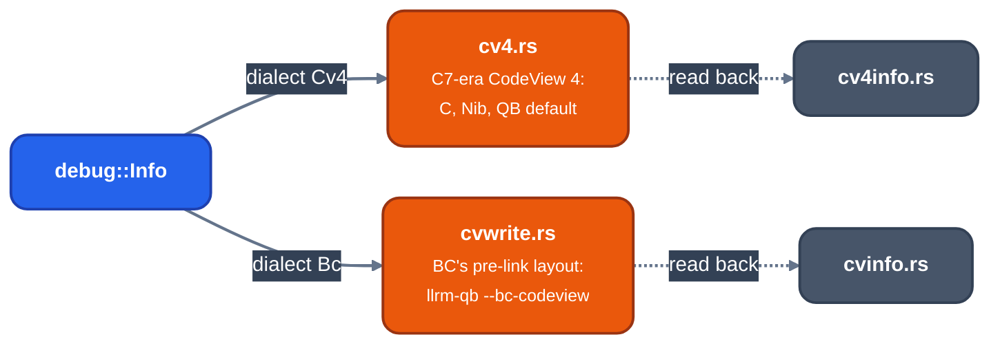
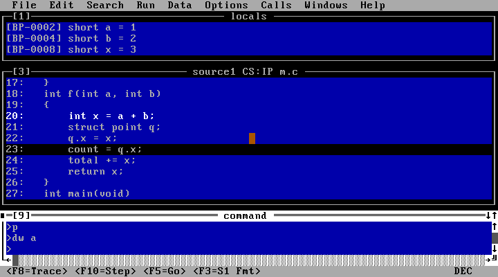
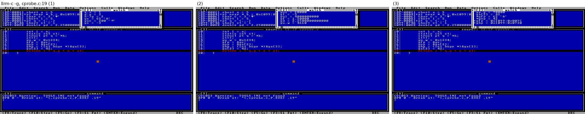
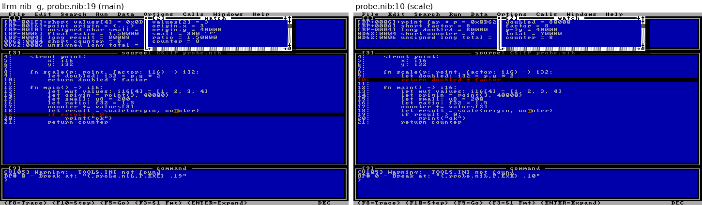
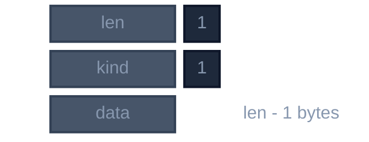
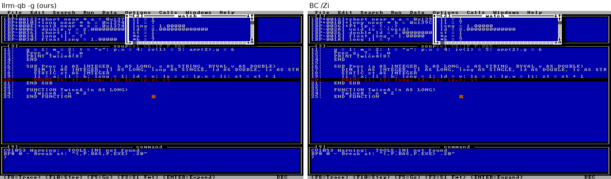
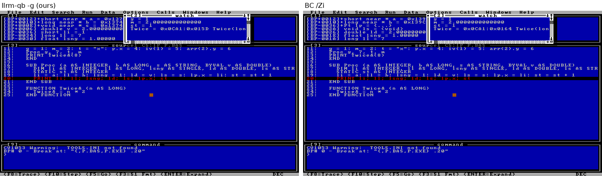
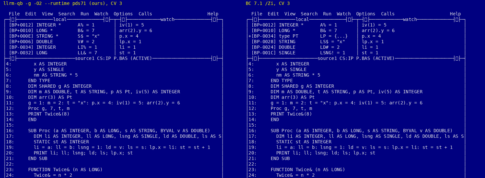
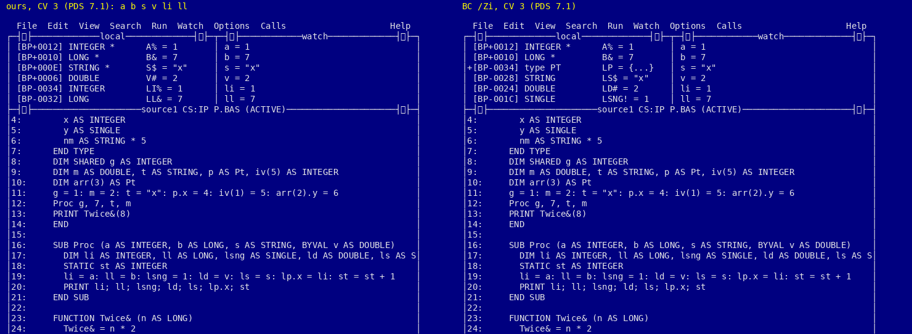
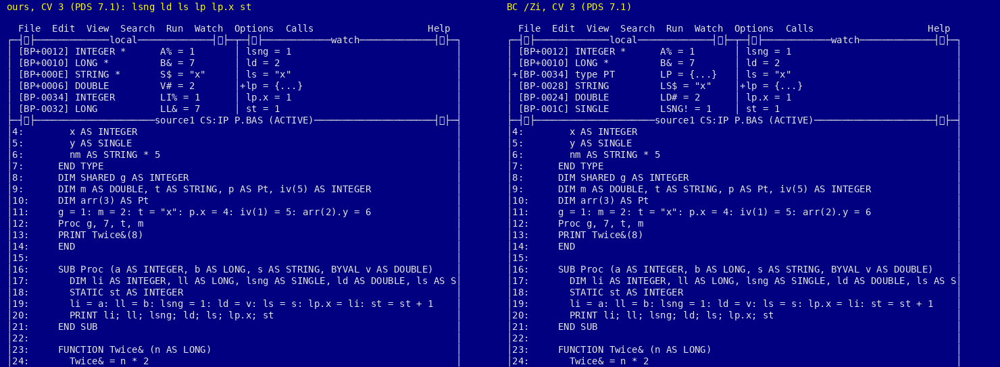

# CodeView in OMF objects

For contributors changing the CodeView writers or reading their output. OMF objects carry CodeView as two
segments, `$$SYMBOLS` (class `DEBSYM`) and `$$TYPES` (class `DEBTYP`), plus LINNUM records and a `CV` marker
COMENT ([omf](omf.md)). The linker (`LINK /CO`, then CVPACK, or `jwlink debug codeview`) turns them into the
packed table a debugger reads. COFF objects carry C13 instead ([debug-info](debug-info.md)).

*Two CodeView dialects of debug::Info*

`codeview::sections` ([source](https://github.com/ali-mosavian/llrm/blob/c341bd6e3de058142c6652d399b8dfeb444eff9b/crates/target/llrm-omf/src/codeview.rs#L216))
picks by `Info.dialect`. Each frontend states it: C and Nib `Cv4`; QB `Cv4`, or `Bc` under `--bc-codeview`.
`Producer::Qb45` adds QuickBASIC 4.5's own references to scalars and `STRING * n`.

## CodeView 4 as C7 writes it (`cv4.rs`)

Records are Open Watcom's `cv4f.h`; each shape was also read from objects ML 6.11 wrote under `/Zi`
(`tests/inputs/cv4/p*.obj`, with sources).

- `$$TYPES` and `$$SYMBOLS` both start with the signature `01 00 00 00`. Type records are `len, leaf, data`,
  each ending on four bytes with `F3 F2 F1` fill; symbol records are `len, code, data`, not padded.
- Types are numbered from 0x1000. A record may name a later index, so a struct that points to itself is
  numbered first (`cv4::Types::structure`).
- `LF_POINTER` is attribute, type and four zero bytes. A pointer to a primitive is the primitive's code with
  the mode in the high byte (near16 1, far 2, huge 3, near32 4) and no record.
- `S_GPROC16`: three zero links, length, debug start, debug end (two bytes each), offset, segment, type,
  flags, name. `S_GPROC32` has four-byte lengths and offset. Offset and segment are one 16:16 fixup, or an
  offset32 and a base.
- Records written: `LF_STRUCTURE`, `LF_UNION`, `LF_ENUM`, `LF_MODIFIER`, `LF_ARRAY`, `LF_BITFIELD`,
  `LF_FIELDLIST`, `LF_PROCEDURE`, `LF_ARGLIST`; `S_GPROC`, `S_LPROC`, `S_BPREL`, `S_REGISTER`, `S_BLOCK`,
  `S_UDT`, statics.
- CodeView 4 names one place per scope: a variable in a register for part of a scope, or removed by the
  optimizer, is left out. A parameter that arrives in one register and stays there for the whole body is an
  `S_REGISTER` (Nib m16 `regparm3`: `b` in EDX); one the code overwrites, or one in a register pair, is not
  written (pairs: [#1368](https://github.com/ali-mosavian/llrm/issues/1368)).

Read by real CodeView (`tests/cv4.rs`, driven in DOSBox-X): enums (`color e = 5`), `const` (`const short k`),
register variables (`SI reg short r = 42`), block scopes (`k` is listed only while the program is in its
block), structs, and a Nib program (`bp add`: the local, and the register parameter `EDX reg long b = 3`). `LINK /CO` runs CVPACK,
which rewrites the table (`NB08` trailer); CodeView then breaks at a function by name.

Still from the Open Watcom headers alone: `LF_UNION` and `LF_BITFIELD` (CodeView accepts them; its locals
window cannot expand them through the debug socket), `LF_ARRAY`'s index type, and the 32-bit records.

### Primitive codes

| code | type | code | type |
|---|---|---|---|
| `0x80` | char | `0x85` | unsigned short |
| `0x81` | INTEGER (short) | `0x86` | unsigned long |
| `0x82` | LONG | `0x88` / `0x89` | SINGLE / DOUBLE |
| `0x84` | unsigned char | `0x8A` | long double |
| `0x97` | STRING (near) | `0x9C` | STRING (far), also `void` |

A pointer's reach byte is `0x74` near, `0x73` far, `0x5E` huge.

## BC's pre-link layout (`cvwrite.rs`, `cvinfo.rs`)

What QuickBASIC's compilers (VBDOS, PDS 7.1, QB 4.5) write under `/Zi` is not CodeView 4: CVPACK translates it,
and fills in the lexical-scope links (`pParent`, `pEnd`, `pNext`). `cvinfo.rs` reads it, `cvwrite.rs` writes
it, and `crates/mc/llrm-omf/src/cvwrite_tests.rs` checks that the writer inverts the reader.

### `$$SYMBOLS`

*A $$SYMBOLS record*

| kind | meaning | data |
|---|---|---|
| `0x00` | module scope | varies by compiler; QB 4.5's has no file name, so the module name is `THEADR`'s |
| `0x01` | SUB or FUNCTION | `offset:u16, proc_type:u16, length:u16, debug_start:u16, debug_end:u16, 0:u16, flags:u8, name` |
| `0x02` | end of scope | none |
| `0x04` | BP-relative parameter or local | `bp_offset:i16, type:u16, name` |
| `0x05` | module-level variable | `offset:u16, segment:u16, type:u16, name` (offset and segment are fixups) |
| `0x0b` | line label | `offset:u16, ?:u8, name` |

`proc_type` indexes the procedure's own signature record in `$$TYPES`. A FUNCTION's return type is read off
the sigil in its name (`%`, `&`, `!`, `#`, `$`); VBDOS drops the sigil from the name. A `CONST` has no
record. QB 4.5 writes a label for each resumable statement under `ON ERROR`.

### `$$TYPES`

*A $$TYPES record*

| tag | meaning | data |
|---|---|---|
| `0x8c` | array | `0x83, element:u16`; never bounds (they are the runtime descriptor's) |
| `0x79 0x86` | structure | `size_bits:u32, 0x85, count:u16, 0x83, field_types:u16, 0x83, field_names:u16, 0x82, namelen:u8, name, 0x69` |
| `0x7f` | list | `(0x83, type:u16)*` (field types or arguments) or `(0x82, namelen, name, 0x85, offset:u16)*` (field names and offsets) |
| `0x76` | BYREF wrapper | `0x83, target:u16` |
| `0x7a 0x74` | pointer | `0x83, target:u16` |
| `0x75 0x80` | procedure signature | `0x83, return:u16, 0x73, nparms:u8, 0x83, arglist:u16` |
| `0x8d 0x00` | `STRING * n` (VBDOS, PDS) | `0x85, length:u16` |
| `0x78 0x86` | `STRING * n` (QB 4.5) | `size_bits:u32, 0x83, 0x0080`; an array of `size_bits` bits of char |

A zero-parameter procedure's argument list points back at `0x0200`. A structure lists its field types and its
names with offsets as two parallel records. A BYREF parameter is two hops on VBDOS and PDS (`0x76`, then
`0x7a`, then the type); BYVAL is the plain type. QB 4.5 names a BYREF scalar by its code plus `0x20`
(`INTEGER` `0xa1`, `LONG` `0xa2`, `STRING` `0xb7`) and an array parameter by a bare `0x7a` pointer.

Packed by `LINK /CO`, the result has an `NBxx` trailer, a subsection directory, real `S_LPROC16`, `S_BPREL16`
and `S_LDATA16` records with scope links, and `sstGlobalTypes` with numbered `LF_` leaves. MS LINK 5.31 (`LINK /CO`) runs
CVPACK and keeps the CodeView 4 records (`tests/cv4.rs`). `jwlink debug codeview` takes them too and Open
Watcom `cvpack` packs its image (`tools/debug-matrix.py`). What the image keeps is pinned in the emulator fork's symbol tests ([`tests/symbols/qb`](https://github.com/ali-mosavian/dosbox-x/blob/main/tests/symbols/qb/README.md)): QB 4.5 LINK 3.69 and PDS LINK 5.10 drop the CodeView 4 records and keep BC-dialect names and offsets; MS LINK 5.31 and jwlink keep CodeView 4.

## Screenshots

`llrm-qb -g --bc-codeview` (left) against BC `/Zi` (right), stopped at the same line. VBDOS's CodeView 4:

PDS 7.1's CodeView 3, which evaluates BASIC:

## Verification

`tests/cv4.rs` (LINK `/CO`, CVPACK and CodeView under DOSBox-X; needs VB/DOS's tools, `LLRM_REQUIRE_CODEVIEW`
makes a missing tool a failure), `crates/mc/llrm-omf/src/cv4_tests.rs`, `cvwrite_tests.rs`, and
`crates/frontends/qb/src/test_debug.rs`. Open items: [#1514](https://github.com/ali-mosavian/llrm/issues/1514),
[#892](https://github.com/ali-mosavian/llrm/issues/892), [#883](https://github.com/ali-mosavian/llrm/issues/883).
