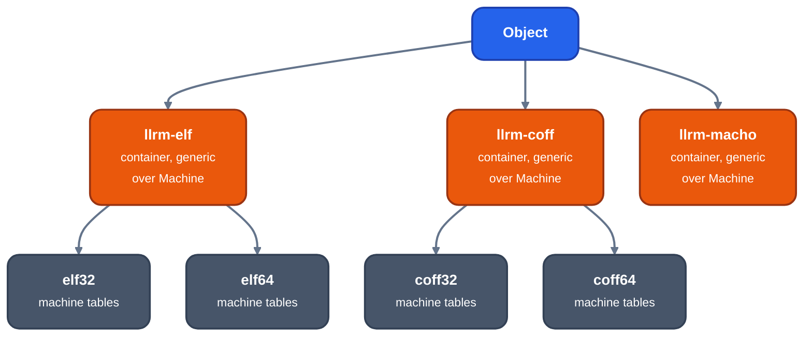

# COFF, ELF and Mach-O

For contributors changing one of the three flat-address writers. Each takes the same [`Object`](object-model.md)
and refuses what only [OMF](omf.md) can say: segments with their own selector (`near == false`), groups,
`Role::Stack`, `SegmentBase` and `FarPointer`.



*One Object, three containers, machine tables below*

## Which exist

| format | crate | machine | reached by a target |
|---|---|---|---|
| ELF32 | `llrm-elf32` | i386, REL | `x86-m32` |
| ELF64 | `llrm-elf64` | x86-64, RELA | none |
| COFF i386 | `llrm-coff32` | `0x14C` | `x86-m32` |
| COFF x86-64 | `llrm-coff64` | `0x8664` | none |
| Mach-O | `llrm-macho` | x86-64 | none |

A writer given an `Arch` other than its own returns `Unsupported`.

## Sections

| role | ELF | COFF | Mach-O (segment, section) |
|---|---|---|---|
| Text | `.text` | `.text` | `__TEXT,__text` |
| ROData | `.rodata` | `.rdata` | `__TEXT,__const`; `__DATA,__const` if it has relocations |
| Data | `.data` | `.data` | `__DATA,__data` |
| Bss | `.bss` (NOBITS) | `.bss` | `__DATA,__bss` (zerofill) |
| Debug | the section's own name | the section's own name, discardable | `__DWARF,__debug_*` |

A further section of a role: ELF `.text.NAME`, COFF `.text$NAME` (the linker merges `$` sections into the
first). Mach-O refuses two sections that would both be the same `(segment, section)`. COFF alignment is a
power of two up to 8192. ELF alignment is at least 4. COFF numbers sections in 15 bits and uses
`LNK_NRELOC_OVFL` for more than 65535 relocations in a section. ELF adds an empty `.note.GNU-stack`.

## Symbols

- ELF: null, `STT_FILE`, one `STT_SECTION` symbol per section, then globals (`STT_FUNC` in text, else
  `STT_OBJECT`; undefined ones `STB_GLOBAL`, no section). A local symbol is its section's symbol plus an
  offset.
- COFF: `.file`, `@feat.00` = 1 on i386 (declares SafeSEH-safe, which a 32-bit link requires), a static symbol
  and an auxiliary entry per section, then the object's symbols, locals as statics. Names over 8 bytes go to
  the string table.
- Mach-O: exported symbols, then undefined ones, each sorted by name; `N_SECT|N_EXT` and `N_EXT`. A local
  symbol is not in the table: a reference to one names its section and the field holds the address. The
  file is not `MH_SUBSECTIONS_VIA_SYMBOLS`, so a code section is one atom and `-dead_strip` keeps the whole
  section.

## Relocation types

| `Kind` | ELF i386 | ELF x86-64 | COFF i386 | COFF x86-64 | Mach-O x86-64 |
|---|---|---|---|---|---|
| `Abs{8}` | | `R_X86_64_64` | | `ADDR64` | `UNSIGNED` (len 3) |
| `Abs{4}` | `R_386_32` | `R_X86_64_32` | `DIR32` | `ADDR32` | `UNSIGNED` (len 2) |
| `Abs{2}` | `R_386_16` | `R_X86_64_16` | | | |
| `Abs{1}` | `R_386_8` | `R_X86_64_8` | | | |
| `PcRel{8}` | | `R_X86_64_PC64` | | | |
| `PcRel{4}` | `R_386_PC32` | `R_X86_64_PC32` | `REL32` | `REL32` (the distance past the field's end is in the field) | `SIGNED`, `SIGNED_1/2/4` (by the total addend, as `X86MachObjectWriter`) |
| `PcRel{2}` | `R_386_PC16` | `R_X86_64_PC16` | | | |
| `PcRel{1}` | `R_386_PC8` | `R_X86_64_PC8` | | | |
| `Branch{4}` | `R_386_PLT32` | `R_X86_64_PLT32` | `REL32` | `REL32` | `BRANCH` |
| `Branch{2}` | `R_386_PC16` | | | | |
| `SectionIndex` | | | `SECTION` | `SECTION` | |
| `SectionOffset{4}` | | | `SECREL` | `SECREL` | |

An empty cell is refused with `Unsupported`. The code is the `Machine::relocation` function of each crate
(for example [`llrm-elf32`](https://github.com/ali-mosavian/llrm/blob/c341bd6e3de058142c6652d399b8dfeb444eff9b/crates/target/llrm-elf32/src/lib.rs#L19)).
Mach-O's table is [`relocation`](https://github.com/ali-mosavian/llrm/blob/c341bd6e3de058142c6652d399b8dfeb444eff9b/crates/target/llrm-macho/src/lib.rs#L103).

## REL and RELA

```
REL  (ELF i386, COFF, Mach-O)         RELA (ELF x86-64)
  entry: offset, symbol|type            entry: offset, symbol|type, addend
  field: addend                         field: zeros
```

ELF writes `S + A - P`, where the model's value is `S + addend - (at + from)`, so the stored addend is
`addend - from` (plus the symbol's offset for a local one). A value that does not fit its field is refused.
COFF always keeps the addend in the field. Mach-O keeps it in the field; a relocation against a local
symbol or a section has `r_extern = 0`, and entries are written last first, as LLVM does.

## Debug information

| format | debug |
|---|---|
| ELF, Mach-O | `llrm_dwarf::expanded` adds DWARF sections; a format other than DWARF is refused ("this object format cannot carry CodeView") |
| COFF | CodeView C13: `.debug$S` and `.debug$T` (`llrm-coff/src/codeview`), whichever `-g` flavor is asked |

Mach-O names are `__debug_info` and so on in segment `__DWARF`. An offset of one debug section into another
is written as the offset itself, unrelocated, as `dsymutil` reads it. Details: [debug-info](debug-info.md).

## Linkers

| object | linker | recipe |
|---|---|---|
| ELF32 | GNU ld, `-m elf_i386` | `[link.elf]` in `x86-m32`'s `object.toml` |
| COFF i386 | `lld-link` (or `link.exe`), machine `x86` | `[link.coff]` |
| Mach-O | `ld64.lld` | tests only |

## Verification

- Unit tests in each crate check headers, relocation entries and the folded addends.
- `tests/objwriters.rs`: `readelf` and `objdump` accept every bench program's ELF object; `llvm-readobj` and
  `llvm-objdump` accept every COFF object and read its CodeView; `lld-link` makes a PDB of a C program and
  links an llrm object with a `clang-cl` object.
- `llrm-coff32`: `lld-link` links an object and the call reaches its target.
- `llrm-elf64`: GNU ld links a hand-built object and it runs.
- `llrm-macho`: `llvm-objdump` reads the object as it reads `llvm-mc`'s of the same assembly, and `ld64.lld`
  links it with a `clang` object.
- `tests/dwarf.rs`: gdb on an ELF program linked by GNU ld.

Known gaps: Mach-O has no `LC_BUILD_VERSION`, a 32-bit absolute address is `UNSIGNED` and needs a non-PIE
link, and arm64 would need `r_extern = 1` only and `ARM64_RELOC_ADDEND`. COFF has no COMDAT
([#767](https://github.com/ali-mosavian/llrm/issues/767)).

x86-64 COFF (`.pdata`/`.xdata` from the declared `.seh_*`) and Mach-O (`__compact_unwind`, `__eh_frame`) are library-only
(`objbuild::built_in`): `llrm-x86-m64`'s `object.toml` lists `elf` alone. Post-main item, 2026-10-29: `formats`, link
recipes and the Win64 calling convention.
