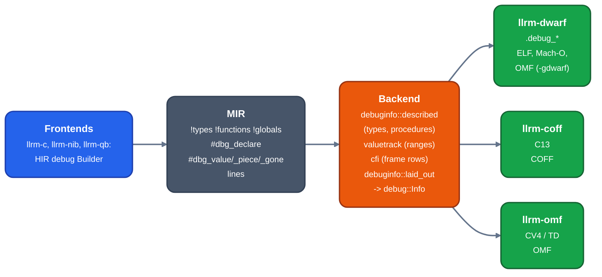

# Debug information

For contributors changing `-g`, its model or a writer. Debug information is built once, in a format-neutral
model, and each object format's writer encodes it. State described here is the code at commit `c341bd6e3`.

*Debug information from frontend to writers*

## The model

[`llrm_object::debug::Info`](https://github.com/ali-mosavian/llrm/blob/c341bd6e3de058142c6652d399b8dfeb444eff9b/crates/target/llrm-object/src/debug.rs#L85)
rides on `Object.debug`:

| field | holds |
|---|---|
| `format` | `Default`, `CodeView`, `Dwarf{version}`, `TurboDebugger` |
| `language`, `dialect`, `producer` | C, Basic or Nib; CodeView 4 as `Bc` or `Cv4`; `Qb45` or `Native` |
| `frame_register`, `frame_base` | what a `Location::Frame` is relative to (below) |
| `return_register` | the target's `pc`-class register, named by call frame information |
| `registers` | the target's register file with its DWARF and CodeView numbers, so a writer needs no target |
| `files`, `lines` | source files (optional checksum) and `(section, offset, file, line, column)` |
| `code`, `functions`, `globals`, `types` | code ranges, functions, module variables, a type arena |

A `Function` has its symbol, ranges, `body` (start and end of the code after the prologue), `far`,
parameters and locals as `Variable`s, nested `Block`s, and `frame: Vec<FrameRow>`. A `Variable` has a
`Location`:

| `Location` | meaning |
|---|---|
| `Frame{disp}` | a cell, relative to the frame register as the code would set it |
| `Register(name)` | a register of the target |
| `List([(Range, Location)])` | where it is over each range of code |
| `Static{symbol, disp}` | data |
| `Relative{register, disp}` | a cell off a named register |
| `Constant(v)`, `Pieces([...])` | a known value; parts of it in several places |

`Info::size_of` and `Location::settled` are the shared helpers: `settled` is the one place a list ends in at
the scope's end, for a format that names one place per scope.

`FrameBase::Register` is the frame register the code keeps. `FrameBase::Cfa{bias, far_bias}` is the
canonical frame address; the code keeps no register for it and a debugger finds the cell from the caller's
frame, which call frame information gives at every address. A format that finds cells this way sets
`CFA_LOCATIONS`; a format that says where a value is over code ranges sets `LOCATION_RANGES`:

| writer | `LOCATION_RANGES` | `CFA_LOCATIONS` |
|---|---|---|
| `llrm-dwarf` | yes | yes |
| `llrm-coff` (C13) | yes | no |
| `llrm-omf` (CV4, Turbo Debugger) | no | no |

[`Options::location_ranges` and `cfa_locations`](https://github.com/ali-mosavian/llrm/blob/c341bd6e3de058142c6652d399b8dfeb444eff9b/crates/backend/llrm-core/src/driver/mod.rs#L85)
pick the writer from the object format and the `-g` flavor, and the backend builds `Info` for that writer.

## From source to `Info`

1. A frontend describes types, procedures and variables through `llrm_hir::debug::Builder`, which lowers to
   MIR metadata (`llrm_mir::debuginfo`: named metadata `TYPES`, `FUNCTIONS`, `GLOBALS`). A frame variable is
   an `#dbg_declare` of its alloca; `#dbg_value`, `#dbg_piece` and `#dbg_gone` are a side table the edit
   points of the optimizer keep true, not instructions. A pass that cannot keep one true drops it.
2. [`debuginfo::described`](https://github.com/ali-mosavian/llrm/blob/c341bd6e3de058142c6652d399b8dfeb444eff9b/crates/backend/llrm-core/src/backend/debuginfo.rs#L172)
   reads the metadata into types and procedures. [`laid_out`](https://github.com/ali-mosavian/llrm/blob/c341bd6e3de058142c6652d399b8dfeb444eff9b/crates/backend/llrm-core/src/backend/debuginfo.rs#L346)
   adds each procedure's place, variables, lines and frame rows once the code is laid out.
3. A parameter that arrives in one register is noted at the function's entry (`noted` in `isel.rs`) and
   tracked from there like any variable the code moves. Nib m16 `regparm3`: CodeView 4 gets `S_REGISTER` where
   the register holds it for the whole body; a parameter the code overwrites has no one place and is left
   out; DWARF gets its ranges. A parameter in two registers (a pair) is still left out
   (at `-O0` no frontend produces one; with optimization [#1368](https://github.com/ali-mosavian/llrm/issues/1368)). Tests:
   `crates/frontends/nib/src/test_debug.rs`, `tests/cv4.rs`.
4. `valuetrack.rs` follows the emitted code along every path (LLVM's instruction-referencing
   LiveDebugValues): isel marks which instructions define a named value, masm marks where each landed, and
   the tracker says where each variable is, in a register or a cell. Where the code cannot be followed or the
   value is nowhere, the variable has no location: `<optimized out>`, never a wrong one.
5. `cfi.rs` decodes the emitted code and follows it to give each function's frame rows: from an offset on,
   the frame address is `cfa_offset` past `cfa_register`, and each register in `saved` is in memory at an
   offset from it. A function whose paths reach one place at two stack depths has no rows.
6. A writer encodes `Info` and refuses by name what it cannot say (`Unsupported`); it does not drop it.

**`-g` never changes the code.** What a format cannot say is left out, gcc's way. A format with one place
per scope (CodeView 4, Turbo Debugger) says a variable only where one place holds it for the whole scope: a
cell, or one register the code keeps it in from its first value to the end of the body. A variable in
several places is left out, and no store is added to make it sayable. `tools/g-identical.sh` and the tests `g_leaves_the_code_of_the_bench_programs_alone` and
`g_leaves_the_code_of_the_basic_and_nib_bench_programs_alone` (`tests/dwarf.rs`) hold the rule.

## Clang's debug nodes in MIR

The MIR parser and printer carry what clang writes for `-g`, unchanged: specialized nodes (`!DILocation(line: 3, column: 5, scope: !10)`,
`DISubprogram`, `DILocalVariable`, `DIBasicType`, `DIDerivedType`, `DICompositeType`, `DIEnumerator`, `DISubrange`, `DIGlobalVariableExpression`,
`DIExpression`...; `Module.special` names each node's kind and fields, its operands are the values in order, flag sets such as `A | B` are
words), `#dbg_declare(ptr %x, !var, !DIExpression(), !loc)` records (`DebugRecord.expression`, `.location`), and `!dbg !N` on a `define` or a
variable (`Function.metadata`, `Module.global_metadata`). Nothing reads them yet: turning them into the model above is the next step
(the import and the writer are the following steps). Test: `crates/ir/llrm-mir/tests/di_roundtrip.rs`.

## Flags

The flags are in `Flags::take` ([source](https://github.com/ali-mosavian/llrm/blob/c341bd6e3de058142c6652d399b8dfeb444eff9b/crates/backend/llrm-core/src/driver/flags.rs#L244)),
shared by `llrm-c`, `llrm-nib`, `llrm-qb` and the other bins that take compiler flags.

| flag | effect |
|---|---|
| `-g` | debug information in the object format's own format |
| `-g0` | none |
| `-gcodeview` | CodeView: refused on ELF and Mach-O |
| `-gdwarf`, `-gdwarf-5` | DWARF 5; `-gdwarf` alone is the target's `dwarf_version` (`object.toml`: 2 for `x86-m16`, else 5) |
| `-gdwarf-4`, `-gdwarf-3`, `-gdwarf-2` | that version |
| `-gtd` | Turbo Debugger records: 16-bit OMF only |

`-fobject-format=omf|elf|macho|coff` picks the object ([object-model](object-model.md#choosing-a-format)).
`llrm-qb` also has `--bc-codeview`: the BASIC-compiler dialect of CodeView 4 rather than the standard one.
`-gdwarf-1` is unrecognized.

## What each combination emits

| object | `-g` | `-gcodeview` | `-gdwarf*` | `-gtd` |
|---|---|---|---|---|
| OMF, 16-bit | CodeView 4 | CodeView 4 | DWARF 2 default, `.debug_*` segments | Turbo Debugger |
| OMF, 32-bit | CodeView 4 | CodeView 4 | DWARF 5 default | refused: 16-bit records |
| ELF | DWARF | refused | DWARF | refused |
| COFF | CodeView C13 | C13 | C13 (the flavor is not consulted) | C13 |
| Mach-O | DWARF | refused | DWARF | refused |

CodeView 4 has two dialects, chosen by the frontend through `Info.dialect`: `Cv4` as C7-era tools write it
(C, Nib, and QuickBASIC by default) and `Bc` as BASIC's compilers write it (`--bc-codeview`). See
[codeview](codeview.md). Turbo Debugger: [turbo-debugger](turbo-debugger.md). OMF layout: [omf](omf.md).

What each writer says, refused or left out:

| writer | says | refuses by name |
|---|---|---|
| DWARF 2-5 | units, base and derived types, structs, enums, typedefs, qualifiers, pointers with address class, functions, blocks of one range, location lists (`.debug_loc`, `.debug_loclists`), pieces, line program (`DW_LNS_*`, MD5 checksums in 5), `.debug_aranges`, `.debug_frame` | BASIC's `STRING`, `CURRENCY` and `STRING * n` (a BASIC array is said as its descriptor struct); a function in several ranges; a module of several code ranges; a block of several ranges |
| C13 | `S_GPROC32`/`S_LPROC32`, `S_LOCAL` with `S_DEFRANGE_REGISTER_REL` or `S_DEFRANGE_REGISTER`, `S_BLOCK32`, `S_GDATA32`/`S_LDATA32`, `S_UDT`, lines with columns, types as `LF_*` | far and huge pointers, BASIC's types, a function or block in several ranges, a register with no CodeView number, a far function |
| CV4 (C7) | procedures, parameters and locals, statics, enums, modifiers, register variables, blocks, structs | 64-bit integers and bools have no scalar code |
| Turbo Debugger | scopes, frame variables, register variables, statics, structs, pointers, arrays, typedefs and tags, lines | enums, a bit field beside padding, a block of several ranges, a function in several ranges, a type past 64K, a register with no Borland number, 32-bit objects (the variable is left out where it is the variable alone that cannot be said) |

## Known gaps

- Module-level BASIC variables are missing from CodeView unless `--bc-codeview`, and have no size
  ([#1514](https://github.com/ali-mosavian/llrm/issues/1514)).
- A parameter in two registers (a pair) has no CodeView record; at `-O0` no frontend produces one, with optimization it is
  [#1368](https://github.com/ali-mosavian/llrm/issues/1368).
- Turbo Debugger: register locals of unsupported registers, enums, bit fields beside padding, types past 64K
  ([#823](https://github.com/ali-mosavian/llrm/issues/823)).
- COFF: COMDAT, `S_FRAMEPROC`, inlinee lines, multi-range functions
  ([#767](https://github.com/ali-mosavian/llrm/issues/767)).
- `far` belongs on the procedure type, not only on the function
  ([#846](https://github.com/ali-mosavian/llrm/issues/846)).
- `.debug_frame` has no Mach-O section name, so a Mach-O object whose functions have frame rows is refused.
- The full matrix of frontend, bit width, object and flavor, and which reader accepts each:
  [#1338](https://github.com/ali-mosavian/llrm/issues/1338); `python3 tools/debug-matrix.py` prints it.

No gap by construction: BASIC's CodeView dialect has no register record (QB locals are always cells, at every level); its array type is element-only, without bounds; `jwlink` reads COFF CodeView only as old CodeView 4, so link the OMF object instead. Waiting on others: QuickBASIC `-m32` on the runtime ABI ([#1160](https://github.com/ali-mosavian/llrm/issues/1160)); Turbo Debugger for QuickBASIC is not checked.

## Linkers and readers

| output | consumed by |
|---|---|
| CodeView 4 in OMF | `jwlink debug codeview` plus Open Watcom `cvpack`; Microsoft LINK `/CO` plus CVPACK |
| DWARF in OMF | `jwlink` (`debug dwarf`), read by `llvm-dwarfdump` and Open Watcom `wdump` (16-bit) |
| Turbo Debugger | Borland `TLINK /v`, read by `TDUMP` and Turbo Debugger |
| DWARF in ELF | GNU ld, read by gdb and `llvm-dwarfdump` |
| C13 in COFF | `lld-link` (PDB), read by `llvm-pdbutil` |

## Verification

| check | what it proves |
|---|---|
| `tests/dwarf.rs` | `llvm-dwarfdump --verify` accepts every bench program at both ends of the optimizer; gdb stops at lines and reads parameters, locals, struct fields and the return type, and the values at `-O2` and `-O3` equal `-O0`'s; backtraces through a function with no frame register; the flavor asked for is the format's or an error; DWARF in OMF links by jwlink into LE and MZ images that LLVM and `wdump` read; `-g` leaves the code alone |
| `tests/cv4.rs` | LINK `/CO` and CVPACK take an llrm object and CodeView, driven under DOSBox-X, shows variables, enums, constants, register variables and block scopes; Nib too |
| `tests/turbo.rs` | `TLINK /v` and `TDUMP` agree with Turbo C++ on the module table; Turbo Debugger shows the same watch values |
| `tests/objwriters.rs` | LLVM tools read every bench COFF object and its CodeView; `lld-link` makes a PDB |
| `crates/mc/llrm-dwarf/src/tests.rs` | unit headers, relocations, line table, frame rows, `llvm-dwarfdump --verify` per class and version |
| `tools/dwarf-coverage.sh llrm-c` | per level, how many source variables have a location and what share of their scope bytes it covers, against gcc |
| `tools/debug-matrix.py` | the matrix of #1338; every OMF DWARF cell is valid under `jwlink` and `wdump` (which reads DWARF 2 and 3 only, so OMF cells use `-gdwarf-2`; 32-bit `-gdwarf 4`/`5` crashes `wdump`) |
| the emulator fork's symbol tests ([`tests/symbols/qb`](https://github.com/ali-mosavian/dosbox-x/blob/main/tests/symbols/qb/README.md)) | QuickBASIC images at `-m16` and `-m32` (under DOS/32A, linked with `jwlink`) read in the debugger with `-gcodeview` and `-gdwarf`: locals, and by-reference parameters read through their pointers |

Tests that need a tool skip by name and fail where `LLRM_REQUIRE_DWARF`, `LLRM_REQUIRE_TURBO`,
`LLRM_REQUIRE_CODEVIEW` or `LLRM_REQUIRE_WDUMP` is set (`tools/debug-gate.env`). Turbo Debugger and
CodeView are driven by the DOSBox-X debug socket ([turbo-debugger](turbo-debugger.md#driving-it)); [debugging](../working/debugging.md) covers using symbols in it.
