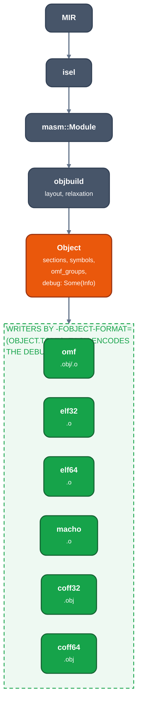

# Object model

For contributors changing a writer or the backend's object layout. The backend lays code and data out
once as a format-neutral `Object`; one writer crate per format serializes it.



*From MIR to an object file*

`objbuild::written_in` ([source](https://github.com/ali-mosavian/llrm/blob/c341bd6e3de058142c6652d399b8dfeb444eff9b/crates/backend/llrm-core/src/backend/objbuild.rs#L434))
builds the `Object` and calls the writer for the chosen format and the object's `Arch`. A pair with no
writer returns `Unsupported`.

## The model

`crates/mc/llrm-object/src/lib.rs`:

```
Object   { name, arch: I8086|I386|X8664, sections, symbols, omf_groups, debug: Option<debug::Info> }
Section  { name, role: Text|ROData|Data|Bss|Stack|Debug, near, align, image, spans, relocs }
Reloc    { at, kind, target, addend }
Kind     = Abs{width} | PcRel{width, from} | Branch{width}
         | SectionIndex | SectionOffset{width} | SegmentBase | FarPointer      (non_exhaustive)
Target   = Symbol(i) | OmfGroup(i) | Section(i)
Symbol   { name, binding: Public|Local, definition: Defined{section, offset}|Undefined, group }
```

- `image` holds zeros where a relocation patches; `spans` are the `[start, end)` ranges that hold data, the
  rest is zeros a format may leave unstored. A `Bss` image is zeros.
- The addend is explicit. A writer places it in the field (OMF, ELF REL, COFF, Mach-O) or in the entry
  (ELF RELA).
- A pc-relative value is `S + addend - (at + from)`. An x86 call has `from` equal to the field's width.
  Each writer folds what its relocation type already subtracts: ELF's addend is `addend - from`, COFF's
  field is `addend - (from - baked)` (`REL32`: 4), Mach-O's `addend - beyond` with `SIGNED_1/2/4`.
- `Branch{width}` is `PcRel{width, from: width}` for the formats that tell a branch from a data reference:
  Mach-O `BRANCH`, ELF `PLT32`.
- `SectionIndex` and `SectionOffset` are COFF's `SECTION` and `SECREL`.
- `Target::Section` names the start of a section: what a DWARF section refers to another one by.
- A reference to a symbol an object keeps local is the same `Target::Symbol`; each writer says it its way:
  OMF a fixup against the segment, ELF the section symbol plus an offset, COFF a static symbol, Mach-O a
  section reference with the address in the field.
- `SegmentBase`, `FarPointer`, `OmfGroup`, `Role::Stack` and `near == false` exist for OMF. A writer that
  cannot say a fact returns `Unsupported(what)`; it never writes a near substitute. `Symbol.group` is OMF's
  frame hint; the other writers ignore it.
- `Arch::bits()` is 16, 32 or 64; OMF writes 16 and 32.

Not in the model: arm64 instruction fields, weak and hidden symbols, symbol sizes, a difference of two
symbols, COMDAT.

## Choosing a format

A target's `object.toml` lists `formats` and a `default`. `-fobject-format=omf|elf|macho|coff` picks one
([`ObjectFormat::choose`](https://github.com/ali-mosavian/llrm/blob/c341bd6e3de058142c6652d399b8dfeb444eff9b/crates/target/llrm-target/src/object.rs#L102));
without it the default applies. A format the target does not list is refused with the list it has.

| target | formats | default | writers reached |
|---|---|---|---|
| `x86-m16` | omf | omf | `llrm-omf` |
| `x86-m32` | omf, elf, coff | omf | `llrm-omf`, `llrm-elf32`, `llrm-coff32` |

`llrm-elf64`, `llrm-coff64` and `llrm-macho` are written and unit-tested, and `objbuild` dispatches
`X8664` objects to them, but no target selects them. Per-format layout: [OMF](omf.md),
[COFF, ELF and Mach-O](coff-elf-macho.md). Debug information: [debug-info](debug-info.md).

## Writers

| format | crate | container | machine crate |
|---|---|---|---|
| OMF | `llrm-omf` (`write`) | records | none; 16- and 32-bit by `Arch` |
| ELF | `llrm-elf` | sections, symtab, REL/RELA | `llrm-elf32` (i386), `llrm-elf64` (x86-64) |
| COFF | `llrm-coff` | sections, symbols, relocations | `llrm-coff32`, `llrm-coff64` |
| Mach-O | `llrm-macho` | one segment, nlist | x86-64 only, in the crate |

ELF and COFF are generic over a `Machine` trait that gives the machine number, the relocation type for each
`Kind` and, for ELF, REL or RELA.

## Debug information

`Object.debug` is `llrm_object::debug::Info`, built once by the backend and encoded by each writer. See
[debug-info](debug-info.md). A writer refuses what it cannot say, by name; `Role::Debug` marks the sections
a writer makes of it.
