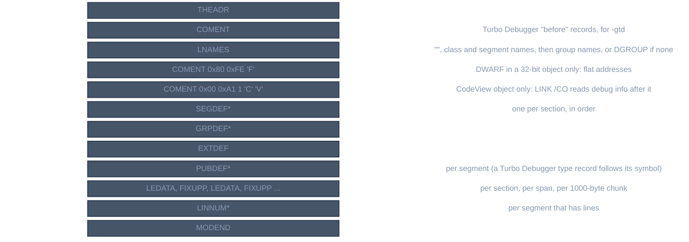

# OMF

For contributors changing the OMF writer or reading its output. OMF (Intel Object Module Format, as
Microsoft and Open Watcom linkers take it) is the default object format of both x86 targets.

## Record layout

*An OMF record*

`llrm-omf/src/omf.rs` reads, edits and emits records (`Record`, `parse`, `emit`). A record keeps its raw
bytes, so a file read and written again is identical. The odd twin of a type (`type + 1`) is its 32-bit
form: `SEGDEF`, `PUBDEF`, `LINNUM`, `FIXUPP`, `LEDATA`, `MODEND`.

| type | record | the writer's use |
|---|---|---|
| 0x80 | THEADR | source name |
| 0x88 | COMENT | CodeView marker, DWARF flat-address directive, Turbo Debugger records |
| 0x8A | MODEND | end, no start address |
| 0x8C | EXTDEF | one record of every undefined symbol |
| 0x90 | PUBDEF | defined public symbols, one record per segment |
| 0x94 | LINNUM | line numbers per segment |
| 0x96 | LNAMES | class, segment, group names |
| 0x98 | SEGDEF | one per `Section` |
| 0x9A | GRPDEF | one per `OmfGroup` |
| 0x9C | FIXUPP | relocations of the LEDATA or COMDAT before it |
| 0xA0 | LEDATA | data of a `[start, end)` span |
| 0xC2 | COMDAT | the data of a section listed in `Object::omf_comdat` (0xC3 for 32 bits) |
| 0xC4 | LINSYM | line numbers of a COMDAT, by its name (0xC5 for 32 bits) |

## Layout of an object

*Layout of an OMF object, first record on top*

The writer is [`llrm_omf::write::write`](https://github.com/ali-mosavian/llrm/blob/c341bd6e3de058142c6652d399b8dfeb444eff9b/crates/target/llrm-omf/src/write.rs#L273).
It takes an [`Object`](object-model.md) and returns bytes, or `Error::Unencodable(what)`.

## Segments, classes and groups

A `Section` is a SEGDEF. Its class name comes from its role:

| role | near | class |
|---|---|---|
| Text | any | `CODE` |
| ROData | any | `CONST` |
| Data | yes / no | `DATA` / `FAR_DATA` |
| Bss | yes / no | `BSS` / `FAR_BSS` |
| Stack | any | `STACK` |
| Debug | `$$SYMBOLS` / `.debug_*` / other | `DEBSYM` / `DWARF` / `DEBTYP` |

Alignment follows the widest item in the segment: word up to 2 bytes, dword up to 4, otherwise paragraph.
A 32-bit segment is dword aligned at least. A segment reached by its own selector (`near == false` data) is
paragraph aligned. A stack segment is `STACK`-combined. A DWARF segment is byte aligned, public, so the linker
joins modules end to end. A 16-bit segment of 0x10000 bytes sets the big bit. A 32-bit object uses
`SEGDEF` + 1 and `USE32`.

An `OmfGroup` is a GRPDEF listing its member segments by index. Without a group, the name `DGROUP` is still
entered in LNAMES.

`CodeLayout::PerProcedure` (in `objbuild`) makes a section for each procedure and lists them in
`Object::omf_comdat`, so the linker drops each procedure nothing calls (jwlink's `option eliminate`, Microsoft's
/PACKFUNCTIONS). The writer gives each a COMDAT, as MSC's /Gy and Watcom's -zm do: an empty SEGDEF of the
code's class to be placed in, then a COMDAT record naming the function, allocated explicitly in that segment, with
its FIXUPPs after it and its lines as a LINSYM. The COMDAT defines the symbol, so there is no PUBDEF for it; a
fixup that reaches it (a call, a debug address) names an EXTDEF of the same name. A local function's name gets
`$` and a 64-bit key of the object's name and everything it holds (not its debug sections), because a linker
finds a local COMDAT by no external and two modules' locals may share a name, two objects of one name (an `m.nib`
in two directories) included.

A module's imports are its EXTDEFs less its own COMDATs (`omf::imports`): `llrm-nib --used-by` cuts the runtime to
what a program imports, and a program's own COMDATs are not that.

A segment per procedure of one name was tried first and is wrong for Microsoft's LINK 5.31: it reads the SEGDEFs of
one name in an object as one segment, keeps the length of the last, and rejects each procedure longer than it
(L1103, #899); hiding the error leaves the image without the code of the rest.

## Relocation fixups

A FIXUPP follows the LEDATA it patches. A subrecord is a location, a fix-data byte, a frame datum and a
target datum.

*A FIXUPP subrecord*

| `Kind` | location | mode |
|---|---|---|
| `Abs{2}` | offset16 | segment-relative |
| `Abs{4}` | offset32 | segment-relative |
| `SegmentBase` | base | segment-relative |
| `FarPointer` | pointer 16:16 | segment-relative |
| `PcRel{w, from: w}` and `Branch{w}`, w = 2 or 4 | offset16 / offset32 | self-relative |

Any other kind, such as `PcRel` with `from != width`, is refused. The target is a segment (a defined symbol,
with the symbol's offset added to the field), a group, or an external (EXTDEF index). A segment-relative
offset to a symbol in a group takes the group as its frame, and so does a segment address in a debug
section (`$$SYMBOLS`, `.debug_*`): jwlink writes the frame's group index, and a frame that is the segment
itself, where the segment is not first in its group, gives it 0 (a CodeView variable at segment 0). Everything
else uses the target's frame. The
field holds the addend plus the symbol's own offset. A fixup is never split across LEDATA records: a record
that would end inside a field ends before it. LEDATA records hold at most 1000 bytes, because a fixup's
offset into its record has ten bits.

## Symbols

Public symbols are PUBDEFs per segment (group index, segment index, then name, offset, type 0). Undefined
symbols are one EXTDEF. Local symbols are not written. Names are counted strings, Latin-1.

## Debug information

| `-g` flavor | what the writer adds |
|---|---|
| CodeView (default) | two segments `$$SYMBOLS` (`DEBSYM`) and `$$TYPES` (`DEBTYP`), LINNUM records, the `CV` COMENT |
| `-gdwarf[-N]` | `.debug_*` segments of class `DWARF`, joined and relocated by the linker; the LINNUM records are also written |
| `-gtd` | Borland COMENT classes 0xE1-0xEA among the other records, 16-bit objects only |

Formats: [debug-info](debug-info.md), [codeview](codeview.md), [turbo-debugger](turbo-debugger.md).

## Linkers

OMF objects are linked by Open Watcom's `jwlink`/`wlink` (the targets' `object.toml` `[link]` tables give
the directives), or by Microsoft LINK for CodeView (`/CO`, then CVPACK). DWARF in OMF is read from the image
by `llvm-dwarfdump` and, for 16-bit, `wdump`.

## Reading and BC objects

`omf.rs` also parses what other tools write: names, segments, groups, EXTDEF and PUBDEF, LEDATA and fixups
with threads. It refuses a module with LIDATA, COMDAT or 32-bit records
(`omf::refusals`), because its decoders read 16-bit forms.

`llrm-omf` (`src/bin/llrm-omf.rs`, `crates/driver/llrm-bcdriver`) takes the objects QuickBASIC's BC wrote and
compiles them again through the optimizer and backend: `llrm-omf OBJ... -o OUT [--manifest M]
[-march=CPU]`, where the objects are one program and a `.lib` argument is the runtime, which is not
recompiled. A module the raise refuses fails the whole program and nothing is written. The result is a new
BASIC object, written by the same `llrm_omf::write::write` path as any other.

## Verification

- `crates/mc/llrm-omf/src/write.rs` unit tests: a fixup is never split between LEDATA records, a call is
  a self-relative fixup against an extern, a 64-bit object is refused.
- `tests/turbo.rs` links with TLINK; `tests/cv4.rs` with LINK /CO and CVPACK; `tests/dwarf.rs` with jwlink
  (DWARF in OMF, 16- and 32-bit).
