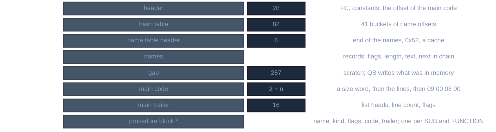

# QuickBASIC binary programs

For contributors who read or write the files QuickBASIC 4.5 saves with *Fast Load and Save*, the default of the IDE's Save
As: a `.BAS` that starts with the byte `FC` and holds the program already compiled to a token stream, not text. Every
statement below was checked against `QB.EXE` itself, run under an emulator on programs written to probe one rule at a time,
and against the four binary programs the kit ships (`REMLINE`, `SORTDEMO`, `TORUS`, `QCARDS`): QB 4.5 turns the shipped
`REMLINE.BAS` back into the text of PDS 7.1's `REMLINE.BAS` exactly, and given that text it writes the shipped file back byte
for byte. `tools/qbbin.py --check` reads and writes each file, and more than 400 more that QB made, byte for byte. It is QB 4.5's
format only: a Visual Basic for DOS `.FRM` also starts with `FC` and has a header of its own, and QBX was not run.

The IDE keeps a program as tokens and lists them back as text, so the file is that memory: a name table, then for each of
the main module and each `SUB` or `FUNCTION` a block of lines, each line a run of 16-bit tokens in postfix order. Nothing in
it is source text but the comments, string literals and `DATA`.

## Layout



*A binary program, first byte on top*

Words are little-endian. An *offset* below is counted from file offset 0x1E, so the first name is at 0x56.

## Header, hash table, names

The 28 bytes before the hash table are the same in every program but four spots:

```
FC 00 01 00 0C 00 81 01 82 01 06 00 01 02 03 04 05 08 [12] [13] [14:2] 24 00 [18:2] [1A:2]
```

`[1A]` is the offset of the main code, always the end of the names + 0x103 (0x101 of gap and the size word). `[12]` is
0x10, or 0x14 in a program with a `TYPE`; `[13]` is 0x10, 0x11 with an `EXIT FUNCTION` in one of mine and 0x51 in `QCARDS`;
`[14]` is 0xFFFF, or 6 in a program with a `DEF FN`; `[18]` is 0xFFFF but for `QCARDS`. QB ignores all of them but `[1A]`.

The hash table is 41 words at 0x1C: the offset of the newest name in each bucket, 0 if empty. A name is a record: a flags
byte, a length byte, the text, and a word that is the offset of the next name of its bucket (0 at the end), so names are
chained. The table is followed by three words: the end of the names, 0x0052, and the offset of the name QB looked up last;
the names start at 0x74. The flags are 0 for a variable, 0x02 for a line number (the text is the number as 2 bytes), 0x04 for a
label, 0x08 for a variable of a user-defined type and 0x40 for a procedure.

Which bucket a name is in is QB's hash, which I could solve for one-letter names only (the letter's code and 0x1F) and not
for longer ones. A reader does not need it: all of `REMLINE`'s names put in one chain read back as the same program.

The 257 bytes after the names are not data. A program QB makes from text has them 0; in a shipped program they hold part of
the first lines as they stood in a buffer, and zeroing them changes nothing.

## Code

A block of code is a word `size` and `size` bytes: lines of tokens, ending `09 00 08 00`. A token is a word: the opcode is its
low 10 bits and the *immediate* its high 6. Some opcodes are followed by operand words. A line begins with a `LINE` token
(opcode 0, the immediate the number of leading spaces); a line with a label or number is opcode 4. A comment that goes on
over a second text line is opcode 1 with the column as its operand; it counts as a line.

The expression is postfix: operands push, an operator or a statement takes what it needs from the stack.

| tokens | is |
|---|---|
| `0000` | `LINE`; the immediate is the indent, `0800` is two spaces |
| `0004 next @name` | a line with a label or number; `next` is the code offset of the next such line's first operand |
| `000B @x`, `000C @x` | read a variable, assign to it; the immediate is its type: 1 integer, 2 long, 3 single, 4 double, 5 string |
| `000E n @a`, `000F n @a` | an array element or a function call of `n` arguments, and its assignment |
| `0164`, `0165 w`, `0166 lo hi` | an integer: 0 to 62 in the immediate, else a word, else a long; `&H` and `&O` are 0167 to 016A |
| `016B lo hi`, `016C w w w w` | a single, a double, as IEEE bits |
| `016D n text` | a string: its length and bytes, padded to even with whatever was in memory |
| `0100 0102 0170 0177 0160 016F 0176` | `+ / * - \ MOD ^` |
| `0101 0175 0179 0104 0161 0174` | `AND OR XOR EQV IMP NOT` |
| `0103 0171 0163 015F 0162 015E` | `= <> < > <= >=` |
| `016E` | closes a parenthesis |
| `0096` etc. | a statement: `0096` is `PRINT` of what is on the stack, `0093` a bare `PRINT`, `0095` `;`, `0094` `,` |
| `0173`, `0172` | an argument left out, `, ` |
| `0097 n col text` | a comment `'`: length, the column, the text, its runs of a character packed as `0D count char` |
| `00E3 n text` | `REM` |
| `00A6 n text` | `DATA`; `0099 n text` `$INCLUDE` |
| `0044`, `0076`, `0058` + `n` bytes | `DECLARE`, `SUB`, `FUNCTION`: the name, a kind word (`0100` SUB, `0200` FUNCTION), the parameter count, and for each parameter its name, `0000` / `0200` (suffix) / `2000` (`AS`), and its type |
| `0056`, `0057`, `0065`, `0066` + `FFFF FFFF` | `FOR`, `FOR STEP`, `NEXT`, `NEXT var` |
| `005D 0000`, `0061 0000`, `0049`, `004D`, `0050` | one-line `IF`, block `IF`, `ELSE`, `ELSEIF`, `END IF`; `0049` and `004D` take a word |
| `007A`, `0079`, `0046`, `0048`, `0047`, `0062`, `0064`, `0063` | `WHILE`, `WEND`, `DO`, `DO WHILE`, `DO UNTIL`, `LOOP`, `LOOP WHILE`, `LOOP UNTIL`; each but `DO` takes `FFFF` |
| `005B @l`, `0059 @l`, `0037 n @p`, `0038 n @p` | `GOTO`, `GOSUB`, `CALL`, a call without `CALL`; `n` arguments |
| `0074 FFFF`, `003B` | `SELECT CASE`, `CASE`; `0052` `END SELECT` |
| `001B next w w`, `0020 end @T`, `001D next` | `DEFtype` (type in `w`'s low 6 bits, the letters as a bitmask), `TYPE`, `END TYPE` |
| `0089 n w...` | `INPUT`: a count `n` and the `n - 1` words after it |

`tools/qbbin.py --opcodes` lists all 368 opcodes with their operand words, how many values each takes and how QB lists it. The
table is QB's: a program of one token behind three integers was loaded for each opcode, and what QB printed is the rendering.
361 of the 368 were seen in a file QB saved; `007 017 034 035 05A 05C 05F` were not.

## Lists in the trailer

Each block ends with 16 bytes: four words, then the number of lines, a word 0, a word (0 in the main module, `FFFF` in a
procedure), and `02` and a flags byte (1 for the main module; for a procedure 0, with bit 8 set when a `DECLARE`
exists for it, which QB makes for every `FUNCTION`, and bit 4 when the program has it as a statement).

The four words head linked lists through the block: the first label line, the first `DEFtype`, the first `TYPE`, and the
first line QB could not compile or a `$INCLUDE` (opcode `0A`, which holds its text). Each is the offset in the block of the first operand
of its first entry and `FFFF` if there is none; every entry's first operand is the offset of the next's, and `FFFF` at the last.
`TYPE` links to its `END TYPE`, and that to the next `TYPE`. The line count is the number of tokens 0, 1 and 4.

## Procedures

After the main trailer, each procedure is `00`, a word `n` and the name, a kind (1 `SUB`, 2 `FUNCTION`), a type (a
`FUNCTION`'s: 1 integer, 2 long, 3 single, 4 double, 5 string), a flags byte (`30`, plus `80` for `STATIC`, plus `08` if a
`DECLARE` names it), a size word, the code and the trailer. Its code begins with its `SUB` or `FUNCTION` token and ends with
`END SUB` (`0051`).

## What QB reads, and what to write

What I set to zero, or to a wrong value, in a shipped program that QB then listed as before: the header's `[12]` to `[18]`,
the names' flags, the line count and flags of a trailer, the gap, the hash buckets. What it did not list as before: the four
list heads (a `DEFINT` came out at the end of the program), and a procedure's flags (it lost its `STATIC`).

So to write a program: the 28 bytes with `[1A]` set, the buckets, names in the order of first use, 257 zeros, the code,
the trailer with its lists and the count. Eight programs written that way from tokens loaded and
listed as the text they should in QB 4.5; six of the seven I compared were byte for byte what QB itself writes, and the seventh,
a string of odd length, differed in its pad byte only.

## The programs

| file | bytes | names | main code | procedures |
|---|---|---|---|---|
| `REMLINE.BAS` | 11658 | 44 | 3320 | 4 `SUB`, 4 `FUNCTION` |
| `SORTDEMO.BAS` | 21689 | 86 | 2940 | 18, 1 |
| `TORUS.BAS` | 27657 | 163 | 4036 | 13, 3 |
| `QCARDS.BAS` | 34978 | 167 | 10916 | 13, 4 |

Between them they hold 3541 lines and 157 of the opcodes. Each is a block of code that `tools/qbbin.py` reads whole, with
the number of lines it finds equal to the trailer's.

## Not known

- The hash of a name of more than one letter, and the meaning of the header's `[12]`, `[13]`, `[14]` and `[18]`.
- The seven opcodes no program of mine made.
- What a `.BAS` of PDS 7.1's QBX or of Visual Basic for DOS holds; neither was run.
