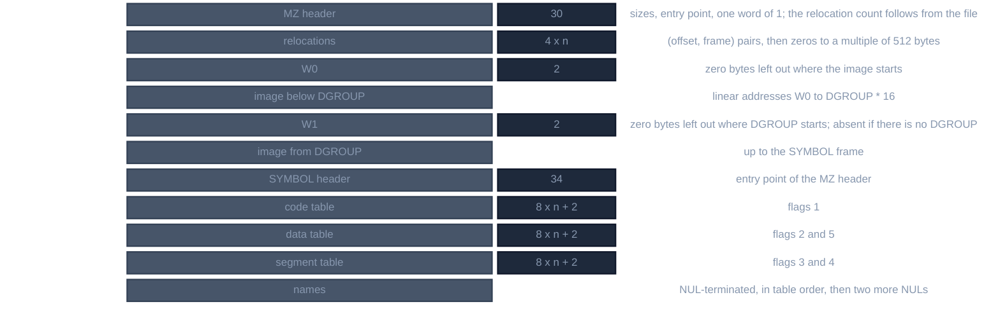

# QLB

For contributors who read or write Quick libraries, the `.QLB` files QuickBASIC 4.5, BASIC PDS 7.1 and Visual Basic for
DOS load with `/L`. Every statement below was checked against the 16 libraries those products ship and against what
Microsoft's LINK 3.69 and 5.10 wrote for objects made to probe one rule at a time; `tools/qlb.py --check` reads each
shipped library and writes it back byte for byte. What QB does with the file was not observed, only what the file says.

A QLB is a DOS executable (MZ) that LINK writes for `/Q` (`/QUICKLIBRARY`), but nothing runs it. Its image is the linked
modules plus the support library's interface (`BQLB45.LIB`, `QBXQLB.LIB`, `VBDOSQLB.LIB`), its relocation table lets a
loader place it at any segment, and its entry point is not code: it is the file offset of a block of symbol tables, the
way for a loader to find the library's routines by name. Microsoft's own reader is `QLBDUMP.BAS` in the QB 4.5 and PDS
examples; it knows the MZ header, the block's magic and the two symbol tables, and nothing else.

## Layout



*A Quick library, first byte on top*

A *frame* is a segment number relative to the load address, a *linear address* is `frame * 16 + offset` in the image as
LINK laid it out (segments in map order, each aligned), and every offset below is in bytes.

## MZ header

| offset | field | value |
|---|---|---|
| 0 | signature | `MZ` |
| 2, 4 | last page, pages | the size of header and linear image, the SYMBOL block included, as if no zeros were left out |
| 6 | relocations | n |
| 8 | header paragraphs | the header is `0x1E + 4n` bytes rounded up to 512 |
| 0xA, 0xC | min, max allocation | 0xFFFF, 0xFFFF |
| 0xE, 0x10 | ss, sp | the SYMBOL frame, or 0 if no segment is `STACK` (LINK warns L4021); 0 |
| 0x12 | checksum | LINK's; 0 in the VBDOS libraries; none of the sums of the file I tried gives it |
| 0x14, 0x16 | ip, cs | the file offset of the SYMBOL block from the end of the header, as `cs * 16 + ip`, not an address |
| 0x18, 0x1A | relocation table, overlay | 0x1E, 0 |
| 0x1C | | 1 |

`QLBDUMP.BAS` finds the block as `(header paragraphs + cs) * 16 + ip`. The entry point is a file offset, which the
zeros left out of the file make smaller than the block's address, so DOS would not start it where the block is.

## Stored image

The file keeps the linear image from address 0 to the SYMBOL frame less two runs of zeros. LINK counts the zero bytes
the first segment of the image begins with and those the first segment of DGROUP begins with, writes each count as a
word and leaves the zeros out. Only that segment's zeros count, never those the next one begins with. DGROUP's first
segment is `NULL` of class `BEGDATA`, all zero, and W1 is its length: 0x3317 in `QB.QLB`, 0x3122 in the PDS
libraries, 0x42B0 in the VBDOS ones, so 12 to 17 KB are not in the file. A library with no group has no W1. The
image is `W0` zeros, the stored bytes up to the DGROUP frame, `W1` zeros, the rest, and zeros up to the SYMBOL frame.

## SYMBOL block

| offset | size | field |
|---|---|---|
| 0 | 5 | `JMP FAR` (`EA`) to `__aulstart`, offset then frame |
| 5 | 1 | version, 2 |
| 6 | 2 | magic `0x6C75`, "ul" |
| 8, 0xA, 0xC | 2 each | offsets of the code, data and segment tables; the first is 0x22 |
| 0xE | 2 | a frame, always 0 |
| 0x10 | 2 | the DGROUP frame; 0 without a group |
| 0x12 | 2 | the SYMBOL frame, the MZ `ss` |
| 0x14 | 2 | the size of the block, which ends the file |
| 0x16 | 2 | the frame of the first segment of class `FAR_DATA` |
| 0x18 | 4 | the bytes from there to the end of the last segment of that class |
| 0x1C | 2 | the frame of the first segment of class `FAR_BSS` |
| 0x1E | 4 | the bytes from there to the end of the last segment of that class |

The size is the span between them, not the sum of their lengths, and 0 with the frame 0 if no segment has the class. The
interface module has an empty segment of each class, so a library made with it has both frames at DGROUP's.

A table is 8-byte entries and a word of 0 at the end. An entry is `flags, name offset, a, b`, the name offset from the
start of the block:

| table | flags | entry | a, b |
|---|---|---|---|
| code | 1 | a public in a segment whose class name ends in `CODE`, any case | offset, frame |
| data | 2 | any other public | offset, frame |
| data | 5 | an absolute public (a PUBDEF with a base frame but no segment) | the offset, 0 |
| segment | 3 | a segment, in the linker's order, the empty ones too | its start: offset, frame |
| segment | 4 | the same for class `BC_VARS` | |

A public's frame and offset are the group's if its segment is a member of one, else the segment's own frame and the
offset from it (a segment starts at an offset in its frame, so that is added). The names follow the three tables in
table order, each NUL-terminated, then `00 00`. The table order is LINK's own: not by name, address or length. A reader
must not depend on it.

Which publics are entered:

- Names that begin with `B$`, in either case, are not: they are the runtime's.
- Of names that differ only in case the first is entered. LINK ignores case unless told otherwise.
- LINK adds `_edata` and `_end`, near with a group and absolute 0 without.
- The last segment is `SYMBOL`, at the SYMBOL frame; a `STACK` segment, if there is one, is just before it.
- A public named `__aulstart` must exist, or LINK stops with L2043 *Quick library support module missing*.

## Relocations

The table lists each word that holds a frame, as `(offset, frame)` of the word: its linear address is
`frame * 16 + offset`, the SYMBOL block at its own frame. A loader adds the frame it loaded the image at to each.

- In the SYMBOL block: the header words at 3, 0xE, 0x10, 0x12 and, where such a segment exists, 0x16 and 0x1C, and the
  frame of every code entry, every data entry of flags 2 and every segment entry. They come first, in address order
  with the header words last.
- In the image: the segment half of each far pointer and each segment-base fixup the linker resolved, in the linker's
  order.

## Making one

```
LINK /Q QB.LIB,QB.QLB,NUL,BQLB45.LIB;        QB 4.5, LINK 3.69
LINK /Q QBX.LIB,QBX.QLB,NUL,QBXQLB.LIB;      PDS 7.1, LINK 5.10
```

`/Q`, the objects and libraries to put in, the output, no map, then the support library. The support library holds
`__aulstart` (`MOV AX,4C01h / INT 21h / RETF`) and the interface: its `_TEXT` is a table of `INT 3Fh` stubs, `CD 3F nn`
and a fourth byte for the higher indexes, one per runtime routine, named `B$…` in a map, the names the `B$` rule keeps
out of the tables; compiled code calls the runtime through them. QB writes a `.LIB` of the same base name beside the
`.QLB` (QB 4.5's help says so) for building a library from one; the two are separate files.

LINK 5.10 run on `QBX.LIB`, `FINANCER.LIB`, `DTFMTER.LIB` and `MATBEFR.LIB` with `QBXQLB.LIB` wrote the shipped
`QBX.QLB`, `FINANCER.QLB`, `DTFMTER.QLB` and `MATBEFR.QLB` byte for byte; LINK 3.69 on `QB.LIB` with the shipped
`BQLB45.LIB` wrote `QB.QLB` but for a `NULL` of 0x3517 bytes in place of 0x3317, 0x200 more, and the words that follow
from it, so the shipped `BQLB45.LIB` is not the one `QB.QLB` was built with. `FONTBEFR`, `CHRTBEFR` and `UITBEFR` were
not reproduced from the libraries and objects the kit holds, and LINK 5.31, which made the VBDOS libraries, needs a
DOS extender.

The smallest, from one 16-byte code segment that defines `__aulstart` and `FOO`, is 661 bytes: 512 of header with 8
relocations, 18 of image and a 131-byte block with two code, two absolute and two segment entries. It is the fixture of
`tools/test_qlb.py`.

## The libraries

| file | from | bytes | code | near | abs | segments | relocations | routines | |
|---|---|---|---|---|---|---|---|---|---|
| `QB.QLB` | QB 4.5 | 5822 | 22 | 54 | 14 | 31 | 143 | 6 | `ABSOLUTE`, `INTERRUPT`, `INTERRUPTX`, `INT86OLD`, `INT86XOLD`, `SetUEvent` |
| `QBX.QLB` | PDS 7.1 | 7208 | 21 | 63 | 14 | 33 | 170 | 5 | the same without `SetUEvent` |
| `FINANCER.QLB` | PDS 7.1 | 12216 | 32 | 63 | 15 | 32 | 193 | 15 | `SLN`, `DDB`, `SYD`, `FV`, `PV`, `PMT`, `IPMT`, `PPMT`, `NPER`, `NPV`, `IRR`, `MIRR`, `RATE`, … |
| `DTFMTER.QLB` | PDS 7.1 | 19086 | 55 | 63 | 14 | 36 | 246 | 18 | `FORMATC`, `DATEVALUE`, `TIMESERIAL`, `NOW`, `WEEKDAY`, … |
| `MATBEFR.QLB` | PDS 7.1 | 28517 | 66 | 63 | 14 | 37 | 1123 | 30 | `MATADDI`, `MATMULTD`, `MATINVC`, `MATSEQNS`, … |
| `FONTBEFR.QLB` | PDS 7.1 | 30461 | 82 | 63 | 14 | 46 | 680 | 46 | `SELECTFONT`, `GETGTEXTLEN`, `FLREADFONT`, … |
| `CHRTBEFR.QLB` | PDS 7.1 | 76005 | 161 | 63 | 14 | 48 | 2097 | 125 | `CHARTMS`, `CLTITLEXAXIS`, `CLDRAWPIEDATA`, … |
| `UITBEFR.QLB` | PDS 7.1 | 74918 | 119 | 63 | 14 | 49 | 2545 | 83 | `MENUOFF`, `MOUSEPOLL`, `WINDOWPRINT`, `BOX`, … |
| `VBDOS.QLB` | VBDOS | 7661 | 33 | 54 | 14 | 36 | 163 | 17 | the five of `QBX.QLB` and the control kit's 12: `GETCONTAINER`, `GETPROPERTY`, `SETPROPERTY`, `INVOKEEVENT`, `INVOKEMETHOD`, `SETATTRIBUTE`, `SETUEVENT`, four `STRING…`, `FO_TEXT_END` |
| `FINANCE.QLB` | VBDOS | 12779 | 44 | 54 | 15 | 36 | 187 | 27 | `FINANCER.QLB`'s 15 and the kit's 12 |
| `MATH.QLB` | VBDOS | 29290 | 78 | 54 | 14 | 42 | 898 | 42 | `MATBEFR.QLB`'s 30 and the kit's 12 |
| `FONT.QLB` | VBDOS | 26094 | 90 | 54 | 14 | 48 | 590 | 54 | `FONTBEFR.QLB`'s 46 less `ATTRBOX`, `DEFAULTFONT`, `GETCOPYBOX`, `PUTCOPYBOX`, and the kit's 12 |
| `CHART.QLB` | VBDOS | 73761 | 170 | 54 | 14 | 54 | 1975 | 134 | `CHRTBEFR.QLB`'s 125 less `ATTRBOX`, `GETCOPYBOX`, `PUTCOPYBOX`, and the kit's 12 |
| `HELP.QLB` | VBDOS | 25467 | 57 | 56 | 14 | 49 | 693 | 21 | `HELPSHOWTOPIC`, `HELPSEARCH`, `HELPREGISTER`, … |
| `CMNDLG.QLB` | VBDOS | 33380 | 59 | 55 | 14 | 45 | 1005 | 23 | `FILEOPEN`, `FILESAVE`, `COLORPALETTE`, `ABOUT`, … |
| `SPIN.QLB` | VBDOS | 16887 | 56 | 54 | 15 | 43 | 686 | 39 | `SPIN_CLOAD`, `SPIN_CPAINT`, `FIRESPIN`, … |

A routine is a code symbol without a leading `_` or `$` and without `b_` (`QLBDUMP.BAS` prints all but `__`, `$` and
`B$`). The near entries are the C runtime's variables and the interface's. The absolute ones are the floating-point
emulator's `F?xRQQ` fixup constants and a few linker constants. `tools/qlb.py --symbols FILE` lists any of them.

## Not known

- What QB does with a file. The reading above is the file's own and `QLBDUMP.BAS`'s; no QuickBASIC was run.
- The MZ checksum and the 0xE word, always 0.
- The rule for the table order, only that it is not by name, address or length.
- A library whose DGROUP is at frame 0 reads as one with none: the writer cannot tell them apart by the header.
