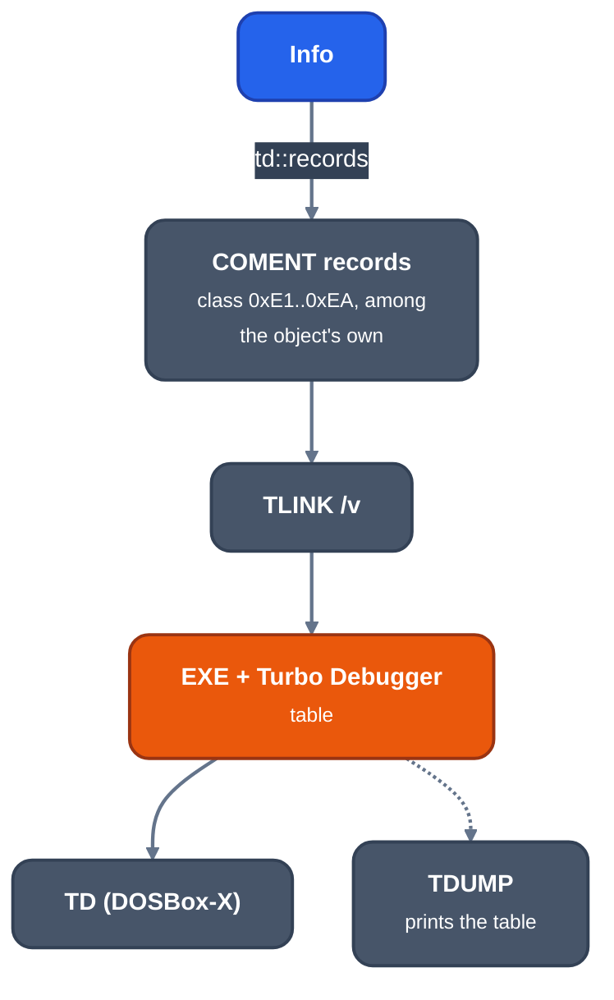

# Turbo Debugger information (`-gtd`)

For contributors changing `crates/mc/llrm-omf/src/td.rs` or checking its output. `-gtd` writes the debug
records Turbo C++ 3.0 writes under `-v` into a 16-bit OMF object; `TLINK /v` turns them into the table Turbo
Debugger reads.

*From Info to the Turbo Debugger table*

The records are `COMENT` records of attribute 0 ("Purge: Yes, List: Yes"). They were measured on `tcc -v`
objects (TC++ 3.0, `-ml` to `-mh`, `-a`) with `TDUMP` as the reader, by linking the object and dumping the
EXE: what TLINK built is what the debugger gets. Only 16-bit objects are written; a 32-bit one is refused
(Borland's 32-bit information is another format). `-gtd` is refused outside OMF
([debug-info](debug-info.md#flags)).

## Records

| class | meaning | data |
|---|---|---|
| E1 | a public symbol's type, after its PUBDEF | `index, flag` (0 data, 0x18 function) |
| E2 | a struct's or union's members, before its E3 | `(bits, name, type [, 0x40 offset32])*, 0xC0 size32` |
| E3 | a type | `index, name, size16, tid, ...` |
| E5 | begin scope | `segment, offset16` |
| E6 | locals, statics, type names | `(name, type, flag, ...)*` |
| E7 | end scope | `offset16` |
| E8 | source file, before LINNUM | `0, name, time32` |
| EA | compiler parameters | `language (1 C), model (8 tiny .. 0xD huge)` |

- An index is one byte below 0x80, else `0x80 | high, low`. The scalars' are fixed: void 1, char 2, int 4,
  long 6, unsigned char 8, unsigned 0xA, unsigned long 0xC, float 0xE, double 0xF, long double 0x10; a type's
  own begin at 0x18, in order of first use. A pointer to a struct is named before the struct's record, so a
  cycle closes.
- E3 `tid`: 0x15 near pointer, 0x16 far (1 huge), 0x1A array, 0x1E struct, 0x1F union, 0x23 function. Pointer:
  `size, tid, target, kind` (kind 4 near data, 2 near code; far: 0 or 1 for huge). Array: `bytes, 0x1A,
  element`. Function: `0, 0x23, return, call, 0` (call: 4 far, 0 near, +1 Pascal). Qualifiers leave no trace.
- Struct members carry offsets only where one is not where the last ended (`0x40, offset`). A bit field is
  `width` in the first byte.
- A function is a scope at its first byte holding its parameters last first (flag 0x0A, BP offset), then a
  scope at its body's first byte holding the locals (flag 0x02, BP offset) and the parameters again, both
  ended at its last byte (E7 twice). A block is a scope inside. A register variable is flag 4 or 0xC and the
  register's number (AX 0, CX 1, DX 2, BX 3, SP 4, BP 5, SI 6, DI 7; AL..BH 0..7). A static is `name, type, 0,
  1, segment, offset16`; a static function `name, type, 0x18, 0, segment, offset16`. Struct tags are flag 7
  and typedef names flag 6, in a module-level E6 after the PUBDEFs.
- One PUBDEF a symbol, its E3 and E1 right after (`write.rs` splits the PUBDEF record there). Turbo C++ also
  writes dependency (E9) and coverage (EE) records, which llrm does not.

What the records cannot say is left out one variable at a time: a variable in a register for part of its scope
(a location list), enums, a bit field beside padding, a type past 64K, and a block or function in several
ranges. Open: [#823](https://github.com/ali-mosavian/llrm/issues/823).

## Driving it

Turbo Debugger 3.00 runs in the fork's DOSBox-X, driven over its debug socket
([debugging](../working/debugging.md) describes the runner and the socket). `tests/common/dosbox.rs` opens
the session (`DOSBOX_DEBUG_PORT`, a private port) and has commands to inject keys, read the text screen and
take a PNG screenshot. The socket stops the emulator at every INT 3, which Turbo Debugger uses for its
breakpoints, so a reader thread answers each with `continue`.

A `-gtd` binary is loaded as in `tests/turbo.rs`:

1. `llrm-c -m16 -gtd -O0 lst.c -o llst.obj`.
2. In DOS, `tlink /v c:\lib\c0m llst.obj, llst.exe,, c:\lib\cm` (`/v` builds the table; `c0m` and `cm` are Turbo
   C++'s medium-model start-up and library).
3. A session mounting the Turbo C++ tree as `c:`, Turbo Debugger as `d:` and the work directory as `w:`, with
   `c:\bin;d:\` on the path, then the command `td llst.exe`.
4. Wait until the screen shows `Module:`; then F8 steps over and F7 into until the window's title line says
   `File: lst.c <line>`. Ctrl-F7 (scan code 0x64, not 0x6A) opens a watch: type the expression, Enter.

For the program built by Turbo C++ (`tcc -v -r- -c -mm`) and the one llrm built with `-gtd`, stopped at line 9
of `lst.c`, the Watches window reads alike: `s int 0`, `n struct node * ds:00AE [_head]`,
`*n struct node {ds:00AA,3}`, `n->v int 3`.

## Verification

`tests/turbo.rs` needs Turbo C++ 3.0 (`TCPP30_DIR`), Turbo Debugger (`TD_DIR`) and the DOSBox-X this
workspace builds; a missing tool skips by name and `LLRM_REQUIRE_TURBO` makes it fail (`tools/debug-gate.env`).

- TLINK's Module Table of an llrm object equals Turbo C++'s for the same program.
- `TDUMP` names a function pointer's type as Turbo C++ does.
- A variable the allocator keeps in a register is a `register` in the table (`-O2`).
- TLINK builds a table from a Nib program (`llrm-nib -m16 -O0 -gtd`, `tests/fixtures/matrix/known.nib`) and from `-O2` C. TDUMP of the Nib object names the function `add` (near, C, returns signed int), the locals `sum` and `total` (auto) and `second` (register), and the lines 2, 3, 6 and 7; `first`, which the first instruction overwrites, has no one place and is left out. Without `-gtd` the object names no source.
- Turbo Debugger shows the same watch values for both programs (above).

`tools/debug-matrix.py` records Turbo Debugger output as emitted but unread by it, and points at this test as
the reader. Unit tests in `td.rs` hold the encodings.
