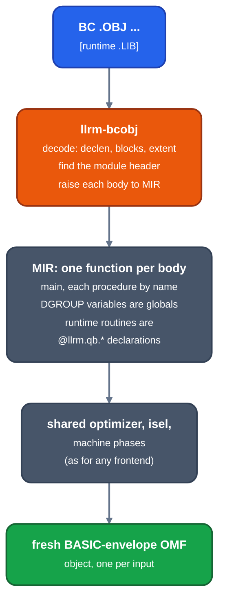

# BC objects as input

Audience: users and contributors of `llrm-omf`. How a Microsoft BASIC compiler
object (QB 4.5, PDS 7.1 or VBDOS `BC` output) is recompiled with llrm's
optimizer and backend. Source programs go through [llrm-qb](qb/readme.md)
instead; this route is for programs whose source is not at hand.



*A BC object recompiled*

## Usage

```
llrm-omf OBJ... [LIB...] -o OUT [--manifest M] [-march=CPU]
```

The objects are one program in LINK order. `-o` names the output object, or a
directory when there are several inputs. Libraries are the runtime and are
not recompiled. `--manifest M` writes a small JSON note of the route.
`-march` and the other target options are the shared ones. The driver is
`crates/driver/llrm-bcdriver`.

## What it does

It is a recompile, not a rewrite in place. Every function is raised to MIR,
optimized, selected and emitted again, and a fresh object is written around
the code. A function the raiser cannot express fails the whole program and
nothing is written. The runtime family is read from the object (QB 4.5, PDS
7.1 or VBDOS); other objects are refused.

The module header (`MODULE_CODE`, 0x30 bytes at the start of the code
segment, whose signature word names the family) is kept as BC wrote it except
for the statement-table and main-frame words, which are written afresh. A
header word relocated other than as BASIC relocates it is refused.

## What the raiser decodes

- The FP emulator's interrupts `34h` to `3Bh` stand in for x87 ESC opcodes
  with the operand inline; `3Ch` stands in for a segment-override prefix and
  `3Dh` for `WAIT`. `crates/frontends/bcobj/src/frontends/bc/declen.rs`
  and `fppatches.rs` decode each for what it is.
- `ON k GOTO` is `call far B$OGTA` followed by inline data: a count byte and
  that many offsets. The runtime reads the return address to find the table, so
  that call does not return to the byte after it
  (`INLINE_TABLE` in `llrm-qbruntime`).
- BC compiles a statement at a time, so no value outlives a statement in its
  code; the raiser sees each body as MIR, not as BC's instruction sequence.
- BC writes an object even after severe errors, so an object's existence is
  not evidence that its source compiled.

## Tests

`crates/driver/llrm-bcdriver/tests/driver.rs` recompiles BC fixtures and checks the
header, constants, statement table, refusals and instruction sequences.
`tests/differential/` compares llrm-qb with BC on source programs
([testing](../working/testing.md)).
