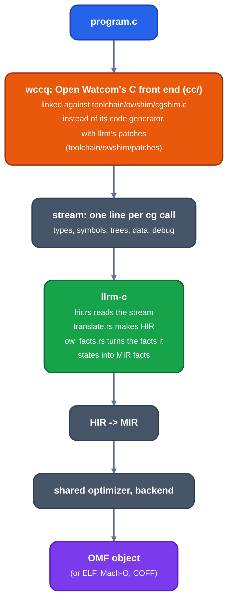

# C frontend

Audience: users and contributors of `llrm-c`. How C source is compiled, which
dialect and ABI it follows, and its options.

`llrm-c` compiles C through Open Watcom's own front end and hands MIR to the
shared optimizer and backend.



*From C source to an object file*

The front end does the parsing, type checking, constant folding and struct
layout; `cgshim.c` records what it asks of its code generator, and nothing
generates code there. What the stream carries and what `llrm-c` does with it
is in [the front end contract](ow-contract.md). `llrm-c` also accepts a
recorded stream (`.cgs`) as its input.

## Targets and ABI

`-m16` compiles for real-mode DOS and `-m32` for flat 32-bit DOS; the target
description names which Open Watcom tree builds the front end (`i86` or `386`),
what `int` is, and the switches `wccq` is given (`runtime/c/x86-m16/c.toml`,
`runtime/c/x86-m32/c.toml`).

On real mode the default is Borland C 3.1's medium model: far code, near
data, cdecl, signed `char`, byte-packed structs, 16-bit
enums, inline x87 and no stack probes. The patched front end also lays bit
fields out as Borland C does. `long double` is x87's 80-bit type at every target (llrm-c adds `-fld` where the layout has it; the
size in memory is the description's, `Layout::long_double_bytes`, the front end is built with it and `__SIZEOF_LONG_DOUBLE__` is it: 12 at m32, with 4-byte alignment, and an argument takes whole 12-byte slots). `-mabi=ABI` selects another ABI of the target:

| Target | ABIs |
|---|---|
| `x86-m16` | `cdecl` (Borland, the default), `watcom`, `ia16`, `regparm3` |
| `x86-m32` | `watcom`, `sysv` |

The C runtime and its start-up are in `runtime/c`, on top of the OS layer in
`runtime/shared/dos`.

## Usage

```
llrm-c SOURCE [-o OUT] [-I DIR]... [options]
```

`-o OUT.obj` (or `.o`) writes an object; any other output name, or `-S`,
writes assembly. The object format is `-fobject-format=omf|elf|macho|coff`.

| Option | Does |
|---|---|
| `-I DIR`, `-IDIR`, `--include DIR` | Add an include directory |
| `-DNAME[=VALUE]`, `-UNAME` | Define or undefine a macro (`-D NAME` too) |
| `-fsigned-char`, `-funsigned-char` | Whether a plain char is signed; each ABI family has its default (Borland's and gcc's signed, Open Watcom's unsigned) |
| `-std=c99` | The language standard, the front end's `-zastd=` |
| `-oa` | Open Watcom's relaxed alias checking: an object whose address is never taken is unaliased |
| `-on` | Open Watcom's relaxed floating point |
| `--dump DIR` | Write every stage to `DIR` |
| `--os-layer FIELD` | Print one field of the target's OS layer and exit |
| `-g` | CodeView line numbers, symbols and types |
| `-fsanitize=stack` | Check the stack on entry, comparing with Open Watcom's `_STACKLOW` and calling `__STKOVERFLOW` |
| `-ftrapv`, `-fwrapv` | Signed overflow traps, or wraps |
| `-fexcess-precision=standard`, `-ffloat-store` | A conversion to a float type rounds to that type (C11 6.3.1.4, 6.3.1.5); by default x87 keeps the wider value in its register, as gcc's fast mode does |

The shared options of `llrm-qb`, `llrm-c` and `llrm-nib` apply: `-O0` to
`-O3`, `-Omax`, `-Os`, `-Oz`, `-Og`, `-f[no-]PASS`, `-march`, `-mtune`,
`-m[no-]stack-is-data`, `-m[no-]far-bss`, `-mcode-segment=NAME` (every module's code in the one segment, as Open Watcom's `-nt=`), `-m[no-]bss-begin` (an empty `BSSB` segment
ahead of each object's `_BSS`, where a start-up zeroes from it, as the QB runtime's does), `--machine`, `-fstack-usage` and
`-Wstack-usage`. `llrm-c --help` prints the full list.

A program that includes `llrm_os.h` finds it without `-I`: the header is the
target's OS layer interface. The target's physical addresses are defined as
`PHYSICAL_<NAME>`.

## `__attribute__`

gcc's `__attribute__((...))` is read where gcc allows it on a declaration: before the type and after a declarator
(`int f(void) __attribute__((noinline));`, which holds for the definition that follows it). The target's header spells it as
Open Watcom's `__declspec( ... )`, and the patched front end reads the list, commas, arguments and `__name__` spellings
included. `noinline`, `always_inline` and `noreturn` state facts. `unused`, `used`, `cold`, `hot`, `format`, `nonnull`,
`pure`, `const`, `malloc`, `deprecated`, `visibility` and a few others are read and dropped: leaving them out changes no
meaning. Any other (`packed`, `aligned`, `section`, `weak`, `alias`) is an error, not ignored.

## Build

The front end is built by `build.rs` from an Open Watcom tree: `$OWROOT` when
set, otherwise a tree cached per commit (`toolchain/owshim/ow-commit`) and
bootstrapped once. `--no-default-features --features wccq` builds only the front
end. Without the toolchain feature `llrm-c` still reads `.cgs` streams.

## Tests

Unit tests are in `crates/frontends/llrm-c/src/`. Programs in `tests/run/c`
are compiled, run in DOSBox-X and compared with their `.out` by
`tools/dosbatch/run_tests.py c`; see [testing](../../working/testing.md).
