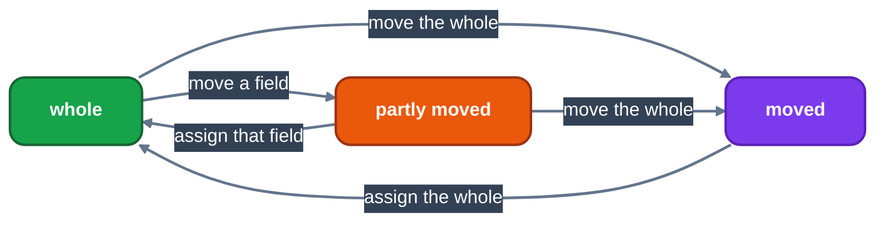
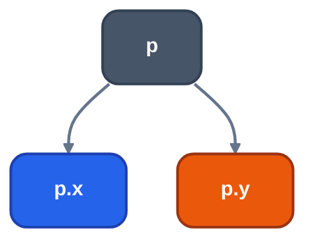

# Borrowing in Nib

Audience: Nib programmers and contributors to the Nib checker. This document
explains every rule of ownership, moves and borrows, and what the checker
accepts and refuses. Every program below was compiled with `llrm-nib`; every
diagnostic is its output. The language-level statement is in the
[language specification](language-spec.md); the regression tests are
`crates/frontends/nib/src/test_borrowck.rs`, and the examples
`examples/borrows.nib` and `examples/borrow_puzzles.nib` are accepted programs.

Diagnostics are `file:line:column: message`; below only `line:column: message`
is shown.

## 1. The model

Every value has one owner. There are three ways to hold a value:

```text
T           owner: passing, returning or assigning it moves it
&T          shared borrow: reads, any number at once
&mut T      exclusive borrow: reads and writes, one at a time
```

Primitives, and structs and enums whose fields all copy, copy instead of
moving. Everything that owns memory (`string`, `vec`, a struct holding one, a
type with a `drop`) moves.

A call writes its argument alone; the parameter's type decides whether it
moves, lends `&` or lends `&mut`. A borrow kept in a binding is written with
`&` or `&mut`:

```text
fn total(v: &[i16]) -> i16        # lends
fn grow(v: &mut vec[i16]) -> void # lends exclusively
fn eat(v: vec[i16]) -> void       # moves

let r = &v[0]                     # a shared borrow held in r
let m = &mut c                    # an exclusive borrow held in m
```

A `&mut` of a binding needs `let mut`; writing through a `&` is refused
(section 8). A reference is read and written as the value it refers to: with
`m = &mut c.n`, `m = 3` writes `c.n`.

The checker keeps, for every binding that holds a reference or a view, the
places it borrows from, its roots. A root is an owner told apart by the
storage the compiler gave it, never by spelling, plus the field path below it.
Four questions are asked of roots:

| Question | File | Check |
|---|---|---|
| Who owns it? | `moves.rs` | the moved set per HIR block |
| May it be changed? | `liveness.rs` | is a holder used after this change? |
| Does it live long enough? | `borrows.rs` | `Life` of the root against `Life` of the holder |
| Do lends overlap? | `borrows.rs` | one call, struct literal or generator |

## 2. Moves

An owner is in one of three states:



*States of an owner. A use of a moved owner, or of a partly moved one, is refused.*

A moved binding cannot be used until it is assigned again. The moved set is
kept per HIR block and flows along every edge, so a move on one branch reaches
the join, and a loop's back edge is checked.

```text
fn keep(text: string) -> u16:
    return text.len

fn main() -> i16:
    let s = "ab" + "c"
    keep(s)
    print(s)                  # 7:11: "s" was moved; copy it with .copy() to keep using it
    return 0
```

Accepted: `keep(s.copy())`, or assign `s` again (`let mut s`, `s = "again"`)
before the next use.

A move on one branch only is still a move at the join:

```text
    let s = "ab" + "c"
    let quit = true
    if quit:
        keep(s)
    print(s)                  # 9:11: "s" was moved; copy it with .copy() to keep using it
```

A move inside a loop body is a move on the next turn:

```text
    while n < 2:
        keep(s)               # 7:5: "s" is moved in one loop iteration and used in the next
        n += 1
```

### Partial moves

A field moves out of a named struct on its own; its siblings stay whole.

```text
struct P:
    a: string
    b: string

fn main() -> i16:
    let p = P(a="x".copy(), b="y".copy())
    take(p.a)
    print(p.b)                # accepted
    return 0
```

What moved cannot be used, nor the whole it was part of:

```text
    take(p.a)
    print(p.a)                # 11:11: "p.a" was moved; copy it with .copy() to keep using it
```

```text
    take(p.a)
    keep(p)                   # 14:10: "p" was partly moved: "p.a"
```

Assigning the field again (`p.a = ...`, with `mut a`) makes `p` whole.

Two things never move out:

```text
fn name(p: &P) -> string:
    return p.a                # 5:5: cannot move out of a borrow, field, or element; use .copy()
```

```text
fn P.drop(self: &mut P) -> void:
    print("bye")
...
    take(p.a)                 # 13:10: cannot move a field out of P, which has a drop
```

A borrowed owner cannot move, nor be dropped, while a holder is used later:

```text
    let s = "ab" + "c"
    let r = &s
    take(s)                   # 7:10: "s" is borrowed here, so it cannot be moved
    print(r)
```

## 3. Shared and exclusive borrows

The rule is shared XOR exclusive: while a borrow is live, nothing may change
what it borrows, and no `&mut` coexists with another borrow. What counts as a
change is a write, a `push` or any `&mut self` method, a `&mut` borrow, a move
and a drop.

A borrow is live from its creation to the last use of the binding that holds
it, on any path through the function. It does not last to the end of its
scope. Conflicts are therefore found by asking, at each change: is a holder
used after this point?

```text
fn main() -> i16:
    let mut v: vec[i16] = [1, 2]
    let r = &v[0]             # r borrows v shared ----+
    v.push(3)                 # 4:5: "v" is borrowed here, so it cannot be changed
    print(r)                  # last use of r ----------+
    return 0
```



```mermaid
%%{init: {'theme':'base','themeVariables':{'fontFamily':'Segoe UI, Helvetica Neue, Arial, DejaVu Sans, sans-serif','fontSize':'15px','textColor':'#64748b','titleColor':'#64748b','gridColor':'#94a3b8','sectionBkgColor':'transparent','sectionBkgColor2':'transparent','altSectionBkgColor':'transparent','taskTextColor':'#ffffff','taskTextOutsideColor':'#64748b','taskTextLightColor':'#ffffff','taskTextDarkColor':'#ffffff','doneTaskBkgColor':'#16a34a','doneTaskBorderColor':'#166534','activeTaskBkgColor':'#2563eb','activeTaskBorderColor':'#1e40af','critBkgColor':'#dc2626','critBorderColor':'#991b1b','taskBkgColor':'#475569','taskBorderColor':'#334155','todayLineColor':'transparent'},'gantt':{'barHeight':34,'barGap':12,'topPadding':48,'leftPadding':150,'fontSize':14,'sectionFontSize':14,'numberSectionStyles':2}}}%%
gantt
  dateFormat X
  axisFormat %s
  tickInterval 1second
  section v (owner)
  owner :done, t8, 3, 5
  ✗ refused∶ r is used later :milestone, crit, t10, 4, 4
  section r = &v[0]
  shared borrow∶ opens, last use closes :active, t9, 3, 5
```

*A change while a shared borrow is used later* Axis: 3 let r = &v[0]; 4 v.push(3); 5 print(r).

Move the use above the change and the program is accepted; the borrow has
ended:

```mermaid
%%{init: {'theme':'base','themeVariables':{'fontFamily':'Segoe UI, Helvetica Neue, Arial, DejaVu Sans, sans-serif','fontSize':'15px','textColor':'#64748b','titleColor':'#64748b','gridColor':'#94a3b8','sectionBkgColor':'transparent','sectionBkgColor2':'transparent','altSectionBkgColor':'transparent','taskTextColor':'#ffffff','taskTextOutsideColor':'#64748b','taskTextLightColor':'#ffffff','taskTextDarkColor':'#ffffff','doneTaskBkgColor':'#16a34a','doneTaskBorderColor':'#166534','activeTaskBkgColor':'#2563eb','activeTaskBorderColor':'#1e40af','critBkgColor':'#dc2626','critBorderColor':'#991b1b','taskBkgColor':'#475569','taskBorderColor':'#334155','todayLineColor':'transparent'},'gantt':{'barHeight':34,'barGap':12,'topPadding':48,'leftPadding':150,'fontSize':14,'sectionFontSize':14,'numberSectionStyles':2}}}%%
gantt
  dateFormat X
  axisFormat %s
  tickInterval 1second
  section v (owner)
  owner :done, t8, 3, 5
  ✓ accepted∶ no live borrow :milestone, done, t10, 5, 5
  section r = &v[0]
  shared borrow :active, t9, 3, 4
```



*The same change after the last use of the borrow* Axis: 3 let r = &v[0]; 4 print(r); 5 v.push(3).

The same holds for `&mut`:

```text
    let m = &mut c
    c.inc()                   # 10:5: "c" is borrowed here, so it cannot be changed
    m.inc()
```



```mermaid
%%{init: {'theme':'base','themeVariables':{'fontFamily':'Segoe UI, Helvetica Neue, Arial, DejaVu Sans, sans-serif','fontSize':'15px','textColor':'#64748b','titleColor':'#64748b','gridColor':'#94a3b8','sectionBkgColor':'transparent','sectionBkgColor2':'transparent','altSectionBkgColor':'transparent','taskTextColor':'#ffffff','taskTextOutsideColor':'#64748b','taskTextLightColor':'#ffffff','taskTextDarkColor':'#ffffff','doneTaskBkgColor':'#16a34a','doneTaskBorderColor':'#166534','activeTaskBkgColor':'#2563eb','activeTaskBorderColor':'#1e40af','critBkgColor':'#dc2626','critBorderColor':'#991b1b','taskBkgColor':'#475569','taskBorderColor':'#334155','todayLineColor':'transparent'},'gantt':{'barHeight':34,'barGap':12,'topPadding':48,'leftPadding':150,'fontSize':14,'sectionFontSize':14,'numberSectionStyles':2}}}%%
gantt
  dateFormat X
  axisFormat %s
  tickInterval 1second
  section c (owner)
  owner :done, t8, 9, 11
  ✗ refused∶ m is used later :milestone, crit, t10, 10, 10
  section m = &mut c
  exclusive borrow∶ opens, last use closes :crit, t9, 9, 11
```

*A change of c while an exclusive borrow is used later* Axis: 9 let m = &mut c; 10 c.inc(); 11 m.inc().

Swapping the two calls (`m.inc()` then `c.inc()`) is accepted.

### The conflict matrix

A holder is live, that is, used later. Each cell is what happens to a new
access to the same place:

| Live holder is used later | Read of the owner | New shared borrow | Write or call that changes | New `&mut` borrow | Move or drop |
|---|---|---|---|---|---|
| shared `&T` | accepted | accepted | refused | refused | refused |
| exclusive `&mut` | accepted | refused | refused | refused | refused |

Refusals by cell, with the diagnostic:

```text
 write, &mut borrow vs a holder   "v" is borrowed here, so it cannot be changed
 shared borrow vs a &mut holder   "v" is mutably borrowed here, so it cannot be borrowed
 move vs a holder                 "s" is borrowed here, so it cannot be moved
 drop vs a holder                 "v" is dropped here while still borrowed
```

```text
    let mut v: vec[i16] = [1, 2]
    let a = &mut v
    let r = &v[0]             # 4:13: "v" is mutably borrowed here, so it cannot be borrowed
    a.push(3)
    print(r)
```

Several shared borrows coexist (`let r = &v[0]` beside `let s = &v[1]`). A
plain read of the owner while a `&mut` holder is live is not checked ([#1525](https://github.com/ali-mosavian/llrm/issues/1525)).

## 4. Scopes and how long an owner lives

Whether a borrow may be kept somewhere is a different question from whether
it conflicts: the holder must not outlive what it borrows. Each root has a
`Life`, longest first:

```text
 Module        a module variable
 Lent          what the caller lent: a borrowed parameter's referent
 Frame         an owned parameter, dropped as the frame ends
 Scope(depth)  a local, by the nesting depth of its block
```



```mermaid
%%{init: {'theme':'base','themeVariables':{'fontFamily':'Segoe UI, Helvetica Neue, Arial, DejaVu Sans, sans-serif','fontSize':'15px','textColor':'#64748b','titleColor':'#64748b','gridColor':'#94a3b8','sectionBkgColor':'transparent','sectionBkgColor2':'transparent','altSectionBkgColor':'transparent','taskTextColor':'#ffffff','taskTextOutsideColor':'#64748b','taskTextLightColor':'#ffffff','taskTextDarkColor':'#ffffff','doneTaskBkgColor':'#16a34a','doneTaskBorderColor':'#166534','activeTaskBkgColor':'#2563eb','activeTaskBorderColor':'#1e40af','critBkgColor':'#dc2626','critBorderColor':'#991b1b','taskBkgColor':'#475569','taskBorderColor':'#334155','todayLineColor':'transparent'},'gantt':{'barHeight':34,'barGap':12,'topPadding':48,'leftPadding':150,'fontSize':14,'sectionFontSize':14,'numberSectionStyles':2}}}%%
gantt
  dateFormat X
  axisFormat %s
  tickInterval 1second
  section Frame
  Frame :done, t8, 1, 3
  p's referent∶ Lent； q∶ Frame :milestone, t10, 1, 1
  a∶ Scope(0) :milestone, t11, 2, 2
  section block, depth 1
  block :t9, 3, 4
  b∶ Scope(1) :milestone, t12, 3, 3
```

*Life of each root in fn f(p: &T, q: U)* Axis: 1 fn f(p: &T, q: U); 2 let a; 3 let b.

A holder may keep a borrow of a root only if the root lives at least as long
as the holder ([`Life::may_hold`](https://github.com/ali-mosavian/llrm/blob/c341bd6e3de058142c6652d399b8dfeb444eff9b/crates/frontends/llrm-nib/src/semantic/borrows.rs#L132)).
What the caller lent holds only what the caller lent. Scopes are lexical:
depth is the block nesting of the binding's declaration.

```text
struct Holder:
    mut r: &i16

fn main() -> i16:
    let a: i16 = 1
    let mut h = Holder(r=a)
    if a > 0:
        let b: i16 = 5
        h.r = &b              # 9:9: "h" would outlive "b", which it borrows
    print(h.r)
    return 0
```



```mermaid
%%{init: {'theme':'base','themeVariables':{'fontFamily':'Segoe UI, Helvetica Neue, Arial, DejaVu Sans, sans-serif','fontSize':'15px','textColor':'#64748b','titleColor':'#64748b','gridColor':'#94a3b8','sectionBkgColor':'transparent','sectionBkgColor2':'transparent','altSectionBkgColor':'transparent','taskTextColor':'#ffffff','taskTextOutsideColor':'#64748b','taskTextLightColor':'#ffffff','taskTextDarkColor':'#ffffff','doneTaskBkgColor':'#16a34a','doneTaskBorderColor':'#166534','activeTaskBkgColor':'#2563eb','activeTaskBorderColor':'#1e40af','critBkgColor':'#dc2626','critBorderColor':'#991b1b','taskBkgColor':'#475569','taskBorderColor':'#334155','todayLineColor':'transparent'},'gantt':{'barHeight':34,'barGap':12,'topPadding':48,'leftPadding':150,'fontSize':14,'sectionFontSize':14,'numberSectionStyles':2}}}%%
gantt
  dateFormat X
  axisFormat %s
  tickInterval 1second
  section h Scope(0)
  h lives :done, t10, 1, 5
  ✗ refused∶ h would outlive b :milestone, crit, t12, 3, 3
  section b Scope(1)
  b lives :done, t11, 2, 4
```

*h.r = &b stores a Scope(1) root in a Scope(0) holder* Axis: 1 let mut h; 2 let b (block depth 1); 3 h.r = &b; 4 block ends; 5 print(h.r).

The same rule governs every store of a borrow: assignment, a struct literal,
a variant, `push`, and a generator's state
([`store_borrow`](https://github.com/ali-mosavian/llrm/blob/c341bd6e3de058142c6652d399b8dfeb444eff9b/crates/frontends/llrm-nib/src/semantic/borrows.rs#L810)).
A callee can store a borrow into a `&mut` argument only from another argument:

```text
fn stash(out: &mut vec[&i16]) -> void:
    let local: i16 = 7
    out.push(local)           # 3:5: "out" would outlive "local", which it borrows
```

```text
fn stash(out: &mut vec[&i16], x: &i16) -> void:
    out.push(x)               # accepted: x is lent

    let mut keep: vec[&i16] = []
    if true:
        let inner: i16 = 7
        stash(keep, inner)    # 8:9: "keep" would outlive "inner", which it borrows
    print(keep.len)
```

A value never holds a borrow of itself:

```text
    let mut n = N(v=1, p=z)
    n.p = &n.v                # 8:5: "n" would hold a borrow of itself
```

### Reseating

A `let mut` borrow can be assigned another borrow. The old borrow ends at the
assignment, and the binding borrows the new place from then on:

```text
    let mut v: vec[i16] = [5, 6]
    let mut last = &v[0]
    print(last)
    v.push(7)                 # accepted: last is not used before it is reseated
    last = &v[1]
    print(last)
```

Without the reseat, `last` is used after `v.push` and the push is refused. A
reseat on one branch only keeps the old borrow on the other.

## 5. Places: fields, elements, calls

A borrow roots at a place path: an owner and the fields below it. Two
borrows overlap when one path is a prefix of the other.



*&mut p.x and &mut p.y are disjoint, both accepted; &mut p.x and p overlap*

```text
    let mut p = P(x=1, y=2)
    let a = &mut p.x
    let b = &mut p.y          # accepted
    a = 3
    b = 4
```

```text
    let a = &mut p.x
    let b = &mut p.x          # 8:13: "p" is borrowed here, so it cannot be changed
```

Likewise a method may walk `self.items` while changing `self.count`
(`examples/borrow_puzzles.nib`), but not while changing `self.items`.

An index is not a field: all elements of an array or `vec` are one place, and
a slice `&v[1:3]` borrows somewhere in `v`.

```text
    let w = &v[1:3]
    v.push(9)                 # 4:5: "v" is borrowed here, so it cannot be changed
    print(w[0])
```

`set(v[0], v[1])` with two `&mut` parameters is refused as one place
(`borrow of "v" aliases a mutable argument`).

A walk borrows what it walks for the whole loop, so a change inside it is
refused, and a `&mut` walk is a change on entry:

```text
    for x in &v:
        v.push(x)             # 4:9: "v" is borrowed here, so it cannot be changed
```

### Reborrows

A borrow taken through a reference borrows what that reference borrows. A
change made through a reference is a change of its owner:

```text
    let a = &mut v
    let r = &a[0]             # r roots in v
    a.push(3)                 # 5:5: "a" is borrowed here, so it cannot be changed
    print(r)
```

A binding holds the borrows its value holds. Putting `r` in
`let o: Option[&i16] = .some(r)` keeps `v` borrowed as long as `o` is used. A
reference copied out of a struct field (`let src = self.src`) points at the
caller's value, not at the struct holding it, so the struct stays writable.

## 6. Calls

A call lends each argument for the call. The lends are checked together:

- `&mut` arguments must be pairwise disjoint, and no `&` argument may overlap
  one. This includes a value that holds a `&mut` (a struct with a `&mut`
  field).
- A call's result borrows from every borrowed argument it could derive from.

```text
fn f(p: &mut i16, q: &i16) -> i16:
    p = 5
    return q

    let mut x: i16 = 1
    let r = &mut x
    print(f(r, x))            # 8:16: borrow of "x" aliases a mutable argument
```

`f(x, y)` with distinct owners is accepted.

```text
fn longer(a: &string, b: &string) -> &string:
    if a.len >= b.len:
        return a
    return b

    let x = "north"
    let mut y = "east"
    let r = longer(x, y)
    y = "changed"             # 10:5: "y" is borrowed here, so it cannot be changed
    print(r)
```

The result may be either argument, so both stay borrowed while `r` lives.
There are no lifetime annotations.

Argument expressions are evaluated before the `&mut` is taken, so
`v.push(v.len)` is accepted.

### Module variables

A function may write module variables the caller lends to it. The checker
summarizes, for each function, the module variables it reads and writes,
closed over its calls. A lend is refused if the callee may write it (or, for
`&mut`, read it), and so is a borrow held across a call that may write it:

```text
fn f(p: &P) -> i16:
    poke()                    # poke writes g
    return p.n
...
    print(f(g))               # 14:13: "g" is lent to "f", which may write it
```

```text
    let r = &g[0]
    setg()                    # setg writes g
    print(r)                  # 8:5: "g" is borrowed across a call to "setg", which may write it
```

If `r`'s last use comes before `setg()`, the program is accepted. Foreign
functions reach only what they can name or call back.

## 7. Returns

A returned borrow must root in a borrowed parameter: only `Life::Lent` roots
may leave the function
([`check_returned_borrows`](https://github.com/ali-mosavian/llrm/blob/c341bd6e3de058142c6652d399b8dfeb444eff9b/crates/frontends/llrm-nib/src/semantic/borrows.rs#L574)).
The result is tied to every borrowed input it could derive from.

```text
fn pick(x: &i16, y: &i16, c: bool) -> &i16:
    return c ? x : y          # accepted
```

```text
fn pick(x: &i16, c: bool) -> &i16:
    if c:
        let x: i16 = 5        # shadows the parameter
        return x              # 4:9: a returned borrow of "x" would dangle; only a borrowed parameter's can be returned
    return x
```

An owned parameter is dropped as the frame ends, so it cannot be returned
borrowed either:

```text
fn first(v: vec[i16]) -> &i16:
    return v[0]               # 2:5: a returned borrow of "v" would dangle; only a borrowed parameter's can be returned
```

A struct, an `Option` or a generator carrying a borrow is returned under the
same rule. A loop variable over a borrowed parameter (`for p in v` with
`v: &[P]`) is an element of the caller's `v` and returns as a borrow; over a
local it dangles.

## 8. Writing through references

One rule decides whether a place may be written: a `&` anywhere on the path
makes it read-only.

```text
fn f(x: &i16) -> void:
    x = 2                     # 2:5: binding "x" is immutable
```

```text
struct H:
    mut r: &i16

    let mut h = H(r=x)
    h.r = 7                   # 7:5: cannot write through "h.r", a '&' reference
```

```text
    let x: i16 = 1
    let r = &mut x            # 3:13: binding "x" is immutable
```

The same holds for an element (`v[0] = 7` where `v: vec[&i16]`:
`cannot write through "v[...]", a '&' reference`) and for a `&mut self` method
called on a `&` field (`field "src" of Scanner is not declared 'mut'`).
Assigning a borrow to a `let mut` reference reseats it (section 4); to a
`mut` field, it replaces the borrow.

Raw pointers (`*near T`, `*far mut T`, ...) are outside the checker and usable
only in `unsafe`.

## 9. Drops

A type with a `drop` method is dropped once, in reverse declaration order, at
the end of its scope and along `return`, `break`, `continue` and `?`. Each
drop is a change of its owner: refused while a holder is used later, and a
later drop is such a holder.

```text
struct G:
    mut r: &i16

fn G.drop(self: &mut G) -> void:
    print(self.r)

    let z: i16 = 0
    let mut g = G(r=z)
    let v: vec[i16] = [7, 8]
    g.r = &v[0]
    return 0                  # 12:5: "v" is dropped here while still borrowed
```

`v`, declared after `g`, is dropped first; then `g`'s drop would read freed
memory. Without the `drop` method, `g.r` has no later use and the program is
accepted. What surely moved is not dropped; what moved on one path only is
dropped under a flag.

## 10. Lambdas

A lambda is compiled where it is called, in the scopes it was written in. It
reads and writes the bindings it names directly, and its changes see the
caller's borrows:

```text
    let mut v: vec[i16] = [1]
    let k = |d: i16| v.push(d)
    let r = &v[0]
    k(1)                      # 3:22: "v" is borrowed here, so it cannot be changed
    print(r)
```

(The diagnostic is at the lambda body's change, line 3, because the lambda is
inlined at `k(1)`.) With `k(1)` before `let r = &v[0]` the program is
accepted.

Capture is late-bound: after `let f = |x: i16| x + a` and `a = 50`, `f(1)`
is `51`. This is sound because a lambda cannot be stored or passed while
capturing:

```text
fn apply[F](f: F) -> i16:
    return f(1)

    let k = 2
    return apply(|x: i16| x + k)   # 6:18: a lambda passed to a function cannot capture "k"
```

```text
    let k: i16 = 1
    let h: fn(i16) -> i16 = |x| x + k   # 3:29: a lambda made a function value cannot capture "k"
```

## 11. Generators

A generator consumed in a `for` loop is inlined into it, and its borrowed
arguments are borrowed for the loop:

```text
fn walk(v: &[i16]) -> iter[i16]:
    for x in v:
        yield x

    for x in walk(v):
        v.push(x)             # 8:9: "v" is borrowed here, so it cannot be changed
```

A generator that escapes (returned, or kept in a binding) holds its state as
a value. The state keeps each borrowed argument, so the returned-borrow rule
applies to it, and it may keep only borrows of what its caller lent:

```text
fn evens(v: &vec[i16]) -> iter[i16]:
    for x in v:
        if x % 2 == 0:
            yield x

fn make() -> iter[i16]:
    let local: vec[i16] = [1, 2, 3, 4]
    return evens(local)       # 8:5: a returned borrow of "local" would dangle; only a borrowed parameter's can be returned
```

Passing the vec in (`fn make(local: &vec[i16])`) is accepted.

```text
fn window() -> iter[i16]:
    let a: i16[3] = [1, 2, 3]
    let w = &a[0:2]
    yield w[0]                # 3:5: a generator that escapes keeps only borrows of what its caller lent it; "w" borrows its own "a"
```

State bundling several borrows (a generator's, a struct literal's, a
variant's) lends them disjoint as a call does: `gen(p, p)` with `&mut` and
`&` parameters is `borrow of "p" aliases a mutable argument`.

## 12. What the checker tells the optimizer

For a function only its own module calls, each `&` and `&mut` parameter is
stated `noalias`: no other argument reaches it, and no callee writes a module
variable lent to it. A borrowed parameter the function does not keep
(store where the caller sees it, return, or hand to something that does) is
stated `nocapture`. Entries that other objects call (exported, or address
taken) state neither.

## 13. Nib against Rust

Rust's NLL borrow checker is flow-sensitive over MIR with region inference.
Nib's is a checker over HIR with three simplifications, named below.

| Question | Rust | Nib |
|---|---|---|
| Borrow lifetime | region inferred; annotations when ambiguous | to the last use of the holder along each HIR path; no annotations |
| Returned reference | named lifetimes tie it to inputs | tied to every borrowed input it could derive from |
| Disjoint fields | tracked | tracked by place path; all elements are one place |
| Disjoint elements | `split_at_mut` | `set(v[0], v[1])` refused |
| `v.push(v.len)` | two-phase borrows | accepted: arguments evaluate before the `&mut` |
| References in structs | lifetime parameters | a field `&T` holds a borrow; its roots follow the value |
| Closures | capture by reference or move, may escape | inlined at the call; may not be stored or passed capturing |
| Module `static mut` | `unsafe` | checked: per-function read/write summaries across calls |
| Read of the owner beside a live `&mut` | refused | accepted ([#1525](https://github.com/ali-mosavian/llrm/issues/1525)) |
| Partial moves | tracked | tracked; not out of a type with `drop` |
| Raw pointers | unchecked | unchecked, `unsafe` only |

Nib accepts what NLL accepts for the common shapes: a borrow that ends at its
last use, borrows of different fields, a method that walks one field and
changes another. It refuses what needs a lifetime relation it cannot state: a
returned borrow is always tied to all borrowed inputs, so
`fn f(a: &T, b: &U) -> &V` that returns only from `a` still keeps `b` borrowed
in the caller.
