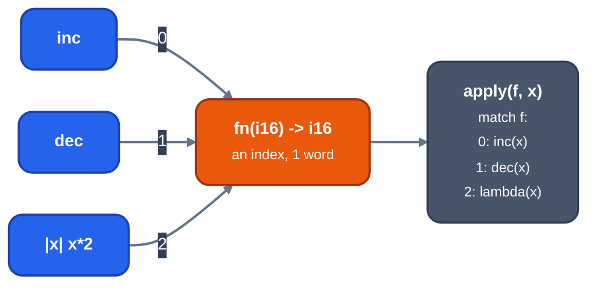
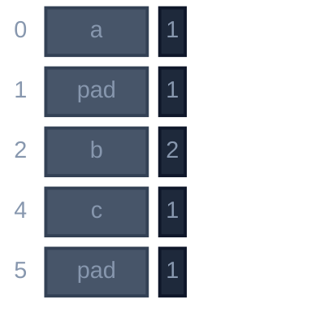
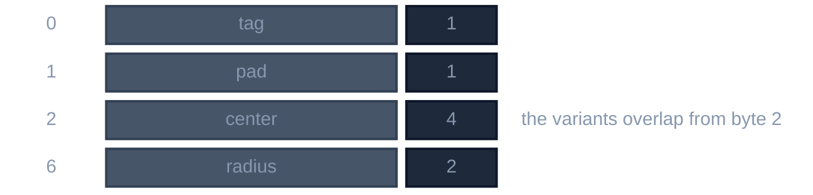
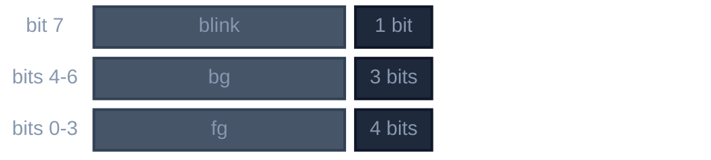
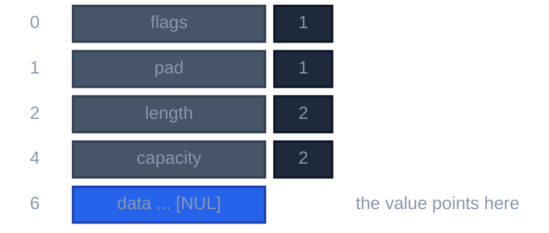
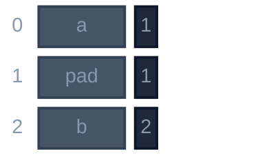

# Nib language reference

This is the reference for Nib, a small statically typed systems language for
DOS programs on 16-bit real mode (`-m16`, the default) and 32-bit flat mode
(`-m32`). It is written for people who write Nib and for people who work on
the compiler. Source files end in `.nib`.

Every example is checked against the parser. Examples are whole programs
unless a comment says otherwise; `unsafe`, foreign and target-specific ones
say so. Where the two targets differ the text says which.

The design rule:

> Every feature must reduce to values, direct control flow, or explicit memory.

There is one mechanism for each job:

| Job | Mechanism |
|---|---|
| Data | `struct`, `bits struct`, `enum` |
| Behavior | `fn`, methods, lambdas |
| Abstraction | Generics and structural protocols |
| Lifetime | Ownership, borrowing, and scoped destruction |
| Failure | `Option`, `Result`, and `?` |
| Iteration | `for`, generators (`yield`), comprehensions |
| Foreign code | Explicit representation, address space, and ABI |

The language has no garbage collector, exception unwinding, runtime
reflection, classes, inheritance, dynamic dispatch, or allocation caused by an
implicit conversion. An expression whose result is an owned dynamic collection
visibly allocates; fixed arrays, views, and generators do not.

Chapters: 1 source form, 2 bindings, 3 types and operators, 4 functions,
5 data types, 6 patterns, 7 control flow, 8 ownership and borrowing, 9 calls
and results, 10 failure, 11 generics and protocols, 12 iteration, 13 arrays
and text, 14 modules, 15 foreign interoperability, 16 compiler flags,
17 diagnostics, 18 built-in names and library, 19 not implemented,
20 grammar, 21 a complete program.

## 1. Source form

### 1.1 Lines and blocks

A source file is UTF-8. Identifiers and operators are ASCII; non-ASCII
characters may appear only in comments and in character and string literals,
where each is converted to one byte of the target's code page. A character
the code page lacks is a compile-time error.

Lines end at `\n`; one `\r` before it is ignored. A statement ends at the end
of its line. There are no semicolons and no backslash continuation. Inside
`(`, `[` or `{` newlines and indentation are ignored, so a bracketed
expression continues across lines.

A block is a line ending in `:` followed by lines indented deeper than it.
Indentation is spaces, of any width, consistent within a block. A tab in
indentation is an error, as is a dedent to a width no enclosing block has.
Blank lines and comment-only lines are ignored. A block holds at least one
statement, and a one-line form such as `if x: return` does not exist.

```nib
fn abs(value: i16) -> i16:
    if value < 0:
        return -value
    return value
```

`#` starts a comment that runs to the end of the line. There are no block
comments and no documentation comments.

### 1.2 Identifiers and keywords

An identifier is `[A-Za-z_][A-Za-z0-9_]*`. These words are reserved and
cannot be names:

```text
fn type fixed fraction struct let const var loop match enum bits with as
import from pub extern protocol yield unsafe asm case mut return if else
while for in break continue true false is
char i8 u8 i16 u16 i32 u32 f32 f64 string addr bool void
```

`from` is reserved and has no use. `addr` is the far data pointer that
`.data()` returns (chapter 18) and is not a type to write in programs.

These words are ordinary identifiers that have a meaning in one place:
`far` and `near` (after `@extern`, and in pointer types), `huge` (before
`var`, and in pointer types), `not` (after `is`), `out` and `clobbers` and
register names (in an `asm` header), `pack` and `name` (attribute
arguments), and `self` and `Self` (parameters and protocols). `usize` and
`isize` are predefined types, `NEAR_BYTES` a predefined constant, and
`PHYSICAL_TEXT_SCREEN` a predefined target constant (section 18.1).
`none` and `some` are variants of `Option`, not keywords.

### 1.3 Tokens

```text
//= <<= >>= .. // && || -> == != <= >= << >> += -= *= /= %= &= |= ^=
, . : = < > + - * / % & | ^ ~ ! ? @ ( ) [ ] { }
```

`|>`, `..=`, `**`, `++`, `--`, `=>`, `;`, `&&=` and `||=` are not tokens.

### 1.4 Integer literals

A literal is decimal (`255`), hexadecimal (`0xFF`), binary (`0b1010`) or octal
(`0o17`). The prefix letters may be upper case. Hexadecimal, binary and octal
literals may contain `_` between digits (`0xB800_0000`); decimal ones may not.
A literal has no sign, since `-` is an operator, and no suffix. One too large
for `i64` is an error.

An integer literal takes its type from context and must fit it (section 3.5).
Otherwise it is `int`, else `i32`, else `u32`. `int` is `i16` on both
targets.

### 1.5 Float literals

`1.5`, `.25`, `2e3`, `1e-3`, `6.674e-11` and `1.` are float literals; a
digit sequence followed by `..` is an integer followed by the range token.
There are no suffixes and no separators. A float literal is `f64` unless
context makes it `f32` or a fixed-point type. A tuple element is named by
`t[k]`, never `t.0`, because `.0` lexes as a float.

### 1.6 Character and string literals

A character literal `'a'` has type `char`: one byte of the code page. Its
escapes are `\0 \n \r \t \\ \'` and `\xHH`.

A string literal `"text"` is a single line of bytes of type `string`
(section 13.5). Its escapes are `\0 \n \r \t \\ \"` and `\xHH`, and `\{` and
`\}` for braces. There are no raw, multi-line or prefixed literals except the
f-string.

An f-string `f"..."` holds `{expr}` and `{expr:spec}` interpolations; `{{` and
`}}` are literal braces. Chapter 13.6 defines its format.

`true` and `false` are `bool` literals. There is no `none` literal: write
`.none`.

### 1.7 Encoding of text

Runtime text uses the target's single-byte code page. There is no Unicode,
normalization or collation.

## 2. Bindings and assignment

`let` creates a binding; values are immutable by default. `const` creates a
compile-time value. `mut` makes a binding mutable.

```nib
const screen_width: u16 = 320

fn main() -> i16:
    let name = "Ada"
    let mut score: i16 = 0
    score = score + 1
    let row: u8[screen_width] = [0] * screen_width
    print(name, " ", score, " ", row.len)
    return 0
```

A binding's type is inferred from its initializer unless written. Assignment
uses `=` and requires a mutable binding, a field declared `mut` of a mutable
binding, or an element of a mutable array. A binding needs an initializer.
A name may not be declared twice in one scope, a parameter and a `let` of
the same name included; a local may hide a `const`, a `var` or a function,
but not an import alias.

A `const` is declared at module level or in a function. Its value folds at
compile time (section 3.9); a typed `const` has that type and an untyped one
is a literal. A module's constants may name each other in any order, and one
that depends on itself is an error. `let const` is another spelling inside a
function. Assigning to a `const` (`K = 2`, `K += 2`) is a compile error, `K is a
const and cannot be assigned`; a local that hides it is assignable.

A destructuring `let` takes a pattern (chapter 6); `let mut` and a type
annotation are for a single name only. `let _ = expr` just evaluates
`expr`.

## 3. Types and operators

### 3.1 Scalar types

```text
bool
char
i8  u8
i16 u16
i32 u32
f32 f64
usize isize
void
```

`char` is one byte. `bool` is one byte and has no implicit truth value:
conditions are `bool`, and integers, pointers, collections and `Option`
values are not. `usize` and `isize` are the width of a near pointer, 16 bits
on `-m16` and 32 bits on `-m32`; `.len`, `.capacity` and `size_of` have
type `usize`. `void` is the result type of a function that returns nothing;
a binding, parameter, field or array element cannot be `void`.

| Type | Size in bytes |
|---|---|
| `bool`, `char`, `i8`, `u8` | 1 |
| `i16`, `u16` | 2 |
| `i32`, `u32`, `f32` | 4 |
| `f64` | 8 |
| `usize`, `isize` | 2 (`-m16`) or 4 (`-m32`) |

There is no `i64`, `u64`, `null`, or character wider than one byte.
Nonstandard widths (`u4`, `i12`) exist only as `bits struct` field types.

### 3.2 Compound types

```text
(T, U)                    tuple
T[N]                      fixed array, N a literal or constant
T[X, Y]                   fixed ranked array, up to four dimensions
vec[T]                    owned dynamic sequence
&[T]   &mut [T]           borrowed slice
&T[N]  &T[X, Y]           borrowed fixed array
dict[K, V]                owned hash table
string                    owned text
&string                   borrowed read-only string view
iter[T]                   generator (chapter 12)
fn(T) -> U                function value
*near T  *far mut T ...   raw pointer (section 8.6)
extern "abi" fn(T) -> U   foreign function pointer (chapter 15)
Option[T]  Result[T, E]   the prelude enums (chapter 10)
```

A tuple element may be a fixed array: `(u8[3], i16)`. `t[k]` with a literal
`k` names element `k`, so `t[0][i]` indexes the array in it. `()` is not a
value; `(x,)` is a one-element tuple. An array of arrays is written as one
ranked array: `u8[2][3]` is not a type. A `vec` has rank one.

Which types copy, compare, hash, print and order:

| Type | Copies | `==` `!=` | `<` `<=` `>` `>=` | Prints | `dict` key |
|---|---|---|---|---|---|
| integers, `char`, floats | yes | yes | yes | yes | yes |
| `bool` | yes | yes | no | yes | yes |
| fixed-point | yes | yes | yes | yes | no |
| payload-free `enum` | yes | yes | no | its tag number | yes |
| `enum` with payload, `Option`, `Result` | if every payload copies | no | no | no | a non-generic user enum, by derived `hash` and `eq`; not `Option` or `Result` |
| `struct` | if every field copies and it has no `drop` | no | no | with a `display` method | if all fields hash |
| tuple, fixed array | if elements copy | no | no | no | no |
| `string`, `&string` | `string` moves | by content | by content | yes | yes |
| `vec`, `dict` | moves | not meaningful | no | no | no |
| raw pointer | yes | yes | near only | no | no |
| `bits struct` | yes | by backing integer | no | no | no |

Equality of aggregates is written with a method or field by field.
`vec`, `dict`, function values and `bits` values do not print: `print` of
them is an error (section 17.4).

### 3.3 Protocols the language names

The prelude declares three protocols (chapter 11):

```text
protocol Hashable:
    fn hash(self: &Self) -> usize
    fn eq(self: &Self, other: &Self) -> bool

protocol Ordered:
    fn cmp(self: &Self, other: &Self) -> i8     # -1, 0 or 1

protocol Display:
    fn display(self: &Self) -> string
```

`dict[K, V]` requires `K` to satisfy `Hashable`. The integer types, `char`,
`bool`, `f32`, `f64` and `string` do; a user `struct` or `enum` that is not
generic and not a `bits struct` gets `hash` and `eq` derived from its fields
unless it defines them. Every scalar except `bool` has `cmp`; it is never
derived. Scalars do not satisfy `Display`; `print` and f-strings handle them
directly and call a user type's `display`. A `vec`, `dict`, function, pointer or `bits struct` value has no default formatter: formatting one is a compile error that names the kind (print what it holds, or give a `struct` a `display` method).

`for` does not use a declared protocol; see section 12.1.

### 3.4 Fixed-point types

A fixed-point type is declared by its storage and fraction bits and is its
own type: two declarations of the same shape do not mix.

```nib
pub type Real = fixed i32, fraction=12    # 20.12: steps of 1/4096
type Angle = fixed i16, fraction=8

fn main() -> i16:
    let a: Real = 2.5
    let b = Real(3)
    let c = a * b / Real(2)
    print(c, " ", i16(c))
    return 0
```

The storage is `i16` or `i32`, and the fraction is 1 to one less than its
bits. `+`, `-`, unary `-` and comparisons work on the stored integers. `*`
takes the full-width product and shifts it right by the fraction, rounding
toward negative infinity; `/` shifts the dividend left first and truncates
toward zero. `%`, `//`, shifts and bitwise operators are not defined.

A literal or constant converts at compile time: `Real(2.5)` is the stored
integer 10240, and `a + 1` and `a + 1.5` convert the literal. A variable of
integer type does not mix: write `Real(i)`. Fixed-point converts to and from
integers (truncating toward zero) and to other fixed-point types
(truncating lost fraction bits); there is no conversion to or from floats.
Printing shows the exact decimal value, with at least one digit after the
point. [examples/mandel.nib](../../../examples/mandel.nib) draws the
Mandelbrot set with one, without an FPU.

### 3.5 Integer semantics

Integer arithmetic is two's-complement and wraps to the operand width after
promotion. Nothing checks overflow, and no compiler flag changes that.
Checked and saturating operations are library methods (section 18.2).

Division by zero and the unrepresentable `min // -1` invoke the panic handler
(section 10.3). Integer `/` is a compile-time error: `a // b` is the quotient
rounded toward negative infinity and `a % b` the remainder of the quotient
truncated toward zero, which takes the dividend's sign. `-7 // 2` is `-4` and
`-7 % 2` is `-1`, so `(a // b) * b + a % b` is not `a` when the signs
differ. There is no truncating integer divide
([#363](https://github.com/ali-mosavian/llrm/issues/363)).

`>>` is arithmetic on a signed operand and logical on an unsigned one. A shift
count that is negative or not less than the promoted left operand's width is a
compile-time error when constant and invokes the panic handler otherwise.

Literals. An integer literal takes the type of the other operand when it
fits, and its own type otherwise: `int`, else `i32`, else `u32`, as C types
a constant. So `0x7FFF` is `i16`, `0x8000` is `i32`, and `0xB8000000` is
`u32`; one that fits none is an error that names its width. With an explicit
type, the literal must fit: `let a: i16 = 0x8000` is an error
([#368](https://github.com/ali-mosavian/llrm/issues/368)), and so is
`let a: u8 = -1`. A constant declared without a type is a literal: with
`const LIMIT = 300`, `LIMIT - 1` meets a `u16` as a `u16`. A constant
declared with a type has that type: with `const LIMIT: i16 = 5`, `u16 +
LIMIT` is an error.

### 3.6 Float semantics

`f32` and `f64` are IEEE 754 binary32 and binary64, evaluated by the x87 in
extended precision and rounded when stored. A float operation that overflows gives `inf`; one with no
defined result, such as `inf - inf` or `0.0 / 0.0`, gives `nan`; division by
zero gives `inf` or `-inf`. Nothing traps: the exceptions are masked, as
the BIOS leaves them. `%` and `//` are not defined on floats.

Floats follow C's fast default. "Stored" means a memory store: a variable promoted to a
register may keep extended precision across statements. `-fexcess-precision=standard` rounds every
`f32` assignment to single.

### 3.7 Conversions

A conversion names its target type as a function: `i32(narrow)`,
`u8(code)`, `f32(count)`.

| From | To | Result |
|---|---|---|
| integer | integer | Wider: sign- or zero-extended by the source's signedness. Narrower: the low bits, as arithmetic wraps. |
| integer | float | The nearest representable value. |
| float | integer | Truncated toward zero; a value outside the target's range invokes the panic handler. |
| float | float | The nearest representable value. |
| `bool` | integer | `0` or `1`. |
| `char` | integer | The code unit, zero-extended. |
| integer | `char` | The low byte. |
| payload-free enum | integer | Its tag. |
| `bits struct` | its backing integer, or any integer | The raw bits. |
| integer, backing integer | `bits struct` | The raw bits. |
| integer | fixed-point | Converted to the storage type, then scaled; the scaled value wraps as arithmetic does. |
| fixed-point | integer | Truncated toward zero, then as integer to integer. |
| fixed-point | fixed-point | Rescaled; lost fraction bits truncate toward zero. |

There is no conversion to `bool` (compare: `count != 0`), from an integer to
an enum, from a float to fixed-point, or from a pointer to an integer. A
constant float out of an integer's range is a compile-time error outside
`unsafe`. The library method `checked_to[T]()` converts without losing
information (section 18.2).

Between the integer and float types, and between `f32` and `f64`,
conversions are also implicit, as in C. `bool`, `char`, enums, pointers and
fixed-point types convert only explicitly.

- **Assignment.** A value bound, assigned, passed, or returned converts to the
  destination's type, narrowing included. A conversion from `usize` or
  `isize` to a narrower type warns (section 16.3).
- **Promotion.** An operand narrower than `int` converts to `int`, which is
  `i16` on both targets. `u16` is not promoted, and neither is `i32`.
- **Usual arithmetic conversions.** The operands of an arithmetic, bitwise,
  or comparison operator convert to a common type. With a float operand it is
  `f64` if either is `f64`, else `f32`. Otherwise, after promotion, it is the
  wider integer type. Where that leaves a signed and an unsigned operand of
  the same width, C picks the unsigned one; here it is a compile-time error,
  unless the signed operand was promoted from an unsigned type. So `i8 + u8`
  is `i16`, `u8 + u16` is `u16`, and `i8 < u16` is rejected.

### 3.8 Operators

From tightest to loosest binding:

| Operators | Meaning |
|---|---|
| `f(x)` `a[i]` `a[i:j]` `a.b` `x?` | call, index or slice, field or method, propagate failure |
| `-x` `~x` `*p` `&x` `&mut x` | negate, bitwise not, dereference (`unsafe`), borrow |
| `*` `/` `//` `%` | multiply, divide, floor divide, remainder |
| `+` `-` | add, subtract |
| `<<` `>>` | shift |
| `&` | bitwise and |
| `^` | bitwise exclusive or |
| `\|` | bitwise or |
| `==` `!=` `<` `<=` `>` `>=` `is` `is not` | compare |
| `cond ? a : b` | ternary conditional |
| `!` | logical not |
| `&&` | logical and |
| `\|\|` | logical or |
| `\|x\| body` | lambda |

Binary operators group left to right. Bitwise operators bind tighter than
comparisons, so `flags & mask == 0` means `(flags & mask) == 0`.

Comparisons chain: any run of comparison operators, mixed or not, is a
chain, so `a < b < c` evaluates as `(a < b) && (b < c)` with `b` evaluated
once.

The ternary `c ? a : b` binds tighter than `&&`, `||` and `!`: the
condition is a comparison or tighter, so `a && b ? x : y` is
`a && (b ? x : y)`. Write parentheses to make a larger condition. Its arms
must agree in type. The parser takes `?` for the ternary when a `:` follows
on the same line outside any bracket, and for the postfix `x?` otherwise.

`!` is looser than every operator but `&&` and `||`. Using `!x` as an operand
of a tighter operator is an error that asks for parentheses: `a == !b`
and `c ? a : !b` are rejected; `a && !b` and `!(a == b)` are fine.

The operands of an arithmetic, bitwise, or comparison operator convert to
their common type; the result has that type, and a comparison's is `bool`. A
shift's operands are promoted separately; the result has the left one's type,
and the count may be any integer type. `&&`, `||`, and `!` take and give
`bool`; `&&` and `||` evaluate their right operand only when it decides the
result. `a is b` is true when `a` and `b` name the same struct: one variable,
or one element of one array. A scalar has no identity; compare it with `==`.
`a is not b` negates it.

`+` also joins strings (section 13.5). `-x` on an unsigned integer wraps;
`~` takes integers only.

Assignment is a statement, not an expression. Every binary arithmetic and
bitwise operator has a compound assignment: `+=`, `-=`, `*=`, `/=`, `//=`,
`%=`, `&=`, `|=`, `^=`, `<<=`, and `>>=`. `/=` is for floats and fixed-point.
There is no `++`, `--`, or `**`, and `&&` and `||` have no compound form.
A compound assignment narrows like an assignment does.

### 3.9 Constant folding

The compiler folds `+ - * // %`, `<< >> & | ^`, unary `-` `~` `!`, literals,
other constants and integer conversions. It does not fold `/`, comparisons,
`?:`, `&&` or float arithmetic, so a `const` whose value needs them is an
error (`X is not a compile-time value`). A float constant is a literal or a
negated one. Where the language needs a compile-time integer (an array
length, a repeat count, an enum tag), it takes a literal or a constant name
and not an expression: `u8[N]` is valid, `u8[N * 2]` is not. `size_of[T]()`
cannot initialize a `const`.

## 4. Functions, methods, and lambdas

### 4.1 Functions

A named function has one declaration form. The parameter types and the result
type are written; `->` is required, and `-> void` says there is no result.

```nib-items
fn add(a: i16, b: i16) -> i16:
    return a + b
```

A parameter may have a default value, which is a literal or a constant, and
parameters with defaults come last. A call may name its arguments, in any
order, after its positional ones:

```nib-items
fn draw(color: u8, x: i16, y: i16, thickness: u8 = 1) -> void:
    print(color, " ", x, " ", y, " ", thickness)
```

```nib-body
draw(7, 100, 200)             # thickness defaults to 1
draw(color=7, x=100, y=200)   # named, any order
draw(7, 1, 2, thickness=3)    # positional, then named
```

A positional argument after a named one, an argument given twice, and a
missing argument without a default are errors. Parameters are immutable;
`mut` is not a parameter modifier. A function with a result that can reach its
end without returning is an error, as is a `return` value in a `void`
function.
Code after a `return`, `break` or `continue` is an error.

Functions are not overloaded or variadic; a second function of the same name
in a module is an error. The exception is the built-in `print`, which takes
any number of arguments, prints them one after another with no separator,
and ends the line with `\r\n`.

A parameter's type says how the argument is passed (chapter 8): `T` moves
it, `&T` borrows it, and `&mut T` borrows it exclusively. The call writes the
argument alone, without `&`.

### 4.2 Methods

A method is a function declared in a type's namespace. Its first parameter is
`self`, with its type written out: `self: &T`, `self: &mut T`, or `self: T`.
Methods follow the same parameter rules as functions.

```nib-items
struct Point:
    mut x: i16
    mut y: i16

fn Point.move(self: &mut Point, dx: i16, dy: i16 = 0) -> void:
    self.x = self.x + dx
    self.y = self.y + dy

fn Point.sum(self: &Point) -> i16:
    return self.x + self.y

fn Point.origin() -> Point:
    return Point(x=0, y=0)
```

```nib-body
let mut point = Point.origin()
point.move(dx=2, dy=3)
point.move(2)               # dy defaults to 0
print(point.sum())
```

A method is called with dot syntax on a value. A function without `self`
is called through the type name, as `Point.origin()`. A method is not also
callable as a free function: the language has no UFCS and no second
spelling. A method of a generic type names the type's parameters implicitly,
as `fn Stack.top(self: &Stack[T]) -> Slot[T]`.

Only the module that defines a type may define its methods, and only types
declared in the module are named after the `fn`. The compiler's own types
(`i16`, `string`) take none from user code. Another module uses a free
function or a wrapper type. A method is private to its module unless it is
`pub`. A `self: T` parameter is an immutable binding. The reserved method
`drop` is described in section 8.4.

### 4.3 Local functions

A function may be declared inside a block. It is seen from its declaration to
the end of its block, and in its own body, so it may recurse. It sees the
constants and functions around it, not the bindings; it is otherwise a
function like any other.

```nib-body
fn fact(n: i16) -> i16:
    if n <= 1:
        return 1
    return n * fact(n - 1)
print(fact(5))
```

### 4.4 Lambdas

A lambda has one expression as its body. Parameter types are optional when
context gives them.

```nib-body
let double = |x: i16| x * 2
let sum = |a: i16, b: i16| a + b
let seven = || 7
print(double(4), sum(1, 2), seven())
```

A statement body or an assignment is not an expression, so a multi-statement
operation is a local function. A lambda is not a value. A `let` of a lambda
names code that the compiler expands at each call in the scope where it was
written, so it may read and change any binding visible there. The expansion
is checked against the caller's live borrows as if written inline.

A lambda leaves its scope in two ways, and neither may capture a binding:

- passed to a function parameter, which is a type parameter of its own;
- converted to a function value, `fn(A) -> R`.

```nib-fail-body
let k: i16 = 3
let f: fn(i16) -> i16 = |x| x * k    # error: a lambda made a function value cannot capture "k"
```

### 4.5 Function values

A function's name, a noncapturing lambda, a local function or a method path
converts to a function value of type `fn(A) -> R`. Such a value can be a
parameter, a field, an element, or a result. Two function types are equal
when their signatures are.

```nib
fn inc(x: i16) -> i16:
    return x + 1

fn dec(x: i16) -> i16:
    return x - 1

fn apply(f: fn(i16) -> i16, x: i16) -> i16:
    return f(x)

fn main() -> i16:
    print(apply(inc, 4))
    print(apply(dec, 4))
    print(apply(|x| x * 2, 4))
    return 0
```

A generic function does not convert to a function value.

A function value is a small integer that names one of the functions
converted to its type. The program is compiled whole, so a call through it is
a `match` over those functions and a direct call of each:



*A call through a function value is a match over the converted functions*

The language has no heap-allocated closures and no currying; partial
application is written with a lambda.

## 5. User-defined data

### 5.1 Structs

A `struct` is a product of named fields in declaration order. Fields are
immutable unless declared `mut`. A struct has at least one field, a field may
not be `void`, and a struct cannot contain itself by value. Fields have no
default values.

```nib-items
struct Point:
    x: i16
    y: i16
```

```nib-body
let origin = Point(x=0, y=0)    # named
let mut p = Point(3, 4)         # positional
```

```nib-fail-body
let mut p = Point(3, 4)
p.x = 1       # field "x" of Point is not declared 'mut'
```

Construction names every field, positionally, by name, or both (positional
first). A field is written only through a `mut` field of a mutable binding.

A field may be a fixed array, `T[N]` or `T[X, Y]`, stored in place and
aligned as its element is. It is used as a local array is: indexed with
bounds checks, iterated, borrowed as `&T[N]`, and assigned whole from a
literal, a repeat, or another array of its type. Writing the array or an
element needs the field declared `mut`. An array of owned elements drops each
one and moves whole, as a struct holding them does: from an owning local or a
temporary, never from a borrow.

```nib-items
struct Face:
    mut bound: u8[6]
```

```nib-body
let mut f = Face(bound=[0] * 6)
f.bound[2] = 7
```

A struct may be generic:

```nib-items
struct Pair[A, B]:
    first: A
    second: B
```

```nib-body
let pair = Pair(first=1, second="a")      # type arguments inferred
let other = Pair[u8, bool](first=1, second=true)
```

Bounds on a struct or enum parameter are not accepted; the protocols a
type must satisfy are stated on the functions that use it.

There are no classes, base types, constructors, properties, or inheritance.

Layout. A field is aligned to the smaller of its size and the struct's
packing, which is 2 unless `@repr` says otherwise (section 15.2); the
struct's size is rounded up to its widest alignment. Nothing is reordered.



*struct Mixed (a: u8, b: i16, c: u8), pack 2, size 6*

`size_of[T]()` gives the size (section 8.6).

### 5.2 Enums

An `enum` is a tagged union. A variant may carry values, named or not.

```nib-items
enum Shape:
    point(Point)
    circle(center: Point, radius: u16)
    rectangle(min: Point, max: Point)
```

A variant is constructed by name, `Shape.circle(center=Point(0, 0),
radius=5)`, or as `.circle(...)` where the expected type is known: a typed
`let`, an argument, a result, an arm of `?:`. `.circle` with no known type
is an error. A variant without a payload is written `Status.done` or `.done`;
giving it arguments is an error.

```nib-body
let s: Shape = Shape.circle(center=Point(0, 0), radius=5)
let t: Shape = .point(Point(1, 2))
```

A variant's tag is its position, from 0, unless it declares one with `= N`,
an integer literal. A declared tag sets the count, and the variants after it
continue from there. Tags are distinct and not negative. A variant that
carries values may declare one too.

```nib-items
enum Status:
    pending = 1
    active = 10
    done            # 11

enum Packet:
    empty
    data(bytes: u8[4]) = 7
```

An enum may declare the width of its tag, `enum Mode: u2`, with `u1` to
`u16`; the tag is stored as `u8` for up to eight bits and `u16` above. Without
a width the tag is `u8` if the largest tag is 255 or less, else `u16`. A tag
that does not fit its width is an error. `u8(Status.active)` converts a
payload-free enum to its tag; there is no conversion back.

A payload-free enum compares with `==` and `!=`, hashes and prints as its tag
number. An enum with payloads is matched (chapter 6), not compared.

Layout. A value is its tag, padded to two bytes, then the payload at the
next two-byte boundary; the variants' payloads overlap and the size is that
of the largest, rounded to two. `Option[i16]` takes four bytes: the tag byte,
a pad byte, and the `i16`.



*Shape.circle(center, radius), pack 2*

An enum may be generic: `Option[T]` and `Result[T, E]` are. Its methods are
declared like a struct's.

### 5.3 Bit-packed structs

A `bits` struct is stored in one backing integer (`u8`, `u16`, or `u32`).
Its fields take bits from the lowest upward, in declaration order, with no
padding. A field is `bool` (1 bit), `uN` (N bits, 1 to 32), `iN` (N bits,
2 to 32), `u8`/`i16`/... at full width, a payload-free enum (as wide as its
declared width, else 8 or 16 bits), or another `bits` struct (as wide as its
backing integer). The field widths must add up to at most the backing width;
unused high bits read as zero. A field cannot be an array or an enum with
payloads. `@repr` does not apply.

```nib-items
bits struct Attr: u8          # the VGA text attribute byte
    fg: u4                    # bits 0-3
    mut bg: u3                # bits 4-6
    blink: bool               # bit 7

enum Mode: u2
    text
    cga
    ega
    vga

bits struct Video: u16
    mode: Mode                # bits 0-1
    attr: Attr                # bits 2-9
    mut level: i5             # bits 10-14
```



*Attr, backing u8*

Reading a field gives the smallest standard type that holds it: `u4` reads as
`u8`, `i12` as `i16`. Writing a value that does not fit is a compile-time
error when constant and wraps to the field width otherwise. `uN` and `iN` of
nonstandard width exist only as field types. A field is read as a name is and
written only if declared `mut`; it has no address, so it cannot be borrowed.

A `bits` struct converts to and from its backing integer, which is how it is
read from and written to memory, ports, or registers. It can also convert to
any integer type, and `Attr(raw)` builds one from an integer.

```nib-body
let a = Attr(fg=15, bg=1, blink=false)
let raw = u8(a)               # 0x1F
let back = Attr(raw)
let wide = u16(a)
```

The bit order is part of the language, so the layout is the same on every
target and matches the hardware formats it is meant for. Reads and writes
compile to shifts and masks on the backing integer, and a field's width is a
range fact for the optimizer: `a.blink` is a `test` of one bit, `a.bg = 2`
clears and sets the field's bits in place, and a signed field is shifted to
the top and shifted back arithmetically.

### 5.4 Fixed-point types

`type Name = fixed i16|i32, fraction=N` declares a fixed-point number type
(section 3.4). It is the only use of `type`; there are no type aliases.

## 6. Patterns

One pattern language is used by `let`, `match`, `for`, and comprehensions.

| Pattern | Spelling | Matches |
|---|---|---|
| binding | `name` | anything; binds it |
| ignore | `_` | anything |
| literal | `42` `-1` `'a'` `true` | that integer, char or bool |
| tuple | `(a, b)` | a tuple |
| struct | `Point(x, y)` | a struct, fields positionally |
| variant | `.circle(center, radius)` | a variant of the expected enum |
| qualified variant | `Shape.circle(c, r)`, `mod.Shape.circle(c, r)` | the same, named |
| sequence | `[head, *tail]` `[]` `[a, b]` `[first, *_, last]` | a vec, array or view |

A string or float literal, a range, an alternative `a | b`, a guard `if`, an
`@` binding and a named-field pattern are not patterns. A name is bound once
per pattern. A pattern's shape must fit its value: wrong field counts and a
variant of another enum are errors.

`match` is a statement; its arms are `PATTERN:` followed by a block.

```nib-items
struct Point:
    x: i16
    y: i16

enum Shape:
    point(Point)
    circle(center: Point, radius: u16)
    rectangle(min: Point, max: Point)

fn describe(shape: &Shape) -> i16:
    match shape:
        .point(Point(x, y)):
            return x + y
        .circle(center, radius):
            return center.x + i16(radius)
        .rectangle(min, max):
            return max.x - min.x
```

A `match` on an enum or on a `bool` must be exhaustive, the checker looking
through nested patterns; the error names a pattern left uncovered. A match on
integers, chars or other values needs `_` for completeness and is not
checked. Arms are tried in order; an unreachable arm is not reported.

A refutable binding in a `let` uses `else`, whose block must leave
(`return`, `break` or `continue`):

```nib-items
fn first(values: &[i16]) -> Result[i16, Fail]:
    let [head, *tail] = values else:
        return .err(.empty)
    return .ok(head)

enum Fail:
    empty
```

A refutable pattern in `for` or a comprehension takes `case`; nonmatching
items are skipped. Without `case`, a refutable iteration pattern is a
compile-time error.

```nib-body
let found: Option[i16][2] = [.some(1), .none]
for case .some(w) in found:
    print(w)
```

A `match` or `let` on a temporary, such as a call's result, consumes it: each
binding owns its part, and the parts no binding takes are dropped as the arm
starts. On a named value, bindings borrow; a borrowed scalar reads as a copy.
A struct with a `drop` method moves only whole: bind it by one name.

Sequence patterns accept at most one starred binding, a name or `_`:

```text
[]
[a]
[a, b]
[head, *tail]
[*head, tail]
[first, *middle, last]
```

Sequence patterns do not remove elements. Single-element bindings are
borrowed elements and a starred binding is a borrowed slice. Creating an
owned remainder is explicit: `let owned_tail = [item for item in tail]`.

A pattern may bind an array field, `Frame(id, body)`, or take it apart with a
sequence pattern, `Frame(_, [a, b, c])`. Behind a borrow the binding
borrows the array; otherwise it is a copy.

On a fixed array a call returns, a sequence pattern consumes it: each
element moves to its binding, and those `_` or `*_` take drop. A named
starred binding there borrows only elements that own nothing. A sequence
pattern of a fixed array's length always matches, so its `let` needs no
`else:`.

Sequence patterns require a sized, sliceable sequence. They do not consume an
arbitrary iterator or generator.

## 7. Control flow

```text
if / else if / else        match            while        loop
for                        break            continue     return
with                       unsafe           asm          yield
let ... else:              ? (ternary)      x? (propagate failure)
```

There are no `switch`, `do`, `goto`, exceptions, labeled loops, or `break`
with a value. Every condition is a `bool`. `else if` is an `else` whose block
is one `if`.

```nib-body
let mut i: i16 = 0
loop:
    i += 1
    if i > 3:
        break
    else if i == 2:
        continue
while i > 0:
    i -= 1
```

`loop:` repeats its block until a `break` or `return` leaves it. `break` and
`continue` outside a loop are errors.

`for pattern in iterable:` runs its block once per item (section 12.1). The
iterable is a fixed array, `vec`, `string` (its chars), view or slice, a
generator call or expression, a value with `iter` and `next` methods, or a
range. `for x in &mut v:` binds each element writable. The loop variable of
an ordinary `for` is a borrowed element and immutable. A `dict` is not
iterable. Changing what a `for` walks inside its body is a borrow error.

`for i in a..b` counts `i` from `a` up to, not including, `b`. The bounds are
integers, evaluated once, and meet at their common type, as operands do;
that is the counter's type. `5..0` runs zero times. `for _ in a..b` repeats
without a counter. A comprehension's clause may be a range too. A range binds
one name or `_`, there is no `..=` and no step, and `a..b` is not an
expression anywhere else.

```nib-body
for j in 0..4:
    print(j)
for _ in 0..2:
    print("x")
```

`with` creates a nested ownership scope:

```nib
import std.io as io

fn save() -> Result[void, io.IoError]:
    with file = io.File.create("OUT.TXT")?:
        print("written")
    return Result.ok()
```

The value is destroyed at the end of the block; `with mut` binds it
mutably, as `let mut` does. Any value may be bound, not only a resource.
`with` has no enter/exit protocol and cannot suppress failure. There is no
separate `defer` mechanism.

`unsafe:` opens a block in which raw pointers, foreign calls and inline
assembly are allowed, and in which no index, slice, shift or float-to-integer
check is emitted (sections 8.6 and 15). `yield` is chapter 12.

## 8. Ownership and borrowing

This chapter states the rules. [borrowing.md](borrowing.md) explains the
checker with diagrams and compares it with Rust's.

### 8.1 Owners and moves

Every value has one owner. Passing, returning, or assigning an owned value
moves it, and the source cannot be used after the move. A type copies instead
of moving when it is a scalar, a pointer, a function value, or a `struct`,
`enum`, tuple or array whose parts all copy and which has no `drop` method.
`string`, `vec`, `dict`, and anything holding one, move; `.copy()` makes an
owned duplicate of a `string`, `vec`, or a struct or tuple whose parts can
copy, and is an error on a value holding a type with a `drop` method.

```text
T           owned (move)
&T          shared borrow (read-only)
&mut T      exclusive borrow (mutable)
```

A parameter's type says how it is passed: `fn f(x: Point)` takes ownership,
`fn f(x: &Point)` borrows, and `fn f(x: &mut Point)` borrows exclusively.
Call sites write the argument alone; an explicit `&` or `&mut` is accepted.

```nib-items
struct Name:
    mut first: string
    last: string

fn take(n: Name) -> void:
    print(n.first)

fn peek(n: &Name) -> usize:
    return n.first.len

fn rename(n: &mut Name) -> void:
    n.first = "Grace"
```

```nib-body
let mut n = Name(first="Ada".copy(), last="Lovelace".copy())
print(peek(n))           # borrows
rename(n)                # borrows exclusively
take(n)                  # moves
```

```nib-fail-body
let n = Name(first="Ada".copy(), last="Lovelace".copy())
take(n)
print(peek(n))           # "n" was moved; copy it with .copy() to keep using it
```

A move on one branch reaches the join: using a value after an `if` that moved
it on one side is an error. A value moved in one iteration of a loop and used
in the next is an error. Assigning to a moved binding makes it whole again.
A value cannot move out of a borrow, an element of an array or `vec`, or a
field of one; use `.copy()`.

A scalar assigned from a borrow copies: reading a borrowed scalar gives its
value. Primitives always copy: a function taking an `i16` receives a copy.

### 8.2 Partial moves

A field moves out of an owned local or parameter alone, and the rest stays
usable. The moved field is unusable until it is assigned again, and the whole
cannot be used while a part is gone.

```nib-body
let p = Name(first="Ada".copy(), last="Lovelace".copy())
let first = p.first      # p.first moved out
print(p.last)            # the rest is intact
```

```nib-fail-body
let p = Name(first="Ada".copy(), last="Lovelace".copy())
let first = p.first
take(p)                  # "p" was partly moved: "p.first"
```

A field never moves out of a struct that has a `drop` method, and array
fields never move out. A field of a borrowed value does not move, so
`return h.name` with `h: &Holder` is an error and `return h.name.copy()`
returns a copy.

### 8.3 Borrows

A borrow is a view of a place that does not own it. The rules:

- A borrow cannot outlive its owner.
- While an exclusive borrow exists, no other borrow may access the same value.
- While shared borrows exist, the value may not be mutated or moved.
- A borrow lives from its creation to the last use of the binding that holds
  it, on each path. After the last use the owner may change again.
- Borrows are tracked by place: disjoint fields do not conflict, while an
  element, a slice, or a call result is "somewhere below" its root and
  conflicts with the whole of it.
- Taking an `&mut` is itself a change of the owner, so a second `&mut` of the
  same place while the first lives is refused.
- A call may not lend one owner twice when one of the lends writes it.

A borrow is held by a `let r = &v[0]`, by a view (`&[T]`, `&string`), by a
struct or `Option[&T]` or `vec[&T]` that stores one, by an iterator or
generator, and by a lambda that reads the binding. A borrow held in a field
reads and writes what it refers to wherever a value is expected; assigning it
a borrow reseats it, as it does a `let mut` binding's.

```nib-body
let mut v: vec[i16] = [1, 2, 3]
let r = &v[0]
print(r)               # last use of r
v.push(4)              # fine: the borrow has ended
```

```nib-fail-body
let mut v: vec[i16] = [1, 2, 3]
let r = &v[0]
v.push(4)              # "v" is borrowed here, so it cannot be changed
print(r)
```

A `&` is valid only as a function argument or a `let` initializer; elsewhere
it is an error. `&mut` of a string or `vec` borrows the owned value.

Module variables (section 14.4) are tracked through calls: each function has
a summary of the variables it reads and writes, and a variable lent to a
function that may write it cannot also be read or written meanwhile.

### 8.4 Returned borrows

There is no lifetime syntax. A returned borrow is tied to every borrowed
input from which it could have been derived. Only a borrowed parameter, or
module data, may be returned or handed out: returning a borrow of a local,
of an owned parameter, or of a value the function frees is an error, and so
is storing a borrow in a longer-lived value than what it borrows.

```nib-items
fn longest(a: &string, b: &string) -> &string:
    return a.len >= b.len ? a : b
```

```nib-fail-body
fn bad() -> &string:
    let local = "y".copy()
    return local
```

A `&string` or `&[T]` field holds the view's descriptor (section 13.3) and
borrows what the view does.

### 8.5 Drop and scopes

A resource type defines the reserved `drop` method, exactly
`fn T.drop(self: &mut T) -> void`:

```nib-items
struct File:
    handle: i16

fn File.drop(self: &mut File) -> void:
    print("close ", self.handle)
```

The compiler calls `drop` once, in reverse construction order, at normal scope
exit and along `return`, `break`, `continue`, and `?` paths; parameters drop
after locals. Cleanup is direct control flow; there is no unwinder or runtime
cleanup table. `drop` cannot be called directly. Early destruction is
expressed with a smaller `with` scope (section 7). A value with a `drop`
method moves even if its fields all copy.

A `string`, `vec` or `dict` has no `drop` method of its own: its owner frees
it. Whoever owns a value when its scope ends drops it. Dropping a string,
vec or fixed array drops its elements, then frees the buffer if its `heap`
flag is set (section 13.2). A function's result is owned by its caller. A
temporary, as in `print(foo())`, is dropped at the end of its statement.
`x = foo()` evaluates the right side first, then drops `x`'s old value, then
stores; `foo` may still borrow the old `x`. Dropping a value while a later-used
borrow of it exists is an error.

A moved string, vec or dict is nulled in its slot and its drop skips null; a
user type with `drop` carries a one-byte live flag that a move clears. An
unconditional move needs neither.

### 8.6 Raw memory and `unsafe`

Raw memory is available only through `unsafe`. Raw pointer types are:

```text
*near T       *near mut T       offset within DGROUP
*far T        *far mut T        segment:offset (one flat address on -m32)
*huge T       *huge mut T       a far pointer that foreign code keeps normalized
```

On `-m32` there is one address space, so `near`, `far` and `huge` are the same
and `far` and `huge` draw a warning (section 16.3).

Raw pointers carry no lifetime, validity, or aliasing guarantee. `*p` is the
place `p` points to, read and written as a name is, and only in `unsafe`; a
pointer without `mut` only reads, and a `*mut` one converts to it implicitly.
A `*near` pointer on `-m16` reaches only DGROUP: the program takes one to a
module variable or to a string's or vec's data. A raw pointer to a field is
the field's place; to a string, vec or array field, its first element. `&a`
of a `&[T]` view and `&mut a` of a `&mut [T]` view are raw pointers to its
first element, to walk with `offset`. A pointer is taken with `&`, or `&mut`
for a `*mut` one.

Pointer operations:

| Operation | Meaning |
|---|---|
| `p.offset(n)` | `n` elements on |
| `p[i]` | `*p.offset(i)` |
| `p.cast[U]()` | the same address as a `*U` |
| `p.far()` | a near pointer's place with DGROUP's segment |
| `p.near()` | in `unsafe`, a far pointer's offset alone, for a place the program vouches is in DGROUP |
| `p.is_null()` | whether `p` is `0` |
| `p == q`, `p != q` | address equality; near ones, offsets in one segment, are also ordered |

`0` is the null pointer of any type. In `unsafe`, an integer literal is also a
raw pointer. A far or huge pointer is 32 bits on `-m16`, the segment in the
high word and the offset in the low one, so a literal that fits `u32` is its
seg:off: `0xB8000000` is B800:0000, as C's `(char far *)0xB8000000L`. A near
pointer takes a literal that fits `u16`, as its offset. No other integer
converts to a pointer.

```nib
var bytes: u8[8] = [1, 2, 3, 4, 5, 6, 7, 8]

fn main() -> i16:
    let mut count: i16 = 5
    let mut corner = Point(x=0, y=0)
    unsafe:
        let base: *near mut u8 = &mut bytes
        let third = base.offset(2)
        third[1] = 40                    # bytes[3]
        let words = base.cast[u16]()
        words[3] = 0x0102                # bytes[6] and bytes[7]
        let whole: *far u8 = base.far()
        let p: *far mut i16 = &mut count
        *p = *p + 1
        let q: *far mut Point = &mut corner
        (*q).x = 3                       # a struct's field, through a pointer to it
        let screen: *far mut u8 = 0xB8000000
        screen[2] = 0x41                 # B800:0002
    return 0

struct Point:
    mut x: i16
    mut y: i16
```

`size_of[T]()` is the bytes a `T` takes as laid out, packing and `@repr`
included, as a `usize` folded at compile time. `T` may be a type parameter. It
cannot initialize a `const`.

Inside `unsafe` no index, slice, shift-count or float-to-integer check is
emitted and the programmer vouches for them; iteration never needs a check.
Taking a raw pointer, reading or writing through one, calling a foreign
function, an inline `asm` block, `.near()` and converting an integer to a
pointer are errors outside `unsafe`.

## 9. Calls, results, and ownership at the boundary

This chapter fixes what crosses a call: how arguments and results are passed
and who allocates and frees. `-S` prints the assembly the compiler emits for
any program, and [targets](../../machine/targets.md) describes the machines.

### 9.1 Passing

Which registers carry arguments depends on the calling convention
(section 15.3). Every Nib function is a far function on `-m16` (`call far`,
`retf`; a 16-bit program is medium model) and a near one on `-m32`. The
default convention is `regparm3` on `-m16` and `watcall32` on `-m32`.

How each kind of argument is represented:

| Argument | Passed as |
|---|---|
| integer, `bool`, `char`, enum | by value, in a register or word of the stack by the convention |
| `f32`, `f64` | in its stored form, 4 or 8 bytes, on the stack; the x87 evaluates in extended precision and rounds when it stores |
| owned `string`, `vec`, `dict` | its near pointer, one word; the callee now owns it and the caller emits no drop |
| owned struct, enum, tuple, `T[N]` | the address of a private copy the caller builds; the callee owns it |
| `&T`, `&T[N]` | a far pointer (on `-m16`) to the value |
| `&[T]`, `&string` | a pointer to a view descriptor on the caller's stack (section 13.3) |

Under `regparm3` the first three integer or near-pointer arguments go in
`eax`, `edx`, `ecx` (`al`, `ax` or `eax` by size); far pointers, floats and
everything else go on the stack, right to left, and the caller removes them.

### 9.2 Where a result goes

| Result | Returned in |
|---|---|
| `void` | nothing |
| `bool`, `char`, 8-bit integer | `al` |
| 16-bit integer, owned `string`, `vec`, `dict` | `ax` (a `string` or `vec` is its near pointer) |
| 32-bit integer, `&T`, `&T[N]` | `eax` (`dx:ax` for a far pointer under `cdecl16`) |
| `f32`, `f64` | `st(0)` |
| struct, enum, tuple, `T[N]` of 4 bytes or less and holding no pointer | `al`, `ax` or `eax`, as the integer its bytes spell |
| the same, larger or holding a pointer | the slot |
| `&[T]`, `&string` | the slot, as a descriptor |
| `Option[T]`, `Result[T, E]` | as the enum they are (section 10.1) |

The slot is uninitialized storage in the caller's frame, reached through a
hidden pointer passed first; the callee only writes it. The caller passes a
fresh variable or a temporary there, never storage that holds a live value, so
a failing or partial write can never damage a value that is still visible.

### 9.3 What a result owns

| Declared result | Data comes from | Allocates | Freed by |
|---|---|---|---|
| scalar, small aggregate | anything | nothing | nothing |
| large aggregate | built in the callee, a local, an owned parameter, or a borrowed parameter whose fields all copy | nothing | the caller's drop, for owned fields |
| `string`, `vec` | a literal | nothing | nothing; the drop sees no `heap` flag |
| `string`, `vec` | built in the callee (`+`, f-string, `.copy()`) | the callee, in the program heap | the caller's drop |
| `string`, `vec` | an owned parameter or local | nothing; the callee's drop is cancelled | the caller's drop |
| `&T`, `&[T]`, `&string` | a borrowed parameter or static data | nothing | nothing |

Returning a borrow of a local, an owned parameter, or a buffer the callee
frees is an error (section 8.4), and so is returning a value that holds
owned fields from a borrowed parameter without `.copy()`.

### 9.4 What the caller does

- **Passing an owned value** moves it; the callee drops it at exit unless it
  moves it on.
- **Passing a borrow** changes no ownership and emits no drop.
- **A conditional move** frees nothing on the path that moved.
- **`?`** drops the live locals, then returns the failure.
- **A write to a string or `vec` that may be `readonly`** copies it to the
  heap first. The test is omitted where the compiler knows the value was
  built writable.

## 10. Failure

### 10.1 Option and Result

Recoverable failure uses two ordinary enums declared by the prelude:

```text
enum Option[T]:        some(T)  none
enum Result[T, E]:     ok(T)    err(E)
```

They have no methods. They are built as `.some(x)`, `.none`, `.ok(x)`,
`.err(e)`, and `Result.ok()` for `Result[void, E]`, and taken apart with
`match`, `let ... else:` and `?`. Stored or returned, they are enums with a
tag byte; there is no pointer niche and no flag-register return.

### 10.2 The `?` operator

`x?` unwraps a success or returns the failure from the enclosing function. The
function must return an `Option` or `Result`. A failure `e` of type `E` is
returned as it is when the function's failure type is `E`. When the function's
own failure type is an enum and exactly one of its variants, `v`, holds just
the failure's type, `?` returns it as `.v(e)`. This is how a program's error
enum carries a `std.io` error:

```nib
import std.io as io

enum AppError:
    io(io.IoError)
    empty

fn first_line(path: &string) -> Result[Option[string], AppError]:
    let mut file = io.File.open(path)?     # an IoError returns as .io(e)
    return .ok(file.read_line()?)

fn load(path: &string) -> Result[string, io.IoError]:
    with mut file = io.File.open(path)?:
        let line = file.read_line()?
        match line:
            .some(text):
                return .ok(text.copy())
            .none:
                return .ok("".copy())
```

`?` runs the cleanup of every live local on its way out. A `?` in a function
whose result is not an `Option` or `Result`, or a failure that fits no
variant, is an error. There are no thrown values, catch blocks, or stack
unwinding.

### 10.3 Panics

A condition the program cannot continue from ends it. A panic prints
`panic: ` and a message on standard output, and exits with code 255. It never
unwinds and runs no `drop`. The conditions:

| Message | When |
|---|---|
| `index out of bounds` | an index or slice end at or past its dimension (omitted in `unsafe` and under `--unchecked-bounds`) |
| `division by zero or overflow` | integer `//` or `%` by zero, or `min // -1` |
| `shift count out of range` | a negative or too large variable shift count |
| `float outside the integer type` | a float converted to an integer out of range |
| `key not found` | `d[k]` of a missing key |
| `pop from an empty vec` | `pop` of an empty `vec` or `string` |
| `out of memory` | an allocation the heap cannot satisfy |
| `stack overflow` | stack check on entry; only with `-fsanitize=stack` |

A constant index into a fixed dimension is checked at compile time. On
`-m16` a divide fault reaches the handler through interrupt 0; `-m32` installs
no such hook.

`main` returns an integer, which is the exit code (its low eight bits), or
`Result[T, E]`, which exits with 0 for `ok` and 1 for `err`.

## 11. Generics and protocols

### 11.1 Generic functions

Generics use square brackets and are monomorphized: each distinct list of type
arguments is compiled once, as `name[i16]`.

```nib
fn first[T](values: &[T]) -> Option[&T]:
    match values:
        []:
            return .none
        [head, *tail]:
            return .some(head)

fn largest[T](values: &[T]) -> T:
    let mut best = values[0]
    for v in values:
        if v > best:
            best = v
    return best

fn parse[T](x: i32) -> T:
    return T(x)

fn main() -> i16:
    let xs: i16[3] = [3, 9, 2]
    print(largest(xs), parse[u16](70000))
    let o = first(xs)
    return 0
```

A call infers its type arguments from its arguments: through `vec[T]`,
tuples, applied types, `&[T]` and borrowed arguments, and from the expected
type for `Option`. The first argument that binds a parameter wins, later ones
convert to it, and a literal takes the type the others bound. Arguments the
call cannot infer are given in brackets, first to last: `parse[u16](text)`;
too many is an error. Inside the body, `T(x)` converts to what `T` is bound
to. A type argument may be a fixed array, `Option[u8[4]]` or `Pair[i16[2]]`,
and a field of that type becomes an array field; it cannot be an array of
arrays.

A body is checked when it is instantiated, not before. A type parameter
without a bound is used as whatever type it is bound to: `v > best` works for
`T = i16` and fails in the instance for `T = bool`. A bound states the
requirement where it is declared.

Bounds are written on function parameters only, `fn f[T: Ordered](...)`;
structs and enums take unbounded parameters.

### 11.2 Protocols

A protocol is a structural compile-time requirement: a list of method
signatures. `Self` is the type that satisfies it.

```nib
protocol Sink:
    fn write(self: &mut Self, amount: i16) -> void

struct Total:
    mut sum: i16

fn Total.write(self: &mut Total, amount: i16) -> void:
    self.sum += amount

fn emit[W: Sink](out: &mut W, n: i16) -> void:
    out.write(n)
    out.write(n)

fn main() -> i16:
    let mut t = Total(sum=0)
    emit(t, 4)
    print(t.sum)
    return 0
```

A protocol's own type parameters are the other types its methods name, and a
bound supplies them:

```nib
protocol Source[T]:
    fn get(self: &Self) -> T

struct Counter:
    n: i16

fn Counter.get(self: &Counter) -> i16:
    return self.n

fn read[S: Source[i16]](s: &S) -> i16:
    return s.get() + 1

fn main() -> i16:
    print(read(Counter(n=2)))
    return 0
```

A type satisfies a protocol when it has each of its methods, taking and
giving the same types after `Self` and the protocol's parameters are
substituted; a parameter taken by value matches one borrowed. The methods may
be user methods or the library methods of section 18.2. A type that does
not satisfy a bound is an error that names the missing method. There is no
`impl` declaration, no default method body, and no use of a protocol as a
type: protocol calls are statically resolved, and there are no protocol
objects or vtables.

Operators cannot be overloaded. The protocols the language defines are
`Hashable`, `Ordered` and `Display` (section 3.3). `Iterable` and `Iterator`
are not protocols; `for` uses the method convention of section 12.1.

## 12. Iteration, generators, and comprehensions

### 12.1 The `for` statement

`for pattern in value:` iterates `value` as follows:

1. A fixed array, `vec`, view, or slice yields its elements, a `string` its
   `char`s. The compiler emits these loops inline.
2. A range `a..b` counts (chapter 7).
3. A generator call or generator expression runs in place (section 12.2).
4. Any other value is iterated through two methods: if its type has
   `iter(self: &T) -> I`, `for` calls it once to get an iterator `I`;
   otherwise the value is itself the iterator. `I` has
   `next(self: &mut I) -> Option[Item]`. The loop calls `next` until it
   returns `.none`.

```nib
struct Dice:
    seed: u16
    rolls: u16

struct Rolls:
    mut state: u16
    mut left: u16

fn Dice.iter(self: &Dice) -> Rolls:
    return Rolls(state=self.seed, left=self.rolls)

fn Rolls.next(self: &mut Rolls) -> Option[u16]:
    if self.left == 0:
        return .none
    self.left -= 1
    self.state = self.state * 25173 + 13849
    return .some((self.state >> 8) % 6 + 1)

fn main() -> i16:
    let dice = Dice(seed=2024, rolls=60)
    for face in dice:
        print(face)
    for face in Rolls(state=7, left=100):
        if face == 6:
            break
    return 0
```

That is, `for item in values: body` is

```text
let it = values.iter()
loop:
    match it.next():
        .some(item):
            body
        .none:
            break
```

A `dict` is not iterable. The loop variable of a sequence is a borrowed,
immutable element; `for x in &mut v:` makes it writable and counts as a
change of `v` on entry. A walk borrows what it walks, so changing the
sequence in the body is an error. A refutable pattern takes `case`
(chapter 6).

### 12.2 Generators

A function declared `-> iter[T]` is a generator, and `yield value` hands one
item to its consumer. A generator has no stack of its own and never
allocates. `yield` outside a generator is an error. A generator takes no
`return value`: a bare `return` ends it.

```nib
fn countdown(start: u16) -> iter[u16]:
    let mut n = start
    while n > 0:
        yield n
        n -= 1

fn enumerate_each[T](items: &[T]) -> iter[(u16, &T)]:
    let mut i: u16 = 0
    for item in items:
        yield (i, item)
        i += 1

fn main() -> i16:
    for n in countdown(3):
        print(n)
    let values: i16[4] = [5, 6, 7, 8]
    for (i, x) in enumerate(values):
        print(f"{i}: {x}")
    return 0
```

The prelude supplies `enumerate(items)`, which yields `(index, &item)` with a
`u16` index; `zip(left, right)`, which pairs two slices' elements until the
shorter ends (a generator is not a sequence, so it cannot be zipped); and
`elements(items)`, which is what `.iter()` of an array, `vec`, view or string
returns.

A generator is consumed in place or escapes. **In place**: when a `for`
consumes a generator whose body the compiler can see, the compiler
substitutes the loop body at each `yield`. No iterator, `Option`, tuple, or
`next` call remains, and the tuple of `enumerate` is never built. A `break` in
the loop body leaves the generator too, dropping its live locals on the way.
The built-in iterators are ordinary library generators, so arrays, strings,
`enumerate` and `zip` all compile by this one rule.

**Escaping**: a generator that is stored, passed on, returned, or whose
`next()` is called becomes a state struct holding its parameters and the
locals that live across a `yield`, and a resume point. It has a fixed size,
so it is placed as section 9 places any such value. `next()` is a call that
jumps to the saved resume point and returns an `Option`; `next` is one loop
over a `match` of the resume point, so no loop is entered at its middle.


*State of an escaping countdown(start: u16) -> iter[u16] (sketch)*

`next()` over that state:

```text
  next(): loop:
            match $resume:
              0: n = start               # first call
              1: n -= 1                  # after the yield
            if n == 0: return .none
            $resume = 1
            return .some(n)
```

The state keeps its parameters and those locals whatever their type: strings,
arrays, structs, resources, other generators. It owns them as the body
would. A local's value is dropped where its scope ends, on every path, and an
iterator dropped part-way drops what is live in it then, a `with` resource
included. A local takes its type from its value, which must be evident;
otherwise write the type. A borrowed parameter is kept as the borrow, so the
iterator borrows the argument: it cannot outlive it, and the argument cannot
change while it lives. A borrow kept across a `yield` must be of what the
caller lent, such as a view of a borrowed parameter; a borrow of the
generator's own local is refused, since the state moves between calls. A
lambda argument cannot be kept: a lambda is compiled where it is called.

A generator expression `(x for x in v if cond)` is a generator of its own.
When it escapes it takes each name it reads: a scalar by value, anything else
borrowed. In a function returning `iter[T]`, `return items` hands `items`
over: its items are yielded, then the function ends. So a function that
returns a generator's iterator, a generator expression or an `iter[T]`
parameter is a generator itself.

```nib
fn evens(values: &vec[i16]) -> iter[i16]:
    return (x for x in values if x % 2 == 0)

fn total(values: iter[u16]) -> u16:
    let mut sum: u16 = 0
    for v in values:
        sum += v
    return sum

fn main() -> i16:
    let v: vec[u16] = [1, 2, 3]
    let doubled = (x * 2 for x in v)    # borrows v
    print(total(doubled))               # 12
    let mut c = countdown(3)
    let item = c.next()                 # .some(3)
    print(total(c))                     # 3
    return 0

fn countdown(start: u16) -> iter[u16]:
    let mut n = start
    while n > 0:
        yield n
        n -= 1
```

A parameter of type `iter[T]` is a type parameter of its own, so each
generator passed to it gets its own instance and no call is indirect.
`iter[T]` is a result or parameter type; it cannot be a field or an element
type.

### 12.3 Comprehensions

List comprehensions, dictionary comprehensions, and generator expressions use
one clause grammar:

```text
[value for pattern in input if condition]
{key: value for pattern in input if condition}
(value for pattern in input if condition)
```

The first creates an eager `vec`, the second an eager `dict`, and the third a
lazy generator. Clauses are any number of `for` and `if`, evaluated left to
right; an input may be a range. Comprehension bindings are local. Duplicate
dictionary keys retain the last value.

```nib
struct Person:
    id: u16
    name: string
    active: bool

fn main() -> i16:
    let values: i16[4] = [5, -6, 7, 8]
    let xs: u8[2] = [1, 2]
    let ys: u8[2] = [2, 3]
    let people: vec[Person] = [Person(id=1, name="a".copy(), active=true)]
    let squares = [x * x for x in values if x > 0]
    let pairs = [
        (x, y)
        for x in xs
        for y in ys
        if x != y
    ]
    let names = {
        person.id: person.name.copy()
        for person in people
        if person.active
    }
    let counts = [n for n in 0..5]
    print(squares.len, pairs.len, names.len, counts.len)
    return 0
```

A refutable pattern uses `case`; nonmatching items are skipped:

```nib-body
let records: vec[vec[i16]] = [[1, 2], [3], [4, 5]]
let seconds = [b for case [_, b] in records]
```

### 12.4 Collection literals

```text
[one, two, three]
{"one": 1, "two": 2}
```

An unconstrained bracket literal, repeat or not, has type `vec[T]`, `T` from
the first element. An expected fixed-array type lets the same elements
initialize fixed storage directly. Empty literals require an expected type.
A ranked literal nests one bracket per dimension. A repeat literal gives
every element one value; the count is a compile-time constant, and the value is
evaluated once and copied into each element, so its type must be copyable.

```nib-body
let zeroes: i32[64] = [0] * 64
let grid: u8[80, 25] = [[32] * 25] * 80
let identity: f32[2, 2] = [[1, 0], [0, 1]]
let empty: vec[i16] = []
let ages: dict[string, u8] = {"ada": 36, "grace": 45}
```

Collection spreading and call splatting do not exist.

## 13. Arrays and text representation

### 13.1 Arrays

A fixed array `T[N]` is `N` elements stored in place. Ranks are one to four:
`T[X, Y]` is a ranked array, stored row-major, so `a[i, j]` and
`a[i, j + 1]` are neighbours. Every array and view is contiguous, so no stride
is stored. Rank is part of an array's static type.

An index is any integer expression. An index at or past its dimension invokes
the panic handler; a constant index into a fixed dimension is checked at
compile time. In `unsafe` no index is checked, and `--unchecked-bounds`
(section 16.1) removes the checks from the whole program; a constant index
is still checked at compile time.

```nib-body
let mut grid: u8[80, 25] = [[32] * 25] * 80
grid[3, 4] = 1
let n = grid.len        # total element count
let d0 = grid.dim[0]    # 80; the index is a literal
let d1 = grid.dim[1]    # 25
```

Properties of every array, `vec`, view and `string`: `.len` (element
count, total for a ranked array), `.capacity`, `.dim[k]` (`k` a literal below
the rank), `.empty()` and `.data()`. `len` is a field: `x.len()` is an error.

A slice is spelled as in Python and selects a half-open range of a rank-1
sequence (an array, `vec`, view, or string; not a ranked array):

```nib-body
let values: i16[4] = [1, 2, 3, 4]
let a = &values[1:3]    # a up to, not including, b
let b = &values[:2]     # the start up to b
let c = &values[2:]     # a to the end
let d = &values[:]      # everything
```

A slice is always borrowed: `&values[a:b]` borrows the selection, and
`values[a:b]` alone is an error. There are no negative indices and no step.
Slicing aliases storage and never copies. An end past the dimension panics.

A `huge var` array (section 14.4) lives in far data and may pass 64K. It is
indexed or iterated only: no view or pointer to it may be taken.

### 13.2 Buffers: the descriptor and its flags

An owned `vec`, `string` or `dict` is one allocation, and its value is a
near pointer to the data. Its descriptor sits immediately before the data:



*Descriptor on m16, a 6-byte header*


*Descriptor on m32, a 12-byte header*

`flags` is one byte of facts for the runtime:

| Bit | Name | Meaning |
|---|---|---|
| 0 | `heap` | the program allocator owns the buffer (`01h`) |
| 3 | `readonly` | literals (`08h`) |

Bits 1, 2 and 4 to 7 are reserved. A static literal has `readonly` set and
`heap` clear. A fixed array or view has the `dimensions` and `capacity` words
of the descriptor and no flags byte. A `string` has a NUL after the last byte
so C and DOS receive the value unchanged; `length` is authoritative, so
embedded NULs are allowed.

`heap` has a bit of its own because drop, the most frequent reader, tests one
bit. `free` releases only `heap` buffers. Growth reallocates a `heap` buffer,
in place when the block after it is free, and copies any other to the heap. A
write to a `readonly` buffer copies it to the heap first. The compiler writes
the flags of static descriptors; the allocator writes them for heap buffers.

The empty literal `[]` shares one static descriptor, so an empty `vec`
allocates nothing until the first `push`, which makes capacity 1, then 2, 4, 8
and so on.

### 13.3 Views

A borrowed `&T[N]` needs no descriptor: its dimensions are in its type, so it
is a pointer to the array. An unsized view, `&[T]` or `&string`, is a
descriptor of its dimensions, capacity, and data pointer:


*Descriptor of &[T] (rank 1) and &string on m16, 8 bytes (12 bytes on m32)*

That descriptor lives on the stack of the frame that creates it and has no
allocator or destructor. A call passes one pointer to it, and a function
returns it in the caller's slot (chapter 9). A view is tied to the borrowed
inputs it came from (section 8.4). Neither copies the elements.

### 13.4 Vectors

A `vec` has rank one; there is no syntax for a ranked `vec`. A `vec[vec[T]]`
is a vector of vectors, each its own allocation. A `vec` grows and shrinks at
its end:

```nib-body
let mut stack: vec[i16] = []
stack.push(4)          # may move the buffer
let top = stack.pop()  # panics when empty
let other = stack.copy()
```

`push` and `pop` need a mutable place: a mutable local, a field of one, or a
`&mut vec[T]`. `pop` of a struct element moves it out. `copy` copies the
elements and everything they own, and needs element types that copy. There are
no `insert`, `remove`, `clear`, `extend` or `contains` methods.

### 13.5 Strings

There is one text type, `string`. It holds target-code-page bytes, each a
`char`. An owned string's value is a near pointer to its bytes, in the buffer
of section 13.2.

A literal is a `static`, `readonly` string. Binding, passing, or returning it
copies only the pointer; the first write or `append` copies it to the heap. A
string is freed at scope exit only if its storage is `heap`.

```nib-body
let greeting = "hello"          # static, no copy
let mut s: string = "hello"     # static until written
s[0] = 'H'                      # copies to the heap, then writes
s.append(" world")              # in place when capacity allows
let t = s + "!"                 # new string
```

Assignment moves the pointer; the target's old heap buffer is freed first.
`+` always makes a new string, and `append` writes in place when capacity
allows.

`&s[a:b]` borrows bytes `a` up to `b` as a `&string` view, with capacity equal
to length. String views are read-only; there is no `&mut` string view. A view
is not NUL-terminated: a foreign function that needs a terminator takes an
owned string, and a view passed there is copied explicitly first. A view
compares as a string does, but is not an operand of `+` or `append`;
`v.copy()` makes an owned string of it.

Returning an owned string moves its pointer. Returning a view copies its
descriptor to the caller's slot. Neither copies bytes; only `+`, `append`
past capacity, and an explicit copy do.

`s.len` is the length, `s[i]` a bounds-checked `char`, and `for c in s`
iterates over the chars. `s.push(c)` and `s.pop()` work as a vec's do, keeping
the NUL. `s.bytes()` is the string's bytes as a `&[u8]`. Strings compare with
`==`, `!=`, `<`, and so on byte by byte. A string literal longer than the descriptor's
length field can hold is an error.

### 13.6 Printing and f-strings

`print(a, b, ...)` takes any number of arguments: a string or view, a scalar,
a fixed-point value, a payload-free enum (its tag number), or a value whose
type has a `display(self: &T) -> string` method. It prints them one after
another and ends the line with `\r\n`; `print()` prints just the newline. A
struct without `display`, an array, a `vec`, a `dict`, a pointer, a function
value or a `bits` value cannot be printed.

An f-string is checked at compile time:

```nib-body
let name = "Ada"
let score: u16 = 255
print(f"{name}: {score:04x}")
let label = f"{name}: {score}"
let braces = f"{{literal}} {score:-6}|"
```

`{expr}` prints the value as `print` does, and `{expr:spec}` pads that text to
the spec's field. `{{` and `}}` are literal braces. The interpolation ends at
the first `}`, so an expression holding a brace is not allowed, and it must be
ASCII; a string literal may sit inside it. The text after the last `:` is a
format spec when it parses as one and the text before it parses as an
expression; otherwise the whole is an expression, so `{c ? a : b}` works. As
a direct `print` argument, an f-string streams each piece to output and
allocates nothing. Anywhere else it builds a new owned string.

A spec is `[-][0][width][x|b|o]`:

| Code | Meaning |
|---|---|
| `x` `b` `o` | hex (lower case), binary, octal; integers only |
| `04x` | zero-padded to 4 (`0` fill goes after a sign) |
| `5` / `-5` | padded to 5, right- / left-aligned |

The width is 0 to 255, and `-` with `0` is an error. A signed value prints as
sign and magnitude in any base. A float prints as the shortest decimal that
reads back as the same `f32` or `f64`, positional from 0.0001 up to 1e16 and in
exponent form outside: `0.1`, `2.0`, `1.5e-05`, `1e+16`, `nan`, `inf`.
[examples/planets.nib](../../../examples/planets.nib) prints both kinds.

### 13.7 Dictionaries

`dict[K, V]` is an owned hash table. `K` must satisfy `Hashable` (section
3.3): integers, `char`, `bool`, floats, `string` and derived user types. A
violation shows up at the first insert or lookup.

```nib-body
let mut ages: dict[string, u8] = {"ada": 36}
ages["grace"] = 45            # inserts or overwrites
let a = ages["ada"]           # panics: key not found, if absent
let n = ages.len
let has = ages.contains("ada")
let b = ages.get("bob", 0)    # a default for a missing key
```

There is no removal and no iteration. The table is open addressing with
linear probing; its descriptor's length is the slot count (a power of two)
and its capacity the entry count. A slot holds the key's hash, the key and
the value; the table doubles before an insert that would pass a load of 3/4.

### 13.8 The runtime

The compiler emits length, indexing, slicing, and iteration inline. The
runtime is written in the language itself (`crates/frontends/nib/src/runtime/*.nib`);
only start-up and the OS layer are assembly. Each routine is a code segment of
its own COMDAT when `--procedure-segments` is given, so a program links only the
routines it reaches. Routines are named `N$`, a letter for the group, then
the operation:

| Group | Routines | Used for |
|---|---|---|
| P print | `N$PI1` to `N$PU4`, `N$PR4`, `N$PR8`, `N$PQ2`, `N$PQ4`, `N$PB`, `N$PC`, `N$PS`, `N$PV`, `N$PN`; `N$PFLD` sets the field; `N$PBEG` and `N$PEND` print into a new string | `print` and f-strings: one set of formatters writing to a sink |
| B buffer | `N$BRES` reserve, `N$BGRW` grow, `N$BSHR` shrink, `N$BCLN` copy, `N$BDRP` free | strings and vecs |
| T text | `N$TCAT` join, `N$TAPP` append | owned strings |
| V view | `N$VCPY` copy, `N$VCMP` compare | `&string` views, and owned strings compared through views of them |
| D dict | `N$DRES` room for one more entry | dicts |
| E error | `N$EBND` bounds, `N$ESHF` shift, `N$ECNV` conversion, `N$EKEY` key, `N$EDIV` divide fault, `N$ESTK` stack | panics |
| O system | `LL$<OP>`: the OS layer's interface, one symbol per operation (`runtime/shared/interface.toml`) | the target's OS, in assembly |

On `-m16` the heap is DGROUP after the stack, taken from DOS (`INT 21h`
function `4Ah`) a kilobyte or more at a time, up to DGROUP's 64 KB; on `-m32`
the first request takes a 16 MiB DPMI arena, and later arenas chain. Free
blocks wait in lists, one per power-of-two size class: 13 on `-m16`, 29 on
`-m32`. An allocation takes the first block that fits in its own class, else
the head of the lowest larger class a bitmap shows is occupied, and splits off
the remainder. A freed block merges at once with free neighbours, which
boundary tags find, so the heap does not fragment into slivers. A buffer grows
in place when the block after it is free. A block's overhead is one word and
sizes round up to 4 bytes. Memory is never returned to DOS. An allocation the
heap cannot satisfy panics with `out of memory`: there is no handler and no
fallible allocation.

## 14. Modules

### 14.1 Files and imports

Each source file is one module. Its module name is its path relative to the
source root, the directory of the file the compiler is given; source code does
not repeat that name in a module declaration.

```text
src/main.nib                 # main
src/graphics.nib             # graphics
src/graphics/sprite.nib      # graphics.sprite
```

Directories provide namespacing only. They contain no executable initializer
and require no special index file.

Imports use absolute module names and remain qualified. An alias shortens
the qualifier or resolves a collision. Imports come before the declarations.

```text
import shapes.geometry                 # names: shapes.geometry.Point
import shapes.geometry as geo          # names: geo.Point
```

These are the only import forms. Selective imports, wildcard imports,
relative imports, re-exports, textual inclusion, and user-configurable
preludes do not exist. An import introduces one module name or alias into
module scope. It does not copy declarations into the importing namespace,
create a runtime module object, or execute code. A local or a declaration may
not take the name of an import alias.

[examples/modules](../../../examples/modules) is a program of three files:
`main.nib` imports `shapes.geometry` and `report`, and `report.nib` imports
`shapes.geometry as geo`.

The import graph must be acyclic. A cycle is a compile-time error and is
reported as the complete chain of module names (`import cycle: a -> b -> a`).
Shared types belong in a lower module imported by both participants.

### 14.2 Visibility

Declarations are private to their module unless marked `pub`. `pub` goes
after any attributes and applies to a function, method, struct, enum, `bits`
struct, protocol, constant, variable, fixed-point type, or `@extern` function.

```text
pub struct Image:
    width: u16
    height: u16
    pixels: vec[u8]

pub fn load(path: &string) -> Result[Image, LoadError]:
    ...
```

`pub` permits another source module to name a declaration. It does not create
an unmangled foreign symbol; `@export` is the separate operation that exposes
a declaration through a foreign ABI. Naming a private declaration is the error
`NAME is private to module M`. A method of an imported type is called on a
value and needs `pub` to be seen from another module.

### 14.3 Top level

The top level holds imports, declarations, and constant initializers only.
There are no executable module bodies and no import-time side effects.
Importing an otherwise unused module adds no code and no data; the linker is
given only the symbols a program uses.

### 14.4 Module variables

A `var` is a place in DGROUP that every function of its module names, with its
initial value stored in the executable. Its type is written and its initial
value is a compile-time value. A local of the same name hides it. It is an
integer, `char` or `bool`, an array of those or of structs, or a struct whose
fields are of those kinds; a string, vec or dict (a heap value) and a float are
not accepted ([#367](https://github.com/ali-mosavian/llrm/issues/367)). A
struct starts as a struct literal, an array as a literal or a repeat.

```nib
struct Point:
    x: i16
    y: i16

var count: u16 = 0
var table: i16[8] = [0] * 8
var origin: Point = Point(x=0, y=0)

fn record(value: i16) -> void:
    table[count] = value
    count += 1

fn main() -> i16:
    record(5)
    print(count, " ", table[0], " ", origin.x)
    return 0
```

A `var` is declared at module level only. A
`huge var` is an array in far data of its own, which may pass 64K. It is only
indexed or iterated; no view or pointer to it may be taken. A plain `var` past
64K is an error that asks for `huge`.

```nib
huge var samples: i32[30000] = [0] * 30000

fn main() -> i16:
    samples[29999] = 1
    print(samples[29999])
    return 0
```

A module variable a function writes is part of that function's effect: the
borrow checker treats a call as reading or writing it (section 8.3), and an
interrupt handler's variables are volatile (section 15.5).

### 14.5 Modules the compiler supplies

The standard library is imported through the `std` root and ABI support
through the `abi` root. The compiler supplies the modules under both roots,
and nothing else is implicitly available beyond the prelude (section 18.1).

- `std.io`: files, in both targets. Section 18.3.
- `std.dos`: interrupt vectors, `-m16` only (section 15.5).
- `std.sort`: `sort(items: &mut [T])` sorts ascending by `<`, in place. An
  element is copied as it moves, so `T` must be a type that copies.
- `std.os`, and `os`: the OS layer's operations, as the target defines them.
- `abi.qb45`, `abi.pds71`, `abi.vbdos`, and `abi.basic`, which they share
  (section 15.7).

The program being compiled is one module plus its imports, linked together.

## 15. Foreign interoperability

Interop separates three independent properties:

1. `@repr` defines byte layout.
2. Pointer types define address space.
3. `@extern` or `@export` defines the calling ABI.

### 15.1 Attributes

There are three attributes. An attribute is written on a line of its own
before a top-level declaration, and `pub` follows it. Any other name, or one
on the wrong declaration, is the error `@NAME does not apply here`.

| Attribute | Applies to | Effect |
|---|---|---|
| `@repr("c16", pack=N)` | a `struct` | real-mode C layout; `pack` 1 or 2 (default 2) |
| `@repr("c", pack=N)` | a `struct` | the target's C layout; `pack` 1, 2 or 4 (default: the target's) |
| `@extern("abi", name="symbol")` | a function header without a body | imports a symbol |
| `@export("abi", name="symbol")` | a function with a body | exposes it under a foreign ABI |

A struct with `@repr` is a represented struct: it may cross a foreign ABI
and `--declare` emits it. A function has one `@extern` or `@export`.

### 15.2 Layout

An unmarked struct is packed to 2 bytes on both targets (section 5.1).
`@repr("c16", pack=1)` has no padding. `@repr("c")` follows the target's C
compiler: with no `pack=`, the target's own alignment.

```mermaid
%%{init: {'theme':'base','themeVariables':{'fontFamily':'Segoe UI, Helvetica Neue, Arial, DejaVu Sans, sans-serif','fontSize':'15px','primaryColor':'#475569','primaryTextColor':'#ffffff','primaryBorderColor':'#334155','lineColor':'#64748b','textColor':'#64748b'}}}%%
block-beta
  columns 8
  o1["0"] c1["a"]:3 s1["1"] n1[" "]:3
  o2["1"] c2["b"]:3 s2["2"] n2[" "]:3
  classDef off fill:transparent,stroke:transparent,stroke-width:2px,color:#64748b
  classDef cell fill:#475569,stroke:#334155,stroke-width:2px,color:#ffffff
  classDef size fill:#1e293b,stroke:#0f172a,stroke-width:2px,color:#e2e8f0
  class o1,n1,o2,n2 off
  class c1,c2 cell
  class s1,s2 size
```



*struct S: a: u8, b: i16 under @repr("c16", pack=1), 3 bytes*



*The same struct under @repr("c16") (pack 2), 4 bytes*

### 15.3 Calling conventions

`@extern("abi")` and `@export("abi")` name the convention. An `@export`
without an ABI uses Nib's own. A target that lacks the named convention
refuses it and lists those it has. The conventions:

| Name | Where | Arguments | Cleanup | Result |
|---|---|---|---|---|
| `c` | both | the target's C convention: `regparm3` on `-m16` and `watcall32` on `-m32` by default; `-mabi=sysv` on `-m32` makes it `sysv32` | | |
| `regparm3` | `-m16` | first three integer or near-pointer arguments in `eax`, `edx`, `ecx`; the rest, and far pointers and floats, on the stack right to left | caller | `al`, `ax`, `eax`; float `st(0)`; small structs as integers; larger through a hidden far pointer |
| `cdecl16` | `-m16` | all on the stack, right to left, two-byte slots | caller | `ax`, `dx:ax`, `st(0)` |
| `pascal16` | `-m16` | all on the stack, left to right; symbols are upper case | callee (`retf n`) | as `cdecl16` |
| `watcall16` | `-m16` | `ax`, `dx`, `bx`, `cx`, then the stack | callee | `ax`, `dx:ax` |
| `ia16` | `-m16` | all on the stack, right to left | caller | `ax`, `dx:ax` |
| `interrupt16` | `-m16` | none; an interrupt handler | `iret` | none |
| `qb45`, `pds71`, `vbdos` | `-m16` | `pascal16`, with BASIC's by-reference arguments (section 15.7) | callee | per BASIC |
| `watcall32` | `-m32` | `eax`, `edx`, `ebx`, `ecx`, then the stack | callee | `eax`, `edx:eax`, `st(0)` |
| `cdecl32` | `-m32` | all on the stack, right to left | caller | `eax`, `edx:eax`, `st(0)` |
| `sysv32` | `-m32` | as `cdecl32`; every struct result through a hidden first-argument pointer | caller | `eax`, `edx:eax`, `st(0)` |

`-mabi=` (section 16.1) picks what `"c"` and an unmarked function are.
The machine tables are in `crates/target/llrm-x86-m16/src/machines/calling.toml`
and its `-m32` twin.

### 15.4 Imported and exported functions

```nib
@repr("c16", pack=1)
struct CPoint:
    x: i16
    y: i16

@extern("cdecl16", name="_draw_points")
far fn draw_points(points: *far CPoint, count: u16) -> void

@export("cdecl16")
fn weight(value: i16) -> i16:
    return value * 2

fn main() -> i16:
    let corners: CPoint[2] = [CPoint(x=0, y=0), CPoint(x=8, y=4)]
    unsafe:
        draw_points(&corners, 2)
    return 0
```

`@extern("abi")` on a function header imports a symbol; `@export("abi")` on a
function exposes one under the function's own name, never qualified by its
module. Either takes `name="symbol"` to give the object symbol instead. `pub`
on an imported function lets other modules call it. A foreign function is a
far function; `far` may be written and `near` is an error. Foreign calls
and taking a raw pointer are unsafe: they appear only in an `unsafe:` block.
A `*mut` pointer is taken with `&mut`.

A signature that crosses an ABI holds only ABI-safe types: scalars,
`@repr` structs, raw pointers to those, and foreign function pointers. A
result is a scalar or a `@repr` struct of four bytes or less holding no
pointer. Native `vec`, `dict`, `string`, views, closures, generators,
protocols, and generic functions never cross an ABI boundary implicitly.

[examples/interop](../../../examples/interop) links a C library both ways,
and uses `@extern("c")`. [examples/pascal](../../../examples/pascal) calls an
assembly library that calls back into the program.

### 15.5 Interrupt handlers

`interrupt16` defines an interrupt handler: a far procedure that INT or an
IRQ enters, with any DS. It takes nothing, returns `void`, and nothing calls
it. It saves every general register and DS, ES, FS and GS; loads DS and ES with
DGROUP; clears the direction flag; and leaves by `iret`. It does not save the
x87 state, so it must not use floating point. It must not call anything that
re-enters DOS or the BIOS, nor allocate or free, which is not checked; the
runtime's other routines, such as arithmetic and comparison, are safe. A
module variable a handler names is volatile: every function reads and writes
it in memory.

A foreign function pointer type, `extern "interrupt16" fn() -> void`, is a far
code address. A handler's name is its value. `std.dos` reads a vector with
`vector(n)`, sets one with `set_vector(n, handler)`, and enters a handler as
its interrupt would with `chain(handler)`, so that a hook passes the
interrupt on. The runtime puts back every vector the program set when it
ends, by return, panic or Ctrl-C; at most 16 are kept.
[examples/ticker.nib](../../../examples/ticker.nib) hooks the timer tick.

### 15.6 Inline assembly

Assembly is not an ABI. An external assembly routine implements one of the
ABIs above. Inline assembly declares all inputs, outputs, and clobbers and may
appear only in `unsafe` code:

```nib
fn now() -> u32:
    unsafe:
        asm(ah=0, out=(cx=let high, dx=let low), clobbers=[al, flags]):
            int 1Ah
        return (u32(high) << 16) | u32(low)
```

- `reg=value` is an input: the register holds the value when the block
  starts. A byte register is part of its word; `ah=0` alone zeroes `ax`. A
  word takes a 16-bit integer or a near pointer.
- `out=(reg=place, reg=let name)` assigns the register's final value to a
  place or binds it, as `u16` or `u8`.
- `clobbers=[...]` lists every other register the block changes, an input
  among them, `flags` if it changes any, and `memory` if it reads or writes
  memory. `memory` reaches what an unknown routine would: memory whose
  address has escaped, and what a pointer input points to.
- Inputs and outputs are `ax`, `bx`, `cx`, `dx`, their bytes, `si` and `di`,
  and on `-m32` the 32-bit registers; a block may also clobber `es`. It
  restores `sp`, `bp`, `ds` and `ss`.
- The body is Intel syntax, one instruction a line, `;` comments, and labels
  ending in `:` that jumps inside the block target. A memory operand of
  unclear size needs `byte` or `word`.
- The compiler assembles the body and accepts these instructions: `mov`,
  `xchg`, `in`, `out`, `int`, `push`, `pop`, `pushf`, `popf`, `pushfd`,
  `popfd`, `cli`, `sti`, `cld`, `std`, `clc`, `stc`, `add`, `sub`, `adc`,
  `sbb`, `and`, `or`, `xor`, `cmp`, `test`, `inc`, `dec`, `neg`, `mul`, `imul`,
  `div`, `shl`, `shr`, `sal`, `rcr`, `shld`, the string instructions
  (`movs`, `stos`, `lods`, `ins`, `outs`, `cmps`, `scas` in `b`, `w` and `d`
  forms) with `rep`, `repe` and `repne`, `jmp`, the conditional jumps, and
  `loop`. Anything else is refused; see
  [#640](https://github.com/ali-mosavian/llrm/issues/640).
- The block is one operation the optimizer keeps in order; it moves only what
  the declarations allow across it. The host interpreter refuses to run it.

[examples/speaker.nib](../../../examples/speaker.nib) plays a tune on the PC
speaker.

### 15.7 BASIC libraries

`qb45`, `pds71` and `vbdos` are those BASIC compilers' conventions:
`pascal16`'s symbols, order and cleanup, but BASIC passes an argument by
reference, as a near pointer into DGROUP, unless it is `BYVAL`. A scalar
parameter is `BYVAL`. A by-reference one is an adapter from the profile's
module, a scoped borrow of what the pointer points to:

| Adapter | BASIC parameter | Borrowed as |
|---|---|---|
| `qb.Ref[T]` | `name AS T` | `&mut T` |
| `qb.StringRef` | `name$` | `&mut [char]`, its characters |
| `qb.ArrayRef[T, N]` | `name() AS T` | `&mut [T, N]`, `N` the rank, the last subscript first |

Retaining, resizing, or taking ownership requires an explicit copy. An
`@extern` function takes an adapter as the near pointer it is: `&mut total` is
a `qb.Ref[i16]`. A library for BASIC runs on BASIC's stack, in DGROUP, so a
near pointer reaches its locals as well as its module variables.

A BASIC function returns an INTEGER in `ax` and a LONG in `dx:ax`. A SINGLE or
DOUBLE goes through a near pointer the caller pushes last: the callee stores
the result there and returns the pointer in `ax`, both ways. A `&string`
export is a string FUNCTION: before it returns, its module's `string_result`
copies the view to BASIC's string temporaries with the runtime's `B$SCPY`,
and BASIC takes that descriptor from `ax`. The view may be of a local. Any
other result type is an error.

The profiles differ in their strings, as their modules say: a QB45
descriptor is a length and a near data pointer, while PDS 7.1's and VB-DOS's
far strings are read through their runtimes' `STRINGADDRESS` and
`STRINGLENGTH` and made with `STRINGASSIGN`.

A library for BASIC links without the Nib runtime, since BASIC owns
start-up, DGROUP and the heap, and every runtime routine needs the Nib
start-up or heap. In a program with a BASIC export or extern, the compiler
refuses a statement that calls the runtime: printing, a heap string, vec or
dict, or a check whose failure panics. Index in `unsafe:`, or iterate.
`--basic-runtime=llrm` links against this repository's own BASIC runtime
routines instead. [examples/basic](../../../examples/basic) sorts a
QuickBASIC program's array. A library for BASIC is built for real mode only: at a flat target (`-m32`) the compiler refuses
`--basic-runtime=llrm` with that said, because the BASIC ABI here is 16-bit (`pascal16`, near and far descriptors with word fields) and the
flat target defines neither; a BASIC program's `' link:` of a Nib library is refused the same way (the port, a `pascal32` convention and
flat adapters, is #1542).

### 15.8 Generated declarations

The compiler can generate `.H`, `.BI`, and assembler `.INC` declarations for
exports with an explicit ABI and for `@repr` structs:
`nibfront --declare h|bi|inc SOURCE`, or the same flag of `llrm-nib`. The
generated files are tooling outputs, not additional language constructs. The
interop example's C library includes the generated `main.h`.

## 16. Compiler flags that change the language

The frontend is `llrm-nib SOURCE [flags]`; `nibfront` prints the checked
program (HIR) instead of an object. Both take the target and ABI flags.

### 16.1 Flags that change what a program means

| Flag | Effect |
|---|---|
| `-m16`, `-m32` | the target: pointer and `usize` width, near and far, default ABI, runtime and heap; default `-m16` |
| `-mabi=FAMILY` | what `"c"` and the default convention are: on `-m16` `cdecl`, `watcom`, `ia16`, `regparm3` (default); on `-m32` `watcom` (default), `sysv` |
| `--unchecked-bounds` | no index or slice is checked at run time, as in `unsafe`; constant indexes are still checked at compile time; shifts, float-to-integer and division checks remain |
| `-fsanitize=stack` | a stack check on entry; overflow panics with `stack overflow` |
| `--entry NAME` | the entry function; default `main` |
| `--basic-runtime qb45\|llrm` | which routines a BASIC library calls (section 15.7) |
| `--procedure-segments` | one code segment per procedure |
| `--used-by OBJ` | library mode: keep only the exports the OBJ files import |
| `--declare h\|bi\|inc` | emit foreign declarations (section 15.8) |
| `--os-layer FIELD` | selects the OS layer of the target |
| `--dump DIR` | write source, tokens, syntax and HIR stages and stop |

Nib arithmetic always wraps; `-fwrapv`, `-ftrapv` and the sanitizers other
than `stack` are accepted and ignored.

Optimization (`-O0`, `-O1`, `-O2` (default), `-O3`, `-Omax`, `-Os`, `-Oz`,
`-Og`, `-f[no-]PASS`), the CPU (`-march`, `-mtune`) and debug information
(`-g`, `-gcodeview`, `-gdwarf`) change code and never change what a program
computes. Output is `-o OUT`, `-S` for assembly, and `-fobject-format=`.

### 16.2 Entry and exit

The entry function is `main`. It returns an integer, the exit code (its low
eight bits), or a `Result`. The program has no argv; on `-m16` the OS layer's
`command_line` and `environment` read them.

### 16.3 Warnings

A warning prints as `path:line:col: warning: text` and does not fail the
build. There are two. `'far' is near on this target: it has one address space`
for a `*far` or `*huge` type on `-m32`, and `usize is 4 bytes and u16 holds
fewer: write u16(...) to cut it` when a `usize` or `isize` narrows
implicitly. `-Wno-target-width` silences both.

## 17. Diagnostics

An error prints as `path:line:col: message` on standard error, and the
compiler exits with status 1. The messages are plain sentences naming the thing wrong,
in the language of this reference. The groups, with the common ones:

### 17.1 Lexical and syntax

`tabs are not allowed in indentation`; `indentation does not match an
enclosing block`; `malformed integer literal`; `integer literal is too
large`; `unterminated string literal`; `unknown string escape`; `identifiers
and operators must be ASCII`; `expected expression`; `expected ':' before
block`; `expected an indented block`; `block cannot be empty`; `expected '->'
and a result type`; `a parameter without a default follows one with a
default`; `a range binds one name`; `'!' binds looser than this operator;
parenthesize it`; `only named functions and methods can be called`.

### 17.2 Types

`expected T, found U`; `no conversion from A to B`; `A and B have no common
type; convert one explicitly`; `integer literal 32768 does not fit i16`;
`integer literal N is B bits, wider than u32`; `'/' is not defined for
integers; use '//'`; `'%' is not defined for floats`; `shift count 16 is
outside 0..16`; `ordering requires numeric or char operands`; `a scalar has
no identity; compare it with '=='`; `unknown type "i64"`; `a type contains
itself`; `field "f" of S is not declared 'mut'`; `binding "x" is immutable`;
`S requires "f"`; `a variant needs an expected enum type`; `array expects 3
elements, got 2`; `an empty list needs a vec type`; `a repeat count must be a
compile-time integer`; `a slice is a scoped view and cannot be used as a
scalar value`; `function "f" can reach its end without returning`; `statement
is unreachable`.

### 17.3 Patterns, generics, protocols

`match does not cover .some(.none)`; `a 'let' pattern that may not match
needs 'else:'`; `a 'let ... else:' block must leave: return, break or
continue`; `a sequence pattern has at most one starred binding`; `cannot infer
T of f from its arguments`; `X is not a P: it has no method m as P declares
it`; `unknown protocol "P"`; `'?' needs a function that returns Option or
Result`; `'?' cannot return this failure from a function returning T`; `a
lambda passed to a function cannot capture "k"`.

### 17.4 Ownership

Section 8 names each rule; the messages are `"x" was moved; copy it with
.copy() to keep using it`; `"p" was partly moved: "p.a"`; `cannot move out of
a borrow, field, or element; use .copy()`; `"v" is borrowed here, so it
cannot be changed`; `"x" is mutably borrowed here, so it cannot be borrowed`;
`borrow of "x" aliases a mutable argument`; `a returned borrow of "x" would
dangle; only a borrowed parameter's can be returned`; `"keep" would outlive
"inner", which it borrows`; `"v" is dropped here while still borrowed`;
`cannot write through "h.r", a '&' reference`; `drop runs when its owner
ends; it cannot be called`; `a value holding a type with a drop method cannot
be copied`.

### 17.5 Modules, constants, foreign code

`import cycle: a -> b -> a`; `cannot import m: ...`; `x is private to module
m`; `"geo" would shadow an import`; `constant A depends on itself`; `X is not
a compile-time value`; `a module variable holds no heap value`; `V takes N
bytes, past DGROUP's 65536 bytes: declare it 'huge var'`; `X is unsafe: put it
in an 'unsafe:' block`; `this target defines no "X" calling convention: it has
A, B`; `NAME's parameter "p" cannot cross a foreign ABI; pass a scalar or a
*far pointer`; `'X' is not an instruction inline assembly supports`; `this
calls the Nib runtime (ROUTINE), which a library for qb45 links without`.

Run-time failures are panics (section 10.3). The complete set of messages is
in the frontend's semantic passes under `crates/frontends/nib/src`; a
test pins each rule in `test_language.rs` and `test_borrowck.rs`.

## 18. Built-in names and library

### 18.1 Without an import

The prelude is in every module: `Option`, `Result`, the protocols `Hashable`,
`Ordered` and `Display`, and the generators `enumerate`, `elements` and `zip`.
The compiler also provides:

| Name | Meaning |
|---|---|
| `print(...)` | section 13.6 |
| `size_of[T]()` | the size of `T` in bytes, a `usize` folded at compile time |
| `T(x)` | conversion (section 3.7), and construction of a `bits` struct from its raw bits |
| `NEAR_BYTES` | 2 on `-m16`, 4 on `-m32` |
| `PHYSICAL_TEXT_SCREEN` | `0xB8000`, the text screen's physical address |

There is no `len()`, `min`, `max`, `abs`, `sqrt` or `pow`; write them.

### 18.2 Methods of the built-in types

| Type | Members |
|---|---|
| integers (`i8` to `u32`) | `checked_add`, `checked_sub`, `checked_mul` give `Option[T]`, `none` on overflow; `saturating_add`, `saturating_sub`, `saturating_mul` clamp to the type's bounds; `hash`, `eq`, `cmp` |
| integers and floats | `checked_to[U]()` gives `Option[U]` for an integer `U`: `none` out of range or for a NaN; a float in range truncates toward zero |
| `char`, floats | `hash`, `eq`, `cmp` |
| `bool` | `hash`, `eq` |
| array, view, `vec`, `string`, `dict` | `.len`, `.capacity` (not `dict`), `.empty()`, `.data()` |
| array, view, `vec`, `string` | `.dim[k]`, `.iter()`, index and slice |
| `vec[T]` | `push(x)`, `pop()`, `copy()` |
| `string` | `append(s)`, `push(c)`, `pop()`, `copy()`, `bytes()`, `+`, comparison, `hash`, `eq`, `cmp` |
| `&string` | `copy()`, `bytes()`, comparison, `hash`, `eq`, `cmp` |
| `dict[K, V]` | `d[k]`, `d[k] = v`, `contains(k)`, `get(k, default)`, `.len` |
| raw pointers | `offset(n)`, `cast[U]()`, `far()`, `near()`, `is_null()`, `p[i]`, `*p` |
| generator values | `next()` |
| tuples | `t[k]` for a literal `k` |
| `Option`, `Result` | none; use `match`, `let ... else:` and `?` |

`.data()` returns the string's own pointer for a `string` and a far
data pointer (`addr`) for the others. The integer methods exist only for the
six integer types, not `usize`, `char` or fixed-point.

### 18.3 `std` modules

`std.io` declares:

```text
pub enum IoError:
    not_found
    denied
    failed(code: u16)

pub const READ: u8 = 0          # the modes of open
pub const WRITE: u8 = 1
pub const READ_WRITE: u8 = 2

pub fn File.open(path: &string, mode: u8 = READ) -> Result[File, IoError]
pub fn File.create(path: &string) -> Result[File, IoError]   # empty, replacing any
pub fn File.write(self: &mut File, text: &string) -> Result[u16, IoError]
pub fn File.write_raw(self: &mut File, data: *far u8, count: u16) -> Result[u16, IoError]
pub fn File.read_line(self: &mut File) -> Result[Option[string], IoError]
pub fn File.read_raw(self: &mut File, data: *far mut u8, count: u16) -> Result[u16, IoError]
pub fn File.lines(self: &mut File) -> iter[string]
```

A `File` owns a DOS handle, closes it when dropped (ignoring a close
failure), and reads through a 128-byte buffer of its own. A failure is an
`IoError`, never a panic: DOS errors 2 and 3 are `not_found`, 5 is `denied`,
and the rest `failed(code)`. A path longer than 79 bytes is truncated.
`write` is one DOS write. `read_line` returns the next line without its end
(every CR is dropped, and LF ends the line), or `none` at the end of the
file; `lines` yields each until the end or a failure, which it swallows.
`read_raw` returns what `read_line` buffered first, and is short only at the
end of the file. The module has no seek, close, or standard-stream handles.

`std.dos` (`-m16` only): `vector(number: u8)` returns a handler,
`set_vector(number: u8, handler)` and `chain(handler)` (section 15.5).

`std.sort`: `sort[T](items: &mut [T]) -> void`, a quicksort with an insertion
pass; its indexes are `u16`.

`std.os` (also `os`): one function per operation of the target's OS layer,
`LL$<OP>` underneath. Every target has `open`, `create`, `read`, `seek`,
`write_file`, `close`, `exit`, `more`, `console_read_key` and
`console_key_ready`, the handles `STDIN`, `STDOUT` and `STDERR`, and `write`
and `text_screen`. `-m16` adds `vector`, `set_vector`, `chain`,
`block_resize`, `command_line` and `environment`. A negative result is minus
the DOS error code.

The `abi.*` modules (section 15.7) hold the BASIC adapters and the string and
array descriptor accessors.

## 19. Not implemented

Deliberate omissions. Nib has no:

- garbage collection or reference counting;
- exceptions or stack unwinding;
- classes or inheritance;
- runtime reflection or RTTI;
- dynamic protocol dispatch;
- function or operator overloading;
- implicit conversion beyond C's between integers and floats, or implicit
  cloning;
- `null` (use `Option[T]`);
- `defer` (use `with` scopes and `drop` methods);
- UFCS or extension methods;
- type aliases, struct field defaults, or bounds on struct and enum
  parameters;
- macros or source rewriting;
- unrestricted compile-time execution;
- async runtime or scheduler;
- automatic currying or call splatting;
- C varargs or C++ ABI;
- Unicode runtime;
- true division on integers (use `//`);
- guards, alternatives, ranges and string or float literals in patterns;
- removal from or iteration of a `dict`;
- methods on `Option` and `Result`.

An omitted feature is added only if real programs cannot express it cleanly
with the existing mechanisms and its implementation does not impose a cost on
programs that do not use it.

Language gaps that are open work:

| Gap | Issue |
|---|---|
| a truncating integer divide | [#363](https://github.com/ali-mosavian/llrm/issues/363) |
| an `i16` literal `0x8000` | [#368](https://github.com/ali-mosavian/llrm/issues/368) |
| a truncating fixed-point multiply | [#383](https://github.com/ali-mosavian/llrm/issues/383) |
| float and heap module variables | [#367](https://github.com/ali-mosavian/llrm/issues/367) |
| `not`, `lds`, `les` and far-pointer or carry operands in inline assembly | [#640](https://github.com/ali-mosavian/llrm/issues/640) |

## 20. Grammar

This is the grammar the parser accepts, with `NL` the end of a line and
`INDENT`/`DEDENT` a block's bounds. `[x]` is optional, `{x}` repeats, `|`
chooses. Chapter 3.8 gives the expression precedence.

```text
module      := { import } { item }
import      := "import" dotted ["as" IDENT] NL
dotted      := IDENT { "." IDENT }
item        := { attr } ["pub"] ( fn_def | foreign_fn | struct | bits_struct
                 | enum | protocol | const | var | "huge" var | fixed_type )
attr        := "@" IDENT [ "(" args ")" ] NL      # repr, extern, export
fn_def      := fn_header suite
foreign_fn  := ["far"] fn_header NL              # after @extern
fn_header   := "fn" fn_name [generics] "(" [param {"," param}] ")" "->" ret_type
fn_name     := IDENT ["." IDENT]
generics    := "[" gp {"," gp} "]" ;  gp := IDENT [":" type]
param       := IDENT ":" ptype ["=" expr]
suite       := ":" NL INDENT stmt {stmt} DEDENT
struct      := "struct" IDENT [names] ":" NL INDENT field {field} DEDENT
bits_struct := "bits" "struct" IDENT ":" ("u8"|"u16"|"u32") NL INDENT field {field} DEDENT
field       := ["mut"] IDENT ":" type NL
enum        := "enum" IDENT [names] ":" [tag] NL INDENT variant {variant} DEDENT
tag         := "u1" .. "u16"
variant     := IDENT [ "(" [IDENT ":"] type {"," [IDENT ":"] type} ")" ] ["=" INT] NL
protocol    := "protocol" IDENT [names] ":" NL INDENT {fn_header NL} DEDENT
const       := "const" IDENT [":" type] "=" expr NL
var         := "var" IDENT ":" type "=" expr NL
fixed_type  := "type" IDENT "=" "fixed" ("i16"|"i32") "," "fraction" "=" INT NL

stmt        := let | const | local_fn | unsafe | asm | loop | return | yield
             | match | with | if | while | for | "break" NL | "continue" NL
             | assign | expr NL
let         := "let" ["mut"] IDENT [":" type] "=" expr NL
             | "let" pattern "=" expr ( NL | "else" suite )
local_fn    := fn_def
unsafe      := "unsafe" suite
loop        := "loop" suite
while       := "while" expr suite
if          := "if" expr suite ["else" (if | suite)]
for         := "for" ["case"] pattern "in" ["&" ["mut"]] expr [".." expr] suite
match       := "match" expr ":" NL INDENT {pattern suite} DEDENT
with        := "with" ["mut"] IDENT "=" expr suite
return      := "return" [expr] NL ;  yield := "yield" expr NL
assign      := place ("=" | "+=" | "-=" | "*=" | "/=" | "//=" | "%=" | "&=" | "|="
                      | "^=" | "<<=" | ">>=") expr NL
place       := IDENT | place "[" index "]" | place "." IDENT | "*" expr
asm         := "asm" "(" [asm_arg {"," asm_arg}] ")" ":" NL <indented lines>
asm_arg     := REG "=" expr | "out" "=" "(" REG "=" (place | "let" IDENT) {...} ")"
             | "clobbers" "=" "[" IDENT {"," IDENT} "]"

type        := ( "(" type {"," type} ")" | tspec ) { "[" type {"," type} "]" }
               [ "[" dim {"," dim} "]" ]
tspec       := "fn" "(" [ptype {"," ptype}] ")" "->" ret_type
             | "extern" STRING "fn" "(" [ptype {"," ptype}] ")" "->" ret_type
             | "&" ["mut"] ( "[" type ["," INT] "]" | type )
             | "*" ["near"|"far"|"huge"] ["mut"] tspec
             | primitive | IDENT {"." IDENT} | "iter" "[" type "]"
dim         := INT | CONST

expr        := lambda | ternary | binary | unary | postfix | primary
lambda      := "|" [IDENT [":" type] {"," IDENT [":" type]}] "|" expr
primary     := literal | IDENT | "." IDENT ["(" args ")"] | "(" expr ")"
             | "(" expr "," [expr {"," expr}] ")" | "[" [expr {"," expr}] "]"
             | "{" [expr ":" expr {"," expr ":" expr}] "}"
             | "[" expr clauses "]" | "(" expr clauses ")"
             | "{" expr ":" expr clauses "}" | fstring | type "(" expr ")"
clauses     := clause {clause}
clause      := "for" ["case"] pattern "in" (expr [".." expr]) | "if" expr
postfix     := primary { "(" args ")" | "[" type_args "]" "(" args ")"
                       | "[" index "]" | "." IDENT | "?" }
args        := arg {"," arg} ;  arg := [IDENT "="] expr
index       := expr {"," expr} | [expr] ":" [expr]

pattern     := "_" | IDENT | INT | "-" INT | CHAR | "true" | "false"
             | "(" [pattern {"," pattern}] ")"
             | IDENT {"." IDENT} "(" [pattern {"," pattern}] ")"
             | "." IDENT ["(" pattern {"," pattern} ")"]
             | "[" [seq {"," seq}] "]" ;  seq := pattern | "*" (IDENT | "_")
```

Not in the grammar: one-line blocks, semicolons, a trailing comma in a
parameter list, generic argument list or tuple type, `var` in a function,
attributes on a local function or method, and the pipe `|>`.

## 21. A complete program

`examples/entries.nib` reads `name=value` lines through `std.io`; a failure
ends the program with exit code 1. The directory holds more programs, each
with its expected output in a `.out` file.

```nib

import std.io as io

enum LoadError:
    not_found
    unreadable
    invalid(line: usize)

struct Entry:
    name: string
    value: i16

# `line` as `name=value`, the value a decimal integer.
fn parse(line: &string, number: usize) -> Result[Entry, LoadError]:
    let mut at: usize = 0
    while at < line.len && line[at] != '=':
        at += 1
    let negative = at + 1 < line.len && line[at + 1] == '-'
    let mut digit = negative ? at + 2 : at + 1
    if at == 0 || digit >= line.len:
        return .err(.invalid(number))
    let mut value: i16 = 0
    while digit < line.len:
        let letter = line[digit]
        if letter < '0' || letter > '9':
            return .err(.invalid(number))
        value = value * 10 + i16(u8(letter) - u8('0'))
        digit += 1
    let name = &line[0:at]
    return .ok(Entry(name=name.copy(), value=negative ? -value : value))

fn load_entries(path: &string) -> Result[vec[Entry], LoadError]:
    match io.File.open(path):
        .ok(opened):
            let mut file = opened
            let mut entries: vec[Entry] = []
            let mut number: usize = 0
            for line in file.lines():
                number += 1
                if !line.empty():
                    let entry = parse(&line, number)?
                    entries.push(entry)
            return .ok(entries)
        .err(.not_found):
            return .err(.not_found)
        .err(_):
            return .err(.unreadable)

fn main() -> Result[void, LoadError]:
    let entries = load_entries("VALUES.DAT")?

    let positive = {
        entry.name.copy(): entry.value
        for entry in entries
        if entry.value > 0
    }

    match entries:
        []:
            print("no entries")
        [first, *rest]:
            print(f"first={first.name}, remaining={rest.len}")
    print(f"{positive.len} positive, width={positive["width"]}")
    return .ok()
```
