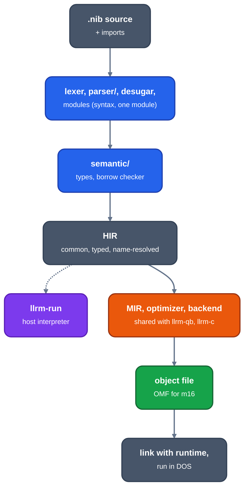

# Nib

Audience: users and contributors of the Nib frontend. What Nib is, how to
build and run its tools, where its code lives, and the documents about it.

Nib is a small, statically typed systems language with indentation-delimited
blocks. It has structs, enums, generics, protocols, ownership and borrowing
with no garbage collector, `Option`/`Result` with `?`, generators, and
explicit foreign interop. Programs target 16-bit real-mode DOS (`-m16`, the
default) or 32-bit flat code (`-m32`).

```text
fn main() -> i16:
    let mut total: i16 = 0
    for i in 0..5:
        total += i
    print(f"total {total}")
    return 0
```

The frontend lexes, parses and checks a module, resolves its imports, and
writes common HIR. HIR goes through the shared MIR optimizer and backend like
every other frontend's.



*From Nib source to a DOS program*

## Tools

Build them without the DOS toolchain, which only `llrm-c` needs:

```sh
cargo build --release --no-default-features --bin llrm-nib --bin llrm-run \
    --bin nibfront --bin nib-lsp
```

`llrm-nib SOURCE [-o OUT] [-S] [--entry NAME] [--dump DIR] [OPTIONS]`
compiles to an object file, or with `-S` to assembly; without `-o` the output
goes beside the source. `OPTIONS` are the compiler's shared gcc-style flags:
`-O0` to `-O3`, `-Os`, `-Oz`, `-Og`, `-Omax`, `-g`, `-m16`/`-m32`,
`-march=`, `-mabi=`, `-f[no-]PASS` and the rest listed by the usage line an
unknown option prints. Nib's own flags:

| Flag | Does |
|---|---|
| `--entry NAME` | the entry function, default `main` |
| `--dump DIR` | writes the input, tokens, syntax, HIR and every pipeline stage under `DIR`, then compiles |
| `--procedure-segments` | one COMDAT per procedure (OMF), for a linker that drops unreferenced ones: jwlink's `option eliminate`, Microsoft's LINK /PACKFUNCTIONS |
| `--used-by OBJ` | keeps only the exports those objects import (repeatable) |
| `--unchecked-bounds` | no index or slice bounds checks, as in `unsafe` |
| `--declare h\|bi\|inc` | prints the C, BASIC or assembler declarations of the program's exports instead of compiling |
| `--os-layer FIELD` | prints a field of the target's OS layer instead of compiling |
| `-Wno-target-width` | turns off the warnings about source widths that differ on the target |

`llrm-run [-m16|-m32] SOURCE.nib [ENTRY] [INTEGER...]` compiles the module and
runs `ENTRY` (default `main`) on the host HIR interpreter, passing the integer
arguments. Standard input, when not a terminal, is the program's console.
It prints the program's output, then `ENTRY returned VALUE` on stderr, and
fails on a panic or a leaked heap buffer.

`nibfront [-m16|-m32] [--tokens|--syntax|--declare h|bi|inc] FILE` prints the
HIR JSON, or with an option an earlier stage.

`nib-lsp` is the language server ([lsp](lsp.md)).

To build a DOS executable, `tools/nib-build.sh SOURCE.nib [OUTPUT.EXE]
[-O2|-Os] [FOREIGN.c|.asm ...]` compiles with `llrm-nib`, assembles the
runtime and any foreign files, and links; it needs the DOS toolchain
the default build bootstraps. `cargo test --test run` builds `examples/` and
runs each in DOSBox against its `.out`.

Diagnostics are `file:line:column: message`. The checker stops at the first
error.

## Where the code is

| Path | Holds |
|---|---|
| `crates/frontends/nib/src/lexer.rs`, `parser/`, `syntax.rs` | tokens and the syntax tree |
| `.../desugar.rs`, `modules.rs`, `scopes.rs`, `consts.rs` | rewrites before checking, import loading and linking, local scopes, constants |
| `.../semantic/` | the type checker, HIR emission, the borrow checker (`borrows.rs`, `liveness.rs`, `moves.rs`, `ownership.rs`, `writable.rs`, `modref.rs`, `escaping.rs`, `captures.rs`) |
| `.../resumable.rs`, `semantic/generators.rs` | generators as resumable state |
| `.../conversions.rs`, `library.rs` | C's implicit conversions per target `int`; number methods written in Nib |
| `.../standard.rs`, `std/`, `runtime/`, `abi/`, `prelude.nib` | the modules the compiler supplies (`std.*`, `abi.*`), the runtime linked into programs, the BASIC runtime layouts, the prelude |
| `.../declarations.rs` | `.H`, `.BI`, `.INC` output |
| `.../compile.rs`, `driver.rs`, `cli.rs`, `nibstages.rs` | HIR to object, the driver, the `llrm-nib` command line, `--dump` |
| `.../lsp/` | the language server |
| `.../test_*.rs`, `semantic/tests.rs` | tests; `test_borrowck.rs` is the borrow checker's |
| `src/bin/llrm-nib.rs`, `llrm-run.rs`, `nibfront.rs`, `nib-lsp.rs` | the four programs |
| `editors/tree-sitter-nib/`, `editors/zed/` | the grammar and the Zed extension |
| `examples/*.nib` with `.out` | programs and their expected output |
| `tools/nib-build.sh` | build a DOS executable |

`cargo test -p llrm-nib` runs the frontend's tests.

## `noundef` (note N1)

llrm-c states `noundef` on scalar parameters and arguments as clang does
(`DetermineNoUndef`, CGCall.cpp). llrm-nib states none yet.

What guarantees a defined value: a binding needs an initializer
(`language-spec.md`, section 2), so a scalar, a pointer, an `&T` or a `string`
or `vec` pointer is never `undef` when it is passed.

What does not: the result slot (uninitialized storage the callee only writes,
`language-spec.md` section 9.2: the hidden pointer to it is defined, what it
points to is not), a struct or enum passed whole (its padding and unused payload bytes are not
shown defined). Those stay unmarked, as clang leaves aggregates.

## Documents

| Document | Content |
|---|---|
| [language-spec](language-spec.md) | the language, with its calling convention and data layout |
| [borrowing](borrowing.md) | ownership, moves, borrows, and what the checker accepts and refuses |
| [lsp](lsp.md) | the language server |
