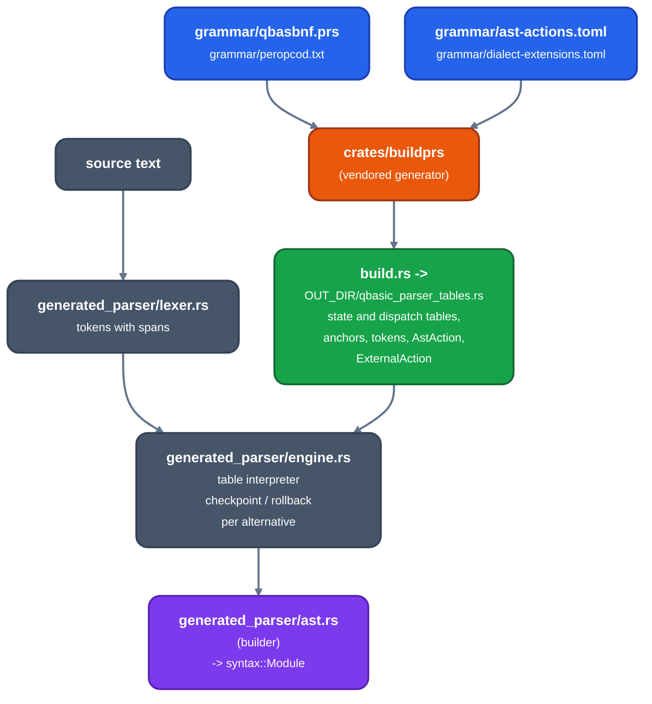
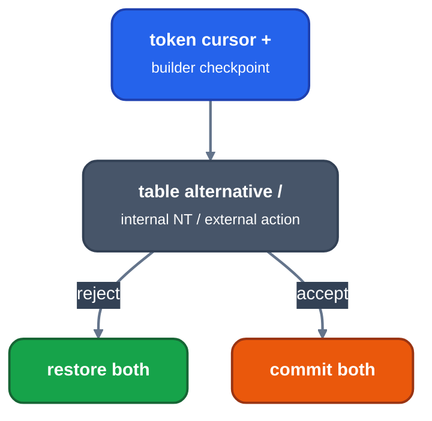

# The generated QB parser

Audience: contributors to `qbfront`'s parser. Where its tables come from, how
they are built and checked, and how they become the syntax tree.

## Pipeline

*From grammar to syntax tree*

`build.rs` runs the vendored generator over the grammar and opcode catalog and
emits the state table, the internal and external nonterminal dispatch tables,
statement and function anchors, token numbers, and the typed `AstAction` and
`ExternalAction` enums. An ordinary build needs no DOS tool and no other
checkout. `ast-actions.toml` names grammar `EMIT` and external identities
symbolically; the build fails when a name is absent from the grammar or the
opcode catalog.

## Source and license

The generator and grammar are extracted from the `qbasic-port` repository,
commit `e468001b32a96a70c44b5767790de71698ef57c0`, a Rust port of the QBasic
1.1 parser. The commit has no standalone license file; its `Cargo.toml` and
`buildprs` `Cargo.toml` declare `license = "MIT"`. The vendored file headers
are kept as they were.

The grammar is recovered Microsoft QBasic 1.1 source. It is evidence for the
QB base syntax, not for PDS 7.1 or VBDOS additions.

Vendored byte for byte, with no p-code dependency:

- `crates/frontends/qb/crates/buildprs`, the generator;
- `grammar/qbasbnf.prs` and `grammar/peropcod.txt`; and
- the captured generator outputs under `crates/frontends/qb/fixtures/buildprs/`
  (`qbasic-1.1`, `qbasic-1.1-o0`, `micro`), which prove the host generator still reproduces the recovered tables.

## Adapted, not copied

| qbasic-port | Local module in `src/generated_parser/` |
|---|---|
| `prslex.rs` | `lexer.rs`: tokenizes with spans; accepts every catalogue spelling, so `?` is `PRINT` and `&377` is octal |
| `prsnt.rs` | `engine.rs`: interprets state bytes, dispatches external actions |
| `prsstmt.rs`, `prsexp.rs`, `prsid.rs`, `prsmain.rs` | `ast.rs`: builds `syntax::Statement`, expressions, names and declarations, and parses a module |

The p-code generator, scanner patching, executor, IDE, display, audio and
runtime modules are not part of the frontend. Numeric grammar words reach only
the table decoder, which turns each into a typed `AstAction`; an unmapped one
is `AstAction::Unsupported("op...")` and fails explicitly. Numeric action IDs
and word buffers do not enter syntax, HIR or MIR.

## Speculative parsing

*An alternative checkpoints the token cursor and the builder*

An alternative checkpoints the token cursor, the `AstSink` and every builder
collection or mode it can change (expressions, statements, declarations,
labels, procedure references, type names, literal values, parameters).
Restoring only the cursor would let a declaration, mark or partial expression
from a failed alternative poison the next one. `MARK` and `EMIT` invoke the
sink immediately, internal nonterminals recurse through `T_INT_NT_DISP`, and
external nonterminals decode to `ExternalAction` variants before the
hand-written builder runs.

## External actions

The grammar delegates its context-sensitive work to 49 external nonterminals
(`EXTERNAL` entries in `qbasbnf.prs`): declaration context (`IdFuncDecl`,
`IdSubDef`, `Deflist*`, ...), expression and lexical boundaries (`Exp`,
`LitString`, `RwB`, ...), name ambiguity (`Assignment`, `IdAry*`, `IdFor`,
...), line structure (`IfStmt`, `LabLn`, `Statement`, ...) and bounded
argument forms (`NArgsMax3` to `5`). Each is registered to a typed action in
`ast-actions.toml`.

## Syntax tree boundary

The hand-written syntax types are the lossless source boundary. They keep
names and the effective written type, fixed string lengths, source-order array
bounds and dynamic or shared form, parameter `BYVAL`/`SEG` state, procedure
kind and static state, and spans. They do not distinguish an equivalent suffix
from an `AS` spelling, and do not model `FAR`/`HUGE`/`COMMON` or the dialect an
element came from. The `retains` entries in `ast-actions.toml` claim only
facts this model can represent, and the build rejects a claim outside that
vocabulary. A dialect extension first gains a syntax field and parser
behavior; only then may the schema claim the fact.

Semantic analysis, not parsing, resolves suffix, default and `AS` types and
names, and applies the selected profile's type sizes, layout, address spaces,
descriptor ordering, floating evaluation and call ABI. The parser chooses no
layout and resolves no ABI policy.

## Dialects

QB 4.5, PDS 7.1 and VBDOS all parse the VBDOS syntax superset, for every
profile. The additions after QBasic 1.1 are named generated-table extensions
in `grammar/dialect-extensions.toml` (for example `OPTION EXPLICIT`,
`ON LOCAL ERROR`, `CDECL ALIAS`), validated by `build.rs` and applied
universally by `src/dialect_extensions.rs`. Profile selection starts after
parsing ([dialects](dialects.md)). A token name that appears in the recovered
grammar is not evidence that a compiler accepts it; ISAM and OS/2 `SIGNAL`
names are catalogue entries only.

## Checks

| Check | Where |
|---|---|
| The vendored generator reproduces the captured QBasic tables and equates | `fixtures/buildprs/`, tests in `crates/buildprs` |
| The generated parser accepts the VBDOS superset under every dialect | `tests/generated_parser.rs` |
| The AST of each accepted conformance case equals its snapshot | `fixtures/legacy_ast_goldens/`, `tests/generated_parser.rs` |

The snapshots are a frozen record of the earlier parser. When the syntax model
gains a field, every case must first match the old snapshot after projecting
only that field; then all snapshots move to the new schema together
(`QBFRONT_BLESS=1` rewrites them, and the diff shows added lines only). The
test never ignores a field.

`cargo run -p qbfront --bin qbparse-stages -- DIALECT SOURCE OUTDIR` dumps the
source, the typed action stream and the syntax tree of one program.

Parse counts are reported apart from semantic HIR, MIR, object, link and DOS
counts, and no case is runtime-green from parser acceptance alone.
