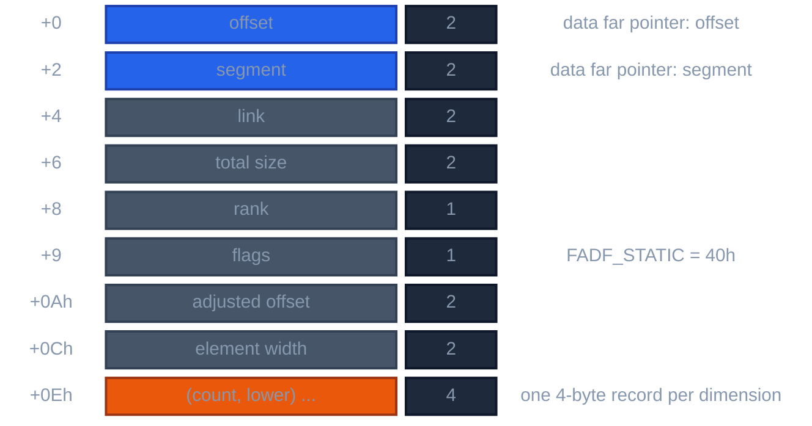

# 386 real-mode memory and runtime model

Audience: contributors to `qbfront` and the QB HIR-to-MIR adapter. The address
spaces, storage classes, floating-point rules and frame layouts the QB frontend
relies on.

The target is Intel 386 or newer executing 16-bit real-mode DOS code. The 386
minimum permits 32-bit integer instructions and operand/address-size
overrides. It does not turn DOS memory into a flat address space.

Ordinary data segments and DGROUP remain 64 KiB resources. A 32-bit `LONG`
or address-size override does not widen a near pointer, increase a segment
limit, or authorize unreal-mode addressing. Module statics, descriptors,
runtime bookkeeping, and near allocations therefore need an explicit group
budget; data that cannot fit uses the runtime's far/huge allocation path.

## Address spaces

| Form | Meaning |
|---|---|
| near | 16-bit offset interpreted in a known segment or group |
| far | 16:16 segment:offset pointer naming one object/access path |
| huge | 16:16 pointer whose arithmetic normalizes and wraps for objects crossing segment windows |
| code | far procedure identity or code relocation used by the runtime/linker |

A far or huge pointer is not a flat 32-bit integer. Huge pointer arithmetic
does not become packed `ADD`: the adapter emits the whole-pointer and
`PTR_OFFSET` MIR form, and the backend performs the selector/offset lowering
described in [pointer-lowering](../../machine/pointer-lowering.md).

No frontend operation selects `DS`, `SS`, `ES`, `BP`, `SI`, or any other
register. Segment selection and addressing modes are backend work.

Field projection through a dynamic array keeps the whole pointer and byte
displacement as HIR `ptr_offset`; it is not the address of an indirect
whole-pointer cell. Dynamic string descriptors are the exception. The QB string
arena is near, so `B$SASS`, `B$FLEN`, and `B$SCMP` receive the projected 16-bit
descriptor offset.

## Logical storage objects

Source storage is classified before HIR emission as one of: automatic
procedure local or parameter; static procedure local; module variable or
constant; `COMMON`/shared or external object; record object or field slice;
array descriptor; array allocation; opaque runtime-owned storage.

An object has stable identity, extent when known, alignment, mutability,
escape, and an address form. Fields and array elements are slices of that
object, not unrelated numeric addresses. The adapter maps these facts into the
memory model in `crates/ir/llrm-mir/src/memory.rs`.

Near-versus-far by itself does not prove two accesses disjoint, and equal
offsets in different objects are not the same storage. Raw segmented memory
(`DEF SEG`, `PEEK`, `POKE`), and addresses passed to unknown code, escape the
object and force conservative alias and call effects. Unequal segment:offset
spellings are never proof that two physical addresses differ.

## One address space (m32): flat addresses, no segments

At a target with one address space a pointer is the whole 32-bit linear address, and the program holds addresses in variables:

- `VARPTR(x)` is the address of `x`; `VARSEG(x)` is 0.
- `DEF SEG = constant` sets the linear base, segment * 16, added to every `PEEK`, `POKE`, `BLOAD` and `BSAVE` address; a bare
  `DEF SEG` sets it to 0. `DEF SEG = &HB800` then reaches video memory at 0xB8000 and `DEF SEG = 0` low memory, as under DOS/32A
  (conventional memory is at linear 0). A segment that is not a constant (`VARSEG(...)`, a variable) is refused: *DEF SEG with a
  non-constant segment is not supported at one address space*, at the line; far3 (a string flipped through `DEF SEG = VARSEG(a$)`
  printed unchanged) is why it cannot silently mean 0.
- `PEEK`, `POKE`, `BLOAD` and `BSAVE` take that address: `p& = VARPTR(a%(1)): POKE p&, 7`.
- An absolute address may also be held in a variable, as `vram& = &HB8000: POKE vram& + 160, 65`. A port of a probe sits beside it as `NAME.flat.bas`, which the harnesses build for m32 and compare with the original's
  BCOM45 output (`tests/qbrt/screen_text.flat.bas`).
- `SADD(s$)` is the flat address of the string's characters, and `VARPTR$(v)` is the string of the variable's type byte and its flat
  address: 3 bytes at m16 (a 16-bit offset), 5 at m32 (a 32-bit address). DRAW and PLAY read through it: `=` + `VARPTR$(v)` takes the
  value of an integer, single or double (rounded) variable (a long is an Illegal function call, as in BC), and `X` + `VARPTR$(s$)` runs a string
  variable (nesting up to 16). Known difference: BC raises Illegal function call when more text follows a VARPTR$ string in the same
  command string; ours accepts it.
- `BLOAD name` with no address is refused: the image holds a 16-bit segment and offset, which cannot name a flat address.
  `BSAVE` writes the low 16 bits of the address it was given.

So `DEF SEG = VARSEG(array(i))` followed by `PEEK(o)` and `POKE o, v` with offsets counted from the array's start (real mode's far
array: its data begins at offset 0 of its own segment) does not work here, and qbdemo's `fracline` is of that class: `o` is a linear
address. It cannot be made to work with a segment value: a 16-bit `VARSEG` cannot name an object above 1 MB, and DOS/32A puts the
program's heap in extended memory (`VARPTR` of a `$DYNAMIC` array is about 5.4 MB, of a variable in the data about 1.5 MB). Such a
program runs at m16 and is ported by hand to m32 (the array's address held in a variable) until the target has segments (a selector per
object); that is the memory-models decision, not a runtime fix.

A QuickBASIC program's `' link:` of a Nib library (examples/basic/scores.bas) is real mode only: Nib's BASIC ABI is 16-bit, so at m32
the build stops with *a library for BASIC is not supported at a flat target* (#1542 tracks the port).

## Runtime profiles

QB 4.5, PDS 7.1, and VBDOS are distinct ABI profiles; `llrm` is QB 4.5's
frames and descriptors called by the target's own convention
([dialects](dialects.md)). A profile owns procedure entry/exit and frame
layout, near/far and callback conventions, argument order and `BYREF`/`BYVAL`,
return locations, dynamic string and array descriptor layout, module header,
startup, event and error integration, external symbol spelling, and the
floating-point library linkage.

Facts are measured per profile. Layouts are shared only after the bytes and
calls agree.

Static STRING literals show the difference. QB 4.5 and PDS 7.1 use one near
descriptor-plus-payload object in `BC_CN`. VBDOS uses a private `FSL_CONST`
far descriptor and payload plus a near `BC_CN` bridge and a shared selector
word. HIR records the profile's typed data objects and relocations; MIR sees
only the descriptor address.

HIR holds typed calls and logical storage. The adapter applies the ABI
contract and produces MIR calls and memory effects. OMF records, module
headers, fixups and library requirements are a link plan beside MIR.

## LONG and integer math

A `LONG` is a signed 32-bit value throughout HIR and MIR. At a public
call/return boundary only, ABI physicalization splits or joins two words and
assigns `DX:AX`. Long multiply, divide, remainder and compare are whole
semantic operations. Overflow and division policy is the compiler's shared
one (`-fsanitize=signed-integer-overflow`, `integer-divide-by-zero`); the
frontend does not infer semantics from the convenient 386 instruction.

## Floating point

- `SINGLE` storage is binary32 and `DOUBLE` binary64.
- Evaluation may use extended x87 precision until a store or conversion rounds.
- Rounding, exceptions and unordered comparisons use the MIR floating
  semantics, not folding of host floats during parsing.

Arithmetic, comparison, negation, absolute value, square root and conversions
are native MIR operations. Other math intrinsics stay named in HIR through
optimization. After x87 stack allocation the QB finalizer replaces each
remaining `st(0) -> st(0)` intrinsic with its 80387 byte sequence: `SIN` and
`COS` are single instructions, `ATN` is `fld1; fpatan`, and a positive-base
power is `log2(base) * exponent` followed by `exp2`, both expanded inline.
Substituting after allocation keeps MIR and the machine passes free of
calls that do not exist.

Inline floating operations are native x87, so a program that uses floats
needs an x87-compatible coprocessor or execution environment. A new module has
no patch-site anchors for the legacy floating-emulator byte protocol, and
there is no soft-float backend.

## Arrays

The frontend records element type and size, rank and source bounds, static or
dynamic allocation, near/far/huge address behavior, descriptor and allocation
identity, and whether a bounds check is required. Dimensions stay in source
order in HIR; the ABI adapter applies descriptor ordering, adjusted base and
stride once, in an explicit width, never host `usize`.

Numeric arrays are addressed inline. String arrays and unsupported
descriptor operations are runtime calls.

A dynamic element of a frame allocation is `ADDRESS(fixed frame base)` plus an
ordinary integer `ADD(dynamic byte offset)`, for near offsets and for the
offset half of far/huge pointers, so the allocator may use any general register
for the offset.

### Descriptor layout

The `AD` descriptor of a numeric array, from the measured `ARRAY.INC` layout:

*AD descriptor of a numeric array*

An array of unspecified rank reserves BASCOM's eight dimension records: a
14-byte header plus eight four-byte records, 46 bytes. That is an ABI storage
rule, distinct from the parser's subscript ceiling.

Module `$STATIC` numeric arrays split storage from metadata. Elements live in
`BC_DATA`; the descriptor lives in read-only `BC_CN` and holds a relocated far
pointer to the elements. BASIC startup clears `BC_DATA`, so a descriptor
emitted there would be zero when a procedure passed it to the runtime.

A module array whose bound is a LONG constant (`DIM SHARED a(32000&) AS INTEGER`) is made as a `$DYNAMIC` one even under
`$STATIC`: BC allocates it in far memory when the program starts, whatever its size, while `a(30000)` stays in `BC_DATA` (probed
with BC 4.5, `tests/qbrt/bc_static_arrays_far.bas`). Two such arrays together may exceed DGROUP. Known difference: `ERASE` frees it
instead of clearing it.

`$DYNAMIC` arrays own a mutable descriptor in `BC_DATA`; a bounded declaration
executes `B$DDIM`, and a later `REDIM` passes the same descriptor to
`B$RDIM`. The element allocation is not in DGROUP. VBDOS `MOD_TEX` and
`R_BSP` load the selector from `AD+2` and the adjusted offset from `AD+0Ah`,
then add the scaled subscript to that 16-bit offset. `AD+0Ah` already accounts
for every declared lower bound, so indexing must not subtract the first lower
bound again. HIR forms the 16-bit byte offset and concatenates it with the
selector; it does not send the pointer through huge-pointer normalization.
`/AH` arrays are not covered.

## Procedure calls and frames

HIR procedure types keep the parameter mode, array/descriptor passing, result
type and whether a call can escape an address. HIR keeps source parameter
order. Pascal pushes left to right, so the first formal is furthest from the
return address and the adapter alone maps it to `6 +` the widths of all later
formals; `CDECL` pushes right to left and uses ascending offsets.

Runtime calls use the audited contracts of `llrm-qbruntime`. An unknown call
reads and writes escaped memory and preserves no fact the ABI does not
guarantee.

### Runtime frames

```mermaid
%%{init: {'theme':'base','themeVariables':{'fontFamily':'Segoe UI, Helvetica Neue, Arial, DejaVu Sans, sans-serif','fontSize':'15px','primaryColor':'#475569','primaryTextColor':'#ffffff','primaryBorderColor':'#334155','lineColor':'#64748b','textColor':'#64748b'}}}%%
block-beta
  columns 8
  space:1 a3["▲ higher addresses"]:3 space:4
  o1[" "] c1["parameters"]:3 s1[" "] n1["Pascal: first formal furthest from [bp+6]"]:3
  o2[" "] c2["return address"]:3 s2[" "] n2["far"]:3
  o3[" "] c3["runtime header"]:3 s3[" "] n3["BP at its top#59; 10 bytes QB 4.5 / llrm, 18 bytes PDS 7.1, 20 bytes VBDOS#59; holds saved BP, frame chain, SI, DI"]:3
  o4[" "] c4["source locals and spills"]:3 s4[" "] n4["SP at the bottom"]:3
  space:1 a8["▼ stack grows down"]:3 space:4
  classDef off fill:transparent,stroke:transparent,stroke-width:2px,color:#64748b
  classDef cell fill:#475569,stroke:#334155,stroke-width:2px,color:#ffffff
  classDef src fill:#2563eb,stroke:#1e40af,stroke-width:2px,color:#ffffff
  classDef opt fill:#ea580c,stroke:#9a3412,stroke-width:2px,color:#ffffff
  class a3,o1,n1,s1,o2,n2,s2,o3,n3,s3,o4,n4,s4,a8 off
  class c1,c4 cell
  class c2 src
  class c3 opt
```

*Frame of a QB procedure (far call, Pascal order)*

`B$ENRA` pushes BP, installs the BASIC frame chain, saves SI and DI, and
allocates and zeroes the locals; `B$EXSA` reverses it before the far return.
Locals and spills are rebased below the header
([sizes](https://github.com/ali-mosavian/llrm/blob/c341bd6e3de058142c6652d399b8dfeb444eff9b/crates/backend/llrm-core/src/driver/basic.rs#L63-L77)).
A procedure frames itself instead when the runtime needs none
([dialects](dialects.md#procedure-frames)); `--runtime-frames` keeps the
runtime's frame everywhere.

Compiler-created cells follow their enclosing storage class: a module-level
`FOR` end or step is module data, a `STATIC` procedure's is a private data
object, an automatic procedure's is a frame cell. Identical floating literals
are pooled per module, as BC does.

### STRING temporaries and descriptors

`BX` at `B$ENRA` counts the frame-owned dynamic-STRING descriptors. Runtime
call results (`COMMAND$`, `LTRIM$`, `RTRIM$`, `LDFS`, `SCAT`) stay on the
runtime's temporary chain and add none. Fixed-bound variable-length STRING
arrays are descriptor-backed and use `B$DDIM` with `B$ERS1` at exit.

A `BYREF STRING` formal needs a descriptor that lives through the whole callee.
A dynamic STRING variable already has one. A literal, fixed string,
concatenation or string-function result is only a runtime temporary, so it is
first assigned with `B$SASS` to an owned descriptor, because `B$FLEN` may
consume a temporary: `LEN` then `ASC` on a literal passed directly raises
error 5 on the second call. In a procedure the descriptor is a managed local
and counts in `BX`; at module level it is module data.

A dynamic STRING function result has two representations. The result variable
is an owned four-byte descriptor in the runtime frame. The expression the
caller sees is a near descriptor address: before `B$EXSA` releases the frame
the callee passes the owned descriptor to `B$SCPF`, which copies it to the
temporary chain and returns the surviving near address in AX. HIR types the
callable's result `near*string` and the local result place `string`.

### Result conventions

- A public `LONG` result is returned in `DX:AX`, also under `/G3`.
- A Pascal function returning `SINGLE` or `DOUBLE` takes a hidden near
  destination pointer after its source formals, stores the rounded result
  there, returns the pointer in AX, and counts its two bytes in `retf n`. HIR
  keeps a floating result; only the adapter introduces the pointer.
- `TIMER` is a zero-argument `B$TIMR` call whose AX result is a near pointer
  to a runtime-owned `SINGLE`.

## Responsibility boundary

| Layer | Responsible for | Must not do |
|---|---|---|
| QB semantic frontend | source types, storage class, parameter mode, bounds, evaluation order | choose registers or encodings |
| HIR | resolved typed meaning and logical effects | model p-code, OMF, or legacy register pairs |
| QB HIR-to-MIR adapter | runtime ABI, memory/array/call facts, allowed semantic expansion | add MIR kinds or machine operations |
| MIR and optimizer | SSA and machine-independent optimization | know QB grammar or x86 registers |
| lowering and backend | real-mode encodings, register allocation, pointer lowering, OMF emission | reinterpret source semantics |
