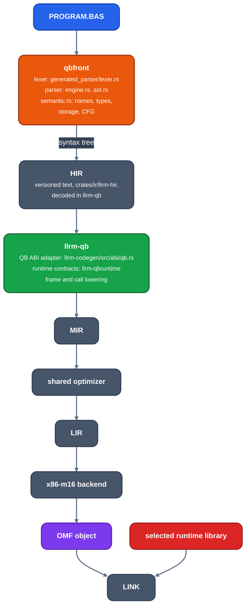

# QuickBASIC frontend

Audience: users and contributors of `llrm-qb`. What the QB-family source
compiler accepts, how it is invoked, and how a program flows from source to an
OMF object.

`llrm-qb` compiles QuickBASIC 4.5, QBasic 1.1, PDS 7.1, VBDOS and QuickrBASIC
source for 386+ real-mode DOS (`-m16`) and for the flat 32-bit DOS target (`-m32`, under DOS/32A). It is a source compiler: it lexes and parses the
program, lowers it to HIR, and hands MIR to the optimizer and backend shared
with every other frontend.

Contents: [dialects](dialects.md) (dialects, runtimes, QuickrBASIC),
[abi](abi.md) (measured procedure, array and symbol ABI),
[memory-model](memory-model.md) (address spaces, frames, descriptors),
[divergences](divergences.md) (deliberate differences from BC),
[generated-parser](generated-parser.md) (parser tables, provenance, checks).
The BC-object input route is [bc](../bc.md).

## Pipeline



*From PROGRAM.BAS to a linked program*

`qbfront` owns everything that varies by language and is a library plus a
`qbfront` binary that prints HIR. `llrm-qb` decodes that HIR, adds what the
runtime promises about its routines, and drives the shared pipeline to an
object. The program is linked by Microsoft `LINK` against the runtime library
of `--runtime`: `BCOM45.LIB`, the PDS or VBDOS runtime, or, for `llrm`,
`LLRMQB.LIB`, built from the C sources in `runtime/qb` by
`tools/dosbatch/qbruntime.py`.

The three selections are independent: dialect controls accepted source and
source semantics, runtime controls descriptors, calls, startup and library
names, and the target is 386+ real mode with native x87 for inline floating
point. See [dialects](dialects.md).

## Usage

```
llrm-qb SOURCE [-o OUT] [options]
```

Without `-o` and `-S` the HIR text is printed. `-o OUT` writes the OMF object,
`-S` the assembly listing.

| Option | Does |
|---|---|
| `--dialect D` | `qbasic11`, `qb45`, `pds71`, `vbdos` (default), `quickr` |
| `--runtime R`, `-fqb-runtime=R` | `qb45`, `pds71`, `vbdos`, `llrm` (default) |
| `--array-order O` | `column-major` (default) or `row-major`, BC's `/R` |
| `--huge-arrays` | BC's `/Ah` |
| `--mbf` | BC's `/MBF`: Microsoft binary floating point |
| `--alternate-math` | BC's `/FPa` |
| `--whole-program` | Procedures get internal linkage; nothing outside the source calls them |
| `--array-merging` | Dynamic arrays read together share one allocation |
| `--runtime-frames` | Every procedure uses the runtime's frame entry and exit |
| `--error-lines` | Errors in a module handler report their BASIC line |
| `--bc-codeview` | With `-g`, BC's own CodeView layout instead of CodeView 4 |
| `--include DIR` | Search path for `$INCLUDE` |
| `--dump-hir PATH` | Write the HIR text to `PATH` |
| `--dump DIR` | Write `00-input.bas` and `01-hir.json` to `DIR`; `LLRM_MIR_STAGES` dumps the MIR passes |

The gcc-style options of `llrm-cc` and `llrm-nib` apply too: `-O0` to `-O3`,
`-Os`, `-Oz`, `-Og`, `-f[no-]PASS`, `-march`, `-mtune`, `-m16`, `-m32`, `-g` and
`-S`. `-fsanitize=bounds,integer-divide-by-zero,signed-integer-overflow` (or
`undefined`) are BC's `/D` checks, `-fsanitize=stack` is its stack check, `-fexcess-precision=standard` (or `-ffloat-store`) rounds every value stored to a SINGLE or DOUBLE variable to its type as BC does (off by default: [floating environment](../../reference/semantics/floating-environment.md)), and
`-g` writes line numbers. `--own-frames` is accepted and does nothing. The
usage text printed by a bad argument lists every option.

`qbfront` itself takes the same dialect, runtime and switch options with
`--syntax` to parse only, `--dump-source FILE` and the checked-switch names
`--checked-arrays`, `--checked-division` and `--checked-overflow`.

## Scope

The targets are an Intel 386 or newer CPU running 16-bit real-mode DOS (`-m16`)
and the flat 32-bit DOS target (`-m32`, one address space: see
[memory-model](memory-model.md#one-address-space-m32-flat-addresses-no-segments)),
not an 8086/286 code generator. The compiler links
against the selected runtime rather than reimplementing it, apart from the
`llrm` runtime.

The parser accepts the VBDOS syntax superset. Semantic expansion is narrower.
Only these are lowered as inline computation:

- integer and `LONG` arithmetic and comparisons;
- floating-point arithmetic and the recognized numeric math operations; and
- numeric array bounds, addressing, loads and stores.

Other statements and functions are runtime calls or ordinary control flow and
add no MIR instructions. Syntax accepted before its lowering exists reports a
specific unsupported construct after semantic analysis.

QB intrinsics are resolved in one declarative catalogue,
`crates/frontends/qb/src/intrinsics.rs`. Each entry holds dialect
availability, arity, result class, effects and an exact lowering variant;
semantic analysis never tells two intrinsics apart by spelling a second time.

## Accuracy policy

Parser fidelity and compiler-bug compatibility are different goals. The
compiler follows documented and measured QB, PDS and VBDOS language behavior and
does not reproduce a legacy optimizer miscompile. Deliberate differences are in
[divergences](divergences.md).

Where manuals, the recovered grammar and compiler binaries disagree, a minimal
executable probe against each relevant compiler decides. FreeBASIC is not an
authority; a test idea taken from it is re-established against QB, PDS or VBDOS
before it becomes a regression. Expected results are derived by hand, not only
by agreement of two implementations.

Two source-level rules follow from probes of VBDOS:

- A variable or parameter declared `AS VOLATILE T` is a volatile HIR place. It
  is the only way to make a `BYREF` poll reload on every loop back-edge; no
  variable is assumed volatile.
- Single-line `IF` keeps every colon-separated statement in its arm through
  `ELSE` or the end of the line.

## Tests

| Where | What |
|---|---|
| `crates/frontends/qb/tests/` | parser, quickr and generated-parser tests; `fixtures/*.bas` programs |
| `crates/frontends/qb/src/test_*.rs` | HIR to object, frames, intrinsics, resume, stack check, debug info |
| `tests/run/qb/*.bas` | programs run in DOSBox-X against their `.out` by `tools/dosbatch/run_tests.py qb` |
| `tests/differential/` | llrm-qb against BC, and the Microsoft BASIC conformance suites on their own runtimes: `cargo test --test differential` |

See [testing](../../working/testing.md).
