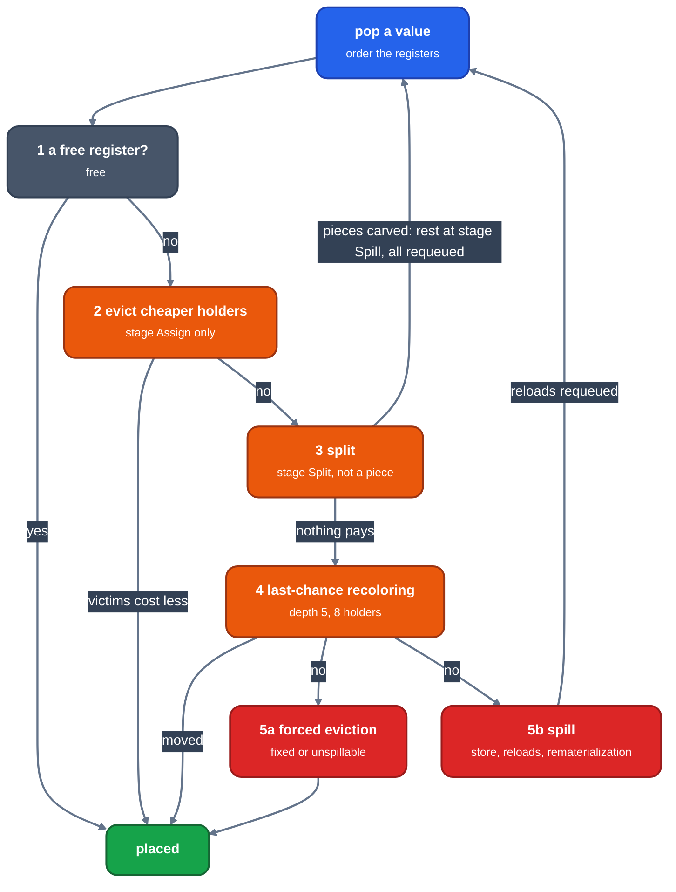

# The assignment loop

Audience: an engineer changing or debugging how `RegAlloc` picks a register. This page follows one value through the queue, then the candidate search around the loop and its cost model.

`RegAlloc::transform` ([`allocate.rs`](https://github.com/ali-mosavian/llrm/blob/82848d3b75a0dc0b0541d99bbcc5071361710eb9/crates/backend/llrm-core/src/backend/allocate.rs#L3181)) prepares the body ([inputs-and-classes](inputs-and-classes.md)), runs [`_allocated`](https://github.com/ali-mosavian/llrm/blob/82848d3b75a0dc0b0541d99bbcc5071361710eb9/crates/backend/llrm-core/src/backend/allocate.rs#L1657) on it and on candidate shapes of it, keeps the cheapest and applies it. `_allocated` is LLVM's `RAGreedy`, with the splitting and spilling carved into the body the moment they are chosen.

## The queue

Every value the body names is queued. `Queued(not fixed, -priority, value)` in a min-heap pops:

1. values pinned to a register (`fixed`), then
2. values by `_queue_priority`: `narrow * 1e9`, where `narrow` is the number of registers the file has less the number the value's class has, so values few registers may hold go before wide ones ([`test_a_value_few_registers_may_hold_goes_before_a_longer_one_any_may`](https://github.com/ali-mosavian/llrm/blob/82848d3b75a0dc0b0541d99bbcc5071361710eb9/crates/backend/llrm-core/src/backend/allocate.rs#L4991)); plus `1e6` for a value past its first stage; plus the interval's size in uniform slots, so longer ranges go first;
3. the lower value number.

Each value carries a [`Stage`](https://github.com/ali-mosavian/llrm/blob/82848d3b75a0dc0b0541d99bbcc5071361710eb9/crates/backend/llrm-core/src/backend/allocate.rs#L1004): `Assign`, `Split`, `Spill`, `Done`. It only moves forward, except that a value evicted from a register goes back to `Assign`.

## One value

*The ladder, in order. A rewrite (split or spill) recomputes the facts and requeues what it made or disturbed.*

**Order of registers.** A fixed value has one. Otherwise `target::order` of its class: `available` in file order, or the selectors for a segment class. The data segment register is left out where the body names it itself, and tried last otherwise. Then, for a value that is not fixed:

* each copy partner (`_copy_hints`: a same-width `mov` between two values) that has a register votes for it; with no partner placed, the register `_wanted` carries to it through chains of copies from a fixed value votes; registers sort by votes;
* registers other values that want them (`Claims`) and are live here are tried last;
* a `preferred` register (given by the caller) is first.

**1 Free.** [`_free`](https://github.com/ali-mosavian/llrm/blob/82848d3b75a0dc0b0541d99bbcc5071361710eb9/crates/backend/llrm-core/src/backend/allocate.rs#L2835) takes the first register not destroyed over the interval (`_clobbered`) with no holder meeting it (`LiveUnion::busy`).

**2 Evict.** At stage `Assign`, or at any stage for a value of infinite weight, [`_evict`](https://github.com/ali-mosavian/llrm/blob/82848d3b75a0dc0b0541d99bbcc5071361710eb9/crates/backend/llrm-core/src/backend/allocate.rs#L2856) takes the register whose holders cost least. A holder that can sit in another free register costs nothing; any other costs its weight. It refuses a register whose holders include a fixed or protected value, a holder from the same or a newer eviction cascade (an unspillable value may break the cascade of a spillable one), and any bill not below the value's own weight. The victims go back to the queue at `Assign`. Failing, the value moves to `Split` and is requeued. Test: [`test_a_hard_register_assignment_is_not_an_eviction_victim`](https://github.com/ali-mosavian/llrm/blob/82848d3b75a0dc0b0541d99bbcc5071361710eb9/crates/backend/llrm-core/src/backend/allocate.rs#L5016).

**3 Split** ([splitting](splitting.md)) when splitting is on, the stage is `Split`, the value is not a piece of an earlier split and not bound (fixed, or infinite weight). The first of `local`, `placed`, `per_block` to give a region that pays is carved; the pieces become `Assign` values, the rest is set to `Spill` and may only take a free register or spill.

**4 Last chance.** [`Coloring::recolor`](https://github.com/ali-mosavian/llrm/blob/82848d3b75a0dc0b0541d99bbcc5071361710eb9/crates/backend/llrm-core/src/backend/allocate.rs#L3014) is `RAGreedy::tryLastChanceRecoloring`: for each register of the value, release its holders, take it, and give each holder a free register or recolor it, up to `DEPTH` 5 levels and `INTERFERENCES` 8 holders, `BUDGET` 256 tries per session, never moving a fenced value or one already recolored in the session. On failure every move is undone ([`test_a_recoloring_that_fails_restores_every_holder`](https://github.com/ali-mosavian/llrm/blob/82848d3b75a0dc0b0541d99bbcc5071361710eb9/crates/backend/llrm-core/src/backend/allocate.rs#L5148)). The constants are LLVM's `lcr-max-depth` and `lcr-max-interf`; the budget is ours.

**5 No register.** A fixed or unspillable value takes the register whose holders cost least by force ([`_forced`](https://github.com/ali-mosavian/llrm/blob/82848d3b75a0dc0b0541d99bbcc5071361710eb9/crates/backend/llrm-core/src/backend/allocate.rs#L2910)); the holders go to `Spill`. A holder that cannot be spilled either rules the register out. This is the "last resort", counted by `allocate::last_resorts` and printed on the `regalloc` channel. Any other value is spilled: its weight is added to the cost; with a frame, the spiller chooses siblings that share its slot, rewrites the body and requeues the reloads it made, which are unspillable ([spilling](spilling.md)).

After a rewrite the allocator recomputes `Facts`, finds the pins of the changed blocks (`required_added`), refreshes the `LiveUnion`, unplaces values whose register now clashes or is destroyed, and requeues what changed.

When the queue is empty, `_recolored_hints` moves a value to a copy partner's register when that register is free over the whole interval and joins more of its copies than the one it has; each move deletes copies and the loop ends because each join count rises. At most `BUDGET` queue visits (200 000) are taken; more is a bug and is logged.
