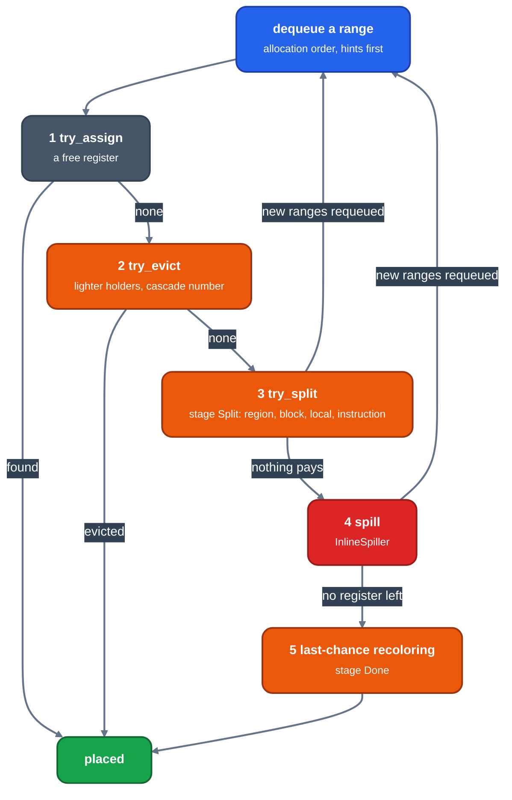

# The assignment loop

Audience: an engineer changing or debugging how the allocator picks a register. This page follows one range through the queue and the ladder from a free register to a spill.

The allocator is the translation of LLVM's `RAGreedy` (`greedy/greedy.rs`); `RegAlloc::transform` ([`allocate.rs`](../../../crates/codegen/llrm-codegen/src/backend/allocate.rs)) prepares the body ([inputs-and-classes](inputs-and-classes.md)), runs it through `greedy_rewritten`, and applies the registers it placed.

## The queue

`calculate_spill_weights_and_hints` gives every virtual register a weight and hints, then `enqueue` puts it in a priority queue and `allocate_phys_regs` (`RegAllocBase::allocatePhysRegs`) takes the best until it is empty. The priority is `get_priority`: ranges the spiller made last, long ranges first, a range inside one block in instruction order. Each range carries a stage that only moves forward (`New`, `Assign`, `Split`, `Split2`, `Spill`, `Done`) and an eviction cascade number.

## One range

*The ladder, in order, from `select_or_split_impl`. A split or spill makes smaller ranges and requeues them.*

**Order of registers.** The allocation order of the range's class, with a hint first (`is_hint`); the register file and what an instruction forces are in [inputs-and-classes](inputs-and-classes.md).

**1 Assign.** `try_assign` takes the first register in that order with no interference from the other placed ranges (`LiveRegMatrix`, [live-ranges](live-ranges.md)).

**2 Evict.** `try_evict` takes the register whose holders are all lighter than the range, each eviction stamping a cascade number so a cycle of evictions ends.

**3 Split.** At stage `Split` `try_split` cuts the range ([splitting](splitting.md)): region split first, then block, local and instruction splits. The pieces are requeued.

**4 Spill.** A range nothing else placed goes to the `InlineSpiller` ([spilling](spilling.md)); its store and reload ranges are tiny and requeued.

**5 Last chance.** A spill product that still finds no register recolors the ranges in its way (`try_last_chance_recoloring`).

When the queue is empty, `try_hints_recoloring` moves a range into the register of the copy it was hinted to when that removes more broken hints than it costs.

Pricing uses block frequencies and `executed::work`; the translation's differences from the pin are listed as `DEVIATE` markers in `greedy/` ([debugging](debugging.md) shows how to read a decision).
