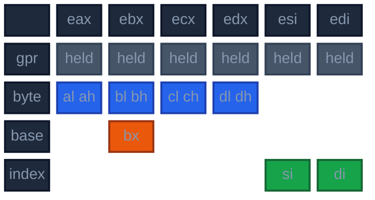

# Inputs, register classes and constraints

Audience: an engineer changing what the allocator may place where. This page states what a value may be held in, what an instruction forces, and what the allocator refuses before it starts.

## The register file

The file is data: each target's `registers.regs` ([m16](https://github.com/ali-mosavian/llrm/blob/82848d3b75a0dc0b0541d99bbcc5071361710eb9/crates/target/llrm-x86-m16/src/registers.regs), [m32](https://github.com/ali-mosavian/llrm/blob/82848d3b75a0dc0b0541d99bbcc5071361710eb9/crates/target/llrm-x86-m32/src/registers.regs)). Each line names a register, its width, its root (the 32-bit register it is a view of), its lane and its classes. [`RegisterClasses::of`](https://github.com/ali-mosavian/llrm/blob/82848d3b75a0dc0b0541d99bbcc5071361710eb9/crates/backend/llrm-core/src/backend/classes.rs#L51) reads it once per target; nothing in the allocator names a register list of its own.

The allocator places a value in a root. Its width picks the view: `al`, `ax` or `eax` of the root `eax`. `available` is the root list in file order, which is the order a free register is tried in.

| | m16 | m32 |
|---|---|---|
| `gpr` (a value may be held), in order | eax ebx ecx edx esi edi | eax ecx edx ebx esi edi |
| `byte` (has an 8-bit view) | eax ebx ecx edx | eax ecx edx ebx |
| `base` (a word address register) | ebx | all of `gpr` |
| `index` | esi edi | all of `gpr` |
| `reserved` | ebp esp, every segment register | ebp esp, every segment register |
| selectors (segment registers a value may be held in) | es fs gs; ds too under `-mstack-is-data` | none: the target is flat |
| x87 | st0 to st7, positional | st0 to st7, positional |
| `@scratch` (borrowed by a pass for a moment) | cx dx bx ax | cx dx bx ax |

m32 lists the caller-saved registers first, then the callee-saved ones. The selectors are `Segments::selectors` ([`target.rs`](https://github.com/ali-mosavian/llrm/blob/82848d3b75a0dc0b0541d99bbcc5071361710eb9/crates/backend/llrm-core/src/backend/target.rs#L242)), from the machine's `[segments]` table in `dos.toml`: the stack and code segments are reserved, and so is the data segment unless the stack lives in it. Which registers a convention keeps or destroys is in [abi](../../abi/x86-m16.md#registers) and [abi](../../abi/x86-m32.md#registers); a call states them as `clobbers` on the instruction, not in the file.

*Class membership on m16. A word address is `[bx+si]`, `[bx+di]`, `[bp+si]` or `[bp+di]`, so a 16-bit base is bx and a 16-bit index si or di.*

The frame register is not allocatable. A function that needs none (`framefree::without_frame_register`, decided in `assemble::staged`) is given `RegisterClasses::with_frame_free`: the frame register is appended last to `available` and joins the word bases and indexes. A BASIC module always keeps it.

## What confines a value to a class

[`regclass::classes`](https://github.com/ali-mosavian/llrm/blob/82848d3b75a0dc0b0541d99bbcc5071361710eb9/crates/backend/llrm-core/src/backend/regclass.rs#L37) reads every instruction once and intersects, per value, the sets its occurrences allow. A value with no entry may take any register.

| An occurrence | Confines the value to |
|---|---|
| a byte operand (width 1) | `byte` |
| a 16-bit base of a cell with no index in the frame space | `index` |
| a 16-bit base of any other cell with no index | `base` or `index` (`addressing`) |
| a 16-bit base and a 16-bit index of one cell | one `base`, the other `index`; which is which is chosen per connected set of values |
| the selector of a far cell, a string operation's segment operands, the segment of a far load | the selectors, unless the value is also read as a number |

The base-and-index choice is `_word_address_roles`: the values joined by `[base+index]` cells form a graph; if it is bipartite each side is made the bases or the indexes, the choice that fewer of the bases' intervals are clobbered in bx first, then the one that puts the fewest values the caller prefers as indexes into the base side. If it is not bipartite, the roles are as the source spells them. A call that destroys bx and the upper half of si and di puts a base live across it on the index side ([`test_word_address_role_keeps_a_call_crossing_base_out_of_bx`](https://github.com/ali-mosavian/llrm/blob/82848d3b75a0dc0b0541d99bbcc5071361710eb9/crates/backend/llrm-core/src/backend/allocate.rs#L5446)).

A 32-bit base is not confined: the `67h` form takes any register ([a32](../a32.md)).

After the coalescer joins a phi's two sides, `_through_webs` gives every member of the web the class of the web. `regclass::violations` checks a body at a point where the values live cannot all sit in registers their classes allow (`Crowded`, or `Unmatched` where no matching of values to distinct registers exists); `LLRM_DEBUG=regclass` prints its count after each early phase and on entry to `RegAlloc`.

## What an instruction forces

| Where | Says | Set by |
|---|---|---|
| `Insn::requires` | value `v` must be in register `r` when the instruction runs: a call's argument, a return's value | isel, from the convention |
| `Insn::delivers` | the instruction writes `v` in `r` and names it nowhere: a call's result, the entry that receives parameters | isel |
| `Insn::clobbers` | these registers are destroyed during the instruction | calls, inline assembly |
| `Insn::clobbers_high` | only the upper 16 bits of these registers are destroyed: a 16-bit value survives | calls on m16, where the callee saves a word of si or di |
| the `fixed` column of the instruction's form | an operand is in a named register: `shl` counts in `cx`, `idiv` divides `dx:ax`, `cwd` reads `ax` and writes `dx`, `stos` uses `ax`, `di` and `es` | the target's `x86.instr`, read by `RegisterClasses::requirements` |
| `Insn::group` | the instruction is one move of a parallel copy | phi elimination |
| `LirBody::pins` | the value is in this register from the start: an argument, a return value | isel |

A form whose `fixed` column differs between members of one family (`les`, `lds`, `lfs`, `lgs` differ only in the selector register) states a choice, not a requirement, and is left out of the requirements.

A point that destroys registers without naming a value is a `Mask`: `during` the instruction, `high` halves only, or `before` it reads its operands (the data segment register, ahead of an instruction that needs the data group). [live-ranges](live-ranges.md#where-a-register-is-destroyed) shows how they are asked.

### Giving a requirement a value of its own

An instruction that wants a value in one register does not pin that value for its whole life. [`constrain::constrained`](https://github.com/ali-mosavian/llrm/blob/82848d3b75a0dc0b0541d99bbcc5071361710eb9/crates/backend/llrm-core/src/backend/constrain.rs#L69) gives each required occurrence a fresh value, pinned to the register, live across that instruction and nothing else, and joins it to the original by a copy: before the instruction for a read, after it for a write. A value required in two registers (read in `ax`, written in `dx`) gets one copy for each ([`test_a_value_read_in_one_register_and_written_in_another_gets_a_copy_for_each`](https://github.com/ali-mosavian/llrm/blob/82848d3b75a0dc0b0541d99bbcc5071361710eb9/crates/backend/llrm-core/src/backend/constrain.rs#L1154)). A source and destination tied to one register share one fresh value ([`test_a_tied_source_and_destination_share_one_fresh_value`](https://github.com/ali-mosavian/llrm/blob/82848d3b75a0dc0b0541d99bbcc5071361710eb9/crates/backend/llrm-core/src/backend/constrain.rs#L1112)). A value already pinned to that register is not copied, and a copy already made into a register is reused by the next instruction that wants it there until something displaces it. The copies are what the coalescer and the hints later try to remove.

`constrained` returns the body and the fresh values' registers. [`constrain::required`](https://github.com/ali-mosavian/llrm/blob/82848d3b75a0dc0b0541d99bbcc5071361710eb9/crates/backend/llrm-core/src/backend/constrain.rs#L514) gives the same map for any body, and the allocator calls it again after every rewrite so a value the spiller or a split makes is pinned too. These are the `fixed` values of [assignment](assignment.md).

Other rewrites `RegAlloc::transform` makes first, in this order:

| Step | Does |
|---|---|
| [`distinct_classes`](https://github.com/ali-mosavian/llrm/blob/82848d3b75a0dc0b0541d99bbcc5071361710eb9/crates/backend/llrm-core/src/backend/constrain.rs#L386) | a value whose reads need classes that share no register (a byte read and a frame-array index) keeps the reads that fit most others; each other read gets a copy |
| [`explicit_selectors`](https://github.com/ali-mosavian/llrm/blob/82848d3b75a0dc0b0541d99bbcc5071361710eb9/crates/backend/llrm-core/src/backend/allocate.rs#L1034) | a far cell whose selector is also read as a number, or pinned to a general register, is reached through `es` |
| [`narrowed`](https://github.com/ali-mosavian/llrm/blob/82848d3b75a0dc0b0541d99bbcc5071361710eb9/crates/backend/llrm-core/src/backend/allocate.rs#L956) | a call's result nothing reads becomes a `clobbers` entry, so no copy out of its register is made |
| `constrained`, then a check | a value pinned outside its class with no defining occurrence to split is refused; a value pinned and required in different registers is refused |
| `spiller::_remove_abandoned` | a plain move whose result nothing reads is removed |
| `spiller::_folded_reads` | a value read once, from a cell that holds until then, by an instruction that takes the cell as a memory operand, is read there and never held ([rematerialization](rematerialization-and-forwarding.md#reads-in-place)) |

## Two-address ties

x86 writes into one of the registers it reads. [`twoaddr::ties`](https://github.com/ali-mosavian/llrm/blob/82848d3b75a0dc0b0541d99bbcc5071361710eb9/crates/backend/llrm-core/src/backend/twoaddr.rs#L388) is true for `Binary`, `Unary`, `Funnel` and a two-operand multiply. `TwoAddress` rewrites `c := a + b` as `c := a` then `c := c + b`, swapping the sources of a commutative instruction first where that lets the destination reuse a dying source. The allocator sees the tie as one value updated in place; the copy it left is the coalescer's to remove ([coalescing-and-copies](coalescing-and-copies.md#two-address)).

## What is refused

[`unallocatable`](https://github.com/ali-mosavian/llrm/blob/82848d3b75a0dc0b0541d99bbcc5071361710eb9/crates/backend/llrm-core/src/backend/allocate.rs#L3092) runs once, before any value is placed, and returns the only `Unplaced` the allocation proper can give:

1. a value whose class holds no register;
2. two values required in one register that are live together;
3. more values that cannot be spilled live at one point than the file has registers.

Everything else the allocator reaches ends in a register or a slot; `unreachable!` after the forced eviction marks the case 3 guards ([`regalloc_total_tests.rs`](https://github.com/ali-mosavian/llrm/blob/82848d3b75a0dc0b0541d99bbcc5071361710eb9/crates/backend/llrm-core/src/backend/regalloc_total_tests.rs#L34) keeps a fixture for each refusal the allocator once made). Tests: [`test_conflicting_hard_register_assignments_are_unplaceable_not_spills`](https://github.com/ali-mosavian/llrm/blob/82848d3b75a0dc0b0541d99bbcc5071361710eb9/crates/backend/llrm-core/src/backend/allocate.rs#L4978), [`test_an_unspillable_range_without_a_register_is_unplaceable`](https://github.com/ali-mosavian/llrm/blob/82848d3b75a0dc0b0541d99bbcc5071361710eb9/crates/backend/llrm-core/src/backend/allocate.rs#L5179).

## What the allocator does not place

x87 values are not in the general file: `ssaspill::floating` names them, and `FloatAssign` and `FloatAlloc` place them on the register stack before `RegAlloc` runs ([x87](x87.md)). Segment registers are placed only for values confined to the selectors. Where the stack lives in the data group (`-mstack-is-data`), `ds` is a fourth selector register between the points that need the data group (`target::needs_data_group`); `datagroup` prefixes the accesses that would read through it and restores it before each such point and at each exit.
