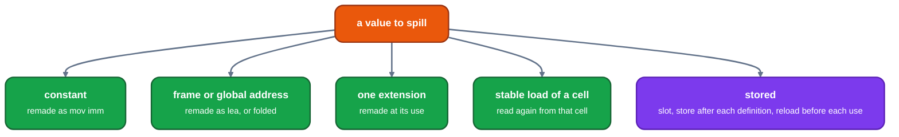

# Spilling

Audience: an engineer changing what the allocator does with a value it chose not to keep in a register. This page states how a spill is planned and written, where its slot comes from, and how its code is kept short.

The code is LLVM's `InlineSpiller`: `greedy/inlinespiller.rs` (it writes the spill code as the allocator spills, see [assignment](assignment.md)). Every instruction the spiller writes is marked: `spill_store`, `spill_reload` or `rematerialized`, which the cost model and the dump read.

## Plan, then write

[`planned`](https://github.com/ali-mosavian/llrm/blob/82848d3b75a0dc0b0541d99bbcc5071361710eb9/crates/backend/llrm-core/src/backend/spiller.rs#L90) decides first, for each value, one of:

*Only the last needs a slot. The first four are rematerialization: the value is made again where it is read ([rematerialization-and-forwarding](rematerialization-and-forwarding.md)).*

Then [`materialized`](https://github.com/ali-mosavian/llrm/blob/82848d3b75a0dc0b0541d99bbcc5071361710eb9/crates/backend/llrm-core/src/backend/spiller.rs#L221) writes the plan, block by block:

* a reload before each read of a stored value, into a fresh value that lives across that one instruction;
* a store after each write;
* a rematerialized value made again into a fresh value before each read;
* where the reading instruction can take a memory operand, it takes the slot (`_source`), so the reload is no instruction at all; a two-address instruction whose destination is the spilled value is done in memory (`_in_place`, `_tied`);
* a move between two spilled values that share a slot is removed (`_identity`).

The fresh values are returned; each is unspillable, so the allocator cannot spill a reload and loop. A spill that makes values it spills in its turn is stopped by the `plain` set. Instructions that name none of the values are left as the same `Arc`, which is how the rest of the body's facts survive ([`postings.rs`](../../optimizations/backend/postings.md) keeps where each value is defined and read as the body changes).

### Short updates

A spilled value that is updated and read again in its block (`x += y; use x`) would run the update in memory and reload for each read. `_short_update_runs` and `_local_updates` keep the result in a register through the update: loaded once, updated and read in a register, stored only if still live after its last read there. These are LLVM's local split ([`test_an_update_read_again_in_its_block_stays_in_a_register`](https://github.com/ali-mosavian/llrm/blob/82848d3b75a0dc0b0541d99bbcc5071361710eb9/crates/backend/llrm-core/src/backend/spiller.rs#L4512)).

## Slots

The frame hands out slots ([`Frame`](https://github.com/ali-mosavian/llrm/blob/82848d3b75a0dc0b0541d99bbcc5071361710eb9/crates/backend/llrm-core/src/backend/frame.rs#L72)): a slot is a home displacement below BP and a capacity. `_color_slots` shares: a stored value takes an existing home whose capacity fits and whose holders its interval does not overlap ([`slots::choose`](https://github.com/ali-mosavian/llrm/blob/82848d3b75a0dc0b0541d99bbcc5071361710eb9/crates/backend/llrm-core/src/backend/slots.rs#L23)), preferring the home of a value it is copied to or from, since that copy then vanishes. A body that calls `setjmp` shares nothing, because after the second return a slot another value used holds that value ([`test_no_spill_slot_is_shared_in_a_body_that_calls_setjmp`](https://github.com/ali-mosavian/llrm/blob/82848d3b75a0dc0b0541d99bbcc5071361710eb9/crates/backend/llrm-core/src/backend/spiller.rs#L5334)). Slots the allocator hands out first fill the hole left below BP above the allocas (`Frame::hole`).

### Siblings

[`siblings`](https://github.com/ali-mosavian/llrm/blob/82848d3b75a0dc0b0541d99bbcc5071361710eb9/crates/backend/llrm-core/src/backend/spiller.rs#L847) grows, from the values being spilled, a group of the values they are plain-copied to or from, one candidate at a time (the web the copies make is not worked out whole), adds a neighbour of the same width that does not interfere with the group (no interval of the allocator meets the group's, else the interference graph of the group and the candidate) when it is itself being spilled, or when its copies to the group outweigh its other references (`worth`: block frequency of the saved copies against its other uses), and gives the group one slot. The neighbours that were chosen are spilled with the value; a neighbour that held a register gives it up, since sharing the slot makes the copies free. The same copy webs lower the weight of a value ([live-ranges](live-ranges.md#weights)).

## After the spill

`allocate` requeues the reloads (which are unspillable, so they may evict) and recomputes facts. The cost of the spill is its weight; the executed cost of the finished body counts the reloads, stores and remats apart (`LLRM_DEBUG=cost`, [debugging](debugging.md)). Frame traffic in loops is then reduced after allocation by [loopslots and forwarding](after-allocation.md#spill-traffic).
