# Live-range splitting

Audience: an engineer changing how a value that finds no register is cut instead of spilled whole. This page states the three ways a split is chosen, how the choice is priced, and how a piece is made.

A split gives a region of a value's range a fresh value, the piece, joined to the rest by copies where control enters or leaves the region. The piece competes for a register on its own; the rest may only take a free register or spill. The code is LLVM's `SplitKit` and `SpillPlacement`: `greedy/splitkit.rs` chooses and carves, [`spillplacement.rs`](../../optimizations/backend/spillplacement.md) decides register or stack per bundle.

## Choosing regions

The loop ([assignment](assignment.md)) asks in this order and takes the first non-empty answer, then drops every region that does not pay:

| Kind | Function | When | Region |
|---|---|---|---|
| local | [`local`](https://github.com/ali-mosavian/llrm/blob/82848d3b75a0dc0b0541d99bbcc5071361710eb9/crates/backend/llrm-core/src/backend/splitkit.rs#L1497) | the value is live in one block only | the longest run of its references that some register is free across, at least two and not all |
| region | [`placed`](https://github.com/ali-mosavian/llrm/blob/82848d3b75a0dc0b0541d99bbcc5071361710eb9/crates/backend/llrm-core/src/backend/splitkit.rs#L1427) | otherwise | per candidate register, the blocks the placement network puts in a register; the best by benefit first, then the compact region of the use clusters for the uses left over |
| block | [`per_block`](https://github.com/ali-mosavian/llrm/blob/82848d3b75a0dc0b0541d99bbcc5071361710eb9/crates/backend/llrm-core/src/backend/splitkit.rs#L1551) | `placed` found nothing | each block that names the value twice, from its first reference to its last |

A `Region` is, per block, instruction ranges `[from, to)` the piece holds. `trimmed` shortens a range to its first and last reference; `snapped` widens it to whole parallel-copy groups, since a copy never lands inside one.

Interference with a candidate register is asked of `Occupied`: the first and last slot inside a span at which something holds the register (the `LiveUnion`) or a point destroys it (`Masks`). Tests: [`test_a_local_split_holds_the_references_before_the_interference`](https://github.com/ali-mosavian/llrm/blob/82848d3b75a0dc0b0541d99bbcc5071361710eb9/crates/backend/llrm-core/src/backend/splitkit.rs#L2239), [`test_a_register_free_only_in_the_loop_holds_the_value_there`](https://github.com/ali-mosavian/llrm/blob/82848d3b75a0dc0b0541d99bbcc5071361710eb9/crates/backend/llrm-core/src/backend/splitkit.rs#L2186).

### Placement

Each block has an entry node and an exit node; an edge joins a block's exit to its successor's entry; joined nodes are a bundle, which is wholly register or wholly stack ([`bundles`](https://github.com/ali-mosavian/llrm/blob/82848d3b75a0dc0b0541d99bbcc5071361710eb9/crates/backend/llrm-core/src/backend/spillplacement.rs#L58), LLVM's `EdgeBundles`). Blocks bias their bundles:

| `Border` | Said by |
|---|---|
| `PrefReg` | a block that names the value, at a border it is live across |
| `PrefSpill` | interference between the border and the nearest reference; a through block the value is not wanted in |
| `MustSpill` | interference at the border itself |
| `DontCare` | a border it is not live across |

A block that only passes the value through, with no interference, links its two bundles. [`Placement`](https://github.com/ali-mosavian/llrm/blob/82848d3b75a0dc0b0541d99bbcc5071361710eb9/crates/backend/llrm-core/src/backend/spillplacement.rs#L175) settles each bundle's sign as a Hopfield network: a bundle's `against` and `toward` are the sums of the blocks' frequencies that want the stack or a register, plus the links to bundles already settled, with a dead zone `threshold`. A bundle that turns positive pulls in the through blocks around it (`_grown`), and the network iterates until nothing changes, at most ten times the node count. The frequency of a block here is `10^depth` of its loop nest ([`intervals::level`](https://github.com/ali-mosavian/llrm/blob/82848d3b75a0dc0b0541d99bbcc5071361710eb9/crates/backend/llrm-core/src/analysis/intervals.rs#L1771)), not the branch-odds frequency of the weights.

```mermaid
%%{init: {'theme':'base','themeVariables':{'fontFamily':'Segoe UI, Helvetica Neue, Arial, DejaVu Sans, sans-serif','fontSize':'15px','primaryColor':'#475569','primaryTextColor':'#ffffff','primaryBorderColor':'#334155','lineColor':'#64748b','secondaryColor':'#475569','tertiaryColor':'transparent','clusterBkg':'transparent','clusterBorder':'#64748b','edgeLabelBackground':'#334155','textColor':'#64748b','titleColor':'#64748b'},'flowchart':{'curve':'basis','nodeSpacing':38,'rankSpacing':52,'padding':16,'wrappingWidth':360,'htmlLabels':true,'useMaxWidth':true}}}%%
flowchart TB
  classDef src fill:#2563eb,stroke:#1e40af,stroke-width:2px,color:#ffffff,rx:12px,ry:12px
  classDef mid fill:#475569,stroke:#334155,stroke-width:2px,color:#ffffff,rx:12px,ry:12px
  classDef opt fill:#ea580c,stroke:#9a3412,stroke-width:2px,color:#ffffff,rx:12px,ry:12px
  classDef warn fill:#dc2626,stroke:#991b1b,stroke-width:2px,color:#ffffff,rx:12px,ry:12px
  linkStyle default stroke:#64748b,stroke-width:2.2px
  subgraph after["AFTER: the loop holds a piece"]
    direction LR
    b1["<b>entry</b><br/><small>defines v</small>"]:::mid -->|copy v to piece| b2["<b>loop</b><br/><small>reads the piece</small>"]:::opt -->|copy piece to v| b3["<b>exit</b><br/><small>reads v</small>"]:::mid
  end
  subgraph before["BEFORE: v spans all three blocks"]
    direction LR
    a1["<b>entry</b><br/><small>defines v</small>"]:::mid --> a2["<b>loop</b><br/><small>reads v often<br/>no register free</small>"]:::warn --> a3["<b>exit</b><br/><small>reads v once</small>"]:::mid
  end
  style before fill:#47556912,stroke:#475569,stroke-width:1.6px,stroke-dasharray:7 5,color:#475569
  style after fill:#ea580c12,stroke:#ea580c,stroke-width:1.6px,stroke-dasharray:7 5,color:#ea580c
```

*The rest of v (entry and exit) spills; only the loop pays for a register. A piece that only reads its value copies nothing back ([`test_a_piece_that_only_reads_its_value_copies_nothing_back`](https://github.com/ali-mosavian/llrm/blob/82848d3b75a0dc0b0541d99bbcc5071361710eb9/crates/backend/llrm-core/src/backend/splitkit.rs#L2261)).*

## Does it pay

[`pays`](https://github.com/ali-mosavian/llrm/blob/82848d3b75a0dc0b0541d99bbcc5071361710eb9/crates/backend/llrm-core/src/backend/splitkit.rs#L1366): the benefit of a region is what each reference inside it costs spilled (`_held_saving`: one reload, or the instruction's saving when it can take the value as a memory operand), times the block's `10^depth`, less the copies `crossings` says carving adds (an edge copy costs the smaller of its two blocks). A region of references that fold the spilled value does not pay ([`test_a_region_of_instructions_that_fold_the_spilled_value_does_not_pay`](https://github.com/ali-mosavian/llrm/blob/82848d3b75a0dc0b0541d99bbcc5071361710eb9/crates/backend/llrm-core/src/backend/splitkit.rs#L2161)). A region that is the whole range is worth nothing.

## Carving

[`carved_moving`](https://github.com/ali-mosavian/llrm/blob/82848d3b75a0dc0b0541d99bbcc5071361710eb9/crates/backend/llrm-core/src/backend/splitkit.rs#L450) rewrites the body: references in the region read the fresh value, and a `Crossing` copy goes where control enters or leaves: at the end of a source with one successor, else at the start of a target whose every predecessor needs the same copy, else in a block of its own on the edge (a bridge, which keeps its edge's odds). A copy at a block end goes before both its branches; a piece defined inside a parallel group hands the value back after the group. Instructions that require or deliver a register, and cells the value is the base of, are renamed ([`test_a_cut_range_renames_what_an_instruction_requires_and_delivers`](https://github.com/ali-mosavian/llrm/blob/82848d3b75a0dc0b0541d99bbcc5071361710eb9/crates/backend/llrm-core/src/backend/splitkit.rs#L1990)).

A piece is not split again unless its live blocks shrink strictly (LLVM's `RS_Split2`), which ends splitting. `LLRM_CHECK_SPLIT=1` and `LLRM_CHECK_PLACING=1` compare the incremental answers with a full look; `LLRM_DEBUG=split` prints `split V at SPANS` for each region carved.

## The greedy allocator's splits

The translated greedy allocator splits with a line-by-line port of LLVM's SplitKit at the [pin](https://github.com/llvm/llvm-project/tree/d1106deb71cc81016406a1917d0508d2df296266): `EdgeBundles`, `SpillPlacement`, `InterferenceCache`, `SplitAnalysis`, `SplitEditor` (module `greedy::spliteditor`) and `RAGreedy::trySplit` ([`tryLocalSplit`, `tryRegionSplit`, `tryBlockSplit`](https://github.com/llvm/llvm-project/blob/d1106deb71cc81016406a1917d0508d2df296266/llvm/lib/CodeGen/RegAllocGreedy.cpp#L1975), module `greedy::regionsplit`). It runs when a range has waited a round and neither a free register nor an eviction took it; `LLRM_NO_SPLIT=1` turns it off. The editor inserts the copies in the function itself; `finish` rewrites the operands and checks out against `LLRM_CHECK_LIVEINTERVALS=1` (every interval equals one computed afresh). Not translated, each named in its module doc: rematerialization at a split ([#2513](https://github.com/ali-mosavian/llrm/issues/2513)), sub-registers, `tryInstructionSplit`, hint splitting. The old splitter above goes when the greedy allocator is the only one.
