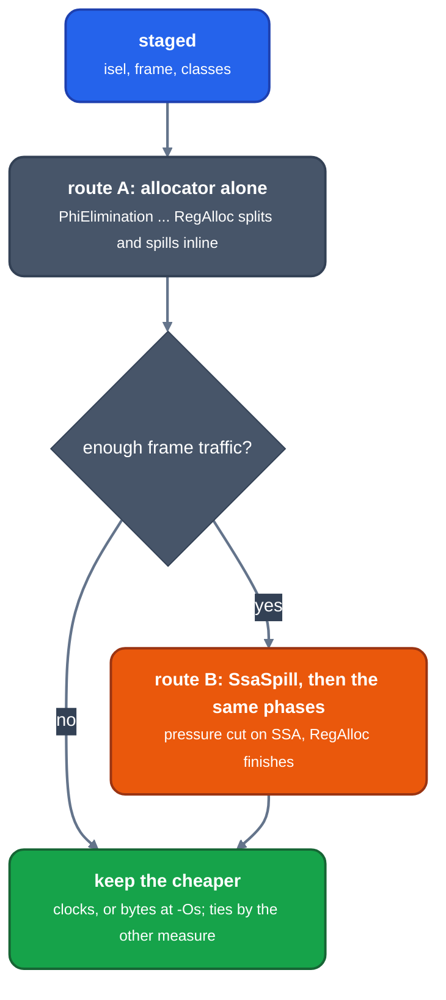

# The two routes: the allocator alone, and the SSA spiller in front

Audience: an engineer asking why a function was made twice, or why spill code appeared before allocation. This page states what the second route is, why it exists, and how one is chosen.

Every function goes through the machine phases by one or both of two routes. They differ by one phase:

*Below -Omax. At -Omax both routes always run.*

## Route B: Braun and Hack spilling

[`SsaSpill`](https://github.com/ali-mosavian/llrm/blob/82848d3b75a0dc0b0541d99bbcc5071361710eb9/crates/backend/llrm-core/src/backend/ssaspill.rs#L95) runs first of the allocation phases, on SSA with phis ([`ssaspill.rs`](https://github.com/ali-mosavian/llrm/blob/82848d3b75a0dc0b0541d99bbcc5071361710eb9/crates/backend/llrm-core/src/backend/ssaspill.rs): "Register Spilling and Live-Range Splitting for SSA-Form Programs", CC 2009). It decides, before any register is chosen, which values are in registers where, and writes the stores and reloads.

1. Blocks are walked in reverse postorder. At a block's entry the values held are those every predecessor ends with, then those some do, nearest next use first; a loop header keeps through the loop only what fits (`loop_room` is the peak pressure inside, printed on `LLRM_DEBUG=ssaspill`).
2. Inside a block, a use of a value not held is a reload; a fold into the instruction's memory operand is taken where the form allows (`folds`). When the held set no longer fits, Belady's rule evicts the value whose next use is furthest, with a value that is stored where it is defined as often as the block runs evicted last (`hot`).
3. "Fits" is `Machine::fits`: at most as many values as registers in the file, and Hall's condition over the classes, so values confined to a class (byte, a 16-bit base) never outnumber its registers. What an instruction `requires`, `delivers` or `clobbers` leaves less room for the values that live through it. The general file and the segment-selector file are simulated separately.
4. A value is stored once, after its definition, or where it leaves the registers, whichever runs less. A phi that does not fit lives in memory and its arguments share its slot (`shared_slots`). A value made again is not stored (`remakable`).
5. A reload redefines its value, so a value now has more than one definition. [`ssarepair::repaired`](https://github.com/ali-mosavian/llrm/blob/82848d3b75a0dc0b0541d99bbcc5071361710eb9/crates/backend/llrm-core/src/backend/ssarepair.rs#L34) restores SSA: phis at the iterated dominance frontier of the definitions, pruned where the value is not live in, then renaming down the dominator tree.

Distances to the next use come from `Flow::distances`; a loop exit counts `EXIT` extra so what is used after a loop is far from inside it. Prices are the target's load and branch costs in clocks, or in bytes at -Os where a loop's trips do not multiply them (`Prices::of`). x87 values, pinned values and the body's inputs are left alone (`untouchable`).

After this, `RegAlloc` runs as in route A on a body whose pressure already fits. It still splits and spills what it must, because the spiller sees only the general registers and the selectors by class counts, not every constraint the allocator sees (a fixed register, glue around calls).

## Why two routes

The allocator alone sees every constraint and spills one value at a time by weight. The SSA spiller sees a block's whole held set and spills by distance to the next use. Neither wins on every function, so the finished code decides ([`cheaper`'s doc](https://github.com/ali-mosavian/llrm/blob/82848d3b75a0dc0b0541d99bbcc5071361710eb9/crates/backend/llrm-core/src/backend/assemble.rs#L442): the spiller decides on the general registers alone, so where pressure is elsewhere its spill code can lie on top of what the allocator does anyway). The settings per level are in [levels](../../reference/levels.md).

## Choosing

`assemble::cheaper` ([`assemble.rs`](https://github.com/ali-mosavian/llrm/blob/82848d3b75a0dc0b0541d99bbcc5071361710eb9/crates/backend/llrm-core/src/backend/assemble.rs#L447)):

| Condition | Routes made |
|---|---|
| `LLRM_CANDIDATES=allocator`, or `-fno-allocation-routes` (-O0) | A only |
| `LLRM_CANDIDATES=spiller` | B only |
| below -Omax, otherwise (`directed`) | A; B too if [spill or frame traffic is at least `SPILLER_TRAFFIC`](https://github.com/ali-mosavian/llrm/blob/82848d3b75a0dc0b0541d99bbcc5071361710eb9/crates/backend/llrm-core/src/backend/assemble.rs#L496) of the work, counting printed instructions by block frequency (once each at -Os) |
| -Omax | both |

B is dropped if the spiller changed nothing (`Run::changed`). The winner is [`cheaper_route`](https://github.com/ali-mosavian/llrm/blob/82848d3b75a0dc0b0541d99bbcc5071361710eb9/crates/backend/llrm-core/src/backend/assemble.rs#L675): the lower `route_cost` (bytes at -Os, else `executed` work, plus two per register the function must save); where equal or unpriced, the other measure decides. Where bytes tie and B admitted a loop's entry loads on trips alone (`Run::ties`), a third run without admission is made and the plainer of the two kept. `LLRM_DEBUG=candidates` prints the two costs.

At -Omax a function that calls one whose written registers are known is also made without those facts, and the cheaper kept.
