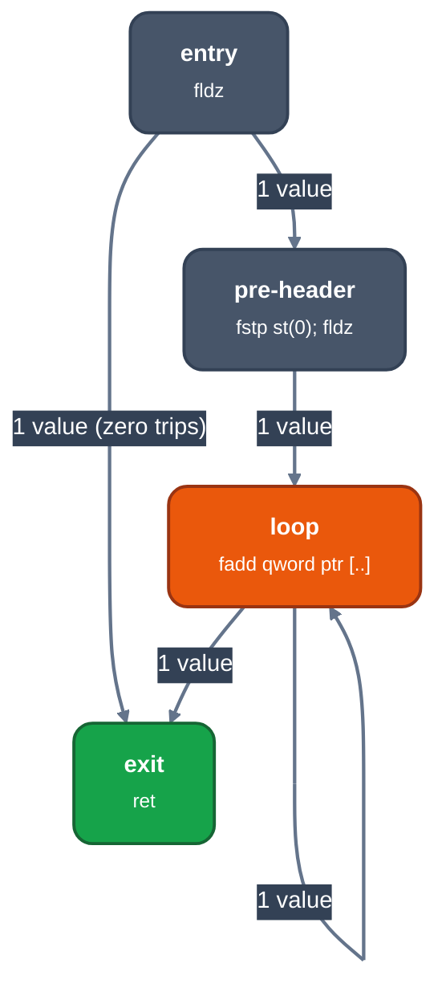
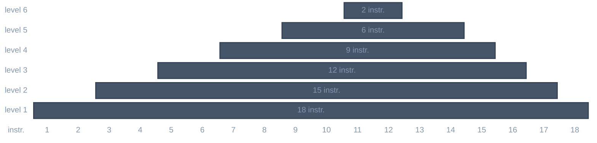

# x87 register-stack allocation

For contributors to the x87 backend (`-m16`, `-m32`). Explains how llrm places floating-point values on the eight-entry x87 register stack, which the [integer allocator](readme.md) does not model, and what the compiler refuses to do.

## What is different

The x87 has eight registers used as a stack. `st(0)` is the top; `st(i)` is the entry `i` below it, so a value's register number changes with every push and pop. Arithmetic names `st(0)` and one other entry, or `st(0)` and a memory operand. `fxch st(i)` swaps the top with entry `i`. A ninth push overflows. The depth is the number of `x87` registers in the target description (`float_stack`, 8 on both x86 targets).

So a float value has no fixed register. Its place is a position in a stack that each instruction rewrites, and a value that is not on the top must be exchanged up (`fxch`), copied (`fld st(i)`) or read with a memory operand before it is used. The allocator tracks the stack contents symbolically, per block.

Every floating value in LIR is a 10-byte `Held` (extended format). Rounding to `float` or `double` happens only in a store of that width (`fstp m32`, `fstp m64`); see [floating-environment](../../reference/semantics/floating-environment.md).

## Phases


*The x87 phases of the machine pipeline. `floatassign` decides; `floatalloc` only converts.*

The phases run in this order in [`flow.rs`](https://github.com/ali-mosavian/llrm/blob/82848d3b75a0dc0b0541d99bbcc5071361710eb9/crates/backend/llrm-core/src/flow.rs#L93-L98) and do nothing on a body without floating values. The split follows GCC: `floatassign` plays IRA and LRA (which values are in registers, every spill and memory operand explicit), `floatalloc` plays `reg-stack` (put each operand where the instruction needs it) and chooses nothing.

The optimizer's `floatfold` and `floatloop` only replace exact float results by constants; they never see the stack ([constant-propagation](../../optimizations/passes/fold.md)). The backend's own `floatfold` is a different pass with the same name.

## Where a value lives

A value is in one of three places.

- **A stack slot**, from its definition to its last read, when it fits and no call comes first.
- **A memory cell**, when a call or barrier empties the stack before its next read, when it is cheaper there, or when more than eight values are live. The cell is the value's home or an 8-byte spill cell.
- **Its home, read again.** A value loaded from a cell that nothing may write before its last reader is not kept: each reader reads the cell (GCC's `REG_EQUIV`). A `fild` or 10-byte cell cannot raise when read, so only a write to it matters. A `float` or `double` cell can (a signalling NaN), so it is also read again only if no instruction that can raise comes before the first read, or the cell was last written by an x87 store.

The stack is empty at every call and barrier ([`boundary`](https://github.com/ali-mosavian/llrm/blob/82848d3b75a0dc0b0541d99bbcc5071361710eb9/crates/backend/llrm-core/src/backend/floatregions.rs#L64)). A float live across one is stored before it and loaded after. Arguments travel in memory; a returned float is left in `st(0)` and nothing else may be on the stack.

## The assignment pass

[`assigned`](https://github.com/ali-mosavian/llrm/blob/82848d3b75a0dc0b0541d99bbcc5071361710eb9/crates/backend/llrm-core/src/backend/floatassign.rs#L1689) (`floatassign.rs`), in order:

1. **Integer loads** ([`_integer_loads`](https://github.com/ali-mosavian/llrm/blob/82848d3b75a0dc0b0541d99bbcc5071361710eb9/crates/backend/llrm-core/src/backend/floatassign.rs#L42)). `fild` reads only memory. An integer constant 0 or 1 becomes `fldz`/`fld1`, any other a constant-pool `fld`; an integer value is stored to a frame cell and `fild`-ed from it.
2. **Integer stores** ([`_integer_stores`](https://github.com/ali-mosavian/llrm/blob/82848d3b75a0dc0b0541d99bbcc5071361710eb9/crates/backend/llrm-core/src/backend/floatassign.rs#L120)). A `fistp` or `fisttp` whose result is an integer value stores to an owned cell, with `wait` before and after in a BASIC module, and reads the cell back only if something reads the integer.
3. **Entry check.** A float live into the entry block is refused.
4. **Repeated loads** ([`_equivalent_loads`](https://github.com/ali-mosavian/llrm/blob/82848d3b75a0dc0b0541d99bbcc5071361710eb9/crates/backend/llrm-core/src/backend/floatassign.rs#L350)). Two loads of one stable cell with nothing that may write it between are one value. A volatile load is never merged.
5. **Homes** (`_homes`, `_stored_homes`). Values that can be read again from their cell (above).
6. **Placement** ([`_stacked`](https://github.com/ali-mosavian/llrm/blob/82848d3b75a0dc0b0541d99bbcc5071361710eb9/crates/backend/llrm-core/src/backend/floatassign.rs#L460)). LLVM's edge bundles and `SpillPlacement`, per value: at each block border the value is wanted on the stack if the block reads it before the stack is next emptied, in memory if a call or barrier comes first. A block the value only passes through links its borders.
7. **Segments** ([`_allocnos`](https://github.com/ali-mosavian/llrm/blob/82848d3b75a0dc0b0541d99bbcc5071361710eb9/crates/backend/llrm-core/src/backend/floatassign.rs#L871)). Each stretch of a value on the stack is a segment; segments joined at a bundle border or by a coalesced copy form one allocno.
8. **Pricing** ([`priced`](https://github.com/ali-mosavian/llrm/blob/82848d3b75a0dc0b0541d99bbcc5071361710eb9/crates/backend/llrm-core/src/backend/floatassign.rs#L1038), [`_use_costs`](https://github.com/ali-mosavian/llrm/blob/82848d3b75a0dc0b0541d99bbcc5071361710eb9/crates/backend/llrm-core/src/backend/floatassign.rs#L612)). IRA's cost per allocno: its register form against its memory form, weighted by block frequency, in the selected CPU's clocks plus one for issue. A register form pays a `fld` copy when an operand lives on (none for `fst`, which keeps its source). A memory form pays a reload, or only the price difference of the memory instruction (`fadd m`, `fcomp m`) where one exists. Allocnos where memory is cheaper start spilled; at equal cost a load whose one reader can take it as an operand stays a memory operand.
9. **Rewrite and check** ([`rewritten`](https://github.com/ali-mosavian/llrm/blob/82848d3b75a0dc0b0541d99bbcc5071361710eb9/crates/backend/llrm-core/src/backend/floatassign.rs#L1335), [`_crowded`](https://github.com/ali-mosavian/llrm/blob/82848d3b75a0dc0b0541d99bbcc5071361710eb9/crates/backend/llrm-core/src/backend/floatassign.rs#L1613)). The chosen assignment is written out: stores where a stretch leaves for memory, restores where one starts, memory operands ([`fused`](https://github.com/ali-mosavian/llrm/blob/82848d3b75a0dc0b0541d99bbcc5071361710eb9/crates/backend/llrm-core/src/backend/floatassign.rs#L1539)) or reloads for spilled reads. If some point still holds more than eight values, counting what a compare or a store without `fst` must duplicate, the allocno read furthest ahead (Belady, cheaper first among equals) is spilled, and the body is written again. A block is rewritten only when a new victim reaches it. With no victim to spill the body is refused.
10. **Dead loads.** `fld1`, `fldz` and fixed-address loads that nothing reads are dropped.

Spilled phi copies are written one copy at a time in an order where each reads before it is overwritten, and a cycle is broken with one temporary, so a step never holds more than two stack slots.

## The stack conversion

[`_converted`](https://github.com/ali-mosavian/llrm/blob/82848d3b75a0dc0b0541d99bbcc5071361710eb9/crates/backend/llrm-core/src/backend/floatalloc.rs#L830) walks blocks in reverse postorder with one [`_Stack`](https://github.com/ali-mosavian/llrm/blob/82848d3b75a0dc0b0541d99bbcc5071361710eb9/crates/backend/llrm-core/src/backend/floatalloc.rs#L164) (`values`, top first). Each instruction reads its operands where they are; a value that nothing reads again is popped where it dies.

### Two-operand arithmetic

[`arithmetic`](https://github.com/ali-mosavian/llrm/blob/82848d3b75a0dc0b0541d99bbcc5071361710eb9/crates/backend/llrm-core/src/backend/floatalloc.rs#L713) is LLVM's `handleTwoArgFP`. The operand an instruction consumes dies there and the result takes its slot; a dying operand is brought to the top first, and a copy is made only when both live on.

| Situation | Emitted | Result in |
|---|---|---|
| neither on top, one dies | `fxch` the dying one to the top | |
| neither on top, both live | `fld st(i)` copy of the left, which then dies | |
| the top dies, the other lives | `fsub st(0), st(i)`; `fsubr` when the top is the right operand | the top |
| the other dies, the top lives | `fsub st(i), st(0)`; `fsubr` when the top is the left operand | the other's slot |
| both die | `fsubp st(i), st(0)`; `fsubrp` when the top is the left operand | the deeper slot, depth one less |
| the same value twice, still live | `fld` a copy, multiply into the copy | the copy |

Reversing `fsub` and `fdiv` is how the operands stay in source order whichever one is on top; `fadd` and `fmul` need no reversed form. A fresh value is never created by an exchange: an operand that is not on the stack is an error.

### Everything else

| Instruction | Stack form |
|---|---|
| `fld`/`fldz`/`fld1` | push |
| unary (`fchs`, `fsqrt`, ...) | in place on the top; a copy first if the source lives on |
| arithmetic with a memory operand | `fadd st(0), m`; `fi` forms over an integer cell |
| store | `fstp m`; a live value is stored `fst m` where the cell is 4 or 8 bytes, else copied and popped (`fst` has no 10-byte form) |
| compare | `fcompp` on two stack values, `fcomp m` on a cell, then `fnstsw ax; sahf`; operands read again are copied first |
| phi copy | a rename when the source dies, `fld st(i)` when it lives; a block's copies on one edge are taken as one simultaneous group |
| call result | the value already in `st(0)`; the stack must be empty |
| returned value | exchanged to `st(0)` and left there; nothing else may remain |

## Block edges

Blocks that share an edge share a bundle (`spillplacement::bundles`). A bundle holds every floating value live at any of its borders, in one order: the first block to leave through the bundle fixes it, and every other exit shuffles to that order.

[`leave`](https://github.com/ali-mosavian/llrm/blob/82848d3b75a0dc0b0541d99bbcc5071361710eb9/crates/backend/llrm-core/src/backend/floatalloc.rs#L281) makes the stack exactly the bundle's list before the block's branches:

1. A value on the stack that the bundle does not hold is popped. If it is live out of the block, that is an error.
2. A bundle value this block does not have is read by none of its successors (another exit into the bundle has it); the slot is filled with `fldz` or `fld st(0)` and the successors that share it pop it.
3. `fxch` until the order matches.

On a critical forward edge into a block that reads fewer floats than its bundle holds, [`_split_for_the_stack`](https://github.com/ali-mosavian/llrm/blob/82848d3b75a0dc0b0541d99bbcc5071361710eb9/crates/backend/llrm-core/src/backend/floatalloc.rs#L942) puts a block of its own, so the unread values are popped on that edge only and the other entries push no fillers. A block that ends the function must leave the stack empty.



*The sum of an array (`sum`, below): the accumulator is one stack slot on every edge, and the loop touches memory only for the element.*

## Constants and conversions

- **Constants.** `+0.0` is `fldz`, `1.0` is `fld1`; any other is a constant-pool `fld` in the narrowest format that holds it exactly (4 bytes if exact as `float`, else 8). `-0.0` is a pool load. ([isel](https://github.com/ali-mosavian/llrm/blob/82848d3b75a0dc0b0541d99bbcc5071361710eb9/crates/backend/llrm-core/src/backend/isel.rs#L6289))
- **Integer to float.** The integer is stored to a frame cell and `fild`-ed: a byte widens to a word, and an unsigned 1, 2 or 4-byte value widens to twice its size (`fild` reads only signed words, dwords and qwords). A source wider than the result's mantissa is rounded by an `fstp`/`fld` of the result's width. ([`float_cast`](https://github.com/ali-mosavian/llrm/blob/82848d3b75a0dc0b0541d99bbcc5071361710eb9/crates/backend/llrm-core/src/backend/isel.rs#L4292))
- **Float to integer.** C `fptosi`/`fptoui` select `fisttp` (truncate); `lrint` selects `fistp` (current rounding). The result is stored to a cell and moved to a register. `fptoui` to 64 bits is first expanded in MIR into signed conversions and a select, since `fistp` stores only signed qwords ([`fpconvert.rs`](https://github.com/ali-mosavian/llrm/blob/82848d3b75a0dc0b0541d99bbcc5071361710eb9/crates/backend/llrm-core/src/backend/fpconvert.rs#L16)).
- **Truncation on a 387.** There is no `fisttp`, so [`_truncating`](https://github.com/ali-mosavian/llrm/blob/82848d3b75a0dc0b0541d99bbcc5071361710eb9/crates/backend/llrm-core/src/backend/floatalloc.rs#L1014) runs after allocation (so the control-word writes split no region): at entry it saves the control word and builds a copy with rounding set to zero (`or 0x0C00`); each `fisttp` becomes `fistp` in the truncating mode, and the `fldcw` that sets it are placed by one analysis over the graph (`_needs`, `_modes`: a block assumes the mode its first need or its successors name, a switch goes on each edge whose ends disagree), so a loop of conversions switches on its entry edge and its exits and a run of blocks switches once (gcc's mode switching, [`optimize_mode_switching`](https://github.com/gcc-mirror/gcc/blob/releases/gcc-13.4.0/gcc/mode-switching.cc#L495), which also minimises the insertions by lazy code motion).

## Exceptions and waits

x87 arithmetic checks pending exceptions itself, so no `wait` is emitted per operation. A BASIC module wraps each integer-conversion store in `wait`, so an error handler sees the fault in the statement that caused it: [native-fpu-waits](../../reference/semantics/native-fpu-waits.md).

Order of possibly-raising instructions is kept where it can be observed:

- A load is moved to its reader, or read again there, only if nothing between may write the cell. For a `float` or `double` cell nothing between may raise either, unless the cell holds no signalling NaN.
- The scheduler never moves x87 instructions.

The backend `floatfold` checks that no write, call, volatile access or barrier lies between a load and its reader; it does not look for instructions that raise.

## Spills

A value that cannot stay on the stack is stored `fstp qword` to an 8-byte frame cell and reloaded with `fld qword`, so a spill rounds an extended value to `double`. Values joined by copies share a cell where their lives do not overlap, so a copy between two spilled values is no instruction. A spill needs an owned frame; without one the body is refused.

## CPUs

The selected CPU (`-march`, `-mtune`; `i386`, `i486`, `pentium` on `-m16`, `i486`, `pentium` on `-m32`) enters only through the price table (`timings.times`, rows `x87_*`). `floatassign` reads it for one decision: register or memory form. It folds a load into `fmul m` when `x87_mul_m` costs no more than `x87_load` plus `x87_mul`, and keeps a multiply-used load in a register when that is cheaper in total (`test_x87_memory_operand_matches_each_public_cpu_cost`, `test_profitable_multiuse_float_home_is_retained_for_the_selected_cpu`). The `-m16` table prices `fxch` at 18 clocks on the 386, 4 on the 486 and 1 on the P5.

Nothing weighs `fxch` when ordering work, and nothing interleaves independent chains to use the P5's cheap exchange; [#1519](https://github.com/ali-mosavian/llrm/issues/1519).

## Switches and debugging

There is no switch for the x87 phases. `-march=` and `-mtune=` change the prices; `-fno-floatloop` turns off the optimizer's exact-loop pass. `llrm-cc -S` prints the stack form. `ISEL_DUMP=1` prints the LIR after every machine phase, so the `FloatFold`, `FloatAssign` and `FloatAlloc` sections show each phase's change. `LLRM_VERIFY=1` checks every phase's output, including lost source bytes, and names the first phase that returns a malformed body. Refusals are the messages in the last section.

## Examples

### Operand order and exchanges

C, `llrm-cc -O2 -m32 -march=i486 -S`, with the stack after each instruction (top first; `a b c` are `p[0] p[1] p[2]`; stack contents derived by simulating the listing):

```c
double g(double *p) { double a=p[0], b=p[1], c=p[2];
                      return (a-b)/(b-c) + (c-a)*(a+b); }
```

```
fld  qword ptr [eax]        ; a
fld  qword ptr [eax+8]      ; b a
fld  qword ptr [eax+16]     ; c b a
fld  st(2)                  ; a c b a
fsub st(0), st(2)           ; a-b c b a
fld  st(2)                  ; b a-b c b a
fsub st(0), st(2)           ; b-c a-b c b a
fdivp st(1), st(0)          ; (a-b)/(b-c) c b a
fxch st(1)                  ; c q b a            q = (a-b)/(b-c)
fsub st(0), st(3)           ; c-a q b a
fxch st(3)                  ; a q b c-a
faddp st(2), st(0)          ; q a+b c-a
fxch st(2)                  ; c-a a+b q
fmulp st(1), st(0)          ; (a+b)*(c-a) q
faddp st(1), st(0)          ; q + (a+b)*(c-a)
```

`a`, `b` and `c` are each read two or three times, so they stay on the stack and are copied (`fld st(2)`) where a consumer would otherwise destroy them. The three `fxch` bring a dying operand to the top for a popping or in-place form.

### Stack depth

```c
double h(double *p, double *q) {
    double x = p[0]*q[0], y = p[1]*q[1], z = p[2]*q[2], w = p[3]*q[3];
    return (x+y)*(z+w) - (x-z)*(y-w);
}
```

The 18 instructions of the 486 listing push the four products, build the two sums on copies, and fold; no value is spilled.



*Stack levels in use across the 18 instructions of h (the x axis counts instructions). A level is occupied from the instruction that pushes it to the one that pops it. The stack holds eight; h peaks at six, so `floatassign` spills nothing.*

### A value across a block edge, and a memory operand

```c
double sum(double *p, int n) { double s = 0; int i;
    for (i = 0; i < n; i++) s += p[i]; return s; }
```

```
        fldz                   ; entry: s = 0
        test ecx, ecx
        jle  done
        fstp st(0)             ; pre-header
        fldz
loop:   fadd qword ptr [eax+edx]   ; s stays in st(0); the element is a memory operand
        add  edx, 8
        jne  loop
done:   ret                    ; s in st(0)
```

The accumulator is a loop phi kept in `st(0)` across the back edge (`test_a_loop_accumulator_stays_on_the_stack_across_the_back_edge`). The loop-invariant `x` of a Horner loop, by contrast, is read from memory each trip (`fmul qword ptr [esp+12]`), because the allocator has no price for keeping it in a register against folding it ([#1086](https://github.com/ali-mosavian/llrm/issues/1086), [#649](https://github.com/ali-mosavian/llrm/issues/649)).

### A float across a call

```c
extern double g(double);
double callf(double a) { double t = a * a; return g(a) + t; }
```

`ISEL_DUMP=1`, 486, `-O2`. Before `FloatAssign`, `v2` is live across the call:

```
v1 := fld  [bp+8]
v2 := fmul v1, v1
SP := sub SP, 8
[None] := fstp v1          ; push the argument
call
v3 :=                      ; the call's result, in st(0)
v4 := fadd v3, v2
```

`FloatAssign` empties the stack at the call: it stores `v2` before it and reads the cell as the memory operand of the add.

```
...
[None]     := fstp v1
[bp-8]     := fstp v2      ; added: v2 does not survive the call on the stack
call
v3 :=
v4 := fadd v3, [bp-8]      ; changed: a memory operand, no reload
```

`FloatAlloc` then gives the stack form:

```
ST0 := fld  [bp+8]         ; a
ST0 := fld  ST0            ; a a        (a is read again)
ST1 := fmul ST1, ST0       ; a a*a
SP  := sub SP, 8
fstp [None]                ; a*a        (a, popped, is the argument)
fstp [bp-8]                ;            (t to its 8-byte cell; stack empty)
call
ST0 := fadd ST0, [bp-8]
```

### A memory operand and a shared value

```c
double s2(double *x, double *kp) { double k = *kp; return x[0] * k + x[1] * k; }
```

`ISEL_DUMP=1`, 486, `-O2`. Selection loads each element, then `FloatFold` makes each single-use load the memory operand of its multiply; `FloatAssign` changes nothing; `FloatAlloc` converts:

```
after PhiElimination         after FloatFold              after FloatAlloc
v3 := fld  [kp]              v3 := fld  [kp]              ST0 := fld  [kp]
v4 := fld  [x]               v5 := fmul v3, [x]           ST0 := fld  ST0
v5 := fmul v4, v3            v7 := fmul v3, [x+8]         ST0 := fmul ST0, [x]
v6 := fld  [x+8]             v8 := fadd v5, v7            fxch ST0, ST1
v7 := fmul v6, v3                                         ST0 := fmul ST0, [x+8]
v8 := fadd v5, v7                                         ST1 := faddp ST1, ST0
```

`k` (`v3`) is read twice, so the first multiply works on a copy (`fld st(0)`); the exchange brings `k` back to the top for the second. The dump omits address displacements; the listing is from `llrm-cc -S`:

```
fld  qword ptr [edx]
fld  st(0)
fmul qword ptr [eax]
fxch st(1)
fmul qword ptr [eax+8]
faddp st(1), st(0)
```

### Fixture: a shared value kept across two consumers

`test_shared_producer_is_kept_across_two_arithmetic_consumers` in `floatalloc_tests.rs`. Before (`[c]` is a 4-byte cell; `v1` is read by both arithmetic instructions):

```
v1 = fld   [c]
v2 = fmul  v1, [c]
     fstp  [c], v2
v3 = fdiv  v1, [c]
     fstp  [c], v3
```

After (the test asserts the names and the `fld st(0)` and `fdiv st(0), [c]` operands):

```
fld   [c]
fld   st(0)            ; v1 lives on, so the multiply works on a copy
fmul  st(0), [c]
fstp  [c]              ; stores and pops the product
fdiv  st(0), [c]       ; v1 dies here and its slot takes the result
fstp  [c]
```

### Fixture: nine live values

`test_ninth_float_uses_an_owned_spill` in `floatalloc_tests.rs` loads nine values, negates each, then stores all nine. Exactly one value is spilled by an 8-byte `fstp` to a cell the frame owns; the stack never exceeds eight and the nine stored answers equal the negated inputs.

## What is not supported

The phases return an error, and the object is not produced, when:

| Cause | Message |
|---|---|
| a float is live into the function entry | `floating stack input is unavailable` |
| an instruction needs more than eight stack operands, after spilling | `floating instruction requires too many stack operands` |
| a float is live across a call or barrier on the stack (after `floatassign` this means a bug) | `a floating value is live across a boundary` |
| a live value would leave a block off its bundle's list | `a live floating value leaves the block off the stack` |
| a call's result arrives with other floats on the stack | `a call's floating result arrives on a stack that is not empty` |
| a return leaves other floats on the stack | `a returned float leaves other values on the stack` |
| a float reaches an instruction the allocator does not model | `floating value used by an unmodelled instruction` |

Not done, and tracked:

- A loop-invariant float is not kept on the stack when a memory operand is available: [#1086](https://github.com/ali-mosavian/llrm/issues/1086) (adjacent `sub esp` are not merged either), [#649](https://github.com/ali-mosavian/llrm/issues/649) (also `fld1`/`fldz` pushed again per use and extra `fxch`).
- Independent float chains are not interleaved for the P5: [#1519](https://github.com/ali-mosavian/llrm/issues/1519).
- A float live across a call is always stored and reloaded; there are no callee-saved x87 registers.

## Operations that are a sequence

`fatan`, `flog2`, `fexp2` and `fround` (and `fsin`, `fcos`, which are one instruction) name an x87 operation on `st(0)` that a frontend's finalizer replaces with a fixed run of bytes. They live in one table, `llrm_x86::select::X87_SEQUENCES`. QB's finalizer places those bytes and the encoder prices the same bytes, so every operation the selector emits has a byte price: at `-Os` the cost of a function is its encoded bytes, and an operation with no price made it cost nothing (and panicked under `LLRM_VERIFY=1`: llrm#1307). A test walks the selector's float functions and asks each for a price. Every x87 unary the backend names has a byte price in both modes, checked by a test that reads the names from the sources (`pricing_tests.rs`): a size build under `LLRM_VERIFY=1` panics on an instruction the encoder cannot price, which `flog2` did (llrm#1307) until it had one. Two sweeps compile what a program can reach and so need no list: `tests/x87_prices.rs` builds QB programs from qbfront's table of numeric intrinsics (over SINGLE, DOUBLE, INTEGER and LONG) and a C program from the operators and types C has (each operator with its operands on the stack, in a global or a constant, either side; negation; each comparison; every conversion to and from every integer type; between the float types), at `-Os` in both modes under `LLRM_VERIFY=1`.

