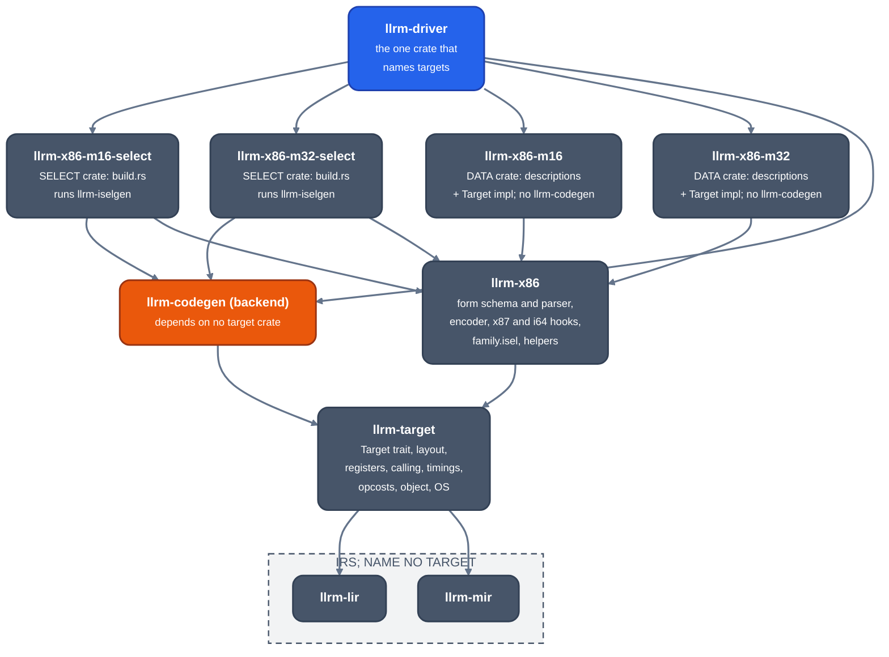
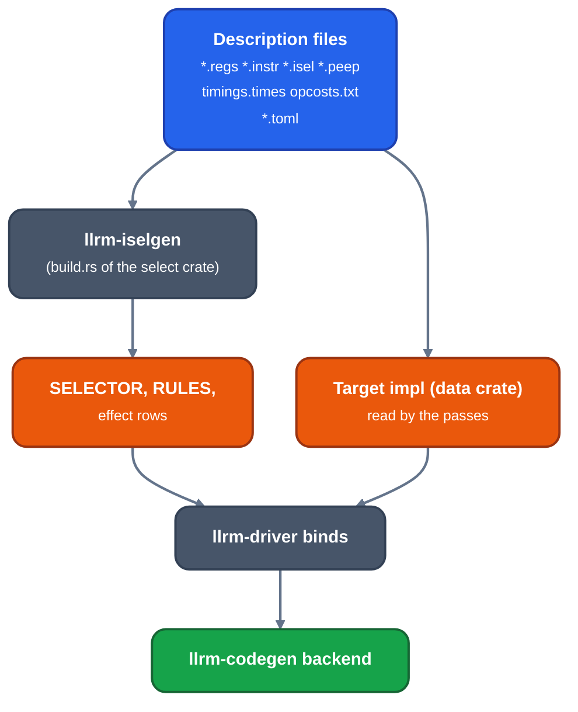

# Targets

For contributors adding or changing a target. A target is a set of description files, a data crate that holds them and a select crate that holds the selector generated from them. No shared pass or IR names a target.

## Targets built

| Name | Crates | Platform |
|---|---|---|
| `x86-m16` (default) | `llrm-x86-m16`, `llrm-x86-m16-select` | 16-bit real mode, far calls, selectors, huge pointers; 386+ instructions under prefixes |
| `x86-m32` | `llrm-x86-m32`, `llrm-x86-m32-select` | flat 32-bit (CS = DS = SS, base 0), DOS under an extender |

`-m16` and `-m32` choose between them; `llrm_driver::all()` lists them.

## Crate graph

*Crate graph of the targets; an arrow reads "depends on"*

A data crate does not depend on `llrm-codegen`; a select crate does, and only `llrm-driver` depends on a select crate. `llrm-codegen` has no target among its normal dependencies (`tests/core_depends_on_no_target.rs`). Its own unit tests need a selector, so a `fixtures` feature generates the m16 and m32 selectors inside `llrm-codegen` for them, and nothing else turns it on (`tests/core_fixtures_are_for_core_tests.rs`). The data/select split is held by a manifest test proposed in [#1273](https://github.com/ali-mosavian/llrm/pull/1273).

## What a target ships

Files under `crates/target/llrm-x86-m32/src` (m16 has the same set):

| File | Says |
|---|---|
| `registers.regs` | registers, subregisters, classes, allocation order, DWARF and CodeView numbers |
| `instructions/x86.instr` | forms: operands, widths, ties, fixed registers, flags, cost key, encoding |
| `isel/patterns.isel` | MIR shape to forms; the generator turns them into a decision automaton |
| `isel/peephole.peep` | form windows to forms |
| `timings.times` | a column per CPU: clocks, latency, issue, prefix and stall costs |
| `opcosts.txt` | each MIR operation priced as a sum of form prices; `unroll_budget` |
| `machines/datalayout.toml` | data layout, address-space kinds, address forms; the `f80` entry is the x87 `long double`'s alignment, so its size in memory (`Layout::long_double_bytes`: 10 at m16, 12 at m32; the front end is built with it, so `sizeof`, arrays and members of a `long double` lay out at that size) |
| `machines/calling.toml` | conventions: slot size, argument registers, results, cleanup, preserved |
| `machines/object.toml` | object writer and listing syntax |
| `machine/platform/dos/real16.toml`, `flat32.toml`, `ports.toml` | the platform: memory map, ports (apart from the target) |

The family crate `llrm-x86` holds the forms and peephole rules every x86 target shares (`x86.instr`, `family.isel`, `peephole.peep`) and `helpers/*.asm`. `llrm-target` holds the parsers and the `Target` trait the passes query ([`lib.rs`](https://github.com/ali-mosavian/llrm/blob/c341bd6e3de058142c6652d399b8dfeb444eff9b/crates/target/llrm-target/src/lib.rs#L210)): layout and address spaces, the frame register and where arguments lie, results, callee-saved registers, CPUs and `-march` names, operation costs per CPU, address forms, float stack depth.

## From description to compiler

*From target description to compiler*

A pattern names a hook (`call NAME`, `when NAME`): a name `llrm-codegen` exports becomes a call on its selection context; any other resolves to the target crate's hook function, and a missing one is a compile error. Cost expressions, loops and searches are hooks, not description.

## Adding a target

1. A data crate and a select crate in `crates/target`, named `llrm-<isa>-<mode>` and `llrm-<isa>-<mode>-select`, with the files above and a `Target` impl.
2. A `build.rs` in the select crate that calls `llrm_iselgen::build::target` with the family directory and `llrm-codegen`'s `peep/groups.list`.
3. One arm in `llrm_driver::all` and `llrm_driver::selector`; nothing else matches on a name.
4. A pass or IR that needs something the target does not state takes it as a parameter from the `Target` trait. An enum variant, constant or branch for one target in a shared crate is a defect.

## Axes

Mode (m16, m32) sets the default operand and address size, segmentation, pointer width, conventions and object format. The CPU (`-march`, `-mtune`; the columns of `timings.times`) sets which instructions and forms exist and their prices. Address forms are per (mode, address size); m16 describes both the 16-bit forms and the 32-bit ones behind `67h` ([a32](a32.md)). m16 keeps its 386 code generation (`test_m16_emits_386_forms`).
