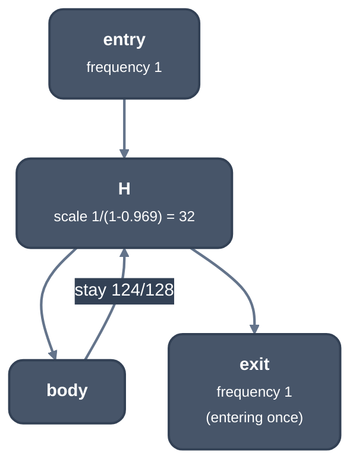

> Generated from the `//!` header of [`crates/opt/llrm-analysis/src/branchprob.rs`](https://github.com/ali-mosavian/llrm/blob/main/crates/opt/llrm-analysis/src/branchprob.rs); edit the header, not this file.
<!-- src: crates/opt/llrm-analysis/src/branchprob.rs sha256:586a4d08b71b2421ec8743fa5a401ea1b715debbad78233edaf3da9eabb4dfc1 -->

# branchprob

Static branch probabilities and block frequencies, as LLVM's
`BranchProbabilityInfo` and `BlockFrequencyInfo` estimate them when no
profile says otherwise.

## How it works
`estimated` gives every edge a probability and every block a frequency. A
block with one successor takes 1. A block with several takes the first of
heuristics 1 to 5 that tells its successors apart; where none does, a
two-way branch combines the votes of 6 to 8 as GCC does (below), and a
wider one takes the first of them (`Heuristic` records which one fired):

1. `Declared`: `!prof` `branch_weights` on the terminator, one per named
   target, summed per distinct successor. Weights that do not name every
   target, or sum to zero, say nothing.
2. `Invoke`: an invoke's unwind edge is taken 1 in 2^20.
3. `Unreachable`: a successor every path of which ends in `unreachable`, a
   `noreturn` call or a `cold` call (`noreturn::cold`) is all but never
   taken.
4. `Loop`: in a loop, staying is 124 to 4 for leaving (`LOOP`, LLVM's
   weights).
5. `Counted`: a branch on a compare of the counters of an enclosing loop
   whose trip count induction proved (`trips`, at most 4096). The counters
   (header phis from a constant start) are stepped trip by trip, once for
   the loop, and a value the compares read is worked out once at each trip;
   the edge is taken on the share of trips the compare holds on, clamped
   away from 0 and 1.
6. `Pointer`, `Zero`, `Float`, from the compare feeding a `br`: `p == q` on
   pointers fails (20:12), as do `x == 0`, `x == -1`, `x < 0` and `x <= 0`
   on integers, and `x == y` on floats; `isnan` (`uno`) is 1 in 2^20. Truth
   values (0 or all ones, 0 or 1, a compare, or a call whose `range` says
   so), one-bit tests (`x & 2^n`) and the sign of a three-way compare are no
   quantity and say nothing.
7. `Call` (GCC, from Ball and Larus; LLVM has no such heuristic): a
   successor that calls, where the other does not, is not taken (67:33).
8. `Return` (GCC): a successor that returns, where the other does not, is
   not taken (66:34); where it only returns a constant, 98% not taken if
   negative, 71% if null, 65% if another constant (`PRED_NEGATIVE_RETURN`,
   `PRED_NULL_RETURN`, `PRED_CONST_RETURN`).
9. `Even`: equal weights.

The votes of 6 to 8 are not first-match in GCC (`PRED_FLAG_FIRST_MATCH` is
set on 1 to 5): `combine_predictions_for_bb` (predict.cc L1213, GCC 13.4)
folds the probability each gives the first successor from 1/2 as
Dempster-Shafer, `d = c*p + (1-c)*(1-p); c = c*p/d` (`combined`), so a zero
test (62.5%) and a call on the same arm (33%) leave that arm at 45%. A call
to the function itself is no vote where the other way returns at once (the
base case of a recursion: the call is the work).

Frequencies are relative to the entry's 1 (`propagated`). Blocks go in
reverse postorder and a block's frequency is the sum over its non-back edges
of predecessor frequency times edge probability, times its loop's scale if
it is a header. A loop's scale is 1 / (1 - p), `p` the probability of coming
back round, capped at 4096 (`LOOP_SCALE`, LLVM's cap). Inner loops are
scaled first. With proven trips the scale is the trips (or trips + 1 when
the only exit is a test at a non-latch header), and the exit test takes `1 /
(trips + 1 - tested)` of the mass, so the trips stay.



*Frequencies around a loop with a header scale of 32*

The propagation takes edge probabilities as a function, so the backend uses
it too (`propagated_edges`, `Cycle`) and MIR and LIR estimates agree.

## Example
A one-block loop with no proven trip count:

```mir
define i16 @f(i16 %n) {
entry:
  br label %head
head:
  %i = phi i16 [ 0, %entry ], [ %j, %head ]
  %j = add i16 %i, 1
  %c = icmp slt i16 %j, %n
  br i1 %c, label %head, label %out
out:
  ret i16 %j
}
```

| Fact | Value |
| --- | --- |
| heuristic at `head` | `Loop` |
| probability `head -> head` | 124/128 |
| frequency of `head` | 32 |
| frequency of `out` | 1 |

From unit test `test_a_loop_stays_in_31_of_32_and_its_header_runs_32_times`
in `branchprob_tests.rs`.

## Provides
`Odds { taken, frequency, by }` from `estimated`, `propagated` and
`propagated_edges`, and the constants `LOOP` and `LIKELY` (0.8, the edge
probability above which machine block placement trades the shorter layout
for it). Consumers: `profit` and `rotate` in `llrm-transforms`; the
backend's `isel`, `jumps` and `analysis/frequency` (grep `branchprob::`).

## Needs
[`crate::cfg::Shape`](cfg.md) for loops, [`crate::noreturn`](noreturn.md) (`terminal_sites`,
`cold`), [`crate::effects::Declarations`](../backend/effects.md) and the trip counts the caller
takes from [`crate::induction`](induction.md).

## See also
LLVM `BranchProbabilityInfo.cpp`, `BlockFrequencyInfo`; GCC `predict.def`.
