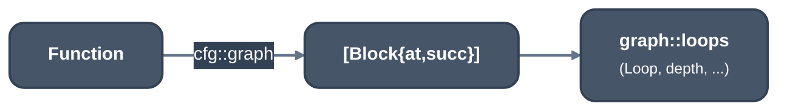

> Generated from the `//!` header of [`crates/opt/llrm-analysis/src/graph.rs`](https://github.com/ali-mosavian/llrm/blob/main/crates/opt/llrm-analysis/src/graph.rs); edit the header, not this file.
<!-- src: crates/opt/llrm-analysis/src/graph.rs sha256:1f23245f3efba010861c1aee58bd36cdd7c8292be85a158a4a3756eda186bb96 -->

# graph

Block-graph algorithms (loops, depth, reducibility, dominators) over any IR
whose blocks implement `loops::Node`.

## How it works
The module holds one submodule, `loops`. A `Node` is a block id and its
successor ids; nothing here knows an IR. The rich MIR adapts a `Function`
through [`crate::cfg`](cfg.md), which turns it into `Block`s in layout order.

*From a Function to loops*

The backend's `LirBlock` has its own copy of these walks in
`crates/codegen/llrm-codegen/src/analysis/loops.rs`; both build on
`llrm_support::graph`.

## Example
No honest example: this module only holds `loops`. Read the example there.

## Provides
The algorithms of `loops`. Consumers: [`crate::cfg`](cfg.md) (`Loop`, `Node`,
`irreducible_under`) and the loop passes of `llrm-transforms`, which read
`Loop` out of [`crate::cfg::Shape`](cfg.md).
